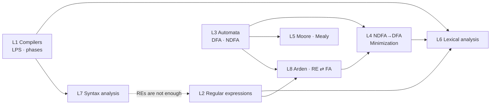

# CMIS 3134 · Computer Architecture & Compiler Design: Course Overview

> [!abstract] What this course is about
> How a program in a high-level language becomes something a machine can run. The course covers the **language processing system** and the **phases of a compiler**, then studies the theory behind the first two phases in depth:
> - **regular expressions** and **finite automata** (DFA, NDFA, conversion, minimization, machines with output) for **lexical analysis**;
> - **context-free grammars** (derivations, parse trees, ambiguity) for **syntax analysis**.

> [!warning] "Computer Architecture" half
> Despite the course title, **none of the lecture materials or past papers (2019/20–2023/24) contain computer-architecture content.** Every question is on compilers and automata theory. These notes therefore cover only that material.

## 1. Course and exam details

| Item | Detail |
|---|---|
| Course | CMIS 3134 · Computer Architecture & Compiler Design (3rd year, BSc (Hons) Computer Science) |
| Exam | 3 hours · **8 questions, answer any 6** · each question 100 marks |
| Question structure | (a) 20 · (b) 20 · (c) 20 · (d) 40 |
| Papers analysed | 2019/20, 2020/21, 2021/22, 2022/23, 2023/24 |
| Typical paper | Q1–Q2 compilers · Q3 regular expressions · Q4–Q5 automata · Q5–Q8 conversion, minimization, Moore/Mealy, Arden, grammars |
| Sources | Lecture PDFs 1–7, two handwritten note sets (`compier note.pdf`, `Compiler note.pdf`), five past papers |

## 2. Priority key

| Mark | Meaning | Evidence rule |
|---|---|---|
| 🔴 High | Learn thoroughly and practise | In **4–5 of 5** papers, or a 40-mark part that repeats |
| 🟡 Medium | Understand and know the standard answer | In **2–3** papers, or as part of a 🔴 question |
| 🟢 Low | Read once | In **0–1** papers, or not in the notes |

## 3. Lessons

| # | Lesson | What it covers | Priority | Summary | Past papers |
|---|---|---|---|---|---|
| 1 | [[01.00 Introduction to Compilers]] | Translators, LPS, phases, symbol table, errors | 🔴 | [[01.99 Summary - Introduction to Compilers]] | [[PP 01.1 - Compilers, Translators and the Language Processing System]] · [[PP 01.2 - Phases of a Compiler]] |
| 2 | [[02.00 Regular Expressions]] | Language operations, RE notation, tokens, real-world REs | 🔴 | [[02.99 Summary - Regular Expressions]] | [[PP 02 - Regular Expressions]] |
| 3 | [[03.00 Automata]] | Σ, Σ\*, Σ⁺, DFA, NDFA, δ, acceptability, DFA design | 🔴 | [[03.99 Summary - Automata]] | [[PP 03.1 - Automata Theory and Terminology]] · [[PP 03.2 - Acceptability and Designing Automata]] |
| 4 | [[04.00 NDFA to DFA Conversion and DFA Minimization]] | Subset construction, Myhill-Nerode, Equivalence theorem | 🔴🔴 | [[04.99 Summary - NDFA to DFA and Minimization]] | [[PP 04.1 - NDFA to DFA Conversion]] · [[PP 04.2 - DFA Minimization]] |
| 5 | [[05.00 Moore and Mealy Machines]] | Machines with output, conversions, design | 🔴 | [[05.99 Summary - Moore and Mealy Machines]] | [[PP 05 - Moore and Mealy Machines]] |
| 6 | [[06.00 Lexical Analysis]] | Tokens, lexemes, patterns, tokenizing C | 🔴 | [[06.99 Summary - Lexical Analysis]] | [[PP 06 - Lexical Analysis]] |
| 7 | [[07.00 Syntax Analysis]] | CFG, LMD/RMD, parse trees, ambiguity, proofs, parsing | 🔴 | [[07.99 Summary - Syntax Analysis]] | [[PP 07.1 - Grammars, Derivations and Ambiguity]] · [[PP 07.2 - Parsing (2019-20 only)]] |
| 8 | [[08.00 Arden's Theorem and RE-FA Conversion]] | RE identities, Arden, FA→RE, RE→FA | 🔴🔴 | [[08.99 Summary - Arden's Theorem and RE-FA Conversion]] | [[PP 08 - Arden's Theorem and RE-FA Conversion]] |

> [!note] Lesson 8
> Arden's theorem and RE ⇄ FA conversion are not in a separate lecture PDF. They come from the handwritten notes, the end of the regular-expressions material and the existing stub [[3134-08 Arden's Theorem & RE-FA Conversion]]. They are examined in **every** paper, so they have their own lesson here.

## 4. How the lessons connect



**The exam's favourite pipeline (one 100-mark question):**
RE → NDFA ([[08.04 Regular Expression to Finite Automaton]]) → DFA ([[04.01 NDFA to DFA - Subset Construction]]) → minimal DFA ([[04.02 DFA Minimization - Myhill-Nerode Theorem]]), with Arden's theorem as part (a). See [[08.05 The Full Pipeline - RE to Minimized DFA]].

## 5. Folder structure

```text
CMIS 3134 - Computer Architecture & Compiler Design/
├── 00. CMIS 3134 Course Overview.md        ← you are here
├── 01. Lessons/
│   ├── 01. Introduction to Compilers/                       (01.00 – 01.11, 01.99)
│   ├── 02. Regular Expressions/                             (02.00 – 02.06, 02.99)
│   ├── 03. Automata/                                        (03.00 – 03.10, 03.99)
│   ├── 04. NDFA to DFA Conversion and DFA Minimization/     (04.00 – 04.04, 04.99)
│   ├── 05. Moore and Mealy Machines/                        (05.00 – 05.05, 05.99)
│   ├── 06. Lexical Analysis/                                (06.00 – 06.05, 06.99)
│   ├── 07. Syntax Analysis/                                 (07.00 – 07.11, 07.99)
│   └── 08. Arden's Theorem and RE-FA Conversion/            (08.00 – 08.05, 08.99)
├── Past Papers/
│   ├── CMIS 3134 Past Paper Mapping.md
│   ├── CMIS 3134 Papers by Year.md
│   └── 01. … 08. (one folder per lesson with PP notes)
├── Exam Revision/
│   ├── CMIS 3134 Important Definitions.md
│   ├── CMIS 3134 Important Comparisons.md
│   ├── CMIS 3134 Algorithms and Procedures.md
│   ├── CMIS 3134 High Priority Topics.md
│   └── CMIS 3134 Final Revision Summary.md
├── CMIS 3134 Course Home.md                 (earlier note, kept)
├── Exam Prep/3134 Topic Map & Past Papers.md (earlier note, kept)
└── Lectures/3134-01 … 3134-08               (earlier stubs, kept)
```

## 6. Past papers
- [[CMIS 3134 Past Paper Mapping]]: lesson → question tree, frequency table, repeated questions
- [[CMIS 3134 Papers by Year]]: every question of every paper, with links, trends and errata

## 7. Exam revision
- [[CMIS 3134 High Priority Topics]]: what to learn first, ranked by evidence
- [[CMIS 3134 Important Definitions]]: definitions to write word for word
- [[CMIS 3134 Important Comparisons]]: every "compare / differentiate" question as a table
- [[CMIS 3134 Algorithms and Procedures]]: step-by-step methods for every conversion and minimization
- [[CMIS 3134 Final Revision Summary]]: the one-page night-before sheet

## 8. Suggested study order

| Step | Do this | Why |
|---|---|---|
| 1 | L3 Automata (03.04–03.10) | Everything in L4, L5 and L8 uses DFAs and NDFAs |
| 2 | L4 NDFA→DFA and both minimizations | 2–3 parts of every paper, including 40-mark parts |
| 3 | L8 Arden + RE→FA | 20 guaranteed marks from Arden in every paper |
| 4 | L5 Moore/Mealy | A full question every year; the conversions are mechanical |
| 5 | L7 Grammars (07.02–07.06) | LMD/RMD and ambiguity every year |
| 6 | L1 Compilers | Q1–Q2 every year; essay-style answers |
| 7 | L2 Regular expressions and L6 tokenizing | Q3 every year, tokenizing in 4 of 5 |
| 8 | Past papers by year, timed | Use [[CMIS 3134 Papers by Year]] |

> [!tip] Choosing 6 of 8
> The mechanical questions (minimization, conversion, Moore/Mealy, Arden) have one right answer and score reliably. Do these first in the exam, then the compiler and theory questions.

## 9. Earlier notes (kept unchanged)
- [[CMIS 3134 Course Home]]
- [[3134 Topic Map & Past Papers]]: the earlier analysis. Where it differs from these notes, these notes have been re-checked against the papers (see the errata in [[CMIS 3134 Papers by Year]]).
- Lecture stubs: [[3134-01 Introduction to Compilers]] and the rest of the `Lectures/` folder
