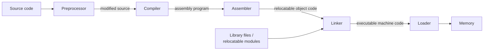
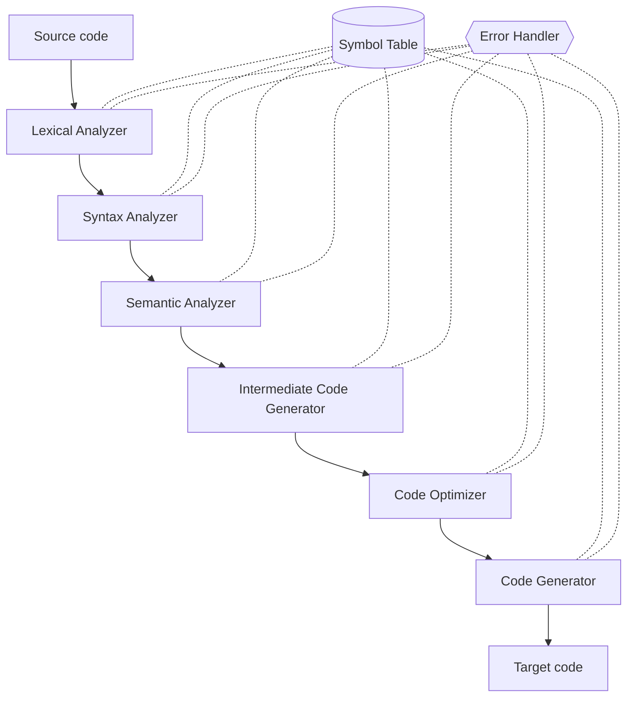

# 01 · Introduction to Compilers

> [!info] Lesson map
> **Source:** Theory Notes 1 *Introduction to Compilers* (typed, 5 pages) + handwritten summary `compier note.pdf` (pp. 1–3) · [[00. CMIS 3134 Course Overview|Course Overview]]
> **Exam priority:** 🔴 **High.** Questions 1 and 2 of **every** paper (2019/20 → 2023/24) come from this lesson. That is up to 200 of the 600 marks you write.
> **Past questions:** [[PP 01.1 - Compilers, Translators and the Language Processing System]] · [[PP 01.2 - Phases of a Compiler]] · **Quick revision:** [[01.99 Summary - Introduction to Compilers]]
> **Your older stub note:** [[3134-01 Introduction to Compilers]] (checklist only)

## What this lesson is about

This lesson answers one question: **how does the text you type in a `.c` file become something the hardware can actually run?**

It works at two zoom levels:
1. **Outside the compiler**, the *Language Processing System*: the chain of tools (preprocessor → compiler → assembler → linker → loader) that turns source code into a running program.
2. **Inside the compiler**, the *phases of compilation*: six steps (lexical, syntax and semantic analysis, then intermediate code, optimization and code generation), plus the symbol table that every phase shares.

There is no mathematics in this lesson. It is definitions, two diagrams, and comparisons. You must be able to reproduce it quickly and precisely.

## Topic structure

```text
Introduction to Compilers
├── What a compiler is (definition, front end / back end)
├── Why translation is needed (hardware understands only binary)
├── Language Processing System
│   ├── Preprocessor
│   ├── Compiler
│   ├── Assembler
│   ├── Linker
│   └── Loader
├── Translators compared: Compiler · Interpreter · Assembler · De-compiler
├── Phases of a compiler
│   ├── Front end: Lexical → Syntax → Semantic analysis
│   ├── Back end: Intermediate code → Code optimization → Code generation
│   └── Symbol table + error handler (shared by all phases)
└── What a compiler cannot detect (logical and run-time errors)
```

## Notes in this lesson

| # | Note | Exam weight |
|---|---|---|
| 1 | [[01.01 What is a Compiler]] | 🔴 (role of a compiler, 2022/23 Q1a; front-end analyses, 2022/23 Q1b) |
| 2 | [[01.02 Why Computers Need Translators]] | 🔴 (2023/24 Q1a; 2022/23 Q1c) |
| 3 | [[01.03 Language Processing System]] | 🔴 (all 5 papers, 20–40 marks) |
| 4 | [[01.04 Preprocessor]] | 🟡 (2020/21 Q1c) |
| 5 | [[01.05 Compiler, Interpreter, Assembler and De-compiler]] | 🔴 (4 of 5 papers) |
| 6 | [[01.06 Linker and Loader]] | 🟡 (2021/22 Q2a; 2022/23 Q2d) |
| 7 | [[01.07 Phases of a Compiler]] | 🔴 (all 5 papers) |
| 8 | [[01.08 Front-End Phases and Error Detection]] | 🔴 (2019/20 Q2b, 2021/22 Q2c, 2023/24 Q1b–c) |
| 9 | [[01.09 Back-End Phases - Intermediate Code, Optimization, Code Generation]] | 🔴 (2021/22 Q2d, 2022/23 Q2a, 2023/24 Q1d & Q2c) |
| 10 | [[01.10 Symbol Table and Error Handler]] | 🟡 (2019/20 Q1c, 2021/22 Q2d, 2023/24 Q1b) |
| 11 | [[01.11 Errors a Compiler Cannot Detect]] | 🟡 (2023/24 Q2d, 40 marks) |
| ★ | [[01.99 Summary - Introduction to Compilers]] | Revision |

## The two diagrams you must be able to draw from memory

**1. Language Processing System** (details in [[01.03 Language Processing System]])



**2. Phases of a compiler** (details in [[01.07 Phases of a Compiler]])



> [!note] Handwritten version
> Your handwritten notes (`compier note.pdf`, p. 1) draw the back end as *Intermediate Code Generator → **Machine-Independent** Code Optimiser → Code Generator → **Machine-Dependent** Code Optimiser*. The typed notes have a single "Code Optimization" phase. Both are correct. The typed six-phase version is the one to use in an exam unless the question asks for more detail.

## Related lessons
- [[06.00 Lexical Analysis]]: phase 1 in depth (tokens, lexemes, tokenizing a C program).
- [[07.00 Syntax Analysis]]: phase 2 in depth (grammars, derivations, parse trees).
- [[02.00 Regular Expressions]]: the notation lexical analysis is built on.
