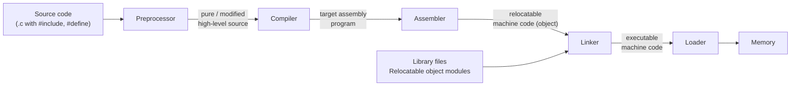

# 01.03 · The Language Processing System

> [!info] [[01.00 Introduction to Compilers|Lesson 1]] · Theory Notes 1 + `compier note.pdf` p. 1 · Priority 🔴 High
> **Asked in all 5 papers:** "Discuss the workflow of the Language Processing System with its inputs and outputs" (2019/20 Q1d, 2021/22 Q1d, 40 marks) · "With the aid of a diagram, explain the LPS…" (2023/24 Q2a) · "how the LPS bridges the gap…" (2022/23 Q2c) · "how a C compiler executes a simple C program on a host machine" (2020/21 Q2a, 2021/22 Q1b) · "Could a single tool replace the compiler, assembler, linker and loader?" (2022/23 Q2d)

## 1. What is it?

> [!abstract] Definition (Theory Notes 1)
> "We write programs in high-level language, which is easier for us to understand and remember. These programs are then fed into a **series of tools and OS components** to get the desired code that can be used by the machine. This is known as **Language Processing System**."

In simple words: the compiler is only **one station** on the journey from source file to running program. The Language Processing System (LPS) is the **whole journey**.

## 2. Why is it used?

The gap between human-readable code and binary hardware is too big for one step. The LPS closes it in **stages of progressive lowering**. Each tool moves the program one step closer to the machine:

human text → expanded text → assembly → machine code fragments → one executable → a running process in memory.

## 3. The diagram (draw this first in every LPS answer)



> [!tip] Memory hook
> **S**ome **P**eople **C**an **A**lways **L**ink **L**ater, **M**aybe = **S**ource → **P**reprocessor → **C**ompiler → **A**ssembler → **L**inker → **L**oader → **M**emory.
> The **library-files arrow into the linker** is examinable. Do not forget it.

## 4. Each stage: input, job, output

| Stage | Input | What it does | Output |
|---|---|---|---|
| **[[01.04 Preprocessor\|Preprocessor]]** | Source code with directives (`#include`, `#define`) | Macro processing, file inclusion, augmentation, language extension | Modified (pure) high-level source |
| **Compiler** | Modified high-level source | Translates to assembly through its six phases ([[01.07 Phases of a Compiler]]) | Assembly language program |
| **Assembler** | Assembly program | Translates assembly into machine instructions | **Object file**: machine instructions + data needed to place them in memory (relocatable) |
| **[[01.06 Linker and Loader\|Linker]]** | Object file(s) + library files + other relocatable modules | Merges them, locates referenced routines, resolves addresses to absolute references | Single **executable** machine-code file |
| **[[01.06 Linker and Loader\|Loader]]** (part of the OS) | Executable file | Calculates program size, creates memory space, loads it, initializes registers | Program in **memory**, executing |

## 5. How a C program is executed on a host machine (the 5 steps)

The lecture gives this as a bullet list. Learn it as five numbered sentences:

1. The **user writes** a program in C (high-level language).
2. The **C compiler** compiles the program and translates it to an **assembly program** (low-level language).
3. An **assembler** then translates the assembly program into **machine code (object)**.
4. A **linker** tool is used to link all the parts of the program together for execution (**executable machine code**).
5. A **loader** loads all of them into **memory** and then the program is executed.

> [!tip] Add the preprocessor
> The 5-step list in the notes starts at the compiler. Mention that the **preprocessor runs before step 2** (expanding `#include <stdio.h>` and macros). Many students forget it.

### Worked example

```c
#include <stdio.h>
#define RATE 5
int main() {
    printf("%d", RATE * 2);
    return 0;
}
```

| Step | What happens to this program |
|---|---|
| Preprocessor | Copies the contents of `stdio.h` into the file; replaces `RATE` with `5`. |
| Compiler | Checks and translates the C code into assembly for the target CPU. |
| Assembler | Turns that assembly into an object file `prog.o`. The call to `printf` is still an unresolved reference. |
| Linker | Finds `printf` in the C standard library and merges it with `prog.o` into `prog.exe`. |
| Loader | When you run `prog.exe`, the OS allocates memory, copies the code in, sets the registers and jumps to `main`. |

## 6. Why separate tools? (for "could a single tool replace them?", 2022/23 Q2d)

> [!warning] Beyond the slides
> The lecture describes what each tool does but does not discuss merging them. The points below are standard reasoning built from those roles.

- **Technically possible.** Integrated tool chains and interpreters/JIT systems already blur the boundaries.
- **But undesirable**, because of:
  - **Complexity:** one huge tool is hard to build, test and maintain.
  - **Separate compilation is lost:** today you recompile only the changed file and re-link. A single tool would redo everything.
  - **Libraries:** pre-compiled libraries (like the one containing `printf`) only work because linking is a separate step. You can link code whose source you do not have.
  - **Portability:** front end = language-dependent, back end = machine-dependent. Merging everything means rebuilding the whole tool per processor.
  - **The loader belongs to the operating system**, not to the tool chain. Memory allocation and register setup are OS jobs.
- **Principle:** *separation of concerns*. Modular stages are easier to optimize, replace and reuse.

## 7. Practical explanation
When you press "Build" in an IDE, it runs the preprocessor, compiler, assembler and linker for you (for example `gcc` runs `cpp`, `cc1`, `as` and `ld`). When you double-click the program, the OS loader runs it.

## 8. Exam-relevant points
- **Diagram first**, every time. Seven boxes, correct order, arrows labelled with what flows, library arrow into the linker.
- For "inputs and outputs" (40 marks), walk the table above **stage by stage**.
- "With the aid of a diagram" means **no diagram, no full marks**.
- "C program on a host machine" = the **5 numbered steps**, naming tool and artefact at each step.

## Related
- [[01.04 Preprocessor]] · [[01.06 Linker and Loader]] · [[01.05 Compiler, Interpreter, Assembler and De-compiler]] · [[01.07 Phases of a Compiler]] · [[PP 01.1 - Compilers, Translators and the Language Processing System]]
