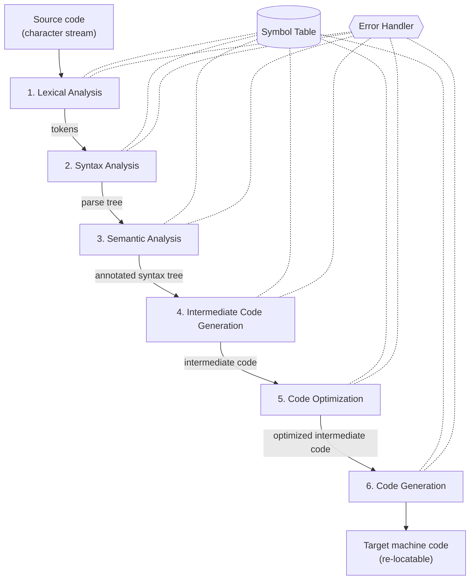

# 01.07 · Phases of a Compiler (the Compilation Process)

> [!info] [[01.00 Introduction to Compilers|Lesson 1]] · Theory Notes 1 + `compier note.pdf` pp. 1–3 · Priority 🔴 High (all 5 papers)
> **Asked as:** "List down the main steps of the compilation process" (2019/20 Q2a) · "Explain the phases of a compiler with a suitable diagram" (2020/21 Q1d, 40 marks) · "What are the main phases of the compilation process?" (2021/22 Q2b, 2022/23 Q2b)

## 1. What is it?

> [!abstract] Theory Notes 1
> "The compilation process is a **sequence of various phases**. Each phase **takes input from its previous stage**, has its own representation of source program, and **feeds its output to the next phase** of the compiler."

So the compiler is like an assembly line: the program is passed from station to station, and each station changes its form.

## 2. The diagram



> [!tip] How to draw it in the exam
> Draw the six phases as a vertical column. Draw the **Symbol Table** on one side and the **Error Handler** on the other, each connected to **all six** phases. They are **not** steps in the sequence.

## 3. Each phase: input, job, output

| # | Phase | Input | What it does | Output | Errors it catches |
|---|---|---|---|---|---|
| 1 | **Lexical Analysis** (scanner) | Character stream | Groups characters into **lexemes** and represents them as **tokens** `<token-name, attribute-value>`. Removes whitespace and comments. | Token stream | Invalid tokens / illegal characters |
| 2 | **Syntax Analysis** (parsing) | Tokens | Checks token arrangements against the **source code grammar** | **Parse tree / syntax tree** | Structural errors: missing `;`, unbalanced brackets |
| 3 | **Semantic Analysis** | Parse tree | Checks the parse tree follows the **rules of the language**: type compatibility, declaration before use | **Annotated syntax tree** | Type mismatch, undeclared identifier |
| 4 | **Intermediate Code Generation** | Annotated tree | Generates code for an **abstract machine**, between high-level and machine language | Intermediate code | (none) |
| 5 | **Code Optimization** | Intermediate code | **Removes unnecessary code lines** and **rearranges statements** to speed up execution without wasting CPU or memory | Optimized intermediate code | (none) |
| 6 | **Code Generation** | Optimized intermediate code | Maps it to the **target machine language** | **Re-locatable machine code** | (none) |
| ★ | **Symbol Table** | (all phases) | Stores identifier names and types; fast search and retrieval; scope management | (shared data structure) | Helps detect undeclared / mistyped identifiers |

Details: phases 1–3 in [[01.08 Front-End Phases and Error Detection]]; phases 4–6 in [[01.09 Back-End Phases - Intermediate Code, Optimization, Code Generation]]; the symbol table in [[01.10 Symbol Table and Error Handler]].

## 4. Worked example: one statement through all phases

```c
position = initial + rate * 60;
```

| Phase | Result (illustrative) |
|---|---|
| Lexical | `<id,position> <op,=> <id,initial> <op,+> <id,rate> <op,*> <const,60> <punct,;>` |
| Syntax | Parse tree: `=` at the root, `position` on the left, `initial + (rate * 60)` on the right (`*` deeper than `+`, so it is done first) |
| Semantic | Checks all three identifiers are declared and numeric. If `rate` is `float`, notes that `60` must be converted to `60.0`. |
| Intermediate code | `t1 = rate * 60.0` · `t2 = initial + t1` · `position = t2` (three-address code) |
| Optimization | `t1 = rate * 60.0` · `position = initial + t1` (one temporary removed) |
| Code generation | `LOAD R1, rate` · `MUL R1, #60.0` · `ADD R1, initial` · `STORE position, R1` |

> [!note] Beyond the slides
> This example (the classic "position = initial + rate * 60") and three-address code are not in the lecture notes. They are added to show concretely what each phase produces.

## 5. Front end vs back end

| Front end (analysis) | Back end (synthesis) |
|---|---|
| Lexical, Syntax, Semantic analysis | Intermediate code generation, Optimization, Code generation |
| Depends on the source language | Depends on the target machine |
| Finds errors | Improves performance |

## 6. Exam-relevant points
- **Order alone carries marks.** Six phases, in sequence.
- Give **input and output** for every phase (use the table).
- State the linking principle: **each phase consumes the previous phase's output**.
- Symbol table and error handler are drawn **spanning all phases**.
- For 40 marks: one or two sentences of detail per phase + the front/back end split + the diagram.

## Related
- [[01.08 Front-End Phases and Error Detection]] · [[01.09 Back-End Phases - Intermediate Code, Optimization, Code Generation]] · [[01.10 Symbol Table and Error Handler]] · [[06.00 Lexical Analysis]] · [[07.00 Syntax Analysis]] · [[PP 01.2 - Phases of a Compiler]]
