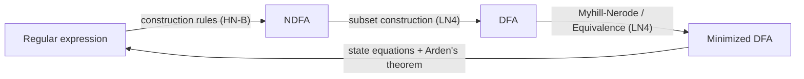
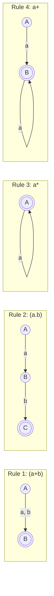
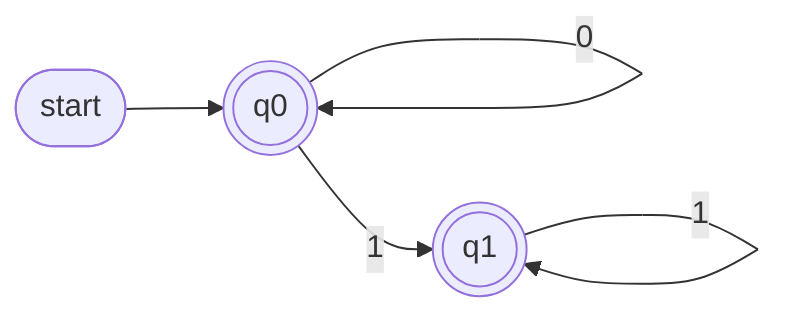
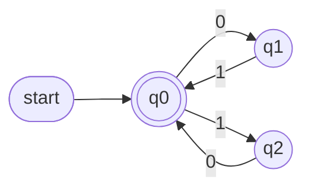
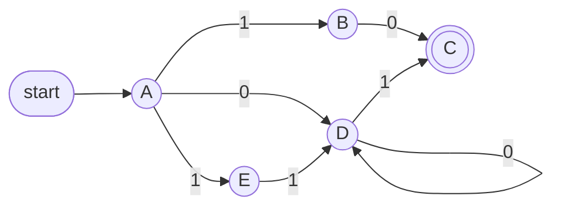
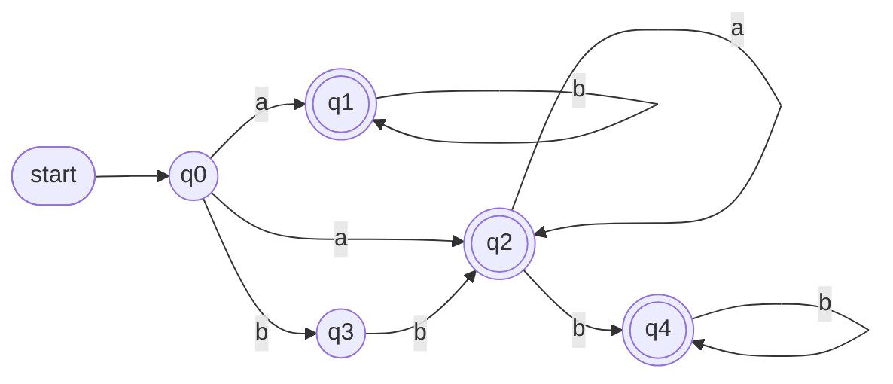

# 02.98 · Regular Expressions: Complete Study Guide (Zero → Exam)

> [!info] What this note is
> One self-contained resource that teaches **Regular Expressions (REs)** for **CMIS 3134 – Computer Architecture & Compiler Design** from zero knowledge up to full past-paper answers. Read it top to bottom once; afterwards use Part E as your revision sheet.
>
> **Sources used (and the short codes used below)**
> - **LN2**: *Theory Notes 2: Regular Expressions* (typed lecture note, 4 pages): the **primary source**. Its wording is preserved wherever possible.
> - **LN3 / LN6 / LN7**: *Theory Notes 3 (Automata), 6 (Lexical Analysis), 7 (Syntax Analysis)*: for alphabets, strings, Σ\*, tokens, and the limits of REs.
> - **HN-A**: handwritten summary notes `compier note.pdf`, pp. 4–6 (token notation, bracket rule, NIC / telephone / index-number REs).
> - **HN-B**: handwritten extended notes `Compiler note.pdf`, pp. 31–37 (RE identities, Arden's theorem, FA → RE, RE → finite machine).
> - **A01**: *Assignment 01* (10 RE construction scenarios).
> - **Past papers**: 2019/20, 2020/21, 2021/22, 2022/23, 2023/24. Every RE question in all five was read from the scans. None was unreadable; the one doubtful symbol (2021/22 Q3(b)) is flagged where it appears.
>
> **Related notes:** [[02.00 Regular Expressions]] · [[PP 02 - Regular Expressions]] · [[08.01 Regular Expression Identities]] · [[08.02 Arden's Theorem]] · [[08.04 Regular Expression to Finite Automaton]] · [[06.00 Lexical Analysis]]

> [!tip] Legend used throughout
> - 📘 **Theory**: essential definitions and rules.
> - ✏️ **Worked example**: a solved problem with reasoning.
> - 🎯 **Exam focus**: how it is asked, what to write, what to memorise.
> - ➕ **Supplementary**: correct and useful, but **not** written in the lecture notes. Use it to understand; in the exam, lead with the lecture-note version.
>
> **Notation.** The course writes **union** as `+` (and sometimes `|`). Both mean "or". **ε** (sometimes written λ or e in the notes) is the empty string. **φ** is the empty set/empty language.

## Contents

- **Part A: Theory from zero**
  1. Why REs exist: their role in lexical analysis
  2. Alphabets, strings, length, the empty string, Σⁿ, Σ\*, Σ⁺, languages
  3. Regular expression vs regular grammar vs regular language
  4. Operations on languages: union, concatenation, Kleene closure
  5. RE notation and the meaning L(r)
  6. The recursive definition of an RE (and the special symbols ε and φ)
  7. The operators \*, ⁺ and ?
  8. Precedence and associativity
  9. Character classes, ranges, letter / digit / sign
  10. REs for real tokens (decimal, identifier, NIC, phone, email…)
  11. Reading an RE: what language does it describe?
  12. Writing an RE from a description in words
  13. Algebraic laws (identities) and equivalent REs
  14. REs, regular languages and finite automata (Arden's theorem, FA → RE, RE → FA)
- **Part B: Every past-paper RE question, solved**
- **Part C: Practice questions**
- **Part D: Practice answers**
- **Part E: Final revision materials**

---

# PART A: THEORY FROM ZERO

---

## 1. Why regular expressions exist: the lexical analyzer

### 📘 Definition (LN2 wording)

> "**Regular expression is an important notation for specifying patterns.** Each pattern matches a set of strings, so regular expressions serve as **names for a set of strings**."

In plain English: a regular expression is a **short formula** that describes a (possibly infinite) **set of strings**. Instead of listing every valid string, you write one pattern that matches all of them.

### 📘 Purpose: where REs are used in a compiler

The first phase of a compiler is the **lexical analyzer** (scanner). It reads the source program character by character and groups the characters into **lexemes**, and each lexeme into a **token** (see [[06.02 Tokens, Lexemes and Patterns]]).

```c
int value = 100;
```

| Lexeme | Token |
|---|---|
| `int` | keyword |
| `value` | identifier |
| `=` | operator |
| `100` | constant (number) |
| `;` | symbol (punctuation) |

How does the scanner *know* that `value` is an identifier and `100` is a number? Each token class has a **rule**, called a **pattern**, and LN6 says: *"patterns are defined by means of regular expressions."* LN2 explains:

> "The lexical analyzer needs to scan and identify only a **finite set of valid string/token/lexeme** that belong to the language in hand. It **searches for the pattern defined by the language rules**."

So:

- `Identifier = (letter)(letter | digit)*` is the pattern for identifiers.
- `Decimal = (sign)?(digit)+` is the pattern for (signed whole) numbers.

### 📘 Why REs (and not something else)?

From LN2, plus the reasons examiners expect:

1. **Programming-language tokens can be described by regular languages** (LN2).
2. A short, **finite** pattern describes an **infinite** set (there are infinitely many possible identifiers).
3. REs are **precise and unambiguous**: two people reading the same RE get the same set.
4. **"Regular languages are easy to understand and have efficient implementation"** (LN2).
5. Every RE can be turned into a **finite automaton**, which checks strings very fast. LN2: *"A well-accepted solution is to use **finite automata** for verification."* Scanner generators (e.g. `lex`/`flex` ➕) do exactly this automatically.
6. REs obey **algebraic laws**, so an RE can be rewritten into simpler **equivalent forms** (LN2).

### 🎯 Exam relevance
- "What is meant by a Regular Expression?" appears in **2021/22 Q3(a), 2022/23 Q3(a), 2023/24 Q3(a)**.
- "Why are regular expressions important in the design of a lexical analyzer?" is **2023/24 Q3(a)**.
- Write: definition (LN2 sentence) + one token example + 3–4 reasons.

> [!summary] Checkpoint 1
> - **Memorise:** "An RE is a notation for specifying patterns; each pattern matches a set of strings, so REs are names for sets of strings."
> - The lexical analyzer uses REs as the **patterns** of tokens.
> - REs ⇄ finite automata: REs *describe* tokens; automata *recognise* them.
> - **Common mistake:** saying "an RE is a string". It is a pattern that denotes a **set** of strings.

---

## 2. The building blocks: alphabet, string, length, ε, Σⁿ, Σ\*, Σ⁺, language

Before you can write an RE you need the vocabulary REs are built from. These come from LN3 (Automata) and LN6 (Specifications of Tokens).

### 2.1 Alphabet (Σ)

**Definition (LN3):** an alphabet is **any finite set of symbols**.

| Alphabet | Example |
|---|---|
| Binary | Σ = {0, 1} |
| Hexadecimal | Σ = {0, 1, …, 9, A, B, C, D, E, F} |
| English letters | Σ = {a, …, z, A, …, Z} |
| Exam-style | Σ = {a, b}, Σ = {x, y}, Σ = {p, q} |

### 2.2 String

**Definition (LN3):** a string is a **finite sequence of symbols taken from Σ**.
Example: over Σ = {a, b, c, d}, `cabcad` is a string. Over Σ = {a, b}, `az` is **not** a string (z ∉ Σ). (HN-A uses exactly this example.)

### 2.3 Length of a string |s|

**Definition:** the **number of symbols** in the string.
- |cabcad| = 6
- |Lexical| = 7 (LN6 example)
- |ε| = 0

### 2.4 The empty string ε

**Definition:** the string with **no symbols**, length 0. Written **ε** (also λ; your handwritten notes sometimes write *e*).

> [!important] ε is a string, not a symbol of the alphabet
> ε is "nothing typed". Concatenating ε to anything leaves it unchanged: aε = εa = a.

### 2.5 Powers of Σ, Σ\* and Σ⁺

- **Σⁿ** = the set of **all strings of length n** over Σ (HN-A "power of sigma").
  With Σ = {a, b}: Σ⁰ = {ε}, Σ¹ = {a, b}, Σ² = {aa, ab, ba, bb}, Σ³ has 2³ = 8 strings.
  In general $|\Sigma^n| = |\Sigma|^n$ (here |Σ| is the **cardinality** of the alphabet, i.e. how many symbols it has).
- **Kleene star Σ\*** = all strings of **all** lengths, **including ε**:
$$\Sigma^* = \Sigma^0 \cup \Sigma^1 \cup \Sigma^2 \cup \dots$$
- **Kleene plus Σ⁺** = all strings of all lengths **excluding ε**:
$$\Sigma^+ = \Sigma^1 \cup \Sigma^2 \cup \dots = \Sigma^* - \{\varepsilon\}$$

### 2.6 Language

**Definition (LN3):** a language is **a subset of Σ\*** for some alphabet Σ. It may be **finite** or **infinite**.
LN6 adds: a language is "a finite set of strings over some finite set of alphabets", and it **can be described with regular expressions**.

✏️ **Examples over Σ = {a, b}**
- L₁ = {ab, ba}: finite (2 strings).
- L₂ = {strings that start with a} = {a, aa, ab, aaa, …}: infinite.
- L₃ = Σ\*: every string (infinite).

### 2.7 Two "empty" things that beginners mix up

| | Name | How many strings? | As an RE |
|---|---|---|---|
| **{ε}** | language containing only the empty string | **1** (the empty string) | `ε` |
| **{ } = φ** | the empty language | **0** | `φ` |

> [!warning] {ε} ≠ φ
> {ε} is a box holding one (empty) string. φ is an empty box. This difference matters in Section 6 and in the identities of Section 13 (e.g. εR = R but φR = φ).

> [!summary] Checkpoint 2
> - Alphabet = finite set of symbols; string = finite sequence of symbols; |s| = number of symbols; ε = the string of length 0.
> - Σⁿ = strings of length n; |Σⁿ| = |Σ|ⁿ.
> - **Σ\* includes ε; Σ⁺ excludes ε**: Σ⁺ = Σ\* − {ε}.
> - Language = any subset of Σ\*; finite or infinite.
> - **Common mistakes:** treating ε as a symbol of Σ; confusing {ε} with φ; forgetting ε when listing Σ\*.

---

## 3. Regular expression vs regular grammar vs regular language

### 📘 Definitions (LN2 wording)

> "The grammar defined by regular expressions is known as **regular grammar**. The language defined by regular grammar is known as **regular language**."

| Term | What it is | Example (all three describe the same thing) |
|---|---|---|
| **Regular expression** | The **notation / pattern** | `a*b` |
| **Regular grammar** | The **set of production rules** defined by the RE ➕ (HN-B: right-linear `A → xB` or left-linear `A → Bx`) | `S → aS \| b` |
| **Regular language** | The **set of strings** generated / matched | {b, ab, aab, aaab, …} |

**How they differ (write this):**
- The **RE** is a compact algebraic *pattern*.
- The **regular grammar** is a *rule system* (variables, terminals, start symbol, productions) that generates strings. It is always a finite set of rules.
- The **regular language** is the *result*: a set of strings, which can be finite or infinite.
- All three are different descriptions of the same class: **every regular language can be written as an RE, generated by a regular grammar and recognised by a finite automaton** ➕.

✏️ **Check the example:** S → aS | b. Derivations: S ⇒ b; S ⇒ aS ⇒ ab; S ⇒ aS ⇒ aaS ⇒ aab. So the grammar generates {b, ab, aab, …} = L(a\*b). ✔

### 🎯 Exam relevance
- **2020/21 Q2(b)**: "Differentiate between Regular Grammar and Regular Language."
- **2021/22 Q3(a), 2022/23 Q3(a)**: "How do regular grammar and regular language differ from a regular expression?"
- Use a **three-row table** and carry **one example** through all three rows. Fully solved in Part B, §B1.

> [!summary] Checkpoint 3
> - **RE** = notation · **Regular grammar** = rules defined by REs · **Regular language** = set of strings defined by the regular grammar.
> - **Common mistake:** writing that a regular language "is a grammar". A language is a *set of strings*.

---

## 4. Operations on languages: union, concatenation, Kleene closure

REs are built from three operations. They are first defined on **languages** (sets of strings).

### 📘 4.1 Union

$$L \cup M = \{\, s \mid s \text{ is in } L \text{ or } s \text{ is in } M \,\}$$

**Meaning:** put both sets together ("either-or").
✏️ L = {a, ab}, M = {b, ab} → L ∪ M = {a, ab, b}. (ab is written once: sets have no duplicates.)

### 📘 4.2 Concatenation

$$LM = \{\, st \mid s \text{ is in } L \text{ and } t \text{ is in } M \,\}$$

**Meaning:** take a string from L, **glue** a string from M after it, in every possible way.
✏️ L = {a, ab}, M = {b, c}:

| s ∈ L | t ∈ M | st |
|---|---|---|
| a | b | ab |
| a | c | ac |
| ab | b | abb |
| ab | c | abc |

LM = {ab, ac, abb, abc}. And ML = {ba, bab, ca, cab}. **LM ≠ ML**: order matters.

➕ Special cases: L{ε} = L (gluing nothing changes nothing), and Lφ = φ (no string in φ to glue). These become identities in Section 13.

### 📘 4.3 Powers of a language ➕

$L^0 = \{\varepsilon\}$, $L^1 = L$, $L^2 = LL$, $L^n = L^{n-1}L$. (Same idea as Σⁿ.)
✏️ L = {ab}: L² = {abab}, L³ = {ababab}.

### 📘 4.4 Kleene closure (star) L\*

LN2: "The Kleene Closure of a language L is written as **L\* = zero or more occurrences of language L**."

$$L^* = L^0 \cup L^1 \cup L^2 \cup \dots \quad (\text{always contains } \varepsilon)$$

✏️ L = {a} → L\* = {ε, a, aa, aaa, …}
✏️ L = {ab} → L\* = {ε, ab, abab, ababab, …}
✏️ L = {0, 1} → L\* = all binary strings, including ε (= Σ\*).

### 📘 4.5 Kleene plus L⁺

**L⁺ = one or more occurrences of L**:

$$L^+ = L^1 \cup L^2 \cup \dots = L\,L^*$$

✏️ L = {a} → L⁺ = {a, aa, aaa, …} (no ε).

> [!note] When is ε in L⁺?
> Only if ε is already in L. If ε ∉ L, then L⁺ = L\* − {ε}. (Compare Σ⁺ = Σ\* − {ε} from Section 2.)

### 🎯 Exam relevance
- **2023/24 Q3(b)**: "Explain the following operations on languages with examples: Union, Concatenation, Kleene Closure Star (L\*), Kleene Closure Plus (L⁺)". Use the **same small languages** for all four parts; solved in Part B, §B2.

> [!summary] Checkpoint 4
> - L ∪ M = {s | s ∈ L or s ∈ M} · LM = {st | s ∈ L and t ∈ M} · L\* = zero or more · L⁺ = one or more = LL\*.
> - **L\* always contains ε.** L⁺ contains ε only if L does.
> - **Common mistakes:** thinking LM = ML; forgetting ε in L\*; writing L\* = {a, aa, aaa, …} (missing ε).

---

## 5. RE notation and the meaning L(r)

An RE is written with symbols and operators; the **language it denotes** is written **L(r)**.

### 📘 LN2 notation

If r and s are regular expressions denoting the languages L(r) and L(s), then:

| Operation | RE | Denotes |
|---|---|---|
| Union | `(r)\|(s)` (course also writes `r + s`) | L(r) ∪ L(s) |
| Concatenation | `(r)(s)` (also `r . s` or `rs`) | L(r)L(s) |
| Kleene closure | `(r)*` | (L(r))\* |
| Grouping | `(r)` | L(r) |

✏️ **Small translations**

| RE | L(RE) |
|---|---|
| `a` | {a} |
| `a + b` | {a} ∪ {b} = {a, b} |
| `ab` | {a}{b} = {ab} |
| `a*` | {ε, a, aa, …} |
| `(a + b)c` | {a, b}{c} = {ac, bc} |
| `(a + b)*` | every string of a's and b's, including ε |

> [!important] Two ways of saying the same thing
> "The RE `(a+b)*abb`" and "the set of strings over {a, b} ending with abb" are the **RE** and its **language**. Exam questions go both ways: RE → language (Section 11) and language → RE (Section 12).

> [!summary] Checkpoint 5
> - `r + s` (or `r|s`) ↔ union · `rs` ↔ concatenation · `r*` ↔ Kleene closure · `(r)` ↔ grouping.
> - L(r) means "the set of strings matched by r".

---

## 6. The recursive definition of an RE (and the special symbols ε and φ)

### 📘 Why "recursive"?

LN2: "The specification of regular expressions is an example of a **recursive definition**." A recursive definition gives (1) **basic** REs and (2) **rules** that build bigger REs from smaller ones. Anything built that way is an RE; nothing else is.

### 📘 The definition (LN2, numbered as rules 1–6)

| Rule | Regular expression | Language |
|---|---|---|
| **1 (basis)** | **ε** is an RE | $L(\varepsilon) = \{\varepsilon\}$: the language containing only the empty string |
| **2 (basis)** | **φ** is an RE | $L(\varphi) = \{\ \}$: the empty language |
| **3 (basis)** | **x** is an RE, for any symbol x ∈ Σ | $L(x) = \{x\}$ |
| **4 (union)** | If X and Y are REs, **X + Y** is an RE | $L(X + Y) = L(X) \cup L(Y)$ |
| **5 (concatenation)** | If X and Y are REs, **X . Y** is an RE | $L(X \cdot Y) = L(X) \cdot L(Y)$ |
| **6 (closure)** | If R is an RE, **R\*** is an RE | $L(R^*) = (L(R))^*$ |
| **Closing clause** | "If we apply any of the rules several times from 1 to 5, they are Regular Expressions." | |

(➕ Grouping `(R)` is also allowed and denotes L(R). The closing clause in LN2 says "rules 1 to 5"; it is meant to include the closure rule too.)

### ✏️ Worked example 6.1: show that `(a + b)*abb` is an RE

| Step | Rule used | RE built | Language |
|---|---|---|---|
| 1 | Rule 3 | `a`, `b` | {a}, {b} |
| 2 | Rule 4 (union) | `a + b` | {a, b} |
| 3 | Rule 6 (closure) | `(a + b)*` | all strings over {a, b} |
| 4 | Rule 5 (concat.) | `(a + b)* . a` | strings ending in a |
| 5 | Rule 5 | `(a + b)* . a . b` | strings ending in ab |
| 6 | Rule 5 | `(a + b)* . a . b . b` | strings ending in abb |

Every step used a rule, so `(a + b)*abb` is an RE. ∎

### ✏️ Worked example 6.2: is `a + * b` an RE?

No. Rule 6 makes `R*` only when **R is already an RE**. In `a + * b`, the `*` follows `+`, which is an operator, not an RE. No rule produces it. Similarly `()` and `a +` (union with nothing on the right) are not REs.

### ✏️ Worked example 6.3: the special symbols ε and φ in action

| RE | Language | Why |
|---|---|---|
| `ε` | {ε} | rule 1 |
| `φ` | { } | rule 2 |
| `a + ε` | {a, ε} | union with {ε} adds the empty string ("optional a"; this is `a?`) |
| `a + φ` | {a} | union with the empty set adds nothing |
| `aε` | {a} | gluing ε changes nothing |
| `aφ` | { } | nothing to glue: concatenating with φ kills everything |
| `ε*` | {ε} | repeating "nothing" gives only "nothing" |
| `φ*` | {ε} | zero repetitions are always allowed, giving ε |

### 🎯 Exam relevance
- The recursive definition is in LN2 but has **not been asked directly** in any of the five papers (it is a "gap" topic). It could appear as "Give the recursive definition of a regular expression" (write the table above) or "Show that … is a regular expression" (write a build table like 6.1).
- ε and φ are used inside the identity proofs (2019/20 Q2(d)) and Arden's theorem (every year).

> [!summary] Checkpoint 6
> - **Basis:** ε → {ε}; φ → { }; x → {x}.
> - **Rules:** X + Y → L(X) ∪ L(Y); X.Y → L(X)L(Y); R\* → (L(R))\*.
> - **Memorise:** φ\* = ε, ε\* = ε, εR = R, φR = φ, φ + R = R.
> - **Common mistake:** writing L(φ) = {ε}. φ has **no** strings; φ\* has the one string ε.

---

## 7. The repetition operators \*, ⁺ and ?

### 📘 Definitions (LN2, "Representing valid tokens of a language")

If x is a regular expression, then:

| Operator | Read as | Meaning | Generates |
|---|---|---|---|
| **x\*** | "x star" | **zero or more** occurrences of x | {ε, x, xx, xxx, xxxx, …} |
| **x⁺** | "x plus" | **one or more** occurrences of x | {x, xx, xxx, …}, i.e. **x.x\*** |
| **x?** | "x optional" | **at most one** occurrence of x | either {x} or {ε}, i.e. {ε, x} |

➕ Useful equalities (all follow from the definitions):

$$x^+ = x\,x^* = x^*\,x \qquad x^* = \varepsilon + x^+ \qquad x? = x + \varepsilon$$

So only `*` is truly needed; `+` and `?` are convenient shorthands.

> [!warning] Two meanings of "+"
> In this course `a + b` (between two REs) means **union**, while a **raised** plus `a⁺` means **one or more**. Look at the position: on the line between two things → union; raised after one thing → one-or-more. In handwriting, always raise ⁺ clearly.

### ✏️ Worked example 7.1: the difference between x\* and x⁺ is exactly ε

| String | in `a*`? | in `a⁺`? | in `a?`? |
|---|---|---|---|
| ε | ✔ (zero a's) | ✘ (needs ≥ 1) | ✔ |
| a | ✔ | ✔ | ✔ |
| aa | ✔ | ✔ | ✘ (at most one) |
| aaa | ✔ | ✔ | ✘ |
| b | ✘ | ✘ | ✘ |

### ✏️ Worked example 7.2: operators applied to a group

`(ab)*` = {ε, ab, abab, ababab, …}: the **whole group** repeats.
`(ab)⁺` = {ab, abab, …}.
`(ab)?` = {ε, ab}.

### 🎯 Exam relevance
"Briefly explain the following **valid tokens**…" is asked in **2020/21 Q2(c)** (`x*`, `x?`), **2021/22 Q3(b)** (`1⁺`, `1*`) and **2022/23 Q3(b)** (`a⁺`, `s*`). For each: meaning in words + the set + one example. Solved in Part B, §B3.

> [!summary] Checkpoint 7
> - `x*` zero or more (has ε) · `x⁺` one or more = x.x\* (no ε) · `x?` zero or one = x + ε.
> - **Common mistakes:** saying x⁺ includes ε; saying x? means "one or more".

---

## 8. Precedence and associativity: how to read an RE without brackets

### 📘 Rules (LN2)

> - `*`, concatenation (.), and | (pipe sign) are **left associative**.
> - `*` has the **highest** precedence.
> - Concatenation (.) has the **second highest** precedence.
> - | (pipe sign) has the **lowest** precedence of all.

(Remember: in this course `+` between REs is the same as `|`, so `+` also has the **lowest** precedence.)

**Order of binding (strongest first):**

$$\boxed{\;{}^*\ (\text{also } {}^+,\ ?)\;\;>\;\; \text{concatenation } (\cdot) \;\;>\;\; \text{union } (+ \text{ or } |)\;}$$

This is just like arithmetic: `*` behaves like a power, concatenation like multiplication, union like addition. In `2 + 3 × 4²` you square first, then multiply, then add. In `a + bc*` you star first, then concatenate, then unite.

**Left associativity** means that a chain of the *same* operator groups from the left: `a + b + c = (a + b) + c` and `abc = (ab)c`. For union and concatenation the grouping does not change the language, so you rarely need to think about it.

### 📘 How to fully bracket an RE (method)

1. Put brackets around each **starred** item first (the star applies only to the symbol or bracket **immediately before it**).
2. Then bracket each **concatenation** run.
3. Finally the **unions** (+) are what is left at the top level.

### ✏️ Worked example 8.1: fully bracketing

| RE as written | Fully bracketed  | Meaning                                                  |
| ------------- | ---------------- | -------------------------------------------------------- |
| `ab*`         | `a(b*)`          | an a, then any number of b's: a, ab, abb… (**not** abab) |
| `(ab)*`       | `(ab)*`          | any number of copies of ab: ε, ab, abab…                 |
| `10*`         | `1(0*)`          | 1, 10, 100…                                              |
| `a + bc`      | `a + (bc)`       | {a, bc} (**not** {ac, bc})                               |
| `a + b*`      | `a + (b*)`       | a, or any number of b's: {a, ε, b, bb, …}                |
| `a + bc*`     | `a + (b(c*))`    | {a, b, bc, bcc, …}                                       |
| `0 + 10*`     | `0 + (1(0*))`    | {0, 1, 10, 100, …} (the LN2 example)                     |
| `ab* + ba`    | `(a(b*)) + (ba)` | {a, ab, abb, …, ba}                                      |

### ✏️ Worked example 8.2: why precedence changes the answer

Compare `(a + b)c` and `a + bc`.
- `(a + b)c`: the brackets force the union first: {a, b}{c} = **{ac, bc}**.
- `a + bc`: concatenation binds first: {a} ∪ {bc} = **{a, bc}**.
Different languages, so brackets matter.

### 🎯 Exam relevance
Precedence is not usually asked on its own, but **every** "provide example strings" question tests it. The classic trap is 2019/20 Q2(c)(i) `(0 + 10*)`: the star belongs only to the 0, so 1010 is **not** generated.

> [!summary] Checkpoint 8
> - `*` > concatenation > union (+ or |); all left-associative.
> - A star applies only to the **single symbol or bracket immediately before it**.
> - **Common mistakes:** reading `10*` as `(10)*`; reading `a + bc` as `(a + b)c`.

---

## 9. Character classes, ranges, and the letter / digit / sign shorthands

Writing `a + b + c + … + z` every time is painful, so lecture notes use **shorthand classes**.

### 📘 Ranges (LN2)

| Shorthand | Means | Equivalent long form |
|---|---|---|
| `[a-z]` | all lower-case English letters | a + b + … + z |
| `[A-Z]` | all upper-case English letters | A + B + … + Z |
| `[0-9]` | "all natural digits used in mathematics" | 0 + 1 + … + 9 |

### 📘 Named classes (LN2, "Representing occurrence of symbols")

```text
letter = [a – z] or [A – Z]
digit  = 0 | 1 | 2 | 3 | 4 | 5 | 6 | 7 | 8 | 9   or   [0-9]
sign   = [ + | - ]
```

Once defined, a name can be used inside a larger RE as if it were one symbol: `(letter)(letter | digit)*`.

### 📘 Square brackets vs round brackets for ranges (HN-A, p. 5)

Your handwritten notes give this rule for ranges:

| Written | Meaning (HN-A) | Example |
|---|---|---|
| `[0, 1, 2, 3, 4, 5]` or `[0 - 5]` | **both end points included** | {0, 1, 2, 3, 4, 5} |
| `(0, 1, 2, 3, 4, 5)` or `(0 - 5)` | **both end points excluded** | {1, 2, 3, 4} |
| `[0 - 9]` | range including 0 and 9 | {0, 1, …, 9} |

This is the same idea as closed and open intervals in mathematics: `[` `]` include, `(` `)` exclude. Applying it one end at a time:

| Mixed form | Meaning |
|---|---|
| `[a – g)` | a included, g excluded → {a, b, c, d, e, f} |
| `(M – W]` | M excluded, W included → {N, …, W} |

> [!warning] This bracket rule is course-specific ➕
> In real regex tools (Python, Java, `lex`) round brackets are **grouping**, not ranges. The exam papers use the HN-A interval meaning (e.g. "explain `(5 - 9)`"), so **in the exam state the rule first, then apply it**. Mixed forms like `[a – g)` are not explained anywhere in the notes; state your reading.

### ✏️ Worked example 9.1

| Token | Meaning | Members |
|---|---|---|
| `[2 - 6]` | 2 to 6 inclusive | 2, 3, 4, 5, 6 |
| `(2 - 6)` | strictly between 2 and 6 | 3, 4, 5 |
| `[p - t]` | p to t inclusive | p, q, r, s, t |
| `[A-Z]` | any one capital letter | A, B, …, Z |

Note: a class stands for **one** symbol. `[0-9]` matches **one** digit; `[0-9]⁺` (= `(digit)+`) matches one or more digits.

> [!summary] Checkpoint 9
> - `[a-z]`, `[A-Z]`, `[0-9]`; `letter`, `digit`, `sign` (LN2).
> - **HN-A rule:** `[ ]` include end points, `( )` exclude them.
> - A class = **one** symbol; add `*` or ⁺ for many.
> - **Common mistake:** writing that `(5 - 9)` contains 5 and 9.

---

## 10. Writing REs for real tokens

### 📘 The two patterns from LN2 (memorise exactly)

$$\textbf{Decimal} = (\text{sign})?\,(\text{digit})^+ \qquad\qquad \textbf{Identifier} = (\text{letter})\,(\text{letter} \mid \text{digit})^*$$

**Decimal** = an *optional* sign, then *one or more* digits. Accepted: 7, 42, +150, −3, 007. Rejected: ε (no digits), + (sign but no digit), 4.5 (the "." is not allowed in this pattern).

**Identifier** = *must* start with a letter, then *any number* (zero or more) of letters or digits. Accepted: x, age, value1, A2b3. Rejected: 1value (starts with a digit), my_var (underscore not in this pattern), ε.

HN-A adds the C-style version that also allows underscore:
$$\text{Identifier} = (\text{letter})\,(\text{letter} \mid \text{digit} \mid \_)^*$$

### 📘 General method for any token (supplementary method, built on the lecture patterns)

1. **Write 3–4 valid examples** and 2–3 invalid ones.
2. **Split** the format into parts: what is **fixed** (literal characters), what is **chosen from a class** (a digit, a letter), and what **repeats** (how many times: exactly n, at least n, any number, optional).
3. Encode each part:
   - fixed text → write it literally (put symbols that clash with RE operators, like `+`, `.`, `@`, in quotes);
   - exactly n of a class → write the class n times;
   - at least n → write it n times, then the class with `*`;
   - optional → `?`.
4. **Concatenate** the parts in order.
5. **Test** with your valid and invalid examples.

> [!important] Literal symbols that look like operators
> A phone number may contain a real `+` and an email address a real `.`. Since `+` and `.` are also RE operators, write them in quotes: `"+"`, `"."`, `"@gmail.com"`. Say "literal" in your answer. (➕ In real regex tools you would escape them as `\+` and `\.`.)

### ✏️ Worked example 10.1: Sri Lankan NIC number (old format) (HN-A, p. 5)

Examples (HN-A): `775772341V`, `789780129X` → **9 digits, then V or X**.
Parts: digit ×9 (exactly), then one of {V, X}.

$$\text{NIC} = (\text{digit})(\text{digit})(\text{digit})(\text{digit})(\text{digit})(\text{digit})(\text{digit})(\text{digit})(\text{digit})\,(V \mid X)$$

HN-A also writes it with ranges: `[0-9][0-9][0-9][0-9][0-9][0-9][0-9][0-9][0-9][V|X]`.
If lower case is allowed (the 2021/22 and 2022/23 papers say "x or v"): end with `(V | v | X | x)`.
➕ Shorthand: some books write $(\text{digit})^9$ for "exactly nine digits". This is not LN2 notation, so if you use it, define it ("$(\text{digit})^9$ means digit written 9 times").

Test: `200012345V` ✔ (9 digits + V); `20001234V` ✘ (8 digits); `200012345` ✘ (no letter); `200012345A` ✘.

### ✏️ Worked example 10.2: mobile telephone number

**HN-A version (international form):**
$$\text{Mobile} = ("{+}947")\,(0 \mid 1 \mid 2 \mid 3 \mid 4 \mid 5 \mid 6 \mid 7 \mid 8)\,(\text{digit})^{\times 7}$$
i.e. the literal `+947`, then one digit 0–8, then **seven** more digits (written out as seven `(digit)`s in HN-A). Example: `+94771234567`.

**Local form (2023/24 Q3(c)(ii): "starting with 07 and containing 10 digits"):** 07 uses 2 of the 10 digits, so **8** digits remain:
$$\text{Mobile} = 07\,(\text{digit})(\text{digit})(\text{digit})(\text{digit})(\text{digit})(\text{digit})(\text{digit})(\text{digit})$$
Test: `0771234567` ✔ (10 digits); `077123456` ✘ (9 digits); `0871234567` ✘ (does not start 07).

### ✏️ Worked example 10.3: email address ending with "@gmail.com"

Assumption (state it): the user name starts with a letter and may contain letters, digits, `_` and `.`.
$$\text{Email} = (\text{letter})\,(\text{letter} \mid \text{digit} \mid \_ \mid ".")^*\ \text{"@gmail.com"}$$
Test: `ranshitha01@gmail.com` ✔; `r.a_2@gmail.com` ✔; `@gmail.com` ✘ (empty user name); `ab@yahoo.com` ✘.

### ✏️ Worked example 10.4: real number with a fraction part ➕

LN2's Decimal has no decimal point. If a question wants `3.14` or `-0.5`:
$$\text{Real} = (\text{sign})?\,(\text{digit})^+\,(\,"."\,(\text{digit})^+\,)?$$
The `( "." (digit)⁺ )?` part is optional, so `42` is still accepted; but if a point is present at least one digit must follow it (`42.` ✘).

> [!summary] Checkpoint 10
> - **Memorise exactly:** `Decimal = (sign)?(digit)+` · `Identifier = (letter)(letter | digit)*` · `sign = [+ | -]`, `digit = [0-9]`, `letter = [a-z] | [A-Z]`.
> - Method: examples → split into fixed / class / repeat → encode → concatenate → test.
> - "Exactly n" = write the class n times; "at least n" = n times + `*`; "optional" = `?`.
> - **Common mistakes:** counting digits wrongly (07 + 8 = 10); using `*` where at least one is required (empty number); forgetting to quote literal `+`, `.`, `@`.

---

## 11. Reading an RE: what language does it describe?

This is the most-asked RE skill (every single paper). The question wording is usually *"Provide example strings and the final output in your words…"*. "Final output" means **a description of the language in words**.

### 📘 The 7-step method for interpreting an RE

1. **Bracket it fully** using precedence (Section 8), so you know exactly what each `*` and `+` applies to.
2. **Name the pieces** from left to right: fixed symbols, optional parts, repeated parts, choices.
3. **Find the shortest string** (take every `*` as zero times and the shortest choice in every `+`). Is it ε?
4. **List strings in order of length** (length 0, 1, 2, 3…) until you see the pattern. 4–6 strings is enough in an exam.
5. **Describe the language in one sentence** (the "final output").
6. **Give 2–3 rejected strings** and say *why* each fails.
7. **State**: is ε included? Is the language finite or infinite?

**Finite or infinite? (quick test ➕)** If the RE contains a `*` or `⁺` applied to something that can produce a non-empty string, the language is **infinite**. If it has no star/plus (only symbols, ε, union and concatenation), it is **finite**, and you can list every string.

### ✏️ Worked examples: all eight RE examples from LN2

#### (1) `(0 + 10*)`
- **Bracketed:** `0 + (1(0*))`, a union of two parts.
- **Pieces:** either the single string `0`, **or** a `1` followed by zero or more `0`s.
- **Strings:** 0, 1, 10, 100, 1000, 10000, …
- **LN2 regular set:** L = {0, 1, 10, 100, 1000, 10000, …}
- **In words:** the string "0", or a 1 followed by any number of 0s.
- **Rejected:** ε (both alternatives need a symbol); 00 (the left part is exactly one 0); 1010 (the star repeats only the 0, not "10"); 01.
- ε? **No.** Finite? **No** (infinite).

#### (2) `(0*10*)`
- **Bracketed:** `(0*)(1)(0*)`.
- **Pieces:** any number of 0s, then **exactly one** 1, then any number of 0s.
- **Strings:** 1, 01, 10, 001, 010, 100, … (LN2: L = {1, 01, 10, 010, 0010, …})
- **In words:** binary strings containing **exactly one 1**.
- **Rejected:** ε, 0, 00 (no 1); 11, 101 (two 1s).
- ε? **No.** Infinite.

#### (3) `(0 + ε)(1 + ε)`
- **Pieces:** an optional 0, followed by an optional 1 (it is `0? 1?`).
- **All strings:** choose 0 or ε, then 1 or ε: ε·ε = ε, 0·ε = 0, ε·1 = 1, 0·1 = 01.
- **LN2:** L = {ε, 0, 1, 01}.
- **In words:** the four strings ε, 0, 1, 01. **Finite** (exactly 4 strings), because there is no star.
- **Rejected:** 10 (1 cannot come before 0); 00.
- ε? **Yes.**

#### (4) `(a + b)*`
- **Pieces:** repeat zero or more times "choose a or b".
- **Strings:** ε, a, b, aa, ab, ba, bb, aaa, …
- **LN2:** "Set of strings of a's and b's of **any length including the null string**."
- This is **Σ\*** for Σ = {a, b}: the language of *every* string. Nothing over {a, b} is rejected.
- ε? **Yes.** Infinite.

#### (5) `(a + b)*abb`
- **Pieces:** any string over {a, b}, then the fixed ending **abb**.
- **Strings:** abb, aabb, babb, aaabb, ababb, …
- **LN2:** "Set of strings of a's and b's **ending with the string abb**."
- **Rejected:** ε, ab, abba (ends with a), bbb.
- ε? **No.** Infinite.

#### (6) `(11)*`
- **Pieces:** the block `11` repeated zero or more times.
- **Strings:** ε, 11, 1111, 111111, …
- **LN2:** "Set consisting of **even number of 1's including empty string**."
- **Rejected:** 1, 111 (odd number), 0.
- ε? **Yes.** Infinite.

#### (7) `(aa)*(bb)*b`
- **Pieces:** an even number of a's (blocks of aa), then an even number of b's, then **one more b**.
- Even + 1 = odd, so the b-part has an **odd** number of b's.
- **Strings:** b, aab, bbb, aabbb, aaaab, aaaabbb, …
- **LN2:** "Set of strings consisting of **even number of a's followed by odd number of b's**."
- **Rejected:** ε, aa (no b), ab (one a is odd), bb (even b's), ba (a after b).
- ε? **No.** Infinite.

#### (8) `(aa + ab + ba + bb)*`
- **Pieces:** repeat zero or more times a choice of **one 2-symbol block** (aa, ab, ba or bb).
- Every string is a sequence of 2-symbol blocks, so every string has **even length**. And since aa, ab, ba, bb are **all four** strings of length 2, *every* even-length string can be built.
- **Strings:** ε, aa, ab, ba, bb, aaab, abba, bbbb, …
- **LN2:** "String of a's and b's of **even length** can be obtained by concatenating any combination of the strings aa, ab, ba and bb **including null**."
- **Rejected:** a, b, aba (odd length).
- ε? **Yes.** Infinite.

> [!note] A small slip in LN2's table
> LN2 lists this set as "L = {aa, ab, ba, bb, aaab, aaba, …}" without ε at the front, although its sentence says "including null". The star allows zero repetitions, so **ε is in the language**. Include ε in your answers.

### 📘 Checking whether a particular string is in L(r) (membership)

**Method:** try to **split the string** into consecutive pieces, one for each part of the RE, in order. If some split works, the string is accepted. If **every** possible split fails, it is rejected. For a `*` part you may use **zero** copies (the empty piece).

### ✏️ Worked example 11.1: is `1101` in `110*(0 + 1)`? Is `1100`? Is `10101`?

`110*(0 + 1)` = `1 · 1 · 0* · (0+1)`.

| String | Split | Result |
|---|---|---|
| 1101 | `1` · `1` · `0` (0\* used once) · `1` | ✔ |
| 1100 | `1` · `1` · `0` · `0` | ✔ |
| 10101 | must start `1·1`, but the 2nd symbol is 0 | ✘ |

### ✏️ Worked example 11.2: interpreting `(a + b)(a + b)(a + b)` ➕

No star → finite. Each bracket picks one of two symbols, so there are 2 × 2 × 2 = **8 strings**: aaa, aab, aba, abb, baa, bab, bba, bbb = **all strings of length exactly 3**. ε? No.

> [!summary] Checkpoint 11
> - Method: bracket → pieces → shortest string → list by length → describe → rejected strings → ε? finite?
> - Membership: find a split of the string that fits the pieces in order.
> - **Memorise the 8 LN2 examples** and their sets: they reappear in the papers almost unchanged.
> - **Common mistakes:** missing ε when there is an outer `*`; repeating more than the star covers; listing only examples with no description ("final output" earns most of the marks).

---

## 12. Writing an RE from a description in words

### 📘 The 5-step method

1. **Write the alphabet** and **list examples**: the shortest accepted strings, a few longer accepted strings, and a few that must be rejected.
2. **Identify the type of condition** (table below).
3. **Pick the standard pattern** for that type and fill it in.
4. **Check the edge cases:** is ε meant to be in? What about the shortest strings (length 0, 1, 2)?
5. **Test** your RE on every example from step 1.

### 📘 Pattern catalogue (Σ = {a, b} unless stated; "Any" = `(a + b)*`)

| Condition | Pattern | Example RE |
|---|---|---|
| any string at all | `(a + b)*` | Σ\* |
| **starts with** w | `w(a + b)*` | starts with ab: `ab(a + b)*` |
| **ends with** w | `(a + b)*w` | ends with abb: `(a + b)*abb` (LN2) |
| **contains** w | `(a + b)*w(a + b)*` | contains aba: `(a + b)*aba(a + b)*` |
| **starts with** x **and ends with** y | `x(a + b)*y` | starts 1, ends 0: `1(0 + 1)*0` |
| exactly one b | `a*ba*` | |
| exactly two b's | `a*ba*ba*` | |
| at least one b | `(a + b)*b(a + b)*` | |
| at least two b's | `(a + b)*b(a + b)*b(a + b)*` | or `a*ba*b(a + b)*` |
| at most one b | `a*(b + ε)a*` | |
| length exactly n | `(a + b)` written n times | length 2: `(a + b)(a + b)` |
| length at most n | `(ε + a + b)` written n times | at most 2: `(ε + a + b)(ε + a + b)` |
| even length | `((a + b)(a + b))*` | |
| odd length | `(a + b)((a + b)(a + b))*` | |
| length a multiple of k | `((a + b)` … k times … `)*` | |
| even number of b's | `a*(ba*ba*)*` | |
| odd number of b's | `a*ba*(ba*ba*)*` | |
| no two consecutive b's | `(a + ba)*(ε + b)` | |
| every b followed by an a | `(a + ba)*` | |

**How to think about the parity patterns.** For "even number of 1s over {0, 1}": the 1s must come in **pairs**. Each pair can have 0s between and after: `10*10*`. Repeat pairs any number of times: `(10*10*)*`. Allow 0s before the first 1: `0*(10*10*)*`. Odd = one extra 1 in front of an even block: `0*10*(10*10*)*`.

**How to think about "no consecutive b's".** Every b except possibly the last must be **immediately followed by an a**, so build the string from the blocks `a` and `ba`: `(a + ba)*`. Then allow one final b: `(ε + b)`. Result: `(a + ba)*(ε + b)`.

### ✏️ Worked examples: the course's Assignment 01 (all ten)

These ten scenarios are from the course's own Assignment 01, so they reflect what the lecturer considers the core skill.

#### A01 (i): Σ = {0, 1}, an **even number of 1s**

**RE:** $0^*\,(1\,0^*\,1\,0^*)^*$

- `0*`: zeros before the first 1. `(10*10*)*`: zero or more **pairs** of 1s, each followed by any zeros.
- Equivalent: $(0^*10^*1)^*0^*$.
- ✔ ε (zero 1s, even), 0, 11, 0101, 1001, 110110 · ✘ 1, 010, 111.

#### A01 (ii): Σ = {0, 1}, an **odd number of 1s**

**RE:** $0^*\,1\,0^*\,(1\,0^*\,1\,0^*)^*$

- One single 1 (with zeros around it) followed by an even number of further 1s: odd total.
- ✔ 1, 010, 111, 1011 · ✘ ε, 11, 0110.

#### A01 (iii): Σ = {a, b}, **contains the substring "aba"**

**RE:** $(a + b)^*\,aba\,(a + b)^*$

- Anything, then aba, then anything.
- ✔ aba, aaba, abab, bbabab · ✘ ε, ab, abba, baab.

#### A01 (iv): Σ = {a, b}, **starts with "a" and ends with "b"**

**RE:** $a\,(a + b)^*\,b$

- Shortest string ab (middle empty).
- ✔ ab, aab, abb, abab · ✘ a, b, ba, aba, ε.

#### A01 (v): Σ = {0, 1}, **even length**

**RE:** $((0 + 1)(0 + 1))^*$

- Blocks of exactly two symbols repeated.
- ✔ ε, 01, 10, 0110 · ✘ 0, 101.

#### A01 (vi): Σ = {0, 1}, **no consecutive 1s (no "11")**

**RE:** $(0 + 10)^*\,(\varepsilon + 1)$

- Every 1 except possibly the last is immediately followed by a 0 (block `10`); an optional single 1 at the end.
- ✔ ε, 1, 0, 10, 0101, 1010, 01001 · ✘ 11, 0110, 111.

#### A01 (vii): Σ = {0, 1}, **every 1 immediately followed by at least two 0s**

**RE:** $(0 + 100)^*$

- Each 1 comes as the block `100`; extra 0s can be anywhere (block `0`), including straight after a `100`, which gives "at least two".
- ✔ ε, 0, 100, 1000, 100100, 0100 · ✘ 1, 10, 101, 1001, 10010.

#### A01 (viii): Σ = {a, b}, **length is a multiple of 3**

**RE:** $((a + b)(a + b)(a + b))^*$

- ✔ ε (0 is a multiple of 3), aba, bbbaaa · ✘ a, ab, abab.

#### A01 (ix): Σ = {a, b}, **does not contain "aa"**

**RE:** $(b + ab)^*\,(\varepsilon + a)$

- Same idea as (vi) with a and b swapped: every a except a final one is immediately followed by b.
- ✔ ε, a, b, ab, ba, abab, bab · ✘ aa, baa, aab.

#### A01 (x): Σ = {a, b}, **starts and ends with the same symbol**

**RE:** $a\,(a + b)^*\,a \;+\; b\,(a + b)^*\,b \;+\; a \;+\; b$

- Two cases (starts and ends with a, or with b), plus the one-symbol strings a and b, which start and end with the same symbol.
- ✔ a, b, aa, aba, bab, bbab · ✘ ε, ab, ba, abab.

All ten were checked by computer against their descriptions for every string up to length 10.

### 🎯 Exam relevance
- **2021/22 Q3(d)(i) and 2022/23 Q3(d)(i)**: "starting with 1 and ending with 0"; "starting and ending with a with any combination of b's in between" (Part B, §B6).
- **2023/24 Q3(c)**: token formats (Part B, §B4).
- The same reasoning is needed to **design DFAs** for the same conditions (Lesson 03).

> [!summary] Checkpoint 12
> - Examples first; identify the condition type; use the pattern catalogue; check ε and the shortest strings; test.
> - **Memorise:** starts `w(a+b)*` · ends `(a+b)*w` · contains `(a+b)*w(a+b)*` · even length `((a+b)(a+b))*` · even count `0*(10*10*)*` · no "bb" `(a + ba)*(ε + b)`.
> - **Common mistakes:** forgetting that `*` permits ε (e.g. writing `1(0+1)*` for "contains at least two symbols"); forgetting one-symbol strings in "starts and ends with the same symbol"; writing `(b*ab*ab*)*` for "even number of a's" (it misses strings like b; see Part C, I4).

---

## 13. Algebraic laws (identities) and equivalent REs

### 📘 What "equivalent" means

Two REs r and s are **equivalent**, written r = s, when they describe **the same language**: L(r) = L(s). LN2: *"There are a number of algebraic laws that are obeyed by regular expressions, which can be used to manipulate regular expressions into equivalent forms."* The laws themselves are listed in **HN-B (pp. 31–33)**.

**Why it matters:** a compiler (and an examiner) prefers the **simplest** equivalent RE; simpler REs give smaller automata. Identities also power **Arden's theorem** (Section 14).

### 📘 The 12 identities (HN-B), with the reason each holds

Let P, Q, R be any REs.

| # | Identity | Why it is true (in words) |
|---|---|---|
| I1 | $\varphi + R = R$ | adding the empty set adds no strings |
| I2 | $\varphi R = R\varphi = \varphi$ | concatenation needs a string from both sides; φ has none |
| I3 | $\varepsilon R = R\varepsilon = R$ | gluing the empty string changes nothing |
| I4 | $\varepsilon^* = \varepsilon$ and $\varphi^* = \varepsilon$ | zero repetitions give ε; repeating ε (or nothing) gives nothing new |
| I5 | $R + R = R$ | a set united with itself is the same set |
| I6 | $R^*R^* = R^*$ | "any number" followed by "any number" is still "any number" |
| I7 | $RR^* = R^*R = R^+$ | one copy plus any number more = at least one |
| I8 | $(R^*)^* = R^*$ | starring a star adds nothing |
| I9 | $\varepsilon + RR^* = \varepsilon + R^*R = R^*$ | "nothing, or at least one" = "any number" (**the key to Arden's proof**) |
| I10 | $(PQ)^*P = P(QP)^*$ | e.g. (ab)\*a and a(ba)\* both give a, aba, ababa… |
| I11 | $(P + Q)^* = (P^*Q^*)^* = (P^* + Q^*)^*$ | all three mean "any mixture of P's and Q's" |
| I12 | $(P + Q)R = PR + QR$ and $R(P + Q) = RP + RQ$ | concatenation distributes over union |

> [!warning] Laws that do NOT hold (classic traps) ➕
> | Looks plausible | Counter-example string |
> |---|---|
> | $(a + b)^* = a^* + b^*$ ✘ | `ab` is in the left side but not the right (right side has only all-a or all-b strings) |
> | $(ab)^* = a^*b^*$ ✘ | `a` is in a\*b\* but not in (ab)\* |
> | $(PQ)^*P = P(PQ)^*$ ✘ | P = a, Q = b: (ab)\*a gives aba; a(ab)\* gives aab |
> | $PR + QR = RP + RQ$ ✘ | concatenation is **not** commutative: ab ≠ ba |
>
> **To prove two REs are NOT equal, one string that is in one language but not the other is enough.**

### 📘 How to prove two REs are equal (method)

1. **List the identities you will use** at the top (examiners give marks for this).
2. Start from the **more complicated side** and rewrite it, **one step per line**.
3. **Name the identity** used on every line.
4. Stop when you reach the other side. Write ∎ / "hence proved".
5. **Verify** with a few strings generated by both sides.

### ✏️ Worked example 13.1: strings of length exactly 2, 3, and at most 2 over {a, b} (HN-B)

- Length exactly 2: $aa + ab + ba + bb = a(a + b) + b(a + b) = (a + b)(a + b)$ (I12 twice).
- Length exactly 3: $(a + b)(a + b)(a + b)$.
- Length at most 2: $\varepsilon + a + b + aa + ab + ba + bb = (\varepsilon + a + b)(\varepsilon + a + b)$.
  **Check by expanding the right side (I12, I3):** $(\varepsilon + a + b)(\varepsilon + a + b) = \varepsilon + a + b + a + aa + ab + b + ba + bb$, and $a + a = a$, $b + b = b$ (I5), giving the left side. ✔

### ✏️ Worked example 13.2: the proof in HN-B

Prove $(1 + 00^*1) + (1 + 00^*1)(0 + 10^*1)^*(0 + 10^*1) = 0^*1(0 + 10^*1)^*$.

$$
\begin{aligned}
\text{LHS} &= (1 + 00^*1)\,\varepsilon + (1 + 00^*1)(0 + 10^*1)^*(0 + 10^*1) && \text{I3} \\
&= (1 + 00^*1)\,[\,\varepsilon + (0 + 10^*1)^*(0 + 10^*1)\,] && \text{I12 (factor out)} \\
&= (1 + 00^*1)(0 + 10^*1)^* && \text{I9 with } R = 0 + 10^*1 \\
&= (\varepsilon\,1 + 00^*1)(0 + 10^*1)^* && \text{I3} \\
&= (\varepsilon + 00^*)\,1\,(0 + 10^*1)^* && \text{I12} \\
&= 0^*1(0 + 10^*1)^* = \text{RHS} && \text{I9 with } R = 0 \qquad \blacksquare
\end{aligned}
$$

(Checked by computer: both sides give identical sets of strings up to length 11.)

### ✏️ Worked example 13.3: simplify $(aa + ab + ba + bb)^*$

By 13.1, $aa + ab + ba + bb = (a + b)(a + b)$. So
$$(aa + ab + ba + bb)^* = ((a + b)(a + b))^*$$
which reads directly as "zero or more pairs of symbols" = all even-length strings. (This is 2023/24 Q3(d)(ii); see Part B.)

### ✏️ Worked example 13.4: simplify $0^* + 0^*11^*$

$$0^* + 0^*11^* = 0^*\varepsilon + 0^*11^* = 0^*(\varepsilon + 11^*) = 0^*1^* \quad (\text{I3, I12, I9})$$

> [!summary] Checkpoint 13
> - Equivalent REs ⇔ same language.
> - **Most-used identities:** I3 (εR = R), I5 (R + R = R), I7 (RR\* = R⁺), **I9 (ε + RR\* = R\*)**, I12 (distributive).
> - Prove: list identities → one step per line → name each → string check.
> - Disprove: give one string in one side only.
> - **Common mistakes:** "factoring" in the wrong order (concatenation is not commutative); claiming (a+b)\* = a\* + b\*.

---

## 14. REs, regular languages and finite automata

### 📘 The big picture

| Description | Tool | Role in the compiler |
|---|---|---|
| **Regular expression** | a pattern (notation) | the programmer of the compiler **writes** token patterns as REs |
| **Finite automaton** (DFA / NDFA) | a machine with finitely many states | the scanner **runs** an automaton to recognise tokens |
| **Regular language** | a set of strings | what both of them describe |

**Key fact ➕ (Kleene's theorem):** a language is regular **if and only if** some RE describes it **if and only if** some finite automaton accepts it. That is why LN2 says finite automata are "a well-accepted solution" for verifying REs.

**The pipeline used in every exam (one whole question each year):**



**Limits of REs (LN7):** REs cannot check **balanced** or nested structures, e.g. matching parentheses `((()))` or {aⁿbⁿ : n ≥ 0}, because a finite automaton cannot count without limit. That is why the next compiler phase (syntax analysis) uses **context-free grammars**, which are a superset of regular grammars.

### 📘 14.1 Arden's theorem (HN-B p. 34): asked in all five papers

> [!abstract] Statement (memorise word for word)
> Let **P** and **Q** be two regular expressions over Σ. If **P does not contain ε**, then the equation
> $$R = Q + RP$$
> has a **unique** solution, given by
> $$R = QP^*$$

**In words:** if R equals "Q, or R followed by P", then R is "Q followed by any number of P's". Intuition: unfolding the equation gives Q, QP, QPP, … which is exactly QP\*.

**Proof, Part 1: $R = QP^*$ is a solution.** Substitute it into the right-hand side:

$$
\begin{aligned}
Q + RP &= Q + (QP^*)P \\
&= Q\,(\varepsilon + P^*P) && \text{(I3, I12: factor out } Q) \\
&= QP^* && \text{(I9: } \varepsilon + P^*P = P^*) \\
&= R
\end{aligned}
$$

So $R = QP^*$ satisfies the equation.

**Proof, Part 2: it is the only (unique) solution.** Substitute R = Q + RP into itself again and again:

$$
\begin{aligned}
R &= Q + RP \\
&= Q + (Q + RP)P = Q + QP + RP^2 \\
&= Q + QP + (Q + RP)P^2 = Q + QP + QP^2 + RP^3 \\
&\ \ \vdots \\
&= Q + QP + QP^2 + \dots + QP^n + RP^{n+1} \\
&= Q(\varepsilon + P + P^2 + \dots + P^n) + RP^{n+1} \qquad (\star)
\end{aligned}
$$

Because **P does not contain ε**, every string of P has length ≥ 1, so every string of $RP^{n+1}$ has length **≥ n + 1**.

Take any string w in R and let |w| = k. Choose n = k. Then w is too short to be in $RP^{n+1}$, so by $(\star)$ it must be in $Q(\varepsilon + P + \dots + P^k) \subseteq QP^*$. Hence every solution R satisfies $R \subseteq QP^*$. Also, $(\star)$ shows every $QP^i$ is contained in R, so $QP^* \subseteq R$. Therefore $R = QP^*$, and the solution is **unique**. ∎

> [!note] Why the condition "P does not contain ε" is needed
> If P = ε and Q = a, the equation becomes R = a + R, which is satisfied by R = a, R = a + b, R = (a + b)\*, … (many solutions). So without the condition, uniqueness fails. Mentioning this earns extra marks.

> [!note] How HN-B ends Part 2
> Your handwritten notes reach $R = Q + QP + \dots + QP^n + RP^{n+1}$, then substitute $R = QP^*$ to get $Q(\varepsilon + P + \dots + P^n + P^*P^{n+1}) = QP^*$. That shows consistency. The **length argument** above is what actually proves uniqueness; write it.

### 📘 14.2 Finite automaton → RE (state equations + Arden)

1. Write **one equation per state**: the state equals the sum of **(source state)·(symbol)** over every arrow **coming into** it.
2. Add **ε** to the **start state's** equation (you are there having read nothing).
3. Substitute to eliminate states; when an equation has the shape R = Q + RP, apply Arden: R = QP\*.
4. The RE of the **final state** is the answer (union of all final states if several).

✏️ **Worked example (HN-B):** q1 (start, final) loops on 0; q1 –1→ q2; q2 (final) loops on 1; q2 –0→ q3 (dead, loops on 0, 1).
$q_1 = \varepsilon + q_1 0 \Rightarrow q_1 = \varepsilon 0^* = 0^*$ (Arden, Q = ε, P = 0).
$q_2 = q_1 1 + q_2 1 = 0^*1 + q_2 1 \Rightarrow q_2 = 0^*11^*$ (Arden, Q = 0\*1, P = 1).
Answer $= q_1 + q_2 = 0^* + 0^*11^* = 0^*1^*$ (13.4).

### 📘 14.3 RE → finite machine (HN-B construction rules, pp. 36–37)

The handwritten notes build machines **without ε-moves**:

| Rule | RE | Machine (bold = final) |
|---|---|---|
| 1 Union | `(a + b)` | A –a, b→ **B** |
| 2 Concatenation | `(a . b)` | A –a→ B –b→ **C** (only the last state is final) |
| 3 Kleene star | `a*` | **A** with a self-loop on a (start state is final, so ε is accepted) |
| 4 Kleene plus | `a⁺` | A –a→ **B**, with a self-loop on a at B (ε not accepted) |



**Method for a compound RE:** (1) decompose at the **top-level union** first (lowest precedence), then concatenations, then stars; (2) build each piece; (3) union → branch from the **same** start state; concatenation → continue from where the previous piece ends; star → loop back; (4) mark start and final states; (5) give the transition table; (6) test strings.

✏️ **Worked example (LN2 RE):** `(a + b)*abb`: q0 loops on a, b (the `(a+b)*`); q0 –a→ q1 –b→ q2 –b→ **q3**.

| State | a | b |
|---|---|---|
| → q0 | {q0, q1} | {q0} |
| q1 | ∅ | {q2} |
| q2 | ∅ | {q3} |
| \*q3 | ∅ | ∅ |

It is non-deterministic (q0 on a → {q0, q1}): the machine "guesses" when the final abb begins.
Test: abb ✔ (q0→q1→q2→q3), babb ✔, ab ✘ (ends in q2), abba ✘.

The past-paper REs for this rule set are all solved in Part B, §B10. NDFA → DFA conversion and DFA minimization (parts (c)–(d) of those questions) are covered in [[04.00 NDFA to DFA Conversion and DFA Minimization]].

> [!summary] Checkpoint 14
> - **RE ⇔ finite automaton ⇔ regular language** (same class).
> - **Arden:** P, Q REs, **ε ∉ P** ⇒ R = Q + RP has unique solution **R = QP\***. Proof = substitute (Part 1) + repeated substitution and length argument (Part 2).
> - FA → RE: equations from **incoming** arrows, **ε** on the start state, Arden, final state's RE.
> - RE → FA: union = branch, concatenation = chain, star = self-loop with final start, plus = one step then loop.
> - **Common mistakes:** omitting "P does not contain ε"; building equations from outgoing arrows; forgetting to make the start state final for a starred RE.

---

# PART B: EVERY PAST-PAPER RE QUESTION, SOLVED

> [!info] Coverage
> All five papers were read from the scans. The RE questions are grouped by the concept they test, and every question has its own complete solution. Each paper has 8 questions (answer 6) and parts are worth 20 / 20 / 20 / 40 marks. "≡" means the question is word-for-word the same as another year's.
>
> | Paper (held) | RE questions |
> |---|---|
> | 2019/20 (June 2022) | Q2(c), Q2(d), Q5(a), Q5(b), Q5(c) |
> | 2020/21 (June/July 2023) | Q2(b), Q2(c), Q2(d), Q5(a), Q5(b), Q5(c), Q6(a) |
> | 2021/22 (Jan/Feb 2024) | Q3(a)–(d), Q6(a), Q6(b) |
> | 2022/23 (Feb/Mar 2025) | Q3(a)–(d), Q6(a), Q6(b) |
> | 2023/24 (Feb 2026) | Q3(a)–(d), Q7(a), Q7(b) |
>
> Not included: parts (c)/(d) of the pipeline questions (NDFA → DFA, DFA minimization). Those are automata questions: see [[PP 04.1 - NDFA to DFA Conversion]] and [[PP 04.2 - DFA Minimization]].

---

## B1. Definitions: RE, regular grammar, regular language

### 2020/21 Q2(b) (20 marks)
> **Question:** Differentiate between **Regular Grammar** and **Regular Language**.

**Concept tested:** Section 3.

**Answer (exam format):**
- **Regular grammar:** the grammar defined by regular expressions. It is a finite set of production rules (variables, terminals, a start symbol and productions) that generates strings. It can be right-linear (A → xB) or left-linear (A → Bx).
- **Regular language:** the language defined by a regular grammar, i.e. the **set of all strings** the grammar generates (equivalently, the set denoted by a regular expression).

| Regular grammar | Regular language |
|---|---|
| a **generator**: a set of rules | the **result**: a set of strings |
| always a finite set of rules | may be finite or infinite |
| e.g. S → aS, S → b | {b, ab, aab, aaab, …} = L(a\*b) |

Every regular language can be generated by a regular grammar, described by a regular expression, and recognised by a finite automaton.

**Common mistakes:** giving only one definition; no example; saying a language "contains rules".
**Similar:** 2021/22 Q3(a), 2022/23 Q3(a).

### 2021/22 Q3(a) ≡ 2022/23 Q3(a) (20 marks)
> **Question:** What is meant by a **Regular Expression**? How do **regular grammar** and **regular language** differ from a regular expression?

**Concept tested:** Sections 1 and 3.

**Answer (exam format):**
A **regular expression** is an important notation for specifying **patterns**. Each pattern matches a set of strings, so regular expressions serve as **names for sets of strings**. It is defined recursively from ε, φ and the symbols of Σ using union (+), concatenation (.) and Kleene closure (\*). In compilers, REs specify the patterns of tokens, e.g. `Identifier = (letter)(letter | digit)*`.

| | Regular expression | Regular grammar | Regular language |
|---|---|---|---|
| What it is | the notation / pattern | the grammar (production rules) defined by REs | the language (set of strings) defined by the regular grammar |
| Example | `a*b` | S → aS \| b | {b, ab, aab, …} |

**Difference:** the RE is a compact **pattern**; the regular grammar is a **rule system** that generates the strings; the regular language is the **set of strings** itself. All three describe the same thing in different forms.

**Common mistake:** defining only the RE and forgetting the "how do they differ" half (half the marks).

### 2023/24 Q3(a) (20 marks)
> **Question:** What is meant by a **Regular Expression**? Why are regular expressions important in the design of a **lexical analyzer**?

**Concept tested:** Section 1.

**Answer (exam format):**
**Definition:** a regular expression is a notation for specifying patterns; each pattern matches a set of strings, so REs are names for sets of strings (built recursively with union, concatenation and Kleene closure).

**Importance in a lexical analyzer:**
1. The lexical analyzer must identify the valid tokens/lexemes of the language by **searching for the patterns defined by the language rules**; those patterns are written as REs, e.g. `Identifier = (letter)(letter | digit)*`, `Decimal = (sign)?(digit)+`.
2. Programming-language tokens are **regular languages**, so REs describe them exactly.
3. A short finite RE describes an **infinite** set of lexemes (all identifiers, all numbers).
4. REs are **precise and unambiguous** specifications of each token class.
5. REs can be converted into **finite automata**, which recognise tokens efficiently; scanners can be generated automatically.
6. Regular languages are **easy to understand and have efficient implementation**, and algebraic laws allow REs to be simplified.

**Common mistake:** listing reasons with no token example.

---

## B2. Operations on languages

### 2023/24 Q3(b) (20 marks)
> **Question:** Explain the following operations on languages with examples: i. Union ii. Concatenation iii. Kleene Closure Star (L\*) iv. Kleene Closure Plus (L⁺)

**Concept tested:** Section 4. Use L = {a, b} and M = {c} throughout.

**Answer (exam format):**
1. **Union:** $L \cup M = \{s \mid s \in L \text{ or } s \in M\}$, all strings in either language. $L \cup M = \{a, b, c\}$.
2. **Concatenation:** $LM = \{st \mid s \in L \text{ and } t \in M\}$, a string of L followed by a string of M. $LM = \{ac, bc\}$ (and $ML = \{ca, cb\}$, so order matters).
3. **Kleene star:** $L^* = $ zero or more occurrences of L $= L^0 \cup L^1 \cup L^2 \cup \dots$, where $L^0 = \{\varepsilon\}$. $L^* = \{\varepsilon, a, b, aa, ab, ba, bb, aaa, \dots\}$. **Always contains ε.**
4. **Kleene plus:** $L^+ = $ one or more occurrences $= L^1 \cup L^2 \cup \dots = LL^*$. $L^+ = \{a, b, aa, ab, ba, bb, \dots\}$. **Excludes ε** (since ε ∉ L), so $L^+ = L^* - \{\varepsilon\}$.

**Common mistakes:** omitting ε from L\*; forgetting the set-builder definitions.

---

## B3. Valid tokens: \*, ⁺, ? and ranges

**Rules to state first (all three questions):** `x*` = zero or more {ε, x, xx, …}; `x⁺` = one or more {x, xx, …} = x.x\*; `x?` = at most one {ε, x}. In ranges, **square brackets include** the end point and **round brackets exclude** it (HN-A).

### 2020/21 Q2(c) (20 marks)
> **Question:** Briefly explain the following valid tokens of a language in a regular expression. i. x\* ii. x? iii. [0 - 5] iv. (5 - 9)

| Token | Meaning | Set / examples |
|---|---|---|
| i. `x*` | zero or more occurrences of x | {ε, x, xx, xxx, …} |
| ii. `x?` | at most one occurrence of x (optional x) | {ε, x} |
| iii. `[0 - 5]` | any one digit from 0 to 5, **both ends included** | {0, 1, 2, 3, 4, 5} |
| iv. `(5 - 9)` | any one digit between 5 and 9, **both ends excluded** | {6, 7, 8} |

### 2021/22 Q3(b) (20 marks)
> **Question:** Briefly explain the following valid tokens of a language in a regular expression. i. 1⁺ ii. 1\* iii. [a – g) iv. (M – W)

*Reading note:* the scan prints items i–ii as a raised plus and star on a "1"-shaped character (it could be the digit 1 or the letter l). The meaning is the same either way; the answer below uses 1.

| Token | Meaning | Set / examples |
|---|---|---|
| i. `1⁺` | one or more occurrences of 1 (= 1.1\*) | {1, 11, 111, …} (no ε) |
| ii. `1*` | zero or more occurrences of 1 | {ε, 1, 11, 111, …} |
| iii. `[a – g)` | one letter from a to g; `[` includes a, `)` excludes g | {a, b, c, d, e, f} |
| iv. `(M – W)` | one capital letter strictly between M and W | {N, O, P, Q, R, S, T, U, V} |

For (iii), write: *"the notes define `[ ]` as inclusive and `( )` as exclusive; applying each end separately gives a…f."* (If the examiner meant `[a – g]`, the set is a…g; stating the rule protects you either way.)

### 2022/23 Q3(b) (20 marks)
> **Question:** Briefly explain the following valid tokens of a language in a regular expression. i. a⁺ ii. s\* iii. [1 – 7) iv. (A – T)

| Token | Meaning | Set / examples |
|---|---|---|
| i. `a⁺` | one or more a's (= a.a\*) | {a, aa, aaa, …} |
| ii. `s*` | zero or more s's | {ε, s, ss, sss, …} |
| iii. `[1 – 7)` | one digit from 1 (included) to 7 (excluded) | {1, 2, 3, 4, 5, 6} |
| iv. `(A – T)` | one capital letter strictly between A and T | {B, C, D, …, S} |

**Common mistakes (all three):** including ε in x⁺; treating `(5 - 9)` as inclusive; forgetting to say a range stands for **one** symbol.

---

## B4. REs for real-world tokens

**Building blocks (define them in your answer):** `letter = [a-z] | [A-Z]`, `digit = [0-9]`, `sign = [+ | -]`.

### 2021/22 Q3(c) ≡ 2022/23 Q3(c) (20 marks)
> **Question:** Represent the following language tokens using regular expressions. i. Any Decimal Value ii. Any Identifier iii. Any NIC number that contains x or v at the end. iv. Any Email address that ends with "@gmail.com".

| Token | Regular expression | Accepted | Rejected |
|---|---|---|---|
| i. Decimal value | `(sign)?(digit)+` | 25, −7, +150 | ε, +, 4a |
| ii. Identifier | `(letter)(letter \| digit)*` | age, x1, Value2 | 1x, ε |
| iii. NIC (x or v at end) | `(digit)(digit)(digit)(digit)(digit)(digit)(digit)(digit)(digit)(V \| v \| X \| x)` | 775772341V, 200012345x | 20001234V, 200012345 |
| iv. Email @gmail.com | `(letter)(letter \| digit \| _ \| ".")* "@gmail.com"` | ranshitha01@gmail.com | @gmail.com, ab@yahoo.com |

**Explanations to write:**
- (i) optional sign (`?`), then **at least one** digit (`⁺`). (LN2 pattern.) ➕ If fractions are intended: `(sign)?(digit)+("."(digit)+)?`.
- (ii) must start with a letter; then any letters/digits (LN2). HN-A variant with underscore: `(letter)(letter | digit | _)*`.
- (iii) old-format NIC = exactly **nine digits** + one letter (HN-A, examples 775772341V, 789780129X).
- (iv) assumption: user name starts with a letter and may contain letters, digits, `_`, `.`; the ending `@gmail.com` is literal.

**Common mistakes:** `(digit)*` for decimals (allows the empty number); wrong digit count in NIC; not quoting the literal `.` in the email.

### 2023/24 Q3(c) (20 marks)
> **Question:** Construct suitable regular expressions for the following tokens: i. A binary number (only 0s and 1s). ii. A valid Sri Lankan mobile phone number starting with 07 and containing 10 digits. iii. A valid university registration number in the format "YYYY/ABC/NNN" (Example: 2026/FAS/015). iv. A password that starts with a letter, has at least 6 characters, and contains only letters and digits.

Let `U = [A-Z]` (one capital letter).

**(i) Binary number:** $(0 + 1)^+$
At least one symbol, each 0 or 1. ✔ 0, 1, 1011 · ✘ ε, 102.
➕ If leading zeros are not allowed: $0 + 1(0 + 1)^*$.

**(ii) Mobile number:** 07 is fixed (2 digits), so 8 more digits make 10:
$$07\,(\text{digit})(\text{digit})(\text{digit})(\text{digit})(\text{digit})(\text{digit})(\text{digit})(\text{digit})$$
✔ 0771234567 · ✘ 077123456 (9 digits), 0871234567 (not 07).

**(iii) Registration number YYYY/ABC/NNN:** 4 digits, literal `/`, 3 capital letters, literal `/`, 3 digits:
$$(\text{digit})(\text{digit})(\text{digit})(\text{digit})\ "/"\ (U)(U)(U)\ "/"\ (\text{digit})(\text{digit})(\text{digit})$$
✔ 2026/FAS/015 · ✘ 26/FAS/015, 2026/fas/015, 2026/FAS/15.

**(iv) Password:** first character a letter, then **at least 5 more** letters/digits (so at least 6 in total):
$$(\text{letter})\,(\text{letter} \mid \text{digit})(\text{letter} \mid \text{digit})(\text{letter} \mid \text{digit})(\text{letter} \mid \text{digit})(\text{letter} \mid \text{digit})\,(\text{letter} \mid \text{digit})^*$$
✔ Abc123, pass2026x · ✘ 1abcde (starts with digit), Ab12 (too short), Abc_123 (underscore not allowed).

**Common mistakes:** using `(letter | digit)*` alone for the password (does not force 6 characters); 10 digits **after** 07; forgetting the literal slashes.

---

## B5. Interpreting REs ("example strings and final output")

### 2019/20 Q2(c) (20 marks)
> **Question:** Provide example strings that can be generated from regular expressions given below: i. (0 + 10\*) ii. (0+1)\*011 iii. (ε + x)(y + ε) iv. (aa)\*(bb)\*b

| RE | Example strings | Language in words | ε? |
|---|---|---|---|
| i. `(0 + 10*)` | 0, 1, 10, 100, 1000 | the string 0, or a 1 followed by any number of 0s (star applies to 0 only) | no |
| ii. `(0+1)*011` | 011, 0011, 1011, 00011, 11011 | all binary strings **ending with 011** | no |
| iii. `(ε + x)(y + ε)` | ε, x, y, xy | an optional x followed by an optional y: **exactly these 4 strings** (finite) | yes |
| iv. `(aa)*(bb)*b` | b, aab, bbb, aabbb, aaaab | an **even** number of a's followed by an **odd** number of b's | no |

**Reasoning to show:** (i) precedence puts `*` on the 0 only; (ii) free prefix + fixed suffix; (iii) 2 choices × 2 choices = 4 strings; (iv) (bb)\* gives even b's and the extra b makes it odd.
**Common mistakes:** listing 1010 for (i); missing ε in (iii); saying "odd number of a's" in (iv).
**Similar:** 2020/21 Q2(d)(iv) (same RE iv).

### 2020/21 Q2(d) (40 marks)
> **Question:** Provide example strings and the final output in your words that can be generated by the regular expressions below. i. (a+b)((a+b)(a+b))\* ii. (aa + ab + ba + bb)\* iii. (aa)\* iv. (aa)\*(bb)\*b

**(i) `(a+b)((a+b)(a+b))*`** (10 marks)
- One symbol, then zero or more **pairs** of symbols: length = 1 + 2k.
- Examples: a, b, aab, bab, abbba.
- **Final output:** all strings over {a, b} of **odd length**. ε? No (minimum length 1).

**(ii) `(aa + ab + ba + bb)*`** (10 marks)
- Zero or more 2-symbol blocks; the four blocks are all possible pairs.
- Examples: ε, aa, ab, abba, bbaa.
- **Final output:** all strings over {a, b} of **even length**, including ε.

**(iii) `(aa)*`** (10 marks)
- Zero or more copies of aa.
- Examples: ε, aa, aaaa, aaaaaa.
- **Final output:** strings of a's only, with an **even number of a's** (including zero).

**(iv) `(aa)*(bb)*b`** (10 marks)
- Examples: b, aab, bbb, aabbb, aaaabbb.
- **Final output:** an even number of a's followed by an **odd** number of b's.

**Extra insight for full marks:** (i) and (ii) are **complements** of each other over {a, b}: every string is either odd or even length.
**Common mistakes:** examples without the "final output" sentence; missing ε in (ii) and (iii).

### 2021/22 Q3(d)(ii) (part of 40 marks)
> **Question:** In your own words, provide example strings and the final output that can be generated by: i. (a + ab)\* ii. b\* (aaa)\* b\*

**(i) `(a + ab)*`**
- Built from blocks `a` and `ab`. Every b is preceded by the a of its own block.
- Examples: ε, a, ab, aa, aab, aba, abab.
- **Final output:** strings over {a, b} in which **every b is immediately preceded by an a**: the string does not start with b and never contains bb. Includes ε.
- Rejected: b, ba, abb.

**(ii) `b*(aaa)*b*`**
- Any b's, then a block of a's whose count is a **multiple of 3** (0, 3, 6, …), then any b's.
- Examples: ε, b, bb, aaa, baaab, bbaaaaaab.
- **Final output:** strings of the form b…b a…a b…b where the number of a's is a multiple of 3 (all the a's are together). Includes ε.
- Rejected: a, aa, aaaa, aaabaaa (two separate a-blocks).

### 2022/23 Q3(d)(ii) (part of 40 marks)
> **Question:** Provide the final output in your own words and example strings that can be generated by: i. (a + b)\* ii. b\* (aaa)\* b\*

**(i) `(a + b)*`**: examples ε, a, b, ab, ba, aab, bbab. **Final output:** every possible string over {a, b}, of any length, including ε (= Σ\*). No string over {a, b} is rejected.
**(ii) `b*(aaa)*b*`**: same as 2021/22 above.

### 2023/24 Q3(d)(i) (part of 40 marks)
> **Question:** Consider (aa + ab + ba + bb)\*. i. Describe the language generated by this expression and state the common property shared by all strings in the language.

**Answer:** Each alternative inside the brackets (aa, ab, ba, bb) has **length 2**, and `*` concatenates zero or more of them, so every generated string is made of 2-symbol blocks and has length 0, 2, 4, …. Because aa, ab, ba, bb are **all** the strings of length 2, **every** even-length string can be built (split it into consecutive pairs).
**Language:** all strings over {a, b} of **even length**, including ε. Examples: ε, ab, aabb, abba, bbbaab.
**Common property:** **even length**, |w| = 2k for k ≥ 0.

(Part (ii) is in §B8.)

---

## B6. Constructing REs from descriptions

### 2021/22 Q3(d)(i) ≡ 2022/23 Q3(d)(i) (part of 40 marks)
> **Question:** Construct the regular expression for the following. i. language accepting all the strings that are starting with 1 and ending with 0, over Σ = {0, 1}. ii. language accepting all the strings that are starting and ending with "a" and having any combination of "b"s in between over Σ = {a, b}.

**(i) Starts with 1, ends with 0:**
$$1\,(0 + 1)^*\,0$$
Fixed first symbol 1, anything in the middle, fixed last symbol 0. Shortest string: **10**.
✔ 10, 100, 110, 1010 · ✘ ε, 1, 0, 01, 101.

**(ii) Starts and ends with "a", any combination of b's in between:**
$$a\,b^*\,a$$
The middle may contain only b's (any number, including none). Shortest string: **aa**.
✔ aa, aba, abba, abbba · ✘ ε, a, ab, aaa (an a in the middle), abab.
*Note:* if the single string "a" should also count (it starts and ends with a), write $a + ab^*a$. State your reading.

**Common mistakes:** writing `1(0+1)*` (does not force the 0 at the end); writing `a(a+b)*a` for (ii) (allows a's in the middle).

---

## B7. Membership: is a string accepted by an RE?

### 2020/21 Q6(a) (20 marks)
> **Question:** Consider the following two regular expressions: A. 110\*(0+1) B. 1(0+1)\*101. State whether the string "1101" is acceptable by A, B, or Both. Justify your answer.

**A = `1 · 1 · 0* · (0+1)`**: split 1101 as `1` | `1` | `0` (0\* used once) | `1` (choosing 1 from (0+1)). Every part matches → **accepted**.

**B = `1 · (0+1)* · 101`**: split 1101 as `1` | ε ((0+1)\* used zero times) | `101`. Every part matches → **accepted**.

**Answer: Both A and B accept "1101".**

**Extra (shows understanding):** they are different languages: `1100` ∈ A but ∉ B (B must end with 101); `10101` ∈ B but ∉ A (A must start with 11).
**Common mistake:** saying B rejects 1101 because "(0+1)\* needs a symbol"; zero repetitions are allowed.

---

## B8. Algebraic proof and simplification

### 2019/20 Q2(d) (40 marks)
> **Question:** Prove that (0110 + 01)(10)\* is equal to 01(10)\*

**Identities used:** I3 εR = Rε = R · I12 (P+Q)R = PR + QR · I7 RR\* = R⁺ · I9 ε + R⁺ = R\* (so R\* = ε + R⁺) · I5 R + R = R.

$$
\begin{aligned}
(0110 + 01)(10)^* &= (01\cdot10 + 01\cdot\varepsilon)(10)^* && \text{I3: } 01 = 01\varepsilon \\
&= 01\,(10 + \varepsilon)\,(10)^* && \text{I12: factor out } 01 \\
&= 01\,[\,10(10)^* + \varepsilon(10)^*\,] && \text{I12} \\
&= 01\,[\,(10)^+ + (10)^*\,] && \text{I7 and I3} \\
&= 01\,[\,(10)^+ + \varepsilon + (10)^+\,] && \text{I9: } (10)^* = \varepsilon + (10)^+ \\
&= 01\,[\,\varepsilon + (10)^+\,] && \text{I5: } R + R = R \\
&= 01(10)^* && \text{I9} \qquad \blacksquare
\end{aligned}
$$

**String check:** both sides generate 01, 0110, 011010, 01101010, … (for example 0110 comes from 0110·ε on the left and 01·10 on the right). Verified by computer for all strings up to length 12.

**Common mistakes:** "cancelling" (10)\* against (10); not naming identities (they carry about half of the 40 marks); swapping the order of concatenation.

### 2023/24 Q3(d)(ii) (part of 40 marks)
> **Question:** Can this language [(aa + ab + ba + bb)\*] be described by a simpler expression? Explain with reasoning, and if yes, write and describe an equivalent regular expression.

**Yes.** By the distributive law (I12):
$$(a + b)(a + b) = a(a + b) + b(a + b) = aa + ab + ba + bb$$
so
$$(aa + ab + ba + bb)^* = ((a + b)(a + b))^*$$
**Description:** "zero or more repetitions of any two symbols", i.e. all strings over {a, b} of even length, including ε. It is simpler (one pair-pattern instead of four alternatives), shows the even-length property directly, and denotes exactly the same language.

---

## B9. Arden's theorem (every paper)

### 2019/20 Q5(a) ≡ 2020/21 Q5(a) ≡ 2021/22 Q6(a) ≡ 2022/23 Q6(a) ≡ 2023/24 Q7(a) (20 marks each)
> **Question:** State **Arden's Theorem** and prove that R = QP\* is a solution, and it is the one and only unique solution of it. (Suppose that P, Q and R are regular expressions.)
> (2023/24 wording: "…prove that R = QP\* is a solution of R = Q + RP, and it is the only unique solution of it.")

**Answer (exam format):** write Section 14.1 exactly:
1. **Statement** (with "P does not contain ε").
2. **Part 1:** $Q + RP = Q + QP^*P = Q(\varepsilon + P^*P) = QP^* = R$ (name I3, I12, I9).
3. **Part 2:** at least three substitution lines, the general form $Q(\varepsilon + P + \dots + P^n) + RP^{n+1}$, the **length argument** using ε ∉ P, and the conclusion R = QP\* unique. ∎
4. (Bonus) Counter-example for P containing ε.

**Common mistakes:** missing the ε condition (the most expensive error); stopping Part 2 after the expansion without the length argument; writing R = PQ\* (order wrong).

---

## B10. RE → (non-deterministic) finite machine

**For all of these:** write the decomposition, name the rules used, draw the machine (start arrow, double-circled finals), give the transition table, and test strings. Then parts (c)–(d) continue in Lesson 04.

### 2019/20 Q5(b) ≡ 2020/21 Q5(b) (20 marks)
> **Question:** Draw the corresponding Finite Machine for the following regular expressions. i. 0\* + 0\*11\* ii. (01 + 10)\*

**(i) `0* + 0*11*`**
- Decomposition: union of `0*` and `0*11*`. Both begin with `0*`, so they can share the starting loop. (Algebraically $0^* + 0^*11^* = 0^*1^*$, Section 13.4.)
- Machine: q0 (start **and** final, rule 3) loops on 0; q0 –1→ q1 (final), q1 loops on 1 (rule 4 for `11*` = `1⁺`).



| State | 0 | 1 |
|---|---|---|
| → \*q0 | q0 | q1 |
| \*q1 | – | q1 |

Tests: ε ✔, 000 ✔, 0011 ✔, 1 ✔, 10 ✘ (no move on 0 from q1), 0101 ✘.
(For a complete DFA, add a dead state D with q1 –0→ D and D –0,1→ D.)

**(ii) `(01 + 10)*`**
- Decomposition: star (rule 3) of a union (rule 1) of two concatenations (rule 2).
- Machine: q0 is start **and** final (star gives ε). q0 –0→ q1 –1→ q0 builds 01; q0 –1→ q2 –0→ q0 builds 10.



| State | 0 | 1 |
|---|---|---|
| → \*q0 | q1 | q2 |
| q1 | – | q0 |
| q2 | q0 | – |

Tests: ε ✔, 01 ✔, 0110 ✔, 1001 ✔, 00 ✘, 011 ✘.

### 2021/22 Q6(b) ≡ 2022/23 Q6(b) (20 marks)
> **Question:** Draw the corresponding Non-Deterministic Finite Machine for the following regular expression, over Σ = {0, 1}: 10 + (0 + 11)0\*1

- Decomposition: **`10`** + **`(0 + 11) · 0* · 1`** (top-level union, lowest precedence).
- Branch 1 `10`: A –1→ B –0→ C.
- Branch 2 `(0 + 11)`: A –0→ D, or A –1→ E –1→ D. Then `0*`: D loops on 0. Then `1`: D –1→ C.
- Final state: C. Non-determinism: A on 1 → {B, E}.



| State | 0 | 1 |
|---|---|---|
| → A | {D} | {B, E} |
| B | {C} | ∅ |
| \*C | ∅ | ∅ |
| D | {D} | {C} |
| E | ∅ | {D} |

Tests: 10 ✔ (A→B→C), 01 ✔ (A→D→C), 0001 ✔, 1101 ✔ (A→E→D→D→C), 11 ✘, 100 ✘.
(This matches the worked example of the same RE in HN-B p. 37.)

### 2023/24 Q7(b) (20 marks)
> **Question:** Draw the corresponding Non-Deterministic Finite Machine for the following regular expression, over Σ = {a, b}: ab\* + (a + bb)a\*b\*

- Decomposition: **`ab*`** + **`(a + bb) · a* · b*`**.
- Branch 1 `ab*`: q0 –a→ q1 (final), q1 loops on b.
- Branch 2 `(a + bb)`: q0 –a→ q2, or q0 –b→ q3 –b→ q2. Then `a*b*`: q2 (final, since a\*b\* may be empty) loops on a; q2 –b→ q4 (final), q4 loops on b.
- Non-determinism: q0 on a → {q1, q2}.



| State | a | b |
|---|---|---|
| → q0 | {q1, q2} | {q3} |
| \*q1 | ∅ | {q1} |
| \*q2 | {q2} | {q4} |
| q3 | ∅ | {q2} |
| \*q4 | ∅ | {q4} |

Tests: a ✔, abb ✔, bb ✔, aaab ✔, bbaab ✔, b ✘, aba ✘.
**Extra insight:** $ab^* \subseteq (a + bb)a^*b^*$ (take `a`, then zero a's), so the whole RE equals $(a + bb)a^*b^*$. Mention it, but draw the machine for the RE **as given**.

All four machines above were checked by computer against their REs for every string up to length 8.

**Common mistakes:** start state of a starred RE not marked final; missing the shared start state for a union; drawing ε-moves that the notes' rules do not use (allowed in general, but keep to the notes' style); forgetting the transition table.

---

## B11. Finite machine → RE

### 2019/20 Q5(c) ≡ 2020/21 Q5(c) (20 marks)
> **Question:** Convert the following Finite Machine into Regular Expression.
> Machine (from the diagram): **A** (start): b → A, a → B · **B**: a → B, b → C · **C** (final): b → A, a → B.

**Step 1: one equation per state (incoming arrows; ε on start state A):**
$$A = \varepsilon + Ab + Cb \qquad B = Aa + Ba + Ca \qquad C = Bb$$

**Step 2: eliminate C.** Substitute C = Bb into B:
$$B = Aa + Ba + Bba = Aa + B(a + ba)$$
This is R = Q + RP with Q = Aa, P = a + ba (P has no ε), so by Arden: $B = Aa(a + ba)^*$.

**Step 3:** $C = Bb = Aa(a + ba)^*b$.

**Step 4: solve A.** Substitute C into A:
$$A = \varepsilon + Ab + Aa(a + ba)^*bb = \varepsilon + A\,[\,b + a(a + ba)^*bb\,]$$
R = Q + RP with Q = ε, P = b + a(a + ba)\*bb, so $A = (b + a(a + ba)^*bb)^*$.

**Step 5: the final state C:**
$$\boxed{\,C = (b + a(a + ba)^*bb)^*\,a\,(a + ba)^*\,b\,}$$

**Simplification / check:** A means "no useful progress", B "last symbol was a", C "last two symbols were ab". So the machine accepts exactly the strings that **end with ab**, and the answer is equivalent to $(a + b)^*ab$ (verified by computer up to length 11). Writing the Arden result and then this simpler equivalent shows full understanding.

**Common mistakes:** equations from outgoing arrows; forgetting ε in A's equation; applying Arden when R appears on the **left** of P (the form must be R = Q + RP).
**Similar:** 2022/23 Q4(d) uses the same A/B/C machine for string-acceptance checks.

---

# PART C: PRACTICE QUESTIONS

> [!tip] How to use this part
> Attempt each question on paper **before** opening Part D. Time yourself: about 3 minutes per basic question, 5 per intermediate, 8–10 per difficult one. Questions marked 📝 are in past-paper style.

## C1. Basic (check understanding)

- **B1.** Let Σ = {0, 1}. Write Σ⁰ and Σ². How many strings are in Σ³? Is ε in Σ⁺?
- **B2.** L = {0, 01} and M = {1, ε}. Find L ∪ M, LM and ML. Is LM = ML?
- **B3.** L = {ab}. Write L⁰, L², the first four strings of L\*, and the first three strings of L⁺.
- **B4.** Write the language of each RE: (i) φ (ii) ε (iii) φ\* (iv) a + ε (v) aφ (vi) aε.
- **B5.** Fully bracket using precedence, then list three strings of each: (i) `ab* + c` (ii) `a + bc*` (iii) `01*0` (iv) `(01)*0`.
- **B6.** Which of 1, 10, 1010, ε, 100 belong to (i) `10*` (ii) `(10)*`?
- **B7.** 📝 Briefly explain these valid tokens: (i) `d?` (ii) `(ab)⁺` (iii) `[p – t]` (iv) `(2 – 6)`.
- **B8.** Write an RE over {a, b} for all strings containing **exactly one** b.

## C2. Intermediate (several operators)

- **I1.** 📝 Give example strings and the final output of `a*b*`. Give two rejected strings.
- **I2.** Describe in words: `(0 + 1)*1(0 + 1)*`.
- **I3.** Describe `(a + b)(a + b)(a + b)`. Is the language finite? How many strings?
- **I4.** A student claims that `(b*ab*ab*)*` describes all strings over {a, b} with an **even number of a's**. Is the claim correct? If not, give a string that shows the error and correct the RE.
- **I5.** Is `0110` in `(01 + 10)*`? Is `0011`? Justify by splitting.
- **I6.** Write an RE over {0, 1} for strings with **at least two 0s**.
- **I7.** Write an RE over {a, b} for strings of **length at most 3**.
- **I8.** 📝 Write an RE for C identifiers: start with a letter or underscore, followed by any letters, digits or underscores.
- **I9.** 📝 Write an RE for a signed decimal number with an optional fractional part (e.g. 42, −3.75, +0.5), where a point, if present, must be followed by at least one digit.

## C3. Difficult (exam level)

- **D1.** RE over {a, b}: the **number of a's is divisible by 3**.
- **D2.** RE over {0, 1}: **every 0 is immediately followed by a 1**.
- **D3.** RE over {a, b}: strings that **end with ab or ba**.
- **D4.** RE over {0, 1}: strings that **do not end with 01**.
- **D5.** 📝 Usernames over {a, b}: (i) **exactly two** a's, any number of b's, in any order. (ii) **At least two** a's. (Compare 2023/24 Q5(d), which asks for DFAs for the same conditions.)
- **D6.** Describe the language of `(a + ba)*(ε + b)` and give two rejected strings.
- **D7.** Describe `(0 + 1)*0(0 + 1)(0 + 1)`. Which past-paper NDFA question does it relate to?
- **D8.** Prove that the following pairs are **not** equivalent: (i) `(a + b)*` and `a* + b*` (ii) `(ab)*` and `a*b*`.
- **D9.** 📝 (40-mark style) For r = `(1 + 01)*(ε + 0)`: (i) list **all** strings of length ≤ 3 in L(r); (ii) describe L(r) in words; (iii) give two rejected strings and explain; (iv) is ε in L(r)? Is L(r) finite?

## C4. Recursive definition, algebra and RE ⇄ FA

- **A1.** Using the recursive definition, show step by step that `(0 + 1)*01` is a regular expression.
- **A2.** Which of these are valid REs? (i) `a + * b` (ii) `(a + b)*` (iii) `ab +` (iv) `φ*`
- **A3.** Prove: ε + 1\*1 = 1\*.
- **A4.** Prove: (ε + a + b)(ε + a + b) = ε + (a + b) + (a + b)(a + b).
- **A5.** 📝 Prove: 1(01)\*0 = (10)⁺.
- **A6.** Simplify: (i) ε + aa\* (ii) φ + ab·ε + φ\*c (iii) (a\*)\*a\*.
- **A7.** 📝 Convert to an RE using Arden's theorem: A (start): a → A, b → B; B (final): b → B, a → A. Then simplify.
- **A8.** 📝 Draw the NDFA for `ba*b` and for `a(bc)*` (HN-B examples) and give their transition tables.
- **A9.** 📝 State Arden's theorem, and explain with an example why the condition "P does not contain ε" is needed.

---

# PART D: PRACTICE ANSWERS

> [!warning] Try Part C first
> Every answer below was checked by computer (string-by-string up to length 10) where an RE is involved.

## D1. Basic answers

**B1.** Σ⁰ = {ε}; Σ² = {00, 01, 10, 11}; |Σ³| = 2³ = **8**; ε ∉ Σ⁺ (Σ⁺ = Σ\* − {ε}).

**B2.**
- L ∪ M = {0, 01, 1, ε}.
- LM: 0·1 = 01, 0·ε = 0, 01·1 = 011, 01·ε = 01 → **LM = {0, 01, 011}**.
- ML: 1·0 = 10, 1·01 = 101, ε·0 = 0, ε·01 = 01 → **ML = {0, 01, 10, 101}**.
- **LM ≠ ML** (concatenation is not commutative).

**B3.** L⁰ = {ε}; L² = {abab}; L\* = {ε, ab, abab, ababab, …}; L⁺ = {ab, abab, ababab, …}.

**B4.** (i) { } (ii) {ε} (iii) {ε} (iv) {a, ε} (v) { } (vi) {a}.

**B5.**
| RE | Bracketed | Strings |
|---|---|---|
| `ab* + c` | `(a(b*)) + c` | a, ab, c |
| `a + bc*` | `a + (b(c*))` | a, b, bcc |
| `01*0` | `0(1*)0` | 00, 010, 0110 |
| `(01)*0` | `((01)*)0` | 0, 010, 01010 |

**B6.** `10*` = {1, 10, 100, …}: **1 ✔, 10 ✔, 1010 ✘, ε ✘, 100 ✔**. `(10)*` = {ε, 10, 1010, …}: **1 ✘, 10 ✔, 1010 ✔, ε ✔, 100 ✘**.

**B7.** (i) `d?`: at most one d → {ε, d}. (ii) `(ab)⁺`: one or more copies of ab → {ab, abab, …} (no ε). (iii) `[p – t]`: one letter p to t inclusive → {p, q, r, s, t}. (iv) `(2 – 6)`: one digit strictly between 2 and 6 → {3, 4, 5}.

**B8.** $a^*\,b\,a^*$. ✔ b, ab, aaba · ✘ ε, a, bb, abab.

## D2. Intermediate answers

**I1.** Examples: ε, a, b, aab, abbb. **Final output:** any number of a's followed by any number of b's (all a's before all b's). Rejected: ba, aba (an a after a b).

**I2.** All binary strings containing **at least one 1**. (✘ ε, 0, 000.)

**I3.** All strings of length **exactly 3**: aaa, aab, aba, abb, baa, bab, bba, bbb. Finite, **8 strings** (2 × 2 × 2). ε not included.

**I4.** **Incorrect.** Every repetition of the starred group contains exactly two a's, so a non-empty string must contain at least two a's. The string **`b`** (zero a's, which is even) is **not** generated (nor are bb, bbb, …).
**Correct RE:** $b^*(ab^*ab^*)^*$, i.e. leading b's then pairs of a's. (Also correct: $(b + ab^*a)^*$.)

**I5.** `0110` = `01` · `10` → ✔ in (01 + 10)\*. `0011`: the first block must be 01 or 10, but the string starts 00 → no split works → ✘.

**I6.** $1^*\,0\,1^*\,0\,(0 + 1)^*$ (first 0, second 0, then anything). Also correct: $(0 + 1)^*0(0 + 1)^*0(0 + 1)^*$.

**I7.** $(\varepsilon + a + b)(\varepsilon + a + b)(\varepsilon + a + b)$ (each position may be empty). Includes ε.

**I8.** $(\text{letter} \mid \_)\,(\text{letter} \mid \text{digit} \mid \_)^*$. ✔ _tmp, x2, my_var · ✘ 2x, ε.

**I9.** $(\text{sign})?\,(\text{digit})^+\,(\,"."\,(\text{digit})^+\,)?$. ✔ 42, −3.75, +0.5 · ✘ 42., .5, +.

## D3. Difficult answers

**D1.** $b^*\,(a\,b^*\,a\,b^*\,a\,b^*)^*$: b's, then groups of exactly three a's (with b's anywhere between). ✔ ε, b, aaa, ababab, baaab · ✘ a, aa, aaaa.

**D2.** $(1 + 01)^*$: build from blocks 1 and 01, so each 0 is glued to a following 1. ✔ ε, 1, 01, 0101, 1011 · ✘ 0, 10, 001.

**D3.** $(a + b)^*(ab + ba)$. ✔ ab, ba, aab, bba · ✘ ε, a, aa, abb.

**D4.** Strings of length 0 or 1 can't end with 01; longer strings must end with 00, 10 or 11:
$$\varepsilon + 0 + 1 + (0 + 1)^*(00 + 10 + 11)$$
✔ ε, 0, 1, 00, 10, 110 · ✘ 01, 101, 0001.

**D5.** (i) Exactly two a's: $b^*\,a\,b^*\,a\,b^*$ (✔ aa, abab, bbaab · ✘ a, aaa). (ii) At least two a's: $b^*\,a\,b^*\,a\,(a + b)^*$ (after the second a, anything; ✔ aa, abab, aaa · ✘ ε, b, bab).
The change from (i) to (ii) replaces the final $b^*$ by $(a + b)^*$, mirroring how the DFA's "two a's seen" state gets a self-loop on a as well as b instead of moving to a dead state.

**D6.** `(a + ba)*` builds strings in which every b is immediately followed by an a; `(ε + b)` allows one final b. So L = all strings over {a, b} with **no two consecutive b's** (no "bb"). Rejected: **bb**, **abba** (contain bb).

**D7.** Any string whose **third-last symbol is 0** (the 0 followed by exactly two more symbols). ✔ 000, 011, 1010 · ✘ 00, 100. It relates to the NDFA design questions "second last symbol is a" (2020/21 Q4(c)) and "third last symbol is b" (2021/22 Q5(c)): the same idea gives $(a + b)^*a(a + b)$ and $(a + b)^*b(a + b)(a + b)$.

**D8.** (i) `ab` ∈ (a + b)\* but ∉ a\* + b\* (the right side contains only strings of all a's or all b's) → not equal. (ii) `a` ∈ a\*b\* but ∉ (ab)\* (every non-empty string of (ab)\* has equal numbers of a's and b's) → not equal. One counter-example string is a complete proof.

**D9.**
- (i) Length ≤ 3: **ε, 0, 1, 01, 10, 11, 010, 011, 101, 110, 111**.
- (ii) Every 0, except possibly a final one, is immediately followed by 1 (blocks `1` and `01`), and one optional 0 at the end: **all binary strings with no two consecutive 0s** (no "00").
- (iii) Rejected: **00** (the first 0 is not followed by 1 and is not the last symbol); **1001** (contains 00).
- (iv) ε ✔ (both factors can be empty). Infinite (outer star).

## D4. Recursive definition / algebra / RE ⇄ FA answers

**A1.**
| Step | Rule | RE |
|---|---|---|
| 1 | basis (symbol) | 0, 1 |
| 2 | union | 0 + 1 |
| 3 | closure | (0 + 1)\* |
| 4 | concatenation | (0 + 1)\*0 |
| 5 | concatenation | (0 + 1)\*01 |

Each step applies a rule of the recursive definition, so (0 + 1)\*01 is an RE. ∎

**A2.** (i) ✘ (`*` must follow an RE, not `+`). (ii) ✔. (iii) ✘ (union needs an RE on both sides). (iv) ✔ (rule 6 applied to φ; it denotes {ε}).

**A3.** By I9 with R = 1: ε + R\*R = R\*, so ε + 1\*1 = 1\*. ∎ (In words: 1\*1 = 1⁺, and adding ε to "one or more 1s" gives "any number of 1s".)

**A4.**
$$
\begin{aligned}
(\varepsilon + a + b)(\varepsilon + a + b) &= \varepsilon\varepsilon + \varepsilon a + \varepsilon b + a\varepsilon + aa + ab + b\varepsilon + ba + bb && \text{I12} \\
&= \varepsilon + a + b + a + aa + ab + b + ba + bb && \text{I3} \\
&= \varepsilon + a + b + aa + ab + ba + bb && \text{I5} \\
&= \varepsilon + (a + b) + (a + b)(a + b) && \text{I12 (13.1)} \quad \blacksquare
\end{aligned}
$$

**A5.**
$$
\begin{aligned}
1(01)^*0 &= (10)^*1\,0 && \text{I10 with } P = 1,\ Q = 0:\ P(QP)^* = (PQ)^*P \\
&= (10)^*(10) && \text{grouping} \\
&= (10)^+ && \text{I7} \quad \blacksquare
\end{aligned}
$$
Check: both give 10, 1010, 101010, …

**A6.** (i) ε + aa\* = **a\*** (I9). (ii) φ + abε + φ\*c = ab + εc = **ab + c** (I1, I3, I4). (iii) (a\*)\*a\* = a\*a\* = **a\*** (I8, I6).

**A7.** Equations (incoming arrows, ε on A):
$A = \varepsilon + Aa + Ba$, $B = Ab + Bb$.
B: Arden with Q = Ab, P = b → $B = Abb^*$.
Substitute: $A = \varepsilon + Aa + Abb^*a = \varepsilon + A(a + bb^*a)$ → Arden (Q = ε) → $A = (a + bb^*a)^*$.
Final state: $B = (a + bb^*a)^*\,bb^*$.
**Simplify:** the machine is in B exactly when the last symbol read was b, so L = strings ending with b = $(a + b)^*b$ (checked by computer).

**A8.**
`ba*b`: A –b→ B, B loops on a, B –b→ **C**.

| State | a | b |
|---|---|---|
| → A | ∅ | {B} |
| B | {B} | {C} |
| \*C | ∅ | ∅ |

`a(bc)*`: A –a→ **B**, B –b→ C, C –c→ **B** (the star loops back, and B is final because (bc)\* may be empty).

| State | a | b | c |
|---|---|---|---|
| → A | {B} | ∅ | ∅ |
| \*B | ∅ | {C} | ∅ |
| C | ∅ | ∅ | {B} |

**A9.** Statement as in Section 14.1. Example: P = ε, Q = a. Then R = Q + RP becomes R = a + R, which is true for R = a, R = a + b, R = (a + b)\*, …, so there is **no unique** solution. With ε ∉ P the length argument forces R = QP\*.

---

# PART E: FINAL REVISION MATERIALS

## E1. Comprehensive summary of all concepts

1. **RE** = notation for patterns; each RE names a **set of strings** (its language L(r)). The lexical analyzer uses REs as the **patterns of tokens**.
2. **Alphabet** Σ = finite set of symbols; **string** = finite sequence of symbols; **|s|** = length; **ε** = empty string (length 0); **language** = subset of Σ\*.
3. **Σⁿ** = strings of length n (|Σⁿ| = |Σ|ⁿ); **Σ\*** = all strings including ε; **Σ⁺** = Σ\* − {ε}.
4. **RE vs regular grammar vs regular language**: notation vs rules vs set of strings.
5. **Operations:** union L ∪ M, concatenation LM (order matters), Kleene star L\* (includes ε), Kleene plus L⁺ = LL\*.
6. **Recursive definition:** ε, φ, single symbols are REs; X + Y, X.Y, R\* of REs are REs; nothing else.
7. **ε vs φ:** L(ε) = {ε} (one string), L(φ) = { } (none); φ\* = ε\* = ε; εR = R; φR = φ; φ + R = R.
8. **Operators:** x\* zero or more; x⁺ one or more = xx\*; x? at most one = x + ε.
9. **Precedence:** \* > concatenation > union; left-associative; a star binds only to what is immediately before it.
10. **Classes:** [a-z], [A-Z], [0-9]; letter, digit, sign. **HN-A rule:** `[ ]` includes end points, `( )` excludes them.
11. **Token REs:** Decimal = (sign)?(digit)⁺ · Identifier = (letter)(letter | digit)\* · NIC = (digit)×9 (V | X) · mobile = 07 (digit)×8.
12. **Reading an RE:** bracket → pieces → shortest string → list → describe → rejected → ε? finite?
13. **Writing an RE:** examples → condition type → pattern → edge cases → test.
14. **Identities** (I1–I12), especially εR = R, R + R = R, RR\* = R⁺, ε + RR\* = R\*, (P+Q)R = PR + QR.
15. **RE ⇔ FA ⇔ regular language.** Arden: R = Q + RP, ε ∉ P ⇒ R = QP\* (unique). FA → RE by state equations; RE → FA by the four construction rules.
16. **Limit:** REs cannot describe balanced/nested structure (aⁿbⁿ, matching brackets) → syntax analysis uses CFGs.

## E2. Operators: meaning and precedence

| Precedence | Operator | Written | Meaning | Example | Language |
|---|---|---|---|---|---|
| 1 (highest) | Kleene star | `r*` | zero or more r | `a*` | {ε, a, aa, …} |
| 1 | Kleene plus | `r⁺` | one or more r (= rr\*) | `a⁺` | {a, aa, …} |
| 1 | Optional | `r?` | zero or one r (= r + ε) | `a?` | {ε, a} |
| 2 | Concatenation | `rs`, `r.s`, `(r)(s)` | r followed by s | `ab` | {ab} |
| 3 (lowest) | Union | `r + s`, `r \| s` | r or s | `a + b` | {a, b} |
| — | Grouping | `(r)` | overrides precedence | `(ab)*` | {ε, ab, abab, …} |

All of `*`, concatenation and `|` are **left-associative** (LN2).

## E3. Important symbols and definitions

| Symbol / term | Meaning |
|---|---|
| Σ | alphabet: a finite set of symbols |
| ε (λ) | the empty string, length 0 |
| φ | the empty set / empty language { } |
| \|s\| | length of string s |
| Σⁿ | all strings of length n over Σ |
| Σ\* | Kleene star: all strings including ε = Σ⁰ ∪ Σ¹ ∪ … |
| Σ⁺ | Kleene plus: all non-empty strings = Σ\* − {ε} |
| L(r) | the language denoted by RE r |
| ∪ | union of sets |
| L·M or LM | concatenation of languages |
| + or \| | union in an RE |
| [a-z], [A-Z], [0-9] | one lower-case letter, upper-case letter, digit |
| letter / digit / sign | [a-z] \| [A-Z] / [0-9] / [+ \| -] |
| Regular grammar | grammar defined by regular expressions |
| Regular language | language defined by a regular grammar |
| Token / lexeme / pattern | token class / actual character sequence / rule (RE) describing the class |
| Arden's theorem | R = Q + RP, ε ∉ P ⇒ unique solution R = QP\* |

## E4. Step-by-step methods for each question type

**Type 1: "Explain these valid tokens"** (20 marks)
1. State the rules once: \* zero or more, ⁺ one or more, ? at most one, `[ ]` inclusive, `( )` exclusive.
2. For each token: meaning in words + the set + an example.

**Type 2: "Represent these tokens with REs"** (20 marks)
1. Define letter, digit, sign (and any class you need).
2. For each token: examples → fixed / class / repeat parts → RE → one accepted and one rejected example.
3. State any assumption (e.g. old NIC format, email user-name rules).

**Type 3: "Provide example strings and the final output"** (20–40 marks)
1. Bracket the RE by precedence.
2. Explain each piece.
3. List 4–6 strings in increasing length (include ε if it is there).
4. One-sentence "final output".
5. One or two rejected strings with a reason.

**Type 4: "Construct an RE for the language…"**
1. Examples (accepted + rejected).
2. Match to the pattern catalogue (Section 12).
3. Write the RE; test shortest strings and ε.

**Type 5: "Is string w accepted by RE A / B / both?"**
1. Break each RE into its concatenated parts.
2. Show an explicit split of w for each RE (remember `*` can be zero times), or explain why no split exists.
3. Verdict.

**Type 6: "Prove RE₁ = RE₂" / "Can it be simplified?"**
1. List the identities.
2. Transform one side, one step per line, naming each identity.
3. ∎ and a string check.

**Type 7: Arden's theorem** (20 marks): statement (with ε ∉ P) → Part 1 substitution → Part 2 repeated substitution + length argument → ∎ → counter-example.

**Type 8: RE → NDFA** (20 marks): decomposition → rules → diagram → transition table → tests.

**Type 9: FA → RE** (20 marks): incoming-arrow equations with ε on start → substitute → Arden (name Q and P) → final state's RE → simplify/check.

## E5. Past-paper checklist: which concepts were tested, and where

| Concept | 2019/20 | 2020/21 | 2021/22 | 2022/23 | 2023/24 | Part B |
|---|---|---|---|---|---|---|
| RE definition / role in lexical analysis | | | Q3a | Q3a | Q3a | B1 |
| Regular grammar vs regular language | | Q2b | Q3a | Q3a | | B1 |
| Operations on languages (∪, ·, L\*, L⁺) | | | | | Q3b | B2 |
| Valid tokens (\*, ⁺, ?, ranges) | | Q2c | Q3b | Q3b | | B3 |
| Token REs (decimal, identifier, NIC, email…) | | | Q3c | Q3c | Q3c | B4 |
| Interpreting REs (examples + final output) | Q2c | Q2d | Q3d(ii) | Q3d(ii) | Q3d(i) | B5 |
| Constructing REs from descriptions | | | Q3d(i) | Q3d(i) | | B6 |
| Membership of a string | | Q6a | | | | B7 |
| Algebraic identities / simplification | Q2d | | | | Q3d(ii) | B8 |
| Arden's theorem + proof | Q5a | Q5a | Q6a | Q6a | Q7a | B9 |
| RE → finite machine (NDFA) | Q5b | Q5b | Q6b | Q6b | Q7b | B10 |
| Finite machine → RE | Q5c | Q5c | | | | B11 |
| Recursive definition of RE | — | — | — | — | — | (not yet asked; Section 6) |
| Precedence / associativity | (inside every interpretation question) | | | | | Section 8 |

**Patterns worth knowing:**
- A full RE question (Q2 or Q3) appears **every year**, plus Arden's theorem and an RE → NDFA drawing **every year**.
- **2021/22 and 2022/23 Q3 are almost identical**, and 2019/20 and 2020/21 Q5(a)–(c) are identical.
- 2023/24 introduced new styles: operations on languages, real-world token formats (phone, registration number, password) and simplification reasoning. Expect more of these.

## E6. Last-minute revision sheet

> [!abstract] Definitions to write word for word
> - **RE:** "an important notation for specifying patterns. Each pattern matches a set of strings, so regular expressions serve as names for a set of strings."
> - **Regular grammar:** the grammar defined by regular expressions. **Regular language:** the language defined by regular grammar.
> - **Union** L ∪ M = {s | s in L or s in M} · **Concatenation** LM = {st | s in L and t in M} · **Kleene closure** L\* = zero or more occurrences of L.
> - **Arden:** P, Q REs over Σ, P does not contain ε ⇒ R = Q + RP has the unique solution R = QP\*.

> [!abstract] Rules
> - `x*` {ε, x, xx…} · `x⁺` {x, xx…} = x.x\* · `x?` {ε, x}.
> - Precedence: **\* > . > +/|**, all left-associative.
> - `[ ]` includes end points, `( )` excludes them (HN-A).
> - L(ε) = {ε}, L(φ) = { }, φ\* = ε, εR = R, φR = φ, φ + R = R.
> - ε + RR\* = R\* · RR\* = R⁺ · R + R = R · (P + Q)R = PR + QR · (PQ)\*P = P(QP)\* · (P + Q)\* = (P\*Q\*)\*.

> [!abstract] Patterns to recall instantly
> | Need | RE |
> |---|---|
> | Decimal | (sign)?(digit)⁺ |
> | Identifier | (letter)(letter \| digit)\* |
> | NIC | (digit)×9 (V \| X) |
> | Mobile (07…) | 07 (digit)×8 |
> | Starts with 1, ends with 0 | 1(0 + 1)\*0 |
> | Ends with abb | (a + b)\*abb |
> | Contains w | (a + b)\*w(a + b)\* |
> | Even length | ((a + b)(a + b))\* = (aa + ab + ba + bb)\* |
> | Odd length | (a + b)((a + b)(a + b))\* |
> | Even number of 1s | 0\*(10\*10\*)\* |
> | Odd number of 1s | 0\*10\*(10\*10\*)\* |
> | No "11" | (0 + 10)\*(ε + 1) |
> | Even a's then odd b's | (aa)\*(bb)\*b |

> [!danger] The 10 most common exam mistakes
> 1. Reading `10*` as `(10)*`.
> 2. Forgetting **ε** in a starred language (or adding it to a ⁺ language).
> 3. Examples with no "final output" description.
> 4. `(digit)*` where at least one digit is required.
> 5. Wrong digit counts in NIC / phone / registration numbers.
> 6. Treating `( )` ranges as inclusive.
> 7. Claiming (a + b)\* = a\* + b\* or (ab)\* = a\*b\*.
> 8. Not naming identities in a proof.
> 9. Omitting "P does not contain ε" in Arden's theorem.
> 10. Building FA → RE equations from **outgoing** arrows, or forgetting ε on the start state.

---

## Related notes
- Lesson notes: [[02.00 Regular Expressions]] · [[02.01 Regular Expressions and Lexical Analysis]] · [[02.02 Operations on Languages]] · [[02.03 Notation, Precedence and Recursive Definition]] · [[02.04 Representing Valid Tokens - Repetition and Ranges]] · [[02.05 Regular Expressions for Real-World Tokens]] · [[02.06 Reading and Writing Regular Expressions]] · [[02.99 Summary - Regular Expressions]]
- Algebra and RE ⇄ FA: [[08.01 Regular Expression Identities]] · [[08.02 Arden's Theorem]] · [[08.03 Finite Automaton to Regular Expression]] · [[08.04 Regular Expression to Finite Automaton]] · [[08.05 The Full Pipeline - RE to Minimized DFA]]
- Past papers: [[PP 02 - Regular Expressions]] · [[PP 08 - Arden's Theorem and RE-FA Conversion]] · [[CMIS 3134 Past Paper Mapping]]
