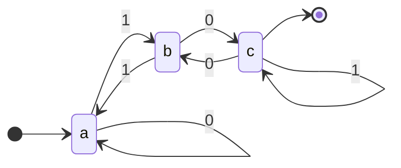

# 03.05 · Deterministic Finite Automaton (DFA)

> [!info] [[03.00 Automata|Lesson 3]] · Theory Notes 3 + `compier note.pdf` pp. 8–9 · Priority 🔴 High
> **Asked as:** "Provide a Formal Definition for a DFA" (2020/21 Q4a, 2021/22 Q5a)

## 1. Definition

> [!abstract] Theory Notes 3
> "In DFA, for each input symbol, **one can determine the state to which the machine will move**. Hence, it is called Deterministic Automaton. As it has a finite number of states, the machine is called Deterministic Finite Machine or Deterministic Finite Automaton."

**Formal definition:** a DFA is a 5-tuple $(Q, \Sigma, \delta, q_0, F)$ where
- Q is a finite set of states,
- Σ is a finite set of symbols called the alphabet,
- δ is the transition function where $\delta : Q \times \Sigma \rightarrow Q$,
- $q_0$ is the initial state from where any input is processed ($q_0 \in Q$),
- F is a set of final state/states of Q ($F \subseteq Q$).

## 2. Graphical representation (state diagram)

> [!abstract] Theory Notes 3
> A DFA is represented by digraphs called **state diagram**.
> - The **vertices** represent the states.
> - The **arcs labeled with an input alphabet** show the transitions.
> - The **initial state** is denoted by an **empty single incoming arc**.
> - The **final state** is indicated by **double circles**.

## 3. The lecture's example

Q = {a, b, c}, Σ = {0, 1}, q0 = a, F = {c}

| Present State | Next State for Input 0 | Next State for Input 1 |
|---|---|---|
| → a | a | b |
| b | c | a |
| \* c | b | c |

*(In Mermaid, the arrow from `[*]` marks the start state and the arrow to `[*]` marks a final state. On paper, draw c with a double circle.)*

**Trace:** "10" → a –1→ b –0→ c. c ∈ F, so it is **accepted**. "11" → a –1→ b –1→ a. a ∉ F, so it is **rejected**.

## 4. The five validation rules of a DFA (handwritten notes)

Check every DFA you draw against these:

1. Number of states **≥ 1**.
2. **Exactly one** initial state.
3. Final states: **one or more**.
4. **Every state must have a transition for every input symbol.**
5. **No multiple transitions** for one input from a state.

> [!tip] The dead (trap) state
> Rule 4 is why DFAs often need a **dead state**: a non-final state with self-loops on every symbol, where strings go when they can never be accepted (for example a string that does not start with the required symbol).

> [!note] About rule 3
> The handwritten notes say "final state can be one or more". The formal definition only requires $F \subseteq Q$ (F could be empty, giving a machine that accepts nothing). For exam DFAs, F always has at least one state.

## 5. Transition table conventions
- One **row per state**, one **column per input symbol**.
- Mark the start state with **→** and final states with **\*** (or a circle around the name).

## 6. Exam-relevant points
- Formal definition = **5-tuple + δ: Q × Σ → Q + "exactly one next state"**.
- Add the **validation rules** and the **acceptance condition** $\delta^*(q_0, S) \in F$.
- Illustrate with a small diagram + table (the lecture's 3-state example is fine).

## Related
- [[03.04 Formal Definition and the Transition Function]] · [[03.06 Non-deterministic Finite Automaton (NDFA)]] · [[03.07 DFA vs NDFA]] · [[03.10 Designing DFAs]] · [[PP 03.1 - Automata Theory and Terminology]]
