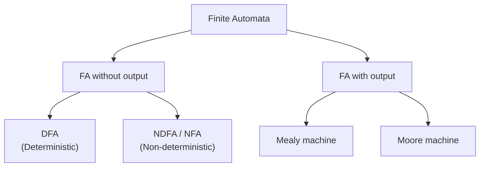

# 03.08 · Classification of Finite Automata (and Acceptors, Classifiers, Transducers)

> [!info] [[03.00 Automata|Lesson 3]] · Theory Notes 3 + `compier note.pdf` p. 6 (classification tree) · Priority 🟡 Medium
> **Asked as:** "Categories the finite automation machines with their examples." (2021/22 Q4c)

## 1. The classification tree (handwritten notes)

| Category | Meaning | Example |
|---|---|---|
| **DFA** (no output) | Exactly one next state for each (state, symbol) | Recognising identifiers in a lexical analyzer; "strings with an even number of 1s" |
| **NDFA / NFA** (no output) | May move to a set of states; may have ε-moves | "Strings whose second-last symbol is a" (3 states) |
| **Mealy** (with output) | Output depends on **present state and present input** | 1's complement of a binary string; vending machine |
| **Moore** (with output) | Output depends on **present state only** | Counting occurrences of a substring such as "abb" |

Theory Notes 3 also states that a finite automaton is classified into two types, **DFA** and **NDFA**, and Theory Notes 5 introduces **Mealy and Moore** as finite state machines that generate output.

## 2. Acceptor, Classifier, Transducer (Theory Notes 3)

> [!abstract] Theory Notes 3
> - **Acceptor (Recognizer):** "An automaton that computes a **Boolean function** is called an acceptor. All the states of an acceptor are either **accepting or rejecting** the inputs given to it."
> - **Classifier:** "A classifier has **more than two final states** and it gives a **single output when it terminates**."
> - **Transducer:** "An automaton that **produces outputs based on current input and/or previous state** is called a transducer. Transducers can be of two types: **Mealy Machine** (output depends on both the current state and the current input) and **Moore Machine** (output depends only on the current state)."

| Type | Output | Example |
|---|---|---|
| Acceptor | Yes/No (accept/reject) | A DFA checking whether a string is a valid identifier |
| Classifier | One of several categories at the end | A scanner deciding whether a lexeme is a keyword, identifier or number (illustrative) |
| Transducer | A sequence of outputs while running | Mealy/Moore machines, e.g. a sequence detector |

## 3. How the two classifications connect
- DFAs and NDFAs (FA **without output**) are **acceptors**.
- Mealy and Moore machines (FA **with output**) are **transducers**.

## 4. Exam-relevant points
- **Draw the tree**, define each leaf in one sentence, and give **an example for each** ("with their examples").
- Add the acceptor/classifier/transducer classification for extra marks.

## Related
- [[03.05 Deterministic Finite Automaton (DFA)]] · [[03.06 Non-deterministic Finite Automaton (NDFA)]] · [[05.01 Finite Automata with Output - Mealy and Moore]] · [[PP 03.1 - Automata Theory and Terminology]]
