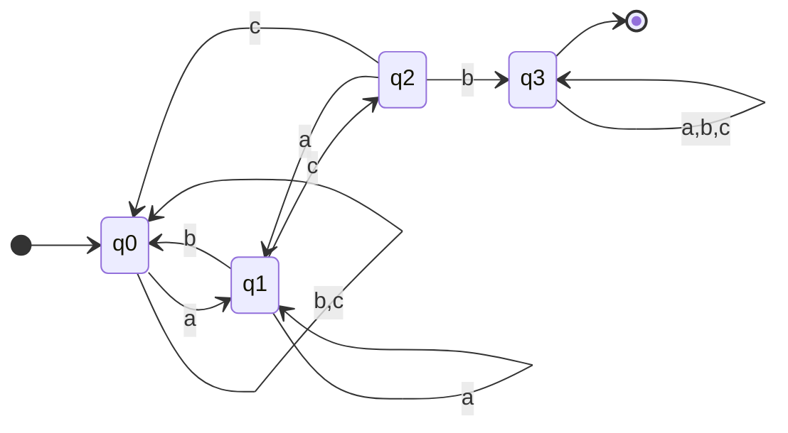

# 03.10 · Designing DFAs from a Description

> [!info] [[03.00 Automata|Lesson 3]] · `compier note.pdf` pp. 9–10 + `Compiler note.pdf` (DFA practice) · Priority 🔴 High (every paper, 40 marks)
> **Asked as:** "Construct a DFA that…" (2019/20 Q4c; 2020/21 Q4d; 2021/22 Q5d; 2022/23 Q5d; 2023/24 Q4d, Q5d)

Every paper has a construction question, and the parts always come from the **same few families**. Learn one method per family.

## 1. The 4-step routine

1. **Decide what each state must remember.** Write it in words: "q2 = two a's seen so far".
2. **Draw the states** and label each with its meaning.
3. **Complete every transition**: each state needs an arrow for **every** symbol (validation rule 4, [[03.05 Deterministic Finite Automaton (DFA)]]). Add a **dead state** if needed.
4. **Test** with two accepted and two rejected strings. Write the 5-tuple and the transition table.

## 2. The families

| Family | What a state remembers | Method |
|---|---|---|
| **Contains substring w** | How much of w has been matched so far | Chain of states q0…qₙ (one per prefix of w). Last state final, self-loop on all symbols. On a mismatch, go back to the **longest prefix of w that is a suffix of what you have read** (not always q0). |
| **Does NOT contain w** | Same as above | Build the "contains" DFA, then **swap final and non-final**: qₙ becomes a **dead state**, all other states become final. |
| **Parity / counting** | Remainders (even/odd) | One parity: 2 states. Two independent parities: 2 × 2 = 4 states. Each symbol flips its own coordinate. |
| **Starts with w** | Position in w | Forced chain; a wrong symbol goes to a dead state; after w, a final sink that accepts everything. |
| **Ends with w** | The last few symbols | Like "contains", but the final state does **not** self-loop on everything: a bad symbol takes you back. |
| **Exactly / at least k of a symbol** | Count so far (capped) | States 0…k (+ a dead state for "exactly"). |

## 3. Worked example 1: contains "acb" over {a, b, c}

| State (meaning) | a | b | c |
|---|---|---|---|
| → q0 (nothing matched) | q1 | q0 | q0 |
| q1 ("a") | q1 | q0 | q2 |
| q2 ("ac") | q1 | q3 | q0 |
| \* q3 ("acb" found) | q3 | q3 | q3 |

Why q1 –a→ q1? After "aa", the last "a" can still start "acb". Why q2 –a→ q1? After "aca", the final "a" is a fresh start.



## 4. Worked example 2: does NOT contain "01011" over {0, 1} (2019/20 Q4c)

Build "contains 01011" (6 states), then invert:

| State (prefix matched) | 0 | 1 | Final? |
|---|---|---|---|
| → q0 (ε) | q1 | q0 | ✔ |
| q1 (0) | q1 | q2 | ✔ |
| q2 (01) | q3 | q0 | ✔ |
| q3 (010) | q1 | q4 | ✔ |
| q4 (0101) | q3 | q5 | ✔ |
| q5 (01011, **dead**) | q5 | q5 | ✘ |

Key fall-backs: q3 on 0 → q1 ("0100" ends in "0"); q4 on 0 → q3 ("01010" ends in "010"). Tests: 0101 ✔, ε ✔, 01011 ✘, 1010110 ✘.

## 5. Worked example 3: even number of 0s and odd number of 1s (2022/23 Q5d iii)

States record **(parity of 0s, parity of 1s)**:

| State | 0 | 1 |
|---|---|---|
| → EE | OE | EO |
| \* EO | OO | EE |
| OE | EE | OO |
| OO | EO | OE |

A 0 flips the first letter and a 1 flips the second. Start = EE (zero of each). Final = **EO** (even 0s, odd 1s). Tests: 1 ✔, 001 ✔, 01 ✘, 11 ✘.

## 6. Worked example 4: the ATM PIN (2023/24 Q4d)

Conditions: digits {0,1}; starts with 1; ends with 0; even number of 1s; length ≥ 3.

**Observation:** the length condition is automatic. A string that starts with 1, ends with 0 and has an even number of 1s needs at least two 1s and one 0, so its length is ≥ 3. ("10" has one 1, which is odd.)

States combine **(parity of 1s, last symbol)**:

| State (meaning) | 0 | 1 |
|---|---|---|
| → q0 (start) | qD | qO1 |
| qO1 (odd 1s, last 1) | qO0 | qE1 |
| qO0 (odd 1s, last 0) | qO0 | qE1 |
| qE1 (even 1s, last 1) | qE0 | qO1 |
| \* qE0 (even 1s, last 0) | qE0 | qO1 |
| qD (dead: started with 0) | qD | qD |

Traces (verified):
```text
10      q0 -1-> qO1 -0-> qO0                         REJECT (odd number of 1s)
110110  q0 -1-> qO1 -1-> qE1 -0-> qE0 -1-> qO1 -1-> qE1 -0-> qE0   ACCEPT
110     q0 -1-> qO1 -1-> qE1 -0-> qE0                ACCEPT
11011   q0 -1-> qO1 -1-> qE1 -0-> qE0 -1-> qO1 -1-> qE1      REJECT (ends with 1)
```

## 7. Exam-relevant points
- **Label each state's meaning.** It costs one line and shows the design was deliberate.
- Give **diagram + transition table + 5-tuple + test traces**.
- For "not contains", say *"build contains, then complement the final states"*.
- Fall-back transitions on overlapping patterns (`aababb`, `abababbb`, `01011`) are where marks are lost. Use the **longest-prefix-that-is-a-suffix** rule.

All past-paper DFA questions with full answers (every machine checked by computer against its description): [[PP 03.2 - Acceptability and Designing Automata]].

## Related
- [[03.05 Deterministic Finite Automaton (DFA)]] · [[03.06 Non-deterministic Finite Automaton (NDFA)]] · [[04.02 DFA Minimization - Myhill-Nerode Theorem]] · [[05.05 Designing Mealy and Moore Machines]]
