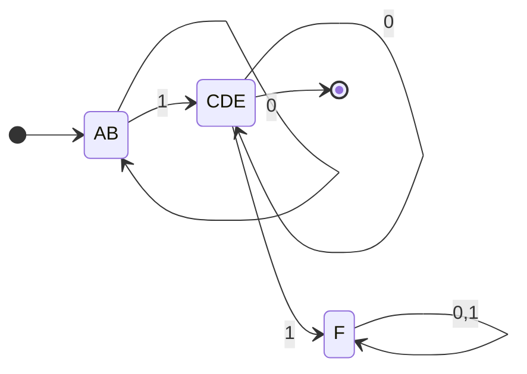

# 04.02 · DFA Minimization using the Myhill-Nerode Theorem (Table-Filling Method)

> [!info] [[04.00 NDFA to DFA Conversion and DFA Minimization|Lesson 4]] · Theory Notes 4 + `Compiler note.pdf` · Priority 🔴 High (all 5 papers, 40 marks)
> **Asked as:** "Minimize the following DFA using Myphill-Nerode Theorem" (2019/20 Q6d, 2020/21 Q8d) · "Minimize the DFA in part (c) using the Myphill-Nerode Theorem" (2021/22 Q6d, 2022/23 Q6d, 2023/24 Q7d)
> (The papers spell it "Myphill"; the correct name is **Myhill**-Nerode.)

## 1. What is minimization and why do it?

A DFA is **minimal** when it has the **fewest possible states** for its language. Two states can be **merged** if no input string can tell them apart. Fewer states means smaller tables, faster lexical analyzers and less memory. Minimization never changes the language.

## 2. The algorithm (Theory Notes 4, "Algorithm 2")

> [!abstract] Algorithm
> **Input:** DFA · **Output:** minimized DFA
> 1. Draw a **table for all pairs of states** (Qi, Qj), not necessarily connected directly. [All are **unmarked** initially.]
> 2. Consider every state pair (Qi, Qj) where **Qi ∈ F and Qj ∉ F** or vice versa and **mark** them. [F is the set of final states.]
> 3. **Repeat** this step until we cannot mark any more states: if there is an **unmarked** pair (Qi, Qj), mark it if the pair $\{\delta(Q_i, A), \delta(Q_j, A)\}$ is **marked** for some input alphabet A.
> 4. **Combine all the unmarked pairs** (Qi, Qj) and make them a single state in the reduced DFA.

> [!note] Typo in the lecture notes
> Step 3 in the typed notes reads "{δ(Qi, A), δ(**Qi**, A)}". It should be **{δ(Qi, A), δ(Qj, A)}**: compare where **both** states go on the same input.

**Intuition for step 3:** if one symbol A sends Qi and Qj to a pair you already know is different, then Qi and Qj are different too. You can tell them apart with "A followed by whatever separated their successors".

## 3. The lecture's worked example

DFA (same as the equivalence example; final states **{c, d, e}**):

| q | δ(q,0) | δ(q,1) |
|---|---|---|
| → a | b | c |
| b | a | d |
| \* c | e | f |
| \* d | e | f |
| \* e | e | f |
| f | f | f |

**Step 1–2: pair table, mark final vs non-final** (✔ = marked):

| | a | b | c | d | e |
|---|---|---|---|---|---|
| **b** | | | | | |
| **c** | ✔ | ✔ | | | |
| **d** | ✔ | ✔ | | | |
| **e** | ✔ | ✔ | | | |
| **f** | | | ✔ | ✔ | ✔ |

**Step 3: transitive marking.**
- (a, f): on input 1, a → c and f → f. (c, f) is marked, so **mark (a, f)**.
- (b, f): on input 1, b → d and f → f. (d, f) is marked, so **mark (b, f)**.
- (a, b): on 0 → (b, a) unmarked; on 1 → (c, d) unmarked. **Stays unmarked.**
- (c, d), (c, e), (d, e): every input leads to the same state or an unmarked pair. **Stay unmarked.**
- A second pass marks nothing new, so **stop**.

| | a | b | c | d | e |
|---|---|---|---|---|---|
| **b** | | | | | |
| **c** | ✔ | ✔ | | | |
| **d** | ✔ | ✔ | | | |
| **e** | ✔ | ✔ | | | |
| **f** | ✔ | ✔ | ✔ | ✔ | ✔ |

**Step 4: combine.** Unmarked pairs: {a,b}, {c,d}, {c,e}, {d,e}. Because c–d, c–e and d–e are all unmarked, they chain into **one** group **{c, d, e}**.

**Minimized DFA: 3 states**: {a, b}, {c, d, e}, {f}.

| Q | δ(q,0) | δ(q,1) |
|---|---|---|
| → (a, b) | (a, b) | (c, d, e) |
| \* (c, d, e) | (c, d, e) | (f) |
| (f) | (f) | (f) |

## 4. Presentation checklist
- [ ] Write the **4 steps** first (method marks).
- [ ] Transition table of the given DFA; state **F** clearly.
- [ ] **Lower-triangular** pair table with every pair present.
- [ ] Step 2 marks shown.
- [ ] Step 3: **write the reason** for each new mark: "input 1 sends (a, f) to (c, f), which is marked, so mark (a, f)".
- [ ] Say explicitly when a full pass marks nothing new.
- [ ] Step 4: list unmarked pairs, **chain overlapping pairs into groups**.
- [ ] Reduced **table + diagram**, new start state (the group containing the old start), new final states.
- [ ] "Reduced from n states to m states."

## 5. Common mistakes
- Forgetting that a state may be **unreachable**: remove it first ([[04.04 Unreachable States, Dead States and Common Mistakes]]).
- Leaving {c,d}, {c,e}, {d,e} as three separate merges instead of one group {c,d,e}.
- Stopping after one pass of step 3. **Repeat until no change.**
- Forgetting the dead state ∅ when minimizing a DFA that came from subset construction.

## Related
- [[04.03 DFA Minimization - Equivalence Theorem]] (the other method, same result) · [[04.01 NDFA to DFA - Subset Construction]] · [[PP 04.2 - DFA Minimization]]
