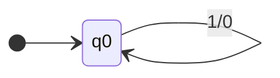

# 05.02 · Mealy Machine vs Moore Machine

> [!info] [[05.00 Moore and Mealy Machines|Lesson 5]] · Theory Notes 5 + `Compiler note.pdf` · Priority 🔴 High
> **Asked as:** "Compare and contrast the Moore machine and Mealy machine." (2019/20 Q6a, 2020/21 Q8a)

## 1. The lecture's comparison table (Theory Notes 5)

| Mealy Machine | Moore Machine |
|---|---|
| Output depends **both upon the present state and the present input** | Output depends **only upon the present state** |
| Generally, it has **fewer states** than Moore Machine | Generally, it has **more states** than Mealy Machine |
| The value of the output function is a function of the **transitions** and the changes, when the input logic on the present state is done | The value of the output function is a function of the **current state** and the changes at the **clock edges**, whenever state changes occur |
| Mealy machines **react faster** to inputs. They generally react in the **same clock cycle** | In Moore machines, **more logic is required to decode the outputs**, resulting in **more circuit delays**. They generally react **one clock cycle later** |

## 2. Extra rows (from the 6-tuples and handwritten notes)

| | Mealy | Moore |
|---|---|---|
| Output function | $X: Q \times \Sigma \rightarrow O$ | $X: Q \rightarrow O$ |
| Where output is drawn | On the **transitions** (`0/1`) | Inside the **states** (`q1/0`) |
| Output length for n inputs | **n** | **n + 1** |
| State table | Next state + output per input column | Next state per input + **one Output column** |

## 3. Similarities (the "compare" half)
- Both are **finite automata with output** (transducers) and are described by **6-tuples**.
- Both have the same kind of transition function $\delta: Q \times \Sigma \rightarrow Q$.
- Neither has final states. They produce output instead of accepting or rejecting.
- They are **equally powerful**: every Mealy machine can be converted to an equivalent Moore machine and vice versa ([[05.03 Moore to Mealy Conversion]], [[05.04 Mealy to Moore Conversion]]).

## 4. A small example to include in your answer

Mealy machine for **1's complement** (from the handwritten notes): one state, outputs on arrows.

Input `1011` → output `0100` (4 outputs for 4 inputs). A Moore version needs separate states for "last output 0" and "last output 1", plus the extra initial output. That shows Moore needs **more states** and gives **n + 1** outputs.

## 5. Exam-relevant points
- Lead with the defining difference (**state + input vs state only**).
- Give **both output-function signatures**.
- Table of at least 5–6 rows **plus similarities**.
- A tiny example (same input on both, output lengths differ by one) demonstrates the whole answer.

## Related
- [[05.01 Finite Automata with Output - Mealy and Moore]] · [[CMIS 3134 Important Comparisons]] · [[PP 05 - Moore and Mealy Machines]]
