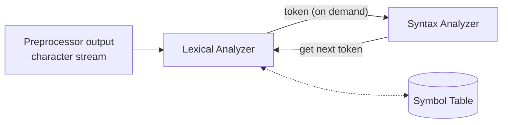

# 06.01 · The Role of the Lexical Analyzer

> [!info] [[06.00 Lexical Analysis|Lesson 6]] · Theory Notes 6 + Theory Notes 1 · Priority 🟡 Medium (part of the front-end questions: 2019/20 Q2b, 2022/23 Q1b, 2023/24 Q1b)

## 1. What is it?

> [!abstract] Theory Notes 6
> "Lexical analysis is the **first phase of a compiler**. It takes **modified source code from language preprocessors** that are written in the form of sentences. The lexical analyzer **breaks these syntaxes into a series of tokens**, by **removing any whitespace or comments** in the source code.
> If the lexical analyzer finds a token **invalid**, it **generates an error**. The lexical analyzer **works closely with the syntax analyzer**. It reads character streams from the source code, checks for legal tokens, and **passes the data to the syntax analyzer when it demands**."

## 2. Its jobs, step by step

1. **Input:** the modified source code produced by the [[01.04 Preprocessor|preprocessor]] (so `#include` and macros are already handled).
2. **Scan** it character by character (Theory Notes 1: it "works as a **text scanner**").
3. **Group** characters into **lexemes** and classify each as a **token** `<token-name, attribute-value>`.
4. **Remove** whitespace (spaces, tabs, new lines) and **comments**. They carry no meaning for later phases.
5. **Report an error** for any sequence of characters that matches no token pattern.
6. **Hand tokens to the parser on demand.** The syntax analyzer asks "next token, please", rather than receiving the whole list at once.

## 3. Why is it a separate phase? (practical explanation)

> [!warning] Beyond the slides
> The notes do not discuss why lexical analysis is separate. These are standard reasons.

- **Simpler parser:** the parser works with tokens like `<id>` and `<num>` instead of individual characters.
- **Efficiency:** scanning is fast because it uses finite automata built from [[02.00 Regular Expressions|regular expressions]].
- **Portability:** character-set details stay inside the scanner.

## 4. What it can and cannot detect

| Can detect | Cannot detect |
|---|---|
| Illegal characters or malformed tokens (no pattern matches) | Wrong order of tokens (for example a missing `;`). That is [[07.00 Syntax Analysis\|syntax analysis]]. |
| | Type errors or undeclared variables. That is [[01.08 Front-End Phases and Error Detection\|semantic analysis]]. |

## 5. Exam-relevant points
- Key words: **first phase · from preprocessor · tokens · removes whitespace and comments · error on invalid token · works with the syntax analyzer · on demand**.
- Output format: `<token-name, attribute-value>`.

## Related
- [[06.02 Tokens, Lexemes and Patterns]] · [[06.05 Tokenizing a C Program]] · [[01.08 Front-End Phases and Error Detection]]
