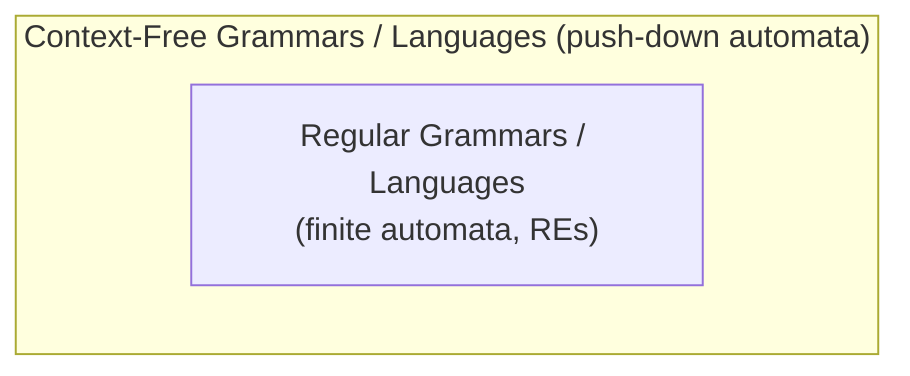

# 07.01 · Syntax Analysis and Why Regular Expressions Are Not Enough

> [!info] [[07.00 Syntax Analysis|Lesson 7]] · Theory Notes 7 · Priority 🟢 (background, but it explains the whole lesson)

## 1. What syntax analysis is

> [!abstract] Theory Notes 7
> "Syntax analysis or **parsing** is the **second phase of a compiler**."
> "A syntax analyzer or parser takes the input from a lexical analyzer in the form of **token streams**. The parser analyzes the source code (token stream) against the **production rules** to detect any errors in the code. The output of this phase is a **parse tree**. This way, the parser accomplishes two tasks, i.e., **parsing the code, looking for errors** and **generating a parse tree** as the output of the phase. Parsers are expected to **parse the whole code even if some errors exist** in the program. Parsers use **error recovering strategies**."

## 2. Why regular expressions are not enough

> [!abstract] Theory Notes 7
> "A lexical analyzer can identify tokens with the help of regular expressions and pattern rules. But a lexical analyzer **cannot check the syntax of a given sentence** due to the limitations of the regular expressions. **Regular expressions cannot check balancing tokens, such as parenthesis.** Therefore, this phase uses **context-free grammar (CFG)**, which is recognized by **push-down automata**."

**Why?** A regular expression corresponds to a **finite** automaton, which has a fixed, finite memory. To check that `((((…))))` is balanced you must count how many brackets are still open, and that number has no upper limit. A **push-down automaton** is a finite automaton **plus a stack**. The stack gives it unbounded memory to push `(` and pop on `)`.

> [!note] Beyond the slides
> The "finite memory vs stack" explanation is the standard reason. The notes state the conclusion (REs cannot balance parentheses; CFGs are recognised by push-down automata) without explaining why.

## 3. CFG is a superset of regular grammar

> [!abstract] Theory Notes 7
> "CFG, on the other hand, is a **superset of Regular Grammar**… It implies that **every Regular Grammar is also context-free**, but there exists some problems, which are beyond the scope of Regular Grammar. CFG is a helpful tool in describing the syntax of programming languages."

| | Regular grammar / RE | Context-free grammar |
|---|---|---|
| Recognised by | Finite automaton | Push-down automaton (FA + stack) |
| Used in | Lexical analysis (tokens) | Syntax analysis (structure) |
| Can balance brackets? | No | Yes |
| Example language | identifiers, numbers | palindromes, balanced parentheses, $a^n b^n$ |
| Relationship | ⊂ | ⊃ (superset) |

## 4. The lecture's example: palindromes

> [!abstract] Theory Notes 7
> "We take the problem of palindrome language, which cannot be described by means of Regular Expression. That is, $L = \{ w \mid w = w^R \}$ is not a regular language. But it can be described by means of CFG:
> G = (V, Σ, P, S) where V = {Q, Z, N}, Σ = {0, 1}, P = { Q → Z | Q → N | Q → ℇ | Z → 0Q0 | N → 1Q1 }, S = {Q}.
> This grammar describes palindrome language, such as: 1001, 11100111, 00100, 1010101, 11111, etc."

Each rule wraps a **matching pair** (0…0 or 1…1) around a smaller palindrome. That kind of unbounded matching is exactly what a finite automaton cannot do.

> [!note] Small gap in the lecture grammar
> As printed, the grammar only produces **even-length** palindromes (Q → ε at the centre), yet the lecture lists odd ones like 00100 and 1010101. Adding **Q → 0 | 1** would produce the odd-length ones too.

## Related
- [[07.02 Context-Free Grammar]] · [[02.01 Regular Expressions and Lexical Analysis]] · [[03.01 What is an Automaton]] (the Java question)
