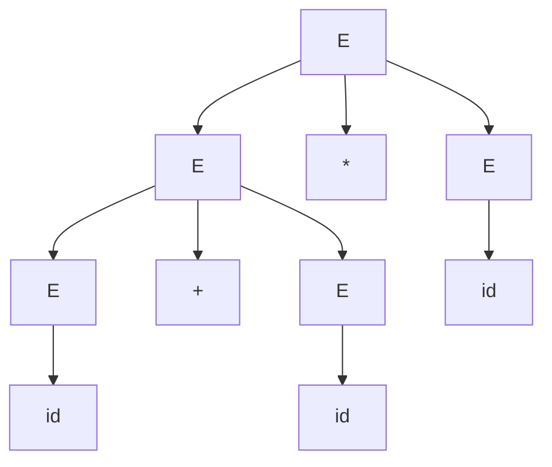
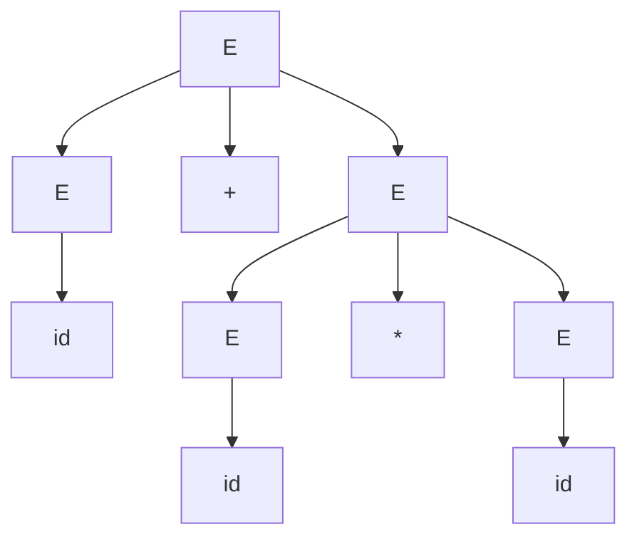

# 07.04 · Parse Trees (Derivation Trees)

> [!info] [[07.00 Syntax Analysis|Lesson 7]] · Theory Notes 7 + `Compiler note.pdf` pp. 39–41 · Priority 🔴 High (needed for every ambiguity question)

## 1. Definition

> [!abstract] Theory Notes 7
> "A parse tree is a **graphical depiction of a derivation**. It is convenient to see how strings are derived from the start symbol. The **start symbol of the derivation becomes the root** of the parse tree."
> In a parse tree:
> - **All leaf nodes are terminals.**
> - **All interior nodes are non-terminals.**
> - **In-order traversal gives the original input string.**
> "A parse tree depicts **associativity and precedence** of operators. The **deepest sub-tree is traversed first**, therefore the operator in that sub-tree gets precedence over the operator which is in the parent nodes."

Handwritten notes: a derivation tree is an **ordered rooted tree** that graphically represents a derivation from a CFG (root = start symbol, vertices = variables, leaves = terminals).

## 2. How to build one (5-step example from the lecture)

Lecture: the left-most derivation of `a + b * c` (written with `id`):

```text
Step 1: E ⇒ E * E
Step 2:   ⇒ E + E * E
Step 3:   ⇒ id + E * E
Step 4:   ⇒ id + id * E
Step 5:   ⇒ id + id * id
```

Each step adds the children of the replaced non-terminal:



Here `+` is deeper than `*`, so `+` is evaluated first: (id + id) * id.

The tree built from E ⇒ E + E … puts `*` deeper, giving the conventional id + (id * id):



## 3. Derivation vs parse tree

| Derivation | Parse tree |
|---|---|
| A **sequence** of steps (order matters) | A **structure** (order of replacement forgotten) |
| LMD and RMD of the same tree look different | LMD and RMD of the same structure give the **same** tree |
| Shows *how* the string was produced | Shows *what structure* the string has |

**Key consequence:** ambiguity is about **different trees**, not different derivation orders ([[07.05 Ambiguity]]).

## 4. Exam-relevant points
- Root = start symbol, interior nodes = non-terminals, leaves = terminals, reading the leaves left to right gives the string.
- Deeper operators are evaluated first (precedence).
- When asked for "two distinct parse trees", draw trees with **different shapes** (usually a different production at the root).

## Related
- [[07.03 Derivations - Left-most and Right-most]] · [[07.05 Ambiguity]] · [[07.07 Associativity and Precedence]]
