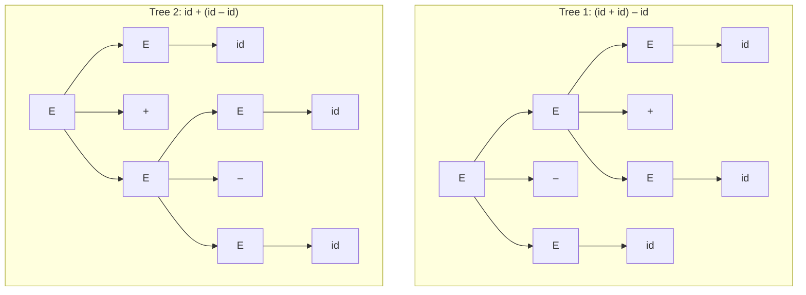
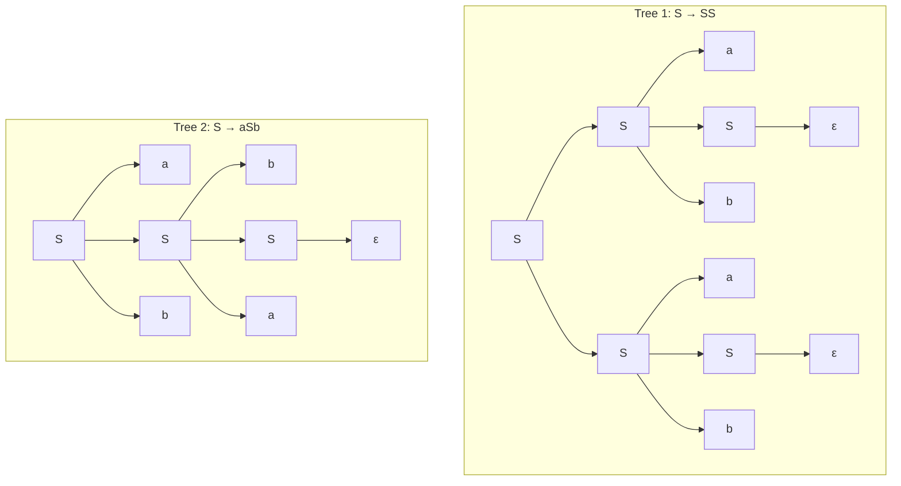

# 07.05 · Ambiguity

> [!info] [[07.00 Syntax Analysis|Lesson 7]] · Theory Notes 7 + `Compiler note.pdf` p. 41 · Priority 🔴 High (all 5 papers)
> **Asked as:** "What is meant by context-free grammar is ambiguous (or unambiguous)? Briefly explain with a suitable example." (2019/20 Q7a, 2020/21 Q7b) · "Determine whether the grammar G is ambiguous or not for the string "aab"" (2021/22 Q8b) · "Is this grammar ambiguous for the string "abab"? … provide two distinct parse trees" (2022/23 Q8b, 2023/24 Q8b)

## 1. Definition

> [!abstract] Theory Notes 7
> "A grammar G is said to be **ambiguous** if it has **more than one parse tree (left or right derivation) for at least one string**."

- **Unambiguous:** every string in the language has **exactly one** parse tree (equivalently exactly one LMD, or exactly one RMD).
- The test is **two different parse trees**, or **two different left-most derivations** (or two different right-most derivations).
- One LMD and one RMD of the **same** tree do **not** prove ambiguity.

## 2. The lecture's example

E → E + E, E → E – E, E → id with the string `id + id – id`:

Two trees for one string → **ambiguous**. With numbers: 5 + 3 – 2 gives 6 either way here, but with `*` and `+` the two trees give **different values** (2 + 3 * 4 = 14 or 20), which is why ambiguity matters.

Handwritten notes use E → E + E | E – E | a | b with input `a − b + a`, giving two trees in the same way.

## 3. Why ambiguity is bad, and what to do

> [!abstract] Theory Notes 7
> "The language generated by an ambiguous grammar is said to be **inherently ambiguous**. Ambiguity in grammar is **not good for a compiler construction**. **No method can detect and remove ambiguity automatically**, but it can be removed by either **re-writing the whole grammar without ambiguity**, or by **setting and following associativity and precedence constraints**."

> [!note] A precise correction
> The notes say "the language generated by an ambiguous grammar is said to be inherently ambiguous". Strictly, a **language** is *inherently ambiguous* only if **every** grammar for it is ambiguous. Many ambiguous grammars (like the E → E + E grammar) have an unambiguous equivalent, so their languages are not inherently ambiguous.

**Remedies:**
1. **Rewrite the grammar**, e.g. E → E + T | T, T → T * F | F, F → (E) | id (standard unambiguous expression grammar, not in the notes).
2. **Impose precedence and associativity** ([[07.07 Associativity and Precedence]]).

## 4. Worked example: `S → AB | aaB, A → a | Aa, B → b` for "aab" (2021/22 Q8b)

**Ambiguous.** Two distinct trees:
- **Tree 1** via S → AB: S ⇒ AB ⇒ AaB ⇒ aaB ⇒ aab (A → Aa, A → a, B → b).
- **Tree 2** via S → aaB: S ⇒ aaB ⇒ aab.

The roots have different children (`A B` vs `a a B`), so these are genuinely different trees. Cause: S → aaB duplicates something S → AB can already produce.

## 5. Worked example: `S → aSb | bSa | SS | ε` for "abab" (2022/23 Q8b, 2023/24 Q8b)

**Ambiguous.**
- **Tree 1 (root S → SS):** S ⇒ SS ⇒ aSbS ⇒ abS ⇒ abaSb ⇒ abab (both inner S → ε). It reads the string as **ab · ab**.
- **Tree 2 (root S → aSb):** S ⇒ aSb ⇒ abSab ⇒ abab (inner S → bSa, then S → ε). It reads it as **a (ba) b**.

The **S → SS** rule (with S → ε) lets the same string be split in several ways, which is the source of the ambiguity.

## 6. Exam-relevant points
- Definition + **two drawn trees** for one string. The trees are the proof.
- Say explicitly: *"one string, two distinct parse trees, therefore ambiguous"*.
- Mention: bad for compilers; **no automatic detection or removal**; remedies = rewrite or precedence/associativity.

## Related
- [[07.04 Parse Trees]] · [[07.07 Associativity and Precedence]] · [[PP 07.1 - Grammars, Derivations and Ambiguity]]
