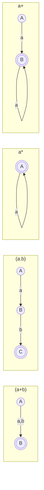

# 08.04 · Regular Expression → Finite Automaton

> [!info] [[08.00 Arden's Theorem and RE-FA Conversion|Lesson 8]] · `Compiler note.pdf` pp. 36–37 · Priority 🔴 High (**all 5 papers**, 20 marks)
> **Asked as:** "Draw the corresponding Finite Machine for: (i) 0\* + 0\*11\* (ii) (01 + 10)\*" (2019/20 Q5b, 2020/21 Q5b) · "Draw the corresponding Non-Deterministic Finite Machine for 10 + (0 + 11)0\*1 over Σ = {0,1}" (2021/22 Q6b, 2022/23 Q6b) · "…for ab\* + (a + bb)a\*b\* over Σ = {a,b}" (2023/24 Q7b)

## 1. The four construction rules (handwritten notes)

The notes build machines **without ε-moves**, directly from the structure of the RE:

| Rule | RE | Machine | Note in your notes |
|---|---|---|---|
| **1. Union** | `(a + b)` | A –a,b→ **B** | "accept a or b; a is final, b is final" |
| **2. Concatenation** | `(a . b)` | A –a→ B –b→ **C** | "only the last is final" |
| **3. Kleene star** | `a*` | **A** with a self-loop on a | "the empty (start) state is final", so ε is accepted |
| **4. Kleene plus** | `a+` | A –a→ **B**, B loops on a | "empty string is not accepted; at least one a" |

(**Bold** = final state.)

## 2. Method for a compound RE

1. **Decompose** outside-in: find the top-level `+` first (lowest precedence), then concatenations, then stars. Write the decomposition down (it is marked).
2. Build a small machine for each piece using the rules.
3. **Join** them:
   - **union** → the pieces branch from the **same start state**;
   - **concatenation** → continue from where the first piece ends;
   - **star** → loop back (a single-symbol star becomes a self-loop).
4. Mark the start state (incoming arrow) and the **final states** (double circles).
5. Give the **transition table** (set-valued for an NDFA) and **test** two accepted and one rejected string.
6. Keep it **small**: parts (c) and (d) will convert and minimize it.

> [!tip] Non-deterministic is allowed
> When the question says "Non-Deterministic Finite Machine", you **may** have two arrows with the same label from one state and missing transitions. Do not waste time making it deterministic. Part (c) does that.

## 3. Worked examples from the handwritten notes
- `ba*b`: A –b→ B, B loops on a, B –b→ **C**.
- `(a+b)c`: A –a,b→ B –c→ **C**.
- `a(bc)*`: A –a→ **B**, then B –b→ C –c→ B (loop back for the star).
- `(a+b)*(abb + a*b)`: A loops on a,b; A –a→ B –b→ C –b→ **D**; A –a→ E (loops on a), E –b→ **F**; also A –b→ **F** for the a\*b case with zero a's (that path is implied in the notes' final diagram).

## 4. Past-paper examples

### (a) `0* + 0*11*` (2019/20 Q5b(i), 2020/21 Q5b(i))
Decomposition: union of `0*` and `0*11*`. Both start with `0*`, so they share the start state.

| State | 0 | 1 |
|---|---|---|
| → \*q0 | q0 | q1 |
| \*q1 | – | q1 |

q0 (start, final) loops on 0 (gives 0\*); q0 –1→ q1 (final) loops on 1 (gives 0\*11\*). Language = **0\*1\*** (since $0^* + 0^*11^* = 0^*(\varepsilon + 11^*) = 0^*1^*$). Missing transition q1 on 0 = dead (add a dead state if a DFA is required).

### (b) `(01 + 10)*` (2019/20 Q5b(ii), 2020/21 Q5b(ii))

| State | 0 | 1 |
|---|---|---|
| → \*q0 | q1 | q2 |
| q1 | – | q0 |
| q2 | q0 | – |

q0 is start **and** final (the star allows ε). q0 –0→ q1 –1→ q0 builds "01"; q0 –1→ q2 –0→ q0 builds "10". Tests: ε ✔, 0110 ✔, 1001 ✔, 00 ✘.

### (c) `10 + (0 + 11)0*1` over {0,1} (2021/22 Q6b, 2022/23 Q6b), the handwritten notes' own Example
Decomposition: `10` **+** `(0 + 11) · 0* · 1`.

| State | 0 | 1 |
|---|---|---|
| → A | {D} | {B, E} |
| B | {C} | ∅ |
| \*C | ∅ | ∅ |
| D | {D} | {C} |
| E | ∅ | {D} |

- `10`: A –1→ B –0→ C.
- `(0 + 11)`: A –0→ D, or A –1→ E –1→ D.
- `0*`: D loops on 0. Then `1`: D –1→ C.
- Non-determinism: A on 1 goes to **B or E**.
- Tests: 10 ✔, 01 ✔, 1101 ✔, 0001 ✔, 11 ✘.

### (d) `ab* + (a + bb)a*b*` over {a,b} (2023/24 Q7b)
Decomposition: `ab*` **+** `(a + bb) · a* · b*`.

| State | a | b |
|---|---|---|
| → q0 | {q1, q2} | {q3} |
| \*q1 | ∅ | {q1} |
| \*q2 | {q2} | {q4} |
| q3 | ∅ | {q2} |
| \*q4 | ∅ | {q4} |

- `ab*`: q0 –a→ q1 (final), q1 loops on b.
- `(a + bb)`: q0 –a→ q2, or q0 –b→ q3 –b→ q2.
- `a*b*`: q2 (final) loops on a; q2 –b→ q4 (final); q4 loops on b. q2 and q4 are final because a\*b\* may be empty or end after the a's.
- Tests: a ✔, abb ✔, bb ✔, bbaab ✔, b ✘, aba ✘.

> [!note] Observation for extra credit
> $ab^* \subseteq (a + bb)a^*b^*$ (take the `a` branch and zero a's), so the whole RE equals $(a+bb)a^*b^*$. You may mention this, but **draw the machine for the RE as given**.

All four machines above were checked by computer against their REs for every string up to length 8.

## 5. Exam checklist
- [ ] Written decomposition of the RE.
- [ ] The rules you used (union / concatenation / star / plus).
- [ ] Diagram with start arrow and double-circled finals.
- [ ] Transition table (sets, ∅).
- [ ] Two accepted and one rejected test string.

## Related
- [[08.05 The Full Pipeline - RE to Minimized DFA]] · [[03.06 Non-deterministic Finite Automaton (NDFA)]] · [[08.03 Finite Automaton to Regular Expression]] · [[PP 08 - Arden's Theorem and RE-FA Conversion]]
