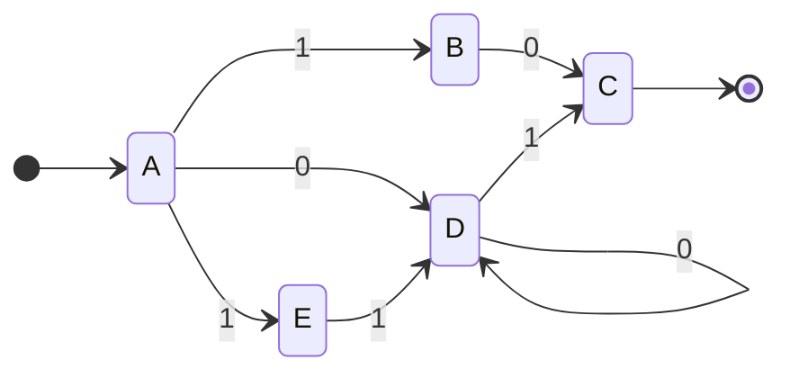
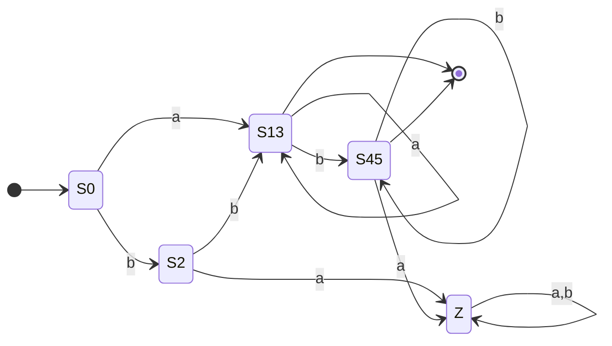

# 08.05 · The Full Pipeline: RE → NDFA → DFA → Minimized DFA

> [!info] [[08.00 Arden's Theorem and RE-FA Conversion|Lesson 8]] + [[04.00 NDFA to DFA Conversion and DFA Minimization|Lesson 4]] · Priority 🔴 High (one whole question, 100 marks)
> **Asked as:** 2021/22 Q6 and 2022/23 Q6 (RE `10 + (0 + 11)0*1`, Myhill-Nerode) · 2023/24 Q7 (RE `ab* + (a + bb)a*b*`, Myhill-Nerode)
> (a) Arden's Theorem (20) · (b) draw the NDFA for the RE (20) · (c) find the equivalent DFA (20) · (d) minimize it (40)

## 1. How to attack the question (about 30 minutes)

1. **(a) first:** Arden's theorem is independent and memorised. Get 20 safe marks in about 6 minutes ([[08.02 Arden's Theorem]]).
2. **(b)** Build a **small** NDFA ([[08.04 Regular Expression to Finite Automaton]]). Every extra state makes (c) and (d) longer.
3. **(c)** Subset construction on **your own** (b) ([[04.01 NDFA to DFA - Subset Construction]]). Even if (b) had a slip, a correct method still earns the method marks. **Include ∅.**
4. **(d)** Use the method the paper names ([[04.02 DFA Minimization - Myhill-Nerode Theorem]]). It may turn out that the DFA is **already minimal**. That is a valid result if your working shows every pair is distinguishable.
5. Redraw the table at the start of each part rather than saying "see above".

---

## 2. Worked pipeline A: `10 + (0 + 11)0*1` (2021/22 Q6, 2022/23 Q6)

### (b) NDFA

| State | 0 | 1 |
|---|---|---|
| → A | {D} | {B, E} |
| B | {C} | ∅ |
| \*C | ∅ | ∅ |
| D | {D} | {C} |
| E | ∅ | {D} |

### (c) Subset construction

| DFA state | 0 | 1 | Final? |
|---|---|---|---|
| → [A] | [D] | [B, E] | |
| [D] | [D] | [C] | |
| [B, E] | [C] | [D] | |
| [C] | ∅ | ∅ | ✔ |
| ∅ (dead) | ∅ | ∅ | |

Unions shown: δ([B,E], 0) = δ(B,0) ∪ δ(E,0) = {C} ∪ ∅ = [C]; δ([B,E], 1) = ∅ ∪ {D} = [D].

Rename: **P** = [A], **Q** = [D], **R** = [B,E], **T** = [C] (final), **Z** = ∅.

### (d) Myhill-Nerode

| | P | Q | R | T |
|---|---|---|---|---|
| **Q** | ✔ (pass 1) | | | |
| **R** | ✔ (pass 1) | ✔ (pass 1) | | |
| **T** | ✔ (step 2) | ✔ (step 2) | ✔ (step 2) | |
| **Z** | ✔ (pass 2) | ✔ (pass 1) | ✔ (pass 1) | ✔ (step 2) |

- Step 2: T is final, so mark (T,P), (T,Q), (T,R), (T,Z).
- Pass 1: (P,Q): on 1 → (R,T), marked, so mark. (P,R): on 0 → (Q,T), marked, so mark. (Q,R): on 0 → (Q,T), so mark. (Q,Z): on 1 → (T,Z), so mark. (R,Z): on 0 → (T,Z), so mark.
- Pass 2: (P,Z): on 0 → (Q,Z), marked in pass 1, so mark.
- Pass 3: nothing new. **No unmarked pairs.**

**Result: the DFA is already minimal** (4 live states + the dead state). State it clearly: *"all pairs are distinguishable, therefore no states can be merged; the DFA from (c) is minimal."* (Checked by computer.)

---

## 3. Worked pipeline B: `ab* + (a + bb)a*b*` (2023/24 Q7)

### (b) NDFA

| State | a | b |
|---|---|---|
| → q0 | {q1, q2} | {q3} |
| \*q1 | ∅ | {q1} |
| \*q2 | {q2} | {q4} |
| q3 | ∅ | {q2} |
| \*q4 | ∅ | {q4} |

### (c) Subset construction

| DFA state | a | b | Final? | Rename |
|---|---|---|---|---|
| → [q0] | [q1,q2] | [q3] | | S0 |
| [q1,q2] | [q2] | [q1,q4] | ✔ | S1 |
| [q3] | ∅ | [q2] | | S2 |
| [q2] | [q2] | [q4] | ✔ | S3 |
| [q1,q4] | ∅ | [q1,q4] | ✔ | S4 |
| [q4] | ∅ | [q4] | ✔ | S5 |
| ∅ | ∅ | ∅ | | Z (dead) |

### (d) Myhill-Nerode
- Step 2: mark every (final, non-final) pair. Finals = S1, S3, S4, S5; non-finals = S0, S2, Z.
- Pass 1:
  - (S0,S2): a → (S1, Z), marked, so mark. (S0,Z): a → (S1,Z), so mark. (S2,Z): b → (S3,Z), so mark.
  - (S1,S4): a → (S3, Z), so mark. (S1,S5): a → (S3,Z), so mark. (S3,S4): a → (S3,Z), so mark. (S3,S5): a → (S3,Z), so mark.
  - (S1,S3): a → (S3,S3) same; b → (S4,S5), not marked, so **leave**.
  - (S4,S5): a → (Z,Z) same; b → (S4,S5) itself, so **leave**.
- Pass 2: (S1,S3) b → (S4,S5) still unmarked; (S4,S5) unchanged. **Stop.**
- **Unmarked pairs: (S1, S3) and (S4, S5).**

**Minimized DFA (7 → 5 states):**

| State | a | b | Final? |
|---|---|---|---|
| → S0 | {S1,S3} | S2 | |
| {S1,S3} | {S1,S3} | {S4,S5} | ✔ |
| S2 | Z | {S1,S3} | |
| {S4,S5} | Z | {S4,S5} | ✔ |
| Z | Z | Z | |

Meaning: {S1,S3} = "read (a or bb) then a's", {S4,S5} = "now in the b\* part". This is exactly $(a + bb)a^*b^*$, which equals the original RE (because $ab^* \subseteq (a+bb)a^*b^*$). Checked by computer.

## Related
- [[08.04 Regular Expression to Finite Automaton]] · [[04.01 NDFA to DFA - Subset Construction]] · [[04.02 DFA Minimization - Myhill-Nerode Theorem]] · [[PP 08 - Arden's Theorem and RE-FA Conversion]] · [[PP 04.1 - NDFA to DFA Conversion]] · [[PP 04.2 - DFA Minimization]]
