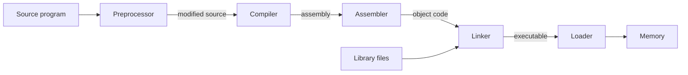

# CMIS 3134 · Final Revision Summary

> [!abstract] The night-before sheet
> One page per lesson, only what scores marks. Details: [[CMIS 3134 Algorithms and Procedures]] · [[CMIS 3134 Important Definitions]] · [[CMIS 3134 Important Comparisons]] · [[CMIS 3134 High Priority Topics]] · Home: [[00. CMIS 3134 Course Overview]]

**Exam:** 3 h · 8 questions, answer 6 · (a) 20 (b) 20 (c) 20 (d) 40 · about 30 min per question.

---

## L1 · Compilers 🔴 → [[01.99 Summary - Introduction to Compilers]]

**LPS** (draw it):

**Six phases** (+ symbol table and error handler connected to all):
Lexical (chars → tokens) → Syntax (tokens → parse tree) → Semantic (→ annotated tree) → ICG (→ intermediate code) → Optimization (→ better intermediate code) → Code generation (→ re-locatable machine code).

- Front end = analysis (source-dependent) · back end = synthesis (machine-dependent).
- Hardware understands only **binary (electronic charge)** → high-level code must be translated.
- `int x = "10" + 5;` → caught by **semantic** analysis.
- Compiles but wrong output → **logical** or **run-time** errors (not detected by the compiler).
- "Do you agree?" with swapped definitions → **No**, give both correct definitions.

## L2 · Regular expressions 🔴 → [[02.99 Summary - Regular Expressions]]
- Precedence: `*` > concatenation > `+`/`|`.
- `x*` zero or more (ε) · `x⁺` one or more · `x?` zero or one · `[ ]` inclusive · `( )` exclusive.
- Identifier `letter(letter|digit)*` · decimal `(sign)?(digit)⁺` · NIC `digit⁹(V|X)` · mobile `07 digit⁸` · binary `(0+1)⁺`.
- `(a+b)*abb` ends in abb · `(aa+ab+ba+bb)*` = `((a+b)(a+b))*` even length · `0*10*` exactly one 1 · `(a+ab)*` no bb and does not start with b.

## L3 · Automata 🔴 → [[03.99 Summary - Automata]]
- DFA/NDFA = $(Q, \Sigma, \delta, q_0, F)$. DFA $\delta: Q\times\Sigma \to Q$ · NDFA $\delta: Q\times\Sigma \to 2^Q$.
- $\Sigma^* = \bigcup_{n\ge0}\Sigma^n$ (has ε) · $\Sigma^+ = \Sigma^* - \{\varepsilon\}$ · $|\Sigma^n| = |\Sigma|^n$.
- Acceptance: DFA, last state ∈ F · NDFA, **some** path ends in F (trace **sets** of states).
- DFA rules: one start state, ≥ 1 final, **every state has every symbol**.
- Complement trick: build "contains w", then swap final/non-final.
- Every DFA is an NDFA: δ′(q, a) = {δ(q, a)}.
- Java FSM: valid syntax → yes · no infinite loop → **no** (undecidable, halting problem).

## L4 · NDFA → DFA and minimization 🔴🔴 → [[04.99 Summary - NDFA to DFA and Minimization]]
- **Subset:** start [q0] → cell = union → new sets become rows → final = contains an NDFA final state → ∅ is the dead state.
- **Myhill-Nerode:** pair table → mark (F, non-F) → mark (p, q) if (δ(p,a), δ(q,a)) is marked → merge unmarked.
- **Equivalence:** P0 = {F, Q−F} → split by where each input goes → stop at Pk = Pk−1.
- Remove **unreachable** states first (the A–G DFA's **F**).

| Paper machine | Minimal result |
|---|---|
| A–E DFA (used in 4 papers) | {A}, {B,C,D}, {E} |
| A–G DFA | {A}, {B,C}, {D,E}, {G} (F unreachable) |
| 2023/24 A–F table | {A,B}, {C,D}, {E,F} |
| DFA of 10 + (0 + 11)0\*1 | already minimal |
| DFA of ab\* + (a + bb)a\*b\* | 7 → 5 states |

## L5 · Moore and Mealy 🔴 → [[05.99 Summary - Moore and Mealy Machines]]
- Mealy X: Q × Σ → O (on arrows, n outputs) · Moore X: Q → O (in states, n + 1 outputs).
- **Moore → Mealy:** copy transitions; output on each arrow = output of the **destination** state.
- **Mealy → Moore:** split every state that is **entered** with different outputs (Qi0, Qi1, …); copies share outgoing arrows; if the start output is 1, add a new start state with output 0.
- Table with `q3/0` cells = Mealy; table with an Output column = Moore.

## L6 · Lexical analysis 🔴 → [[06.99 Summary - Lexical Analysis]]
- Token `<name, value>` · lexeme = text · pattern = RE.
- Remove whitespace, comments and `#include` lines; one string literal = one token; `printf` = identifier.
- Program 1 (`int main`, max) = **50 tokens** · Program 2 (`void main`, age) = **39 tokens**.

## L7 · Syntax analysis 🔴 → [[07.99 Summary - Syntax Analysis]]
- CFG = (V, Σ, P, S); REs cannot match brackets → CFG + push-down automaton.
- LMD: replace left-most · RMD: replace right-most · one step per line.
- Ambiguous = two parse trees for one string → **draw both**.
- `S → aSbb | abb` = $\{a^n b^{2n} \mid n \ge 1\}$ · `S → aSb | bSa | SS | ε` = equal a's and b's, ambiguous on "abab".
- Grammar with **A → ε** as printed: every string has #b ≥ #a and ends in b → say so, then answer the A → a version too.
- Parser cannot check: declared before use, types, initialization → semantic analysis.

## L8 · Arden and RE ⇄ FA 🔴🔴 → [[08.99 Summary - Arden's Theorem and RE-FA Conversion]]
- **Arden:** P without ε ⇒ R = Q + RP has the unique solution R = QP\*.
- Proof: (1) Q + QP\*P = Q(ε + P\*P) = QP\*. (2) R = Q(ε + P + … + Pⁿ) + RPⁿ⁺¹; strings of RPⁿ⁺¹ are longer than n → R ⊆ QP\*; and QP\* ⊆ R. ∎
- FA → RE: equations from **incoming** arrows, + ε on the start state, solve with Arden.
- Identities: ε + R\*R = R\* · RR\* = R⁺ · (P + Q)R = PR + QR · R + R = R · (R\*)\* = R\*.
- (0110 + 01)(10)\* = 01(10 + ε)(10)\* = 01(10)\*.

---

## Answer-writing checklist
- [ ] Name the method/algorithm and **write its steps** before the working.
- [ ] Every automaton: start arrow, double circles, full table, test strings.
- [ ] Every conversion: show each intermediate table.
- [ ] Every comparison: definitions + similarities + 5–6 row table + example.
- [ ] Printing error in the question → **one line** stating your interpretation, then answer.
