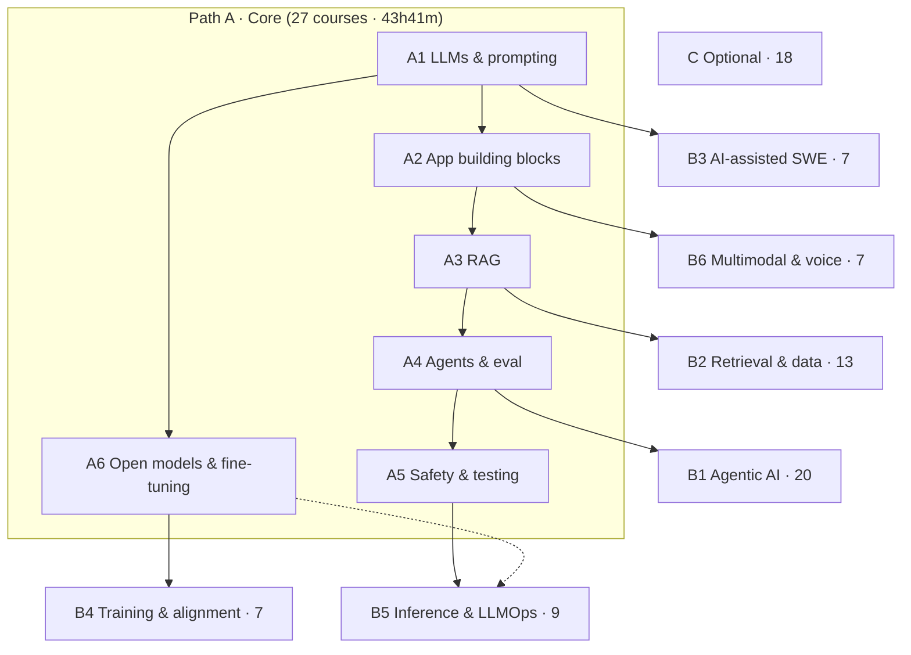

# DeepLearning.AI Short Courses — Roadmap Home
> [!info] 108 short courses, ordered as a learning path · Progress: [[00. Learning Tracker]]
> Source: *DeepLearning.AI Short Courses — Catalog Analysis & Learning Roadmap* (Project doc) · Catalog: https://www.deeplearning.ai/courses?types=short_course

> [!tip] How this folder works
> - One folder per **stage** (`A1 …`, `B1.1 …`, `C …`), each with a stage note holding the objective, entry requirements and consolidation project.
> - One folder per **course** inside it (`01 Course name/`), numbered in study order. The course note is the home; put lesson notes beside it.
> - Change `status` in a course's properties: `not-started` → `in-progress` → `done`. The tables below update themselves.
> - ← / → links in every course note follow the global roadmap order (1–108).

> [!important] My route (AI/ML engineer goal)
> Finish **Path A** → then **B4** (training) and **B5** (inference & LLMOps) → add **B1** for agent-focused roles.
> Path A alone is ~118 h with practice and one project per stage (~12 weeks at 10 h/week).
> Gap: no short course covers classical ML, NN training basics or the maths — that's the [[ML Specialization - Course Home|ML Specialization]] and Maths for ML.

## The map


## Stages
| Stage | Courses | Video time | Essential |
|---|---|---|---|
| [[A1 LLMs & Prompting]] | 4 | 6h35m | 3 |
| [[A2 LLM App Building Blocks]] | 5 | 7h22m | 3 |
| [[A3 RAG & Retrieval]] | 5 | 6h24m | 5 |
| [[A4 Agents, Tools & Evaluation]] | 5 | 10h10m | 3 |
| [[A5 Safety & Testing]] | 3 | 4h33m | 3 |
| [[A6 Open Models & Fine-tuning]] | 5 | 8h37m | 4 |
| [[B1.1 Multi-Agent & Protocols]] | 5 | 9h26m | — |
| [[B1.2 Agent Memory]] | 6 | 8h21m | — |
| [[B1.3 Agent Reliability & Governance]] | 5 | 7h12m | — |
| [[B1.4 Specialised Agents]] | 4 | 4h54m | — |
| [[B2.1 Advanced Retrieval & KGs]] | 9 | 15h48m | — |
| [[B2.2 Document & Multimodal Pipelines]] | 4 | 6h53m | — |
| [[B3 AI-Assisted Software Engineering]] | 7 | 10h01m | — |
| [[B4 Model Training & Alignment]] | 7 | 10h50m | — |
| [[B5.1 Inference Efficiency]] | 5 | 8h17m | — |
| [[B5.2 LLMOps & MLOps]] | 4 | 6h16m | — |
| [[B6 Multimodal, Vision & Voice]] | 7 | 10h01m | — |
| [[C Optional & Overlapping]] | 18 | 26h29m | — |

## Up next
```base
filters:
  and:
    - type == "course"
    - provider == "DeepLearning.AI"
    - status != "done"
views:
  - type: table
    name: Next 8 in order
    order:
      - order
      - file.name
      - stage
      - status
      - roadmap_priority
      - duration_min
    sort:
      - property: order
        direction: ASC
    limit: 8
  - type: table
    name: In progress
    filters:
      and:
        - status == "in-progress"
    order:
      - file.name
      - stage
      - started
```

## All courses
```base
filters:
  and:
    - type == "course"
    - provider == "DeepLearning.AI"
views:
  - type: table
    name: By stage
    groupBy:
      property: stage
      direction: ASC
    order:
      - order
      - file.name
      - status
      - roadmap_priority
      - duration_min
      - level
      - partner
    sort:
      - property: order
        direction: ASC
  - type: table
    name: Essentials only
    filters:
      and:
        - roadmap_priority == "Essential"
    order:
      - order
      - file.name
      - status
      - duration_min
    sort:
      - property: order
        direction: ASC
  - type: table
    name: Done
    filters:
      and:
        - status == "done"
    order:
      - file.name
      - stage
      - finished
```
