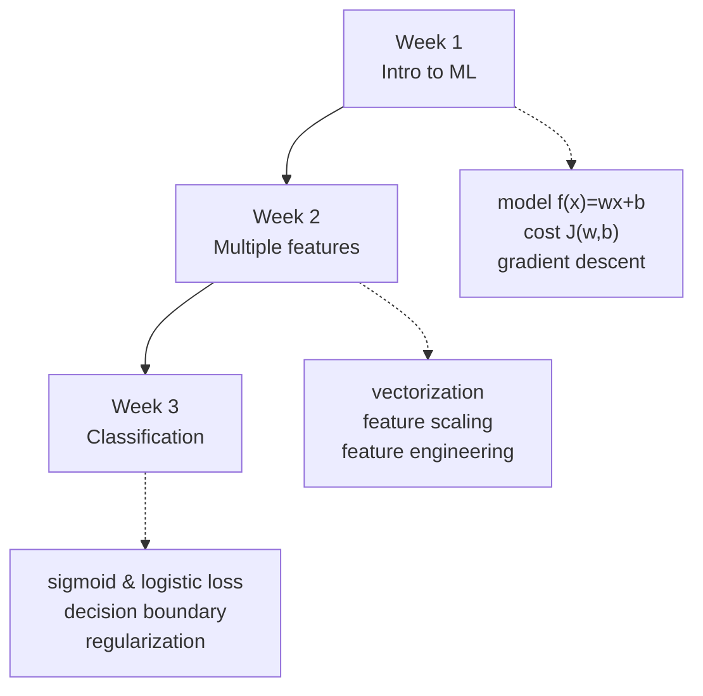

# Course 1 — Supervised Machine Learning: Regression and Classification
> [!info] ↑ [[ML Specialization - Course Home]] · Next course → C2 - Advanced Learning Algorithms *(planned)*
> **Goal of the course:** build and train your first ML models in Python with NumPy and scikit-learn. You start with **linear regression** (predict a number), learn the engine that trains almost every model (**gradient descent**), then move to **logistic regression** (predict a category) and learn how to stop models from **overfitting**.

## Course map


## Weeks
| Week | Hub | Lessons | Labs |
|---|---|---|---|
| 1 — Introduction to ML | [[C1W1 - Week Hub]] | [[C1W1-01 What is Machine Learning\|01]] · [[C1W1-02 Supervised vs Unsupervised Learning\|02]] · [[C1W1-03 Linear Regression Model\|03]] · [[C1W1-04 Cost Function\|04]] · [[C1W1-05 Gradient Descent\|05]] | [[C1W1-L01 Lab - Python and Jupyter\|L01]] · [[C1W1-L02 Lab - Model Representation\|L02]] · [[C1W1-L03 Lab - Cost Function\|L03]] · [[C1W1-L04 Lab - Gradient Descent\|L04]] |
| 2 — Regression with multiple inputs | *next batch* | | |
| 3 — Classification | *planned* | | |

## The one idea that runs through Course 1
> [!abstract] Every model in this course is trained the same way
> 1. **Choose a model** $f(x)$ with parameters (e.g. $w, b$).
> 2. **Choose a cost function** $J$ that measures how wrong the model is on the training data.
> 3. **Minimise $J$** with gradient descent: repeat $w \leftarrow w - \alpha \frac{\partial J}{\partial w}$.
> Only the model and the cost change between linear and logistic regression.

## Progress
```base
filters:
  and:
    - course == "ML Specialization"
    - file.name.startsWith("C1")
views:
  - type: table
    name: Course 1 notes
    order:
      - file.name
      - note.type
      - note.status
    sort:
      - property: file.name
        direction: ASC
```
