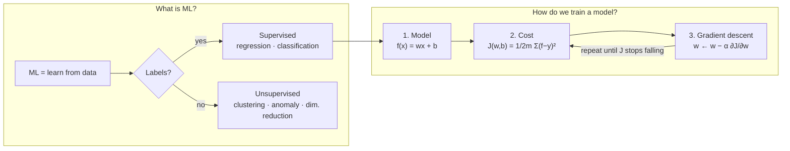

# C1W1 — Week Hub: Introduction to Machine Learning
> [!info] ↑ [[C1 - Supervised ML - Course Home|Course 1 Home]] · [[ML Specialization - Course Home|Specialization Home]] · Next week → C1W2 *(next batch)*
> LinkedIn post: [[ML Specialization - Week 01 Post]] · Code: https://github.com/rSith/machine-learning-specialization

## This week in one picture


## Lessons and labs (in course order)
| # | Lesson | Lab | Key idea |
|---|---|---|---|
| 01 | [[C1W1-01 What is Machine Learning]] | — | learn from data instead of hand-written rules |
| 02 | [[C1W1-02 Supervised vs Unsupervised Learning]] | [[C1W1-L01 Lab - Python and Jupyter]] | labels → supervised; no labels → unsupervised |
| 03 | [[C1W1-03 Linear Regression Model]] | [[C1W1-L02 Lab - Model Representation]] | $f_{w,b}(x) = wx + b$ |
| 04 | [[C1W1-04 Cost Function]] | [[C1W1-L03 Lab - Cost Function]] | $J(w,b)$ measures fit; minimise it |
| 05 | [[C1W1-05 Gradient Descent]] | [[C1W1-L04 Lab - Gradient Descent]] | step downhill: $w \leftarrow w - \alpha\,\partial J/\partial w$ |

## Key terms
| Term | Meaning (simple English) | Note |
|---|---|---|
| Supervised learning | learn $x \to y$ from examples that include the right answer | [[Supervised Learning]] |
| Unsupervised learning | find structure in data **without** labels | [[Unsupervised Learning]] |
| Regression | predict a **number** | [[Regression]] |
| Classification | predict a **category** | [[Classification]] |
| Clustering | group similar unlabelled points | [[Clustering]] |
| Feature $x$ / target $y$ | input / true output | [[C1W1-03 Linear Regression Model\|03]] |
| $m$ | number of training examples | [[C1W1-03 Linear Regression Model\|03]] |
| $\hat{y}$ | the model's prediction | [[C1W1-03 Linear Regression Model\|03]] |
| Parameters $w, b$ | weight (slope) and bias (intercept), learned in training | [[C1W1-03 Linear Regression Model\|03]] |
| Cost function $J$ | one number measuring how wrong the model is | [[Cost Function]] |
| Gradient descent | repeatedly step parameters downhill on $J$ | [[Gradient Descent]] |
| Learning rate $\alpha$ | step size in gradient descent | [[C1W1-05 Gradient Descent\|05]] |
| Convex | bowl-shaped; only one (global) minimum | [[C1W1-04 Cost Function\|04]] |
| Batch GD | every step uses **all** training examples | [[C1W1-05 Gradient Descent\|05]] |

## Equations to know
$$f_{w,b}(x) = wx + b$$
$$J(w,b) = \frac{1}{2m}\sum_{i=1}^{m}\left(f_{w,b}(x^{(i)}) - y^{(i)}\right)^2$$
$$w \leftarrow w - \alpha\frac{\partial J}{\partial w}, \quad b \leftarrow b - \alpha\frac{\partial J}{\partial b} \quad \text{(simultaneously)}$$
$$\frac{\partial J}{\partial w} = \frac{1}{m}\sum_{i=1}^{m}\left(f_{w,b}(x^{(i)}) - y^{(i)}\right)x^{(i)}, \qquad \frac{\partial J}{\partial b} = \frac{1}{m}\sum_{i=1}^{m}\left(f_{w,b}(x^{(i)}) - y^{(i)}\right)$$
→ All equations for the whole specialization: [[ML Specialization - Equation Sheet]]

## Code skeleton (from the labs)
```python
def compute_model_output(x, w, b):     # model      → L02
    return w * x + b

def compute_cost(x, y, w, b):          # cost       → L03
    return np.sum((w * x + b - y) ** 2) / (2 * len(x))

def compute_gradient(x, y, w, b):      # gradient   → L04
    err = w * x + b - y
    return np.mean(err * x), np.mean(err)

# training loop                        # GD         → L04
for i in range(num_iters):
    dj_dw, dj_db = compute_gradient(x, y, w, b)
    w, b = w - alpha * dj_dw, b - alpha * dj_db
```

## Week summary
> [!summary]
> 1. **ML** lets computers learn from examples. The main types are supervised (with labels) and unsupervised (no labels).
> 2. **Supervised learning** splits into **regression** (numbers) and **classification** (categories).
> 3. **Linear regression** models the data with a line $f_{w,b}(x) = wx + b$.
> 4. The **squared error cost** $J(w,b)$ scores how well a line fits. For linear regression it's a **convex bowl**.
> 5. **Gradient descent** finds the bottom of that bowl by repeatedly stepping against the gradient. The **learning rate** must be neither too small (slow) nor too large (diverges).

## Self-test (mixed)
> [!question]- 1. A model predicts whether a patient has diabetes (yes/no) from blood tests. Supervised or unsupervised? Regression or classification?
> Supervised **classification**.

> [!question]- 2. Write the cost function from memory and say what each part means.
> $J(w,b)=\frac{1}{2m}\sum (f_{w,b}(x^{(i)})-y^{(i)})^2$: prediction minus target, squared, summed over $m$ examples, divided by $2m$.

> [!question]- 3. Data $(1, 3), (2, 5)$. Which $w, b$ give $J = 0$?
> Solve $w + b = 3$ and $2w + b = 5$ → $w = 2$, $b = 1$.

> [!question]- 4. During training the cost goes up every iteration. Give two possible causes.
> (1) Learning rate $\alpha$ too large. (2) A bug, e.g. `w = w + alpha*dj_dw` (wrong sign) or a non-simultaneous update.

> [!question]- 5. Why do gradient descent's steps get smaller near the minimum even with a fixed $\alpha$?
> The **gradient** gets smaller as the slope flattens, and step = $\alpha \times$ gradient.

> [!question]- 6. What does each ellipse on a contour plot of $J(w,b)$ represent?
> All $(w, b)$ pairs with the **same cost**.

## Progress
- [ ] Watched all videos
- [ ] Ran all 4 optional labs
- [ ] Practice quizzes: supervised vs unsupervised · regression model · gradient descent
- [ ] Wrote the LinkedIn post → [[ML Specialization - Week 01 Post]]
