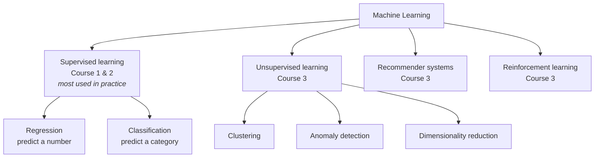

# C1W1-01 What is Machine Learning?
> [!info] Course: [[C1 - Supervised ML - Course Home|Course 1]] · Week: [[C1W1 - Week Hub]] · Concept: [[Machine Learning]]
> ← [[C1W1 - Week Hub]] | [[C1W1-02 Supervised vs Unsupervised Learning]] →

**Videos covered:** Welcome to machine learning! · Applications of machine learning · What is machine learning?

## Topic checklist
- [ ] Explain what machine learning is, in one sentence
- [ ] Give examples of ML you use every day
- [ ] Name the main types of ML algorithms covered in the specialization
- [ ] Explain why *knowing how to apply* ML matters as much as knowing the algorithms

## Notes

### 1. ML is already everywhere
You use machine learning many times a day, often without noticing:
- **Web search** ranks pages so the useful ones come first.
- **Photo apps** recognise friends' faces and tag them.
- **Streaming apps** recommend movies you might like.
- **Voice assistants** turn speech into text ("Hey Siri, play a song").
- **Email** filters spam.

It is also used in industry: optimising wind turbines, helping doctors read X-rays, and **visual inspection** in factories (finding defects on a production line).

### 2. Why do we need ML?
Some tasks are easy to program step by step (e.g. *find the shortest path on a map*). But for many tasks **nobody knows how to write the rules**:
- What exact rules tell a cat photo from a dog photo?
- What rules turn sound waves into words?

ML solves this by letting the computer **learn the rules from examples** instead.

> [!note] Definition (Arthur Samuel, 1959)
> Machine learning is the *"field of study that gives computers the ability to learn without being explicitly programmed."*

**Samuel's checkers program** is the classic example. Samuel was not a strong checkers player. He made the computer play **tens of thousands of games against itself**. It learned which board positions tended to win and which tended to lose. In the end, it played better than Samuel himself.

> [!tip] Key lesson from the checkers story
> **More data / more practice → better learning.** If the program had played only 10 games instead of 10,000, it would have learned much less. This idea comes back again and again in the course.

### 3. Types of machine learning in this specialization

- **Supervised learning** gets the most real-world use and the fastest progress, so Courses 1 and 2 focus on it.
- **Unsupervised learning, recommender systems and reinforcement learning** are covered in Course 3.

### 4. Tools *and* the skill of using them
Andrew Ng's analogy: giving someone a hammer and a drill doesn't make them a good carpenter. You also need to know **how to apply** the tools well.
- Even experienced teams sometimes spend **months** on an approach that was never going to work.
- This course teaches **best practices** for building ML systems (mostly in Course 2, Week 3: [[Model Evaluation]], bias and variance, error analysis).

### 5. The bigger picture: AI and AGI
- ML is a sub-field of [[Artificial Intelligence]]. Today it is the main way AI systems are built. See also [[AI Terminology - The Big Picture]].
- **AGI (artificial general intelligence)** means a machine as intelligent as a human. Andrew Ng thinks it is still far away (possibly decades or more). Learning algorithms that mimic how the brain learns may be one path towards it.
- McKinsey estimated that AI and ML could create around **$13 trillion** of value a year by 2030. Much of it will be outside software, in retail, transport, manufacturing, agriculture and healthcare. This is why ML engineers are in demand.

## Key definitions
> [!note] Machine learning
> Getting computers to **learn from data** (examples) instead of following hand-written rules.

> [!note] Algorithm vs model
> - An **algorithm** is the *learning procedure* (e.g. gradient descent).
> - A **model** is what it produces: a function that makes predictions (e.g. $f(x) = 200x + 100$).

> [!note] AGI
> Artificial *general* intelligence: AI that could do any intellectual task a human can. This is different from today's *narrow* AI, which does one task well (e.g. spam filtering).

## Summary (in my own words)
Machine learning lets computers **learn patterns from examples** instead of being programmed rule by rule. That is why it works for problems like recognising images and speech. The four big families are supervised learning, unsupervised learning, recommender systems and reinforcement learning. Supervised learning is the most widely used, so it comes first. Knowing *how to apply* algorithms well (practical judgment) matters as much as knowing the algorithms themselves.

## Review questions
> [!question]- Q1. Why is ML useful for recognising cats in photos, but not needed for finding the shortest route on a map?
> Shortest route has a known step-by-step algorithm (e.g. Dijkstra). For cats, nobody can write down precise rules. ML **learns** those rules from many labelled examples.

> [!question]- Q2. In Samuel's checkers program, what would happen with only 10 practice games instead of tens of thousands?
> It would perform **worse**. More data and experience generally make a learning algorithm better.

> [!question]- Q3. Which type of ML is used most in real-world applications today?
> **Supervised learning**.

## Open questions
- [ ] Which of my projects (e.g. [[PlantFolio - Project Home|PlantFolio]] leaf disease detection) are supervised learning problems?
