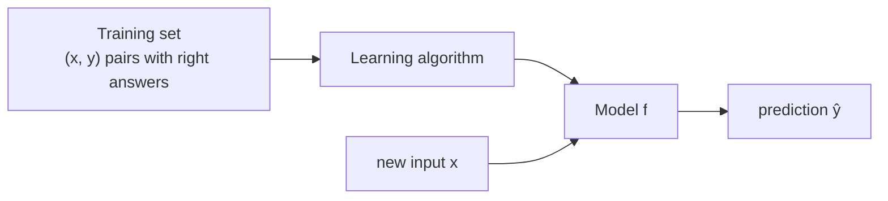
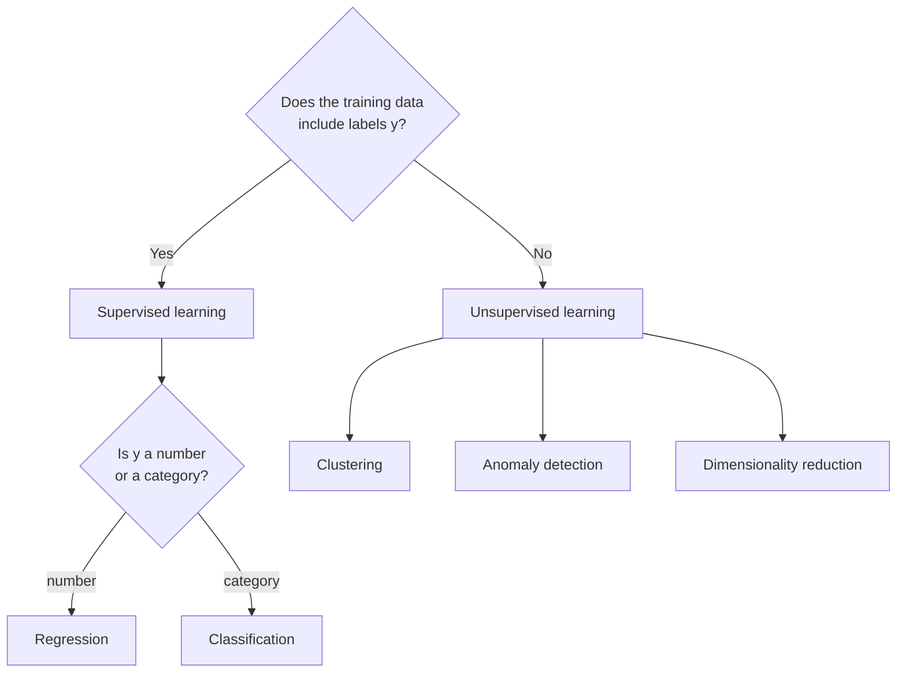

# C1W1-02 Supervised vs Unsupervised Learning
> [!info] Course: [[C1 - Supervised ML - Course Home|Course 1]] · Week: [[C1W1 - Week Hub]] · Concepts: [[Supervised Learning]] · [[Unsupervised Learning]]
> ← [[C1W1-01 What is Machine Learning]] | [[C1W1-03 Linear Regression Model]] →
> Lab: [[C1W1-L01 Lab - Python and Jupyter]]

**Videos covered:** Supervised learning part 1 & 2 · Unsupervised learning part 1 & 2 · Jupyter Notebooks

## Topic checklist
- [ ] Define supervised learning using the words *input x*, *output label y*, *right answers*
- [ ] Tell **regression** from **classification**
- [ ] Define unsupervised learning and give 3 types: clustering, anomaly detection, dimensionality reduction
- [ ] Decide whether a given problem is supervised or unsupervised

![[c1w1_supervised_vs_unsupervised.png]]
*Left: every point has a label (o = benign, x = malignant), so the algorithm learns a boundary. Right: no labels; the algorithm discovers the three groups by itself.*

## Notes

### Part A — Supervised learning: learning x → y from "right answers"
**Supervised learning** algorithms learn a mapping from **input x** to **output y**. You train them with examples that include the **right answer** (the label $y$) for each input. After seeing enough (x, y) pairs, the model can predict $y$ for a **new x** it has never seen.

| Input (x) | Output (y) | Application |
|---|---|---|
| email | spam? (0/1) | spam filtering |
| audio clip | text transcript | speech recognition |
| English text | Spanish text | machine translation |
| ad + user info | click? (0/1) | online advertising (very profitable!) |
| image + radar | positions of other cars | self-driving cars |
| image of a phone | defect? (0/1) | visual inspection in factories |

Supervised learning has **two main types**:

#### A1. Regression: predict a **number** (from infinitely many possible values)
- *Example:* predict a house's price from its size.
- With a plot of price vs size, you could fit a **straight line** or a **curve**. Choosing the best fit is the algorithm's job, and the rest of Course 1 shows how it does it.
- Output can be **any number**: 150 000, 183 250.5, …

#### A2. Classification: predict a **category** (from a small, fixed set)
- *Example:* breast cancer detection. Is a tumour **benign (0)** or **malignant (1)**?
- Outputs are **classes** or **categories**. They don't have to be numbers: *cat / dog*, *benign / type 1 / type 2*.
- Can use **more than one input**: tumour size **and** patient age. The algorithm then learns a **boundary** that separates the classes (left plot above).

> [!tip] Quick test: regression or classification?
> Ask: *"Is the output a number on a continuous scale, or one of a few named categories?"*
> - number → **regression** (house price, temperature, sales)
> - category → **classification** (spam/not spam, digit 0–9, disease type)

### Part B — Unsupervised learning: find structure in **unlabelled** data
In **unsupervised learning** the data has **inputs x only, no labels y**. We are not asking for a right answer. We ask the algorithm to **find something interesting**: patterns, groups or structure.

It's called *unsupervised* because we don't supervise it with right answers.

#### B1. Clustering: group similar points together
- **Google News** groups thousands of articles about the same story (e.g. many articles using the words *panda*, *twin*, *zoo*) without anyone labelling them.
- **DNA microarray data**: groups people by which genes are active, so different "types" of people appear without being defined in advance.
- **Customer segmentation**: groups customers by behaviour (e.g. learners who want skills, career changers, people keeping up with AI).

#### B2. Anomaly detection: find unusual data points
- Fraud detection in banking: spot transactions that look unlike normal ones. → covered in Course 3 Week 1.

#### B3. Dimensionality reduction: compress data while losing little information
- Take a big dataset and squeeze it into fewer numbers. → PCA in Course 3 Week 2. Concept: [[Dimensionality Reduction]].

### Part C — Jupyter Notebooks
- Jupyter Notebooks are the standard tool ML engineers use to try ideas. Every lab in this course is a notebook.
- **Markdown cells** hold text and explanations. **Code cells** hold Python you can run (Shift + Enter).
- Labs come in two kinds:
  - **Optional labs**: just open and run; they show working code (great for understanding).
  - **Practice labs**: you write the code yourself (graded).
- → See [[C1W1-L01 Lab - Python and Jupyter]].

## Key definitions
> [!note] Label (y) / target
> The "right answer" attached to each training example in supervised learning.

> [!note] Regression
> Supervised learning where the output is a **continuous number**. Concept: [[Regression]].

> [!note] Classification
> Supervised learning where the output is a **category** from a small set. Concept: [[Classification]].

> [!note] Clustering
> Unsupervised learning that puts **similar** unlabelled points in the same group. Concept: [[Clustering]].

## Summary (in my own words)
**Supervised** = learn from examples that come with the right answer, then predict answers for new inputs. If the answer is a number, it's **regression**. If it's a category, it's **classification**. **Unsupervised** = no answers given; the algorithm finds structure by itself, such as **clusters**, **anomalies** or a **compressed** version of the data.

## Review questions
> [!question]- Q1. Spam filter: supervised or unsupervised? Regression or classification?
> **Supervised** (emails are labelled spam / not spam) and **classification** (two categories).

> [!question]- Q2. Grouping news articles about the same story: which type?
> **Unsupervised: clustering.** Nobody labels the stories in advance.

> [!question]- Q3. Predicting tomorrow's temperature in °C?
> **Supervised regression.** The output is a continuous number.

> [!question]- Q4. Why can classification output "cat" or "dog" while regression can't?
> Classification predicts from a **finite set of categories** (which may be words). Regression predicts a number on a **continuous scale**.

## Open questions
- [ ] Where does **semi-supervised** learning fit? (few labels + many unlabelled) → [[Semi-Supervised Learning]]
