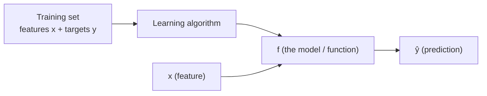

# C1W1-03 Linear Regression Model
> [!info] Course: [[C1 - Supervised ML - Course Home|Course 1]] · Week: [[C1W1 - Week Hub]] · Concepts: [[Simple Linear Regression]] · [[Linear Regression]]
> ← [[C1W1-02 Supervised vs Unsupervised Learning]] | [[C1W1-04 Cost Function]] →
> Lab: [[C1W1-L02 Lab - Model Representation]]

**Videos covered:** Linear regression model part 1 · Linear regression model part 2

## Topic checklist
- [ ] Use the standard notation: $x$, $y$, $m$, $(x^{(i)}, y^{(i)})$, $\hat{y}$
- [ ] Describe the supervised learning workflow: training set → algorithm → $f$
- [ ] Write the linear regression model $f_{w,b}(x) = wx + b$ and explain $w$ and $b$
- [ ] Use a fitted model to make a prediction

## Notes

### Step 1 — The problem: predict house prices
You have data on houses in Portland: **size** (sq ft) and **price**. A friend wants to sell a **1250 sq ft** house. What price should they expect?

Plot the data (size on the x-axis, price on the y-axis), draw the **best-fitting straight line**, then read off the price at 1250 sq ft (about $220k in the lecture).

This is:
- **supervised learning**, because each house in the data comes with its right answer (the price), and
- **regression**, because the output is a number.

### Step 2 — Notation (memorise this; the whole course uses it)
| Symbol | Meaning | Example (house data) |
|---|---|---|
| $x$ | **input** variable / **feature** | size in 1000 sq ft |
| $y$ | **output** variable / **target** | price in $1000s |
| $m$ | number of **training examples** | 47 houses |
| $(x, y)$ | **one** training example | (2.104, 400) |
| $(x^{(i)}, y^{(i)})$ | the $i$-th training example | $x^{(1)} = 2.104,\ y^{(1)} = 400$ |
| $\hat{y}$ ("y-hat") | the model's **prediction** (an estimate of $y$) | 220 |

> [!warning] $x^{(i)}$ is **not** a power
> The superscript $(i)$ in brackets is an **index** (which example), not "x to the power i". In Python we write it `x[i]`. Python indexes from 0, so the first example is `x[0]`.

### Step 3 — The supervised learning workflow

1. Feed the **training set** (inputs *and* right answers) to a **learning algorithm**.
2. The algorithm outputs a **function** $f$, which is the **model**.
3. Give $f$ a new $x$ and it outputs $\hat{y}$, the prediction.

The key question: **how do we represent $f$?**

### Step 4 — The linear regression model
For now, $f$ is a **straight line**:
$$f_{w,b}(x) = wx + b$$
- $w$ = **weight** (the **slope**: how much the price goes up for each extra unit of size)
- $b$ = **bias** (the **intercept**: the value where the line crosses the y-axis)
- $w$ and $b$ are the **parameters** of the model. Training means **finding good values** for them.
- Shorthand: $f(x)$ means $f_{w,b}(x)$.

With one input feature this is called **linear regression with one variable**, or **univariate linear regression**. Concept note: [[Simple Linear Regression]].

![[c1w1_linear_regression_model.png]]
*The lab's two houses: (1.0, 300) and (2.0, 500). The line $w=200, b=100$ passes exactly through both. For a 1200 sq ft house ($x = 1.2$): $\hat{y} = 200(1.2) + 100 = 340$, i.e. **$340 000**.*

> [!example] Worked example — how $w$ and $b$ change the line
> | $w$ | $b$ | Line | Prediction at $x = 1.2$ |
> |---|---|---|---|
> | 0 | 150 | flat: always 150 | 150 |
> | 0.5 | 0 | through origin, gentle slope | 0.6 |
> | 200 | 100 | fits the two houses | **340** |
> | 100 | 100 | too flat: under-predicts | 220 |
> Changing $w$ **tilts** the line; changing $b$ **moves it up or down**.

### Step 5 — Why start with a straight line?
A line is the simplest model, and it's easy to understand and train. Later you'll fit **curves** (polynomial regression, C1W2) and much more complex functions ([[Neural Network|neural networks]], Course 2). The training ideas you learn here (cost function and gradient descent) carry over to all of them.

## Key definitions
> [!note] Feature / input variable ($x$)
> The information fed into the model to make a prediction.

> [!note] Target / output variable ($y$)
> The true value we want the model to predict.

> [!note] Parameters ($w$, $b$)
> Variables the learning algorithm **adjusts during training** to improve the model. Also called **coefficients** or **weights**.

> [!note] Model ($f$)
> The function learned from data that maps $x \to \hat{y}$.

## Summary (in my own words)
Linear regression fits a **straight line** $f_{w,b}(x) = wx + b$ through the training data. $w$ is the slope and $b$ the intercept. The training set has $m$ examples, each written $(x^{(i)}, y^{(i)})$. Once we've found good $w$ and $b$, predicting is just plugging a new $x$ into the line to get $\hat{y}$. **Next question:** how do we *measure* which line is "good"? → [[C1W1-04 Cost Function]].

## Review questions
> [!question]- Q1. In the notation, what is the difference between $y$ and $\hat{y}$?
> $y$ is the **true** target in the training set. $\hat{y}$ is the model's **prediction** (an estimate).

> [!question]- Q2. With $w = 150$, $b = 50$ (units: $1000s, 1000 sq ft), predict the price for 1500 sq ft.
> $x = 1.5$ → $\hat{y} = 150(1.5) + 50 = 275$ → **$275 000**.

> [!question]- Q3. What is $m$, and what does $x^{(3)}$ mean?
> $m$ = number of training examples. $x^{(3)}$ = the input feature of the **3rd** training example (it's `x[2]` in Python).

> [!question]- Q4. What does changing only $b$ do to the line?
> It shifts the whole line **up or down** without changing its slope.
