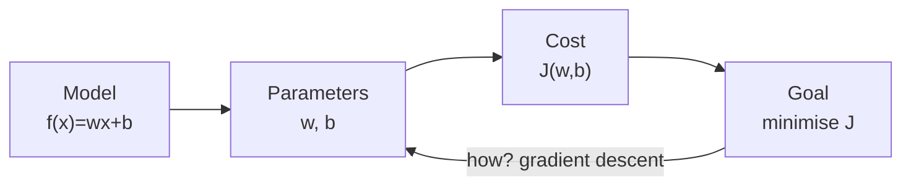

# C1W1-04 Cost Function
> [!info] Course: [[C1 - Supervised ML - Course Home|Course 1]] · Week: [[C1W1 - Week Hub]] · Concepts: [[Cost Function]] · [[Simple Linear Regression]]
> ← [[C1W1-03 Linear Regression Model]] | [[C1W1-05 Gradient Descent]] →
> Lab: [[C1W1-L03 Lab - Cost Function]]

**Videos covered:** Cost function formula · Cost function intuition · Visualizing the cost function · Visualization examples

## Topic checklist
- [ ] Explain **why** we need a cost function
- [ ] Write the squared error cost $J(w,b)$ and explain each piece
- [ ] Compute $J$ by hand for a tiny dataset
- [ ] Read a plot of $J(w)$, a 3D surface plot and a contour plot of $J(w,b)$
- [ ] State the goal of training: $\min_{w,b} J(w,b)$

## Notes

### Step 1 — Why we need a cost function
Different values of $w$ and $b$ give different lines. Some fit the data well and some badly. We need a **single number** that tells us **how well a given $(w, b)$ fits the training data**. That number is the **cost**, $J(w,b)$:
- small $J$ → predictions are close to the targets → **good** fit
- large $J$ → predictions are far off → **bad** fit

### Step 2 — Build the formula piece by piece
For one example $i$:
1. **Prediction:** $\hat{y}^{(i)} = f_{w,b}(x^{(i)}) = wx^{(i)} + b$
2. **Error:** $\hat{y}^{(i)} - y^{(i)}$ (how far off we are; can be + or −)
3. **Squared error:** $(\hat{y}^{(i)} - y^{(i)})^2$ (always positive, and big errors count much more)

Then **add up over all $m$ examples** and take the **average**. Divide by $2m$ instead of $m$; the extra $\frac{1}{2}$ just makes the derivative tidier later:

$$\boxed{J(w,b) = \frac{1}{2m}\sum_{i=1}^{m}\left(f_{w,b}(x^{(i)}) - y^{(i)}\right)^2}$$

This is the **squared error cost function**. It is the standard choice for regression.

> [!tip] Why divide by $m$?
> So the cost doesn't grow just because you have more data. It becomes an **average** error per example, which you can compare across datasets of different sizes.

> [!tip] Why square the error?
> 1. Positive and negative errors don't cancel out.
> 2. Big mistakes are punished more than small ones.
> 3. It makes $J$ a smooth, **convex** "bowl" with only one minimum, which is perfect for gradient descent.

### Step 3 — The goal of training
$$\text{find } w, b \text{ that } \underset{w,b}{\text{minimise}}\ J(w,b)$$

### Step 4 — Intuition with a simplified model ($b = 0$)
To build intuition, the lecture sets $b = 0$, so $f_w(x) = wx$ (lines through the origin), with training data $(1,1), (2,2), (3,3)$.

> [!example] Worked example — compute $J(w)$ by hand
> | $w$ | predictions for x = 1, 2, 3 | errors | $J(w) = \frac{1}{2 \cdot 3}\sum \text{err}^2$ |
> |---|---|---|---|
> | 1 | 1, 2, 3 | 0, 0, 0 | $\frac{1}{6}(0) = \mathbf{0}$ |
> | 0.5 | 0.5, 1, 1.5 | −0.5, −1, −1.5 | $\frac{1}{6}(0.25+1+2.25) = \mathbf{0.58}$ |
> | 0 | 0, 0, 0 | −1, −2, −3 | $\frac{1}{6}(1+4+9) = \mathbf{2.33}$ |
> | −0.5 | −0.5, −1, −1.5 | −1.5, −3, −4.5 | $\frac{1}{6}(2.25+9+20.25) = \mathbf{5.25}$ |
> Plot $J$ against $w$ and you get a **U-shaped curve** with its lowest point at $w = 1$, the line that fits the data perfectly.

**Two linked views:**
- Left plot: $f_w(x)$ for **one fixed** $w$ (a function of $x$).
- Right plot: $J(w)$ as a function of the **parameter** $w$. Each point on it is a whole line on the left.

![[c1w1_cost_intuition.png]]
*Lab data (1, 300), (2, 500) with $b = 100$ fixed. $w = 200$ fits perfectly (J = 0). $w = 100$ and $w = 300$ are equally wrong (J = 12 500), which is why the curve is symmetric.*

### Step 5 — Both parameters: 3D surface and contour plot
When **both** $w$ and $b$ can change, $J(w,b)$ is a **3D surface** shaped like a **bowl** (a soup bowl or hammock).

A **contour plot** is the same bowl seen **from above**, like a topographic map of a mountain:
- each **ellipse** joins all $(w, b)$ pairs that have the **same cost**
- the **centre** of the smallest ellipse is the **minimum**
- points on the same ellipse give *different lines* with *equally good (or bad)* fits

![[c1w1_cost_surface_contour.png]]
*Left: the squared-error cost is always a convex bowl. Right: contour plot for the lab's 6-house dataset. The minimum is at about $w = 209$, $b = 2.4$. These points don't all lie on one line, so the minimum cost is **not** zero.*

> [!example] Reading the contour plot (from the "Visualization examples" video)
> - A point **far from the centre** (e.g. $w = -0.15$, $b = 800$) is a line that **slopes the wrong way** and fits terribly.
> - A point **near the centre** is a line that fits the data well.
> - Pick points by hand and you can get close, but we want an algorithm that does it **automatically** → [[C1W1-05 Gradient Descent]].

## Key definitions
> [!note] Cost function $J$
> A function of the **parameters** that measures how badly the model fits the training data. Concept: [[Cost Function]].

> [!note] Squared error cost
> $J = \frac{1}{2m}\sum(\hat{y}^{(i)} - y^{(i)})^2$. Half the mean of the squared errors.

> [!note] Contour plot
> A 2D "top view" of a 3D surface. Each curve joins points with equal height (equal cost).

> [!note] Convex function
> A bowl-shaped function with a **single global minimum** and no other local minima.

## Summary (in my own words)
The cost function $J(w,b)$ turns "how good is this line?" into one number: the average squared gap between predictions and true values (divided by 2). Training = finding the $w, b$ at the bottom of $J$. With one parameter, $J$ is a U-shaped curve. With two, it's a bowl, which we can draw in 3D or as a contour map. For linear regression this bowl is **convex**, so it has exactly one best answer.

## Review questions
> [!question]- Q1. If $J(w,b) = 0$, what does that mean?
> Every prediction equals its target exactly, so the line passes **through every training point**.

> [!question]- Q2. Data: $(1, 2), (2, 4)$, model $f(x) = wx$ with $w = 1$. Compute $J$.
> Predictions: 1, 2. Errors: −1, −2. $J = \frac{1}{2\cdot 2}(1 + 4) = \mathbf{1.25}$.

> [!question]- Q3. Two points lie on the same contour ellipse. What do they have in common?
> They have the **same cost** $J$, even though they represent different lines.

> [!question]- Q4. What is the input to $J$: $x$, or $w$ and $b$?
> $J$ is a function of the **parameters $w, b$**. The data $x, y$ is fixed while we search.

## Open questions
- [ ] Why does the 1/2 make the derivative "neater"? → answered in [[C1W1-05 Gradient Descent]] (the 2 from the square cancels it).
