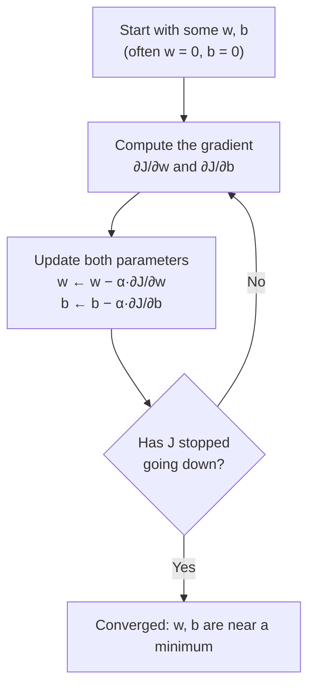

# C1W1-05 Gradient Descent
> [!info] Course: [[C1 - Supervised ML - Course Home|Course 1]] · Week: [[C1W1 - Week Hub]] · Concepts: [[Gradient Descent]] · [[Cost Function]]
> ← [[C1W1-04 Cost Function]] | [[C1W1 - Week Hub]] →
> Lab: [[C1W1-L04 Lab - Gradient Descent]]

**Videos covered:** Gradient descent · Implementing gradient descent · Gradient descent intuition · Learning rate · Gradient descent for linear regression · Running gradient descent

## Topic checklist
- [ ] Describe gradient descent as "walking downhill"
- [ ] Write the update rule and do a **simultaneous** update correctly
- [ ] Explain the role of the derivative (direction) and of $\alpha$ (step size)
- [ ] Explain what happens when $\alpha$ is too small or too large
- [ ] Derive the gradient formulas for linear regression
- [ ] Explain "batch" gradient descent and why linear regression has no local-minimum problem

## Notes

### Step 1 — The idea: walk downhill
We want $\min_{w,b} J(w,b)$. **Gradient descent** is an algorithm that finds the minimum of almost any function, not only linear regression's cost. It is also used to train deep [[Neural Network|neural networks]].

**The hill analogy:** imagine standing on a hilly golf course (the surface of $J$) and wanting to reach a valley.
1. Look all around you and find the direction of **steepest descent**.
2. Take a **small step** that way.
3. Repeat until you're at the bottom, where every direction goes up.



> [!warning] Local minima
> On a general bumpy surface, **where you start decides which valley you end in**. Each valley bottom is a **local minimum**.
> **Good news:** the squared-error cost for linear regression is a **convex bowl**, so it has **only one minimum, the global one**. Gradient descent always gets there (if $\alpha$ is sensible).

### Step 2 — The update rule
Repeat until convergence:
$$w = w - \alpha \frac{\partial}{\partial w}J(w,b) \qquad\qquad b = b - \alpha \frac{\partial}{\partial b}J(w,b)$$
- $=$ here means **assignment** (like `w = w - ...` in Python), not a maths equality.
- $\alpha$ (alpha) = **learning rate**: how big a step to take (a small positive number, e.g. 0.01).
- $\frac{\partial J}{\partial w}$ = **derivative** (slope): which direction is uphill, and how steep.

> [!important] Update **simultaneously**
> Compute **both** derivatives using the **old** $w$ and $b$ first, then update both:
> ```python
> tmp_w = w - alpha * dj_dw(w, b)   # uses old w, b
> tmp_b = b - alpha * dj_db(w, b)   # still uses old w, b
> w, b = tmp_w, tmp_b               # now overwrite both
> ```
> ❌ **Wrong:** updating `w` first and then using the *new* `w` to compute `dj_db`. That is a different (incorrect) algorithm.

### Step 3 — Why the derivative points the right way
Simplify to one parameter, $J(w)$:
- At a point where the **slope is positive** (right of the minimum): $w - \alpha \cdot (\text{positive})$ → $w$ **decreases** → moves left, downhill ✅
- At a point where the **slope is negative** (left of the minimum): $w - \alpha \cdot (\text{negative})$ → $w$ **increases** → moves right, downhill ✅
- **At the minimum, the slope is 0**, so $w$ stops changing.

![[c1w1_derivative_intuition.png]]

### Step 4 — The learning rate $\alpha$
![[c1w1_learning_rate.png]]
| $\alpha$ | What happens |
|---|---|
| **too small** | tiny baby steps: it works but is **very slow** |
| **just right** | reaches the minimum quickly |
| **too large** | **overshoots** the minimum, bounces from side to side, and may **diverge** (cost goes **up**) |

> [!tip] Why steps shrink by themselves near the minimum
> Even with a **fixed** $\alpha$, the steps get smaller as you approach the minimum, because the **derivative gets smaller** (the slope flattens). So you don't need to reduce $\alpha$ over time.

> [!question]- What if $w$ is already at a local minimum?
> The derivative is 0, so $w = w - \alpha \cdot 0 = w$. Gradient descent leaves it unchanged.

### Step 5 — Gradient descent for linear regression (the formulas)
Plug in $f_{w,b}(x) = wx + b$ and $J(w,b) = \frac{1}{2m}\sum_{i=1}^{m}(f_{w,b}(x^{(i)}) - y^{(i)})^2$:

$$\frac{\partial J}{\partial w} = \frac{1}{m}\sum_{i=1}^{m}\left(f_{w,b}(x^{(i)}) - y^{(i)}\right)x^{(i)}$$
$$\frac{\partial J}{\partial b} = \frac{1}{m}\sum_{i=1}^{m}\left(f_{w,b}(x^{(i)}) - y^{(i)}\right)$$

> [!example]- Derivation (optional calculus, step by step)
> Let $e^{(i)} = wx^{(i)} + b - y^{(i)}$ (the error).
> 1. $J = \frac{1}{2m}\sum (e^{(i)})^2$
> 2. Chain rule: $\frac{\partial}{\partial w}(e^{(i)})^2 = 2e^{(i)} \cdot \frac{\partial e^{(i)}}{\partial w} = 2e^{(i)}x^{(i)}$
> 3. So $\frac{\partial J}{\partial w} = \frac{1}{2m}\sum 2e^{(i)}x^{(i)} = \frac{1}{m}\sum e^{(i)}x^{(i)}$. **The 2 cancels the ½.** That's why we put ½ in $J$.
> 4. For $b$: $\frac{\partial e^{(i)}}{\partial b} = 1$, so $\frac{\partial J}{\partial b} = \frac{1}{m}\sum e^{(i)}$.

> [!example] Worked example — one step by hand
> Data $(1, 300), (2, 500)$, start $w = 0, b = 0$, $\alpha = 0.01$.
> - Predictions: 0, 0 → errors: −300, −500
> - $\frac{\partial J}{\partial w} = \frac{1}{2}[(-300)(1) + (-500)(2)] = -650$
> - $\frac{\partial J}{\partial b} = \frac{1}{2}[-300 - 500] = -400$
> - $w = 0 - 0.01(-650) = \mathbf{6.5}$, $b = 0 - 0.01(-400) = \mathbf{4.0}$
> - Both derivatives were negative, so both parameters **increased**: towards the answer $(200, 100)$. ✅

### Step 6 — Running it
![[c1w1_gradient_descent_path.png]]
- Left: the path on the contour plot. **Big steps at first**, then **tiny steps** as the slope flattens near the minimum.
- Right: **cost vs iterations** (a *learning curve*). The cost should **decrease every iteration**. If it ever goes up, $\alpha$ is probably too large (or there's a bug).
- On the lab data, 10 000 iterations with $\alpha = 0.01$ reach $w \approx 200$, $b \approx 100$.

> [!note] "Batch" gradient descent
> Each step uses **all $m$ training examples** (the full sum $\sum_{i=1}^{m}$). That's called **batch** gradient descent. Other versions use small subsets (mini-batches). You'll meet them in Course 2 and Course 3.

## Key definitions
> [!note] Gradient descent
> An iterative algorithm that repeatedly steps the parameters in the direction that **reduces** the cost: $\theta \leftarrow \theta - \alpha \nabla J$. Concept: [[Gradient Descent]].

> [!note] Learning rate ($\alpha$)
> A positive number that controls step size. Too small = slow, too large = diverges.

> [!note] Convergence
> When further steps barely change the parameters or the cost: you've reached (or are very near) a minimum.

> [!note] Local vs global minimum
> A local minimum is lowest in its neighbourhood. The global minimum is lowest everywhere. Convex functions have only a global minimum.

## Summary (in my own words)
Gradient descent finds the bottom of the cost bowl by repeatedly computing the slope (gradient) and taking a step **downhill**: $w \leftarrow w - \alpha\,\partial J/\partial w$ (same for $b$, updated at the same time). The **sign** of the derivative sets the direction. The **size** of the derivative and $\alpha$ set the step size. Choose $\alpha$ carefully. For linear regression the gradients are just averages of "error × input" (for $w$) and "error" (for $b$). Since the cost is convex, gradient descent always finds the single best line.

## Review questions
> [!question]- Q1. The derivative $\partial J/\partial w$ at the current $w$ is −20. Does $w$ go up or down?
> $w \leftarrow w - \alpha(-20) = w + 20\alpha$, so $w$ **increases**.

> [!question]- Q2. Your cost goes 120 → 180 → 390 → 1100. What is wrong?
> The cost is **increasing**: $\alpha$ is **too large** (overshooting / diverging), or there's a bug such as a wrong sign in the update.

> [!question]- Q3. Why don't we need to shrink $\alpha$ as we get close to the minimum?
> Because the **derivative itself** shrinks towards 0 near the minimum, so the steps get smaller automatically.

> [!question]- Q4. What does "batch" mean in batch gradient descent?
> Each update uses **all** the training examples.

> [!question]- Q5. Why can't linear regression with squared error get stuck in a bad local minimum?
> Its cost function is **convex** (one bowl), so it has only a **global** minimum.

## Open questions
- [ ] How do I pick $\alpha$ in practice? → C1W2 *Choosing the learning rate* (try 0.001, 0.003, 0.01, 0.03, …).
