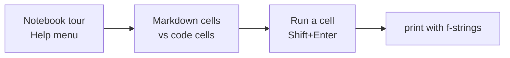

# C1W1-L01 Lab — Brief Introduction to Python and Jupyter Notebooks
> [!info] Lesson: [[C1W1-02 Supervised vs Unsupervised Learning]] (Jupyter Notebooks video) · Week: [[C1W1 - Week Hub]]
> Lab file: `C1_W1_Lab01_Python_Jupyter_Soln.ipynb` · Next lab → [[C1W1-L02 Lab - Model Representation]]

> [!note] About the code in these lab notes
> The code blocks are **my own re-written versions** of what each lab section does, so I can explain every line. They follow the same steps as the official notebook, but the notebook itself stays on the course platform.

## Goal
Get comfortable with the notebook environment used in every lab:
- tell **markdown cells** from **code cells**
- run a cell
- use Python **f-strings** for printing (used in every later lab)

## Lab map


| Section | What it does | Why it's there | Input → Output |
|---|---|---|---|
| Notebook tour | points to *Help → User Interface Tour* | learn the toolbar and menus | — |
| Cell types | explains **Markdown** and **Code** cells and the cell-type drop-down | a cell left in the wrong mode won't run; you need to know how to switch it back | — |
| Python / running cells | Shift+Enter or the ▶ Run button | every lab is "read, then run" | code cell → printed output |
| Print statement | `print(f"...")` with a variable inside `{}` | all labs print results this way | variable → formatted text |

## Section by section

### 1. Markdown cells vs code cells
- **Markdown cell**: formatted text (headings, lists, LaTeX like $f_{w,b}(x)$). Running it *renders* the text.
- **Code cell**: Python that the **kernel** (a running Python process) executes. Results appear below the cell.
- Variables **persist** between cells. Running cell 5 can use a variable created in cell 2, as long as cell 2 was run first.

> [!warning] Common beginner trap
> If you get `NameError: name 'x_train' is not defined`, you probably skipped an earlier cell. Use **Kernel → Restart & Run All** to run everything in order.

### 2. A first code cell
```python
# This is a code cell: everything here is executed by Python
print("This is a code cell")
```
| Line | What it does |
|---|---|
| `# This is …` | a **comment**; Python ignores anything after `#` |
| `print("…")` | prints the string to the output area under the cell |

### 3. f-strings (formatted string literals)
```python
course = "Machine Learning Specialization"
week = 1
cost = 12500.0
print(f"{course}: week {week}, cost = {cost:0.2e}")
```
**Output:** `Machine Learning Specialization: week 1, cost = 1.25e+04`

| Line | What it does | Why |
|---|---|---|
| `course = …`, `week = 1`, `cost = …` | create three variables (string, int, float) | something to print |
| `f"..."` | the `f` before the quote turns it into an **f-string** | lets you put variables straight into text |
| `{course}` | replaced by the variable's value | clean, readable printing |
| `{cost:0.2e}` | **format spec**: scientific notation with 2 decimals | the labs print costs like `Cost 1.25e+04` this way |

> [!tip] Format specs you'll see in later labs
> | Spec | Meaning | `1234.5678` becomes |
> |---|---|---|
> | `:0.2f` | 2 decimals, fixed | `1234.57` |
> | `:0.2e` | scientific notation | `1.23e+03` |
> | `:8.4f` | width 8, 4 decimals | `1234.5678` |
> | `:4` | width 4 (for ints) | `  12` |
> | `:0.0f` | no decimals | `1235` |

## How it connects to the course
Every lab after this one is a Jupyter notebook. The **optional labs** are "read and run" (no grading). **Practice labs** have exercise cells you complete. Knowing how cells, the kernel and f-strings work saves a lot of confusion later.

## Try it yourself
- [ ] Change the variable in the f-string cell and re-run it.
- [ ] Print `w` and `b` with 3 decimals: `print(f"w={w:0.3f}, b={b:0.3f}")`.
- [ ] Turn a code cell into a markdown cell and back again (the cell-type drop-down, or `M` / `Y` keys in command mode).

## Key takeaways
- Notebooks = **markdown** (explanations) + **code** (runnable Python), sharing one kernel.
- Run cells **top to bottom**. If things break, restart and run all.
- f-strings `f"{var:format}"` are the standard way to print results in this course.

Related: [[NumPy]] · [[Matplotlib]] · Next → [[C1W1-L02 Lab - Model Representation]]
