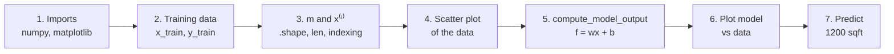

# C1W1-L02 Lab — Model Representation
> [!info] Lesson: [[C1W1-03 Linear Regression Model]] · Week: [[C1W1 - Week Hub]] · Concept: [[Simple Linear Regression]]
> Lab file: `C1_W1_Lab02_Model_Representation_Soln.ipynb`
> ← [[C1W1-L01 Lab - Python and Jupyter]] | [[C1W1-L03 Lab - Cost Function]] →

> [!note] About the code in these lab notes
> The code blocks are **my own re-written versions** of what each lab section does, so I can explain every line. They follow the same steps and function names as the official notebook.

## Goal
Implement the linear regression model $f_{w,b}(x) = wx + b$ for **one feature** in NumPy. Plot it against the data, find $w, b$ that fit by hand, and make a prediction.

## Lab map


| # | Section | What it does | Why | Input → Output | Lecture link |
|---|---|---|---|---|---|
| 1 | Tools | imports NumPy and Matplotlib | arrays + plots | — | — |
| 2 | Problem statement | makes the 2-house dataset | smallest possible training set | — → `x_train`, `y_train` (shape `(2,)`) | Notation |
| 3 | Number of examples | gets $m$ from `.shape[0]` / `len()` | $m$ appears in every formula | array → int `m = 2` | $m$ |
| 4 | Training example $x^{(i)}$ | indexes `x_train[i]` | links maths notation to Python | `i` → `(x_i, y_i)` | $(x^{(i)}, y^{(i)})$ |
| 5 | Plotting the data | red-× scatter plot | always look at data first | arrays → figure | house-price plot |
| 6 | Model function | `compute_model_output(x, w, b)` | turns the formula into code | `x (m,)`, `w`, `b` → `f_wb (m,)` | $f_{w,b}(x)=wx+b$ |
| 7 | Challenge | try different $w, b$ until the line fits | intuition for parameters | — → $w=200, b=100$ | effect of $w, b$ |
| 8 | Prediction | price for 1200 sqft | use the trained model | `x = 1.2` → `340` | $\hat{y}$ |

## Section by section

### 1. Imports
```python
import numpy as np                 # arrays and fast maths
import matplotlib.pyplot as plt    # plotting
```
- `np` and `plt` are the standard short names (aliases) everyone uses. → [[NumPy]] · [[Matplotlib]]
- The lab also applies a course style sheet (`deeplearning.mplstyle`). That only changes colours and fonts, not the maths.

### 2. The training data
```python
# x = size in 1000 sqft, y = price in $1000s
x_train = np.array([1.0, 2.0])
y_train = np.array([300.0, 500.0])
print(f"x_train = {x_train}")
print(f"y_train = {y_train}")
```
| Line | What it does | Why |
|---|---|---|
| `np.array([1.0, 2.0])` | makes a **1-D NumPy array** (shape `(2,)`) | NumPy arrays support fast element-wise maths |
| units comment | sizes are in *1000 sqft*, prices in *$1000s* | keeps numbers small and readable (1.0, not 1000) |
| `print(f"…")` | shows the arrays | sanity-check the data |

**Output:** `x_train = [1. 2.]`, `y_train = [300. 500.]`

### 3. Number of training examples $m$
```python
print(f"x_train.shape: {x_train.shape}")   # (2,)
m = x_train.shape[0]                        # first (only) dimension → 2
m = len(x_train)                            # same result with Python's len()
print(f"Number of training examples is: {m}")
```
- `.shape` returns a **tuple** with one entry per dimension. A 1-D array of 2 numbers has shape `(2,)`.
- `.shape[0]` takes the first entry, which is the number of examples. You'll use this in every function you write.

### 4. Accessing the $i$-th example
```python
i = 0                    # change to 1 for the second house
x_i = x_train[i]
y_i = y_train[i]
print(f"(x^({i}), y^({i})) = ({x_i}, {y_i})")    # (x^(0), y^(0)) = (1.0, 300.0)
```
- Maths $x^{(1)}$ (1st example) = Python `x_train[0]`, because Python counts from **0**.

### 5. Plot the data
```python
plt.scatter(x_train, y_train, marker='x', c='r')   # red crosses
plt.title("Housing Prices")
plt.xlabel("Size (1000 sqft)")
plt.ylabel("Price (in 1000s of dollars)")
plt.show()
```
| Line | What it does |
|---|---|
| `plt.scatter(x, y, marker='x', c='r')` | draws each $(x^{(i)}, y^{(i)})$ as a red **×** |
| `title / xlabel / ylabel` | labels, so the plot makes sense on its own |
| `plt.show()` | renders the figure |

### 6. The model function — the core of the lab
```python
def compute_model_output(x, w, b):
    """
    Linear model prediction for every example.
    x : ndarray (m,)  input features
    w, b : scalars    model parameters
    returns f_wb : ndarray (m,)  predictions
    """
    m = x.shape[0]               # how many examples
    f_wb = np.zeros(m)           # empty array to hold m predictions
    for i in range(m):           # go through each example
        f_wb[i] = w * x[i] + b   # apply the formula f(x) = wx + b
    return f_wb
```
| Line | What it does | Why |
|---|---|---|
| `def compute_model_output(x, w, b):` | defines a function taking the data and the two parameters | reusable model |
| docstring | documents shapes: `x` is `(m,)`, `w, b` are scalars | shapes matter a lot in ML code |
| `m = x.shape[0]` | number of examples | loop length |
| `f_wb = np.zeros(m)` | pre-allocates an array of $m$ zeros | somewhere to store each prediction |
| `for i in range(m):` | loop over examples $i = 0 … m-1$ | apply the model to each house |
| `f_wb[i] = w * x[i] + b` | **the model**: $f_{w,b}(x^{(i)}) = wx^{(i)} + b$ | maths → code |
| `return f_wb` | returns all predictions | used for plotting / cost |

> [!tip] Vectorized version (you'll learn this in C1W2)
> NumPy can do the whole loop in one line: `f_wb = w * x + b`. It's faster and shorter. The loop version is used here to match the maths step by step.

### 7. Plot the model against the data, then tune $w, b$
```python
w, b = 100, 100
f_wb = compute_model_output(x_train, w, b)

plt.plot(x_train, f_wb, c='b', label='Our Prediction')           # model line
plt.scatter(x_train, y_train, marker='x', c='r', label='Actual Values')
plt.legend(); plt.show()
```
- With $w = 100, b = 100$ the line misses both points: it predicts 200 and 300 instead of 300 and 500.
- **Challenge answer:** solve the two equations $w(1) + b = 300$ and $w(2) + b = 500$. Subtracting gives $w = 200$, then $b = 100$. The line then passes through both points.

![[c1w1_linear_regression_model.png]]

### 8. Make a prediction
```python
w, b = 200, 100
x_i = 1.2                         # 1200 sqft in units of 1000 sqft
price = w * x_i + b               # 340
print(f"${price:.0f} thousand dollars")
```
**Expected output:** `$340 thousand dollars`

## How it connects to the course
- This is the **model** half of linear regression ([[C1W1-03 Linear Regression Model]]).
- Here we found $w, b$ by **solving by hand**, which only works because there are 2 points. With real data we need a **cost function** to measure fit ([[C1W1-L03 Lab - Cost Function]]) and **gradient descent** to find $w, b$ automatically ([[C1W1-L04 Lab - Gradient Descent]]).

## Try it yourself
- [ ] Add a third house `(1.5, 380)`. Can any straight line pass through all three points exactly?
- [ ] Rewrite `compute_model_output` in one vectorized line and check both versions give the same output.
- [ ] Predict the price for 2500 sqft with $w = 200, b = 100$. (Answer: 600 → $600k.)

## Key takeaways
- Linear regression maps **feature → target** with $f_{w,b}(x) = wx + b$.
- $w$ and $b$ are the **parameters** fitted from training data.
- Once fitted, the model can predict for **new** inputs.
