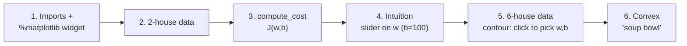

# C1W1-L03 Lab — Cost Function
> [!info] Lesson: [[C1W1-04 Cost Function]] · Week: [[C1W1 - Week Hub]] · Concept: [[Cost Function]]
> Lab file: `C1_W1_Lab03_Cost_function_Soln.ipynb` (plot helpers in `lab_utils_uni.py`)
> ← [[C1W1-L02 Lab - Model Representation]] | [[C1W1-L04 Lab - Gradient Descent]] →

> [!note] About the code in these lab notes
> The code blocks are **my own re-written versions** of what each lab section does, so I can explain every line. They follow the same steps and function names as the official notebook.

## Goal
Implement the **squared error cost** $J(w,b)$ for one-variable linear regression, and explore how it changes as $w$ and $b$ change (1D curve, 3D bowl, contour map).

## Lab map


| # | Section | What it does | Why | Input → Output | Lecture link |
|---|---|---|---|---|---|
| 1 | Tools | NumPy, Matplotlib (interactive), plot helpers | interactive plots | — | — |
| 2 | Problem statement | same data `(1,300), (2,500)` | continue from L02 | — → arrays | house prices |
| 3 | Computing cost | `compute_cost(x, y, w, b)` | measures fit as one number | `x, y (m,)`, `w, b` → `float` | $J(w,b)$ formula |
| 4 | Cost intuition | slider for $w$ with $b = 100$ fixed | see $J(w)$ is U-shaped, min at 200 | slider → plot | "Cost function intuition" |
| 5 | Larger dataset + contour | click points on a contour plot | see that the minimum isn't 0 when points aren't on a line | click → line + cost | "Visualizing the cost function" |
| 6 | Convex cost surface | 3D "soup bowl" | squared error ⇒ one minimum | — → 3D plot | bowl shape |

## Section by section

### 1. Imports
```python
import numpy as np
%matplotlib widget                  # makes plots interactive (sliders, clicking)
import matplotlib.pyplot as plt
# the lab also imports plt_intuition, plt_stationary, plt_update_onclick, soup_bowl
# from lab_utils_uni.py: ready-made plotting helpers (you don't need to write them)
```
- `%matplotlib widget` is a **Jupyter magic command**. It switches Matplotlib to interactive mode so the slider and click plots work.
- The helper functions in `lab_utils_uni.py` only **draw**. The maths you need to understand is in `compute_cost`.

### 2. Data
```python
x_train = np.array([1.0, 2.0])       # size (1000 sqft)
y_train = np.array([300.0, 500.0])   # price ($1000s)
```

### 3. `compute_cost` — the core of the lab
Formula being implemented:
$$J(w,b) = \frac{1}{2m}\sum_{i=0}^{m-1}\left(f_{w,b}(x^{(i)}) - y^{(i)}\right)^2$$
*(The lectures sum $i = 1 … m$. Code sums $0 … m-1$ because Python counts from 0. Same thing.)*

```python
def compute_cost(x, y, w, b):
    """
    Squared error cost for linear regression.
    x, y : ndarray (m,)   features and targets
    w, b : scalars        parameters
    returns total_cost : float
    """
    m = x.shape[0]                    # number of examples
    cost_sum = 0.0                    # running total of squared errors
    for i in range(m):
        f_wb = w * x[i] + b           # prediction for example i
        cost = (f_wb - y[i]) ** 2     # squared error for example i
        cost_sum += cost              # add it to the total
    total_cost = cost_sum / (2 * m)   # average, then halve
    return total_cost
```
| Line | What it does | Maths piece |
|---|---|---|
| `m = x.shape[0]` | count examples | $m$ |
| `cost_sum = 0.0` | start the sum at 0 | $\sum$ starts empty |
| `for i in range(m):` | visit each example | $\sum_{i}$ |
| `f_wb = w * x[i] + b` | model prediction | $f_{w,b}(x^{(i)})$ |
| `cost = (f_wb - y[i]) ** 2` | error, squared (`**` is power) | $(f - y)^2$ |
| `cost_sum += cost` | accumulate | adding terms |
| `cost_sum / (2 * m)` | divide by $2m$ | $\frac{1}{2m}$ |

**Expected values (check yourself):**
```python
compute_cost(x_train, y_train, 200, 100)   # 0.0     → perfect fit
compute_cost(x_train, y_train, 100, 100)   # 12500.0 → errors −100, −200 → (10⁴ + 4·10⁴)/4
compute_cost(x_train, y_train, 0, 0)       # 85000.0 → errors −300, −500 → (9·10⁴ + 25·10⁴)/4
```

> [!tip] One-line vectorized version (C1W2 preview)
> `np.sum((w * x + b - y) ** 2) / (2 * len(x))` does the same thing without a loop.

> [!warning] "Cost" ≠ "price"
> In this lab **cost** means the *error measure* $J$, not the house's price. The data is about house prices; the cost tells us how wrong our price predictions are.

### 4. Cost intuition (slider, $b = 100$ fixed)
- `plt_intuition(x_train, y_train)` draws the model line (left) and $J(w)$ (right). Moving the slider changes $w$.
- What you should notice:
  - the cost is **minimised at $w = 200$**, which matches L02
  - the cost grows **fast** when $w$ is too big *or* too small, because the errors are **squared**
  - at the minimum the line fits **perfectly**

![[c1w1_cost_intuition.png]]

### 5. A bigger dataset and the contour plot
```python
x_train = np.array([1.0, 1.7, 2.0, 2.5, 3.0, 3.2])
y_train = np.array([250, 300, 480, 430, 630, 730])
# fig, ax, dyn_items = plt_stationary(x_train, y_train)
# updater = plt_update_onclick(fig, ax, x_train, y_train, dyn_items)
```
- Clicking a point $(w, b)$ on the contour plot draws that line on the left plot. The **dashed vertical lines** show each example's error, i.e. its share of the cost.
- The best point is about **$w \approx 209$, $b \approx 2.4$**. The cost there is **not 0**, because the six points don't lie on one straight line.

![[c1w1_cost_surface_contour.png]]

### 6. Convex cost surface ("soup bowl")
- `soup_bowl()` draws $J(w, b)$ with $w$ and $b$ on similar scales so the shape is easy to see.
- **Key fact:** because the cost **squares** the errors, the surface is **convex**: one bowl with one minimum. You can always reach that minimum by following the downhill direction. That is exactly what [[C1W1-L04 Lab - Gradient Descent]] does.

## How it connects to the course
- Implements the formula from [[C1W1-04 Cost Function]].
- `compute_cost` is **reused** in the gradient descent lab (to track progress) and again, vectorized, in C1W2.
- The contour plot here is the "map" that gradient descent's path is drawn on in L04.

## Try it yourself
- [ ] Compute `compute_cost` for $w = 150, b = 100$ on the 2-house data. (Answer: errors −50, −100 → $J = 3125$.)
- [ ] Write the vectorized one-line version and check it matches the loop version on the 6-house data.
- [ ] Use `np.polyfit(x_train, y_train, 1)` to find the exact best line for the 6-house data and compare it with your clicks.

## Key takeaways
- The cost $J(w,b)$ is **one number** that measures how well the line fits the training data.
- Minimising $J$ gives the best $w, b$.
- For squared error, the $J$ surface is a **convex bowl**, so a single global minimum exists.
