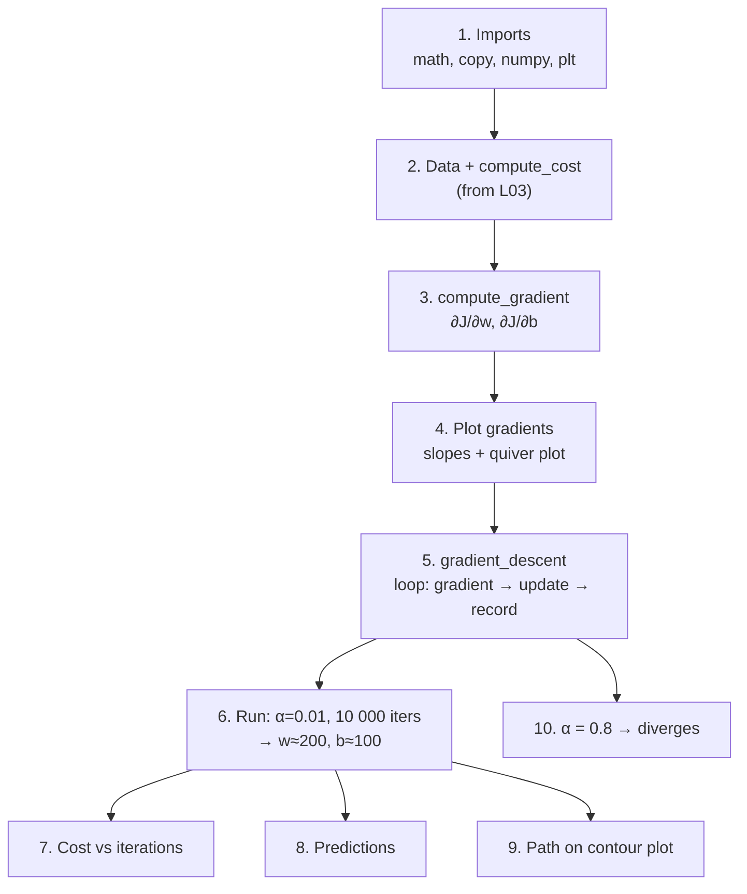

# C1W1-L04 Lab — Gradient Descent for Linear Regression
> [!info] Lesson: [[C1W1-05 Gradient Descent]] · Week: [[C1W1 - Week Hub]] · Concept: [[Gradient Descent]]
> Lab file: `C1_W1_Lab04_Gradient_Descent_Soln.ipynb` (plot helpers in `lab_utils_uni.py`)
> ← [[C1W1-L03 Lab - Cost Function]] | [[C1W1 - Week Hub]] →

> [!note] About the code in these lab notes
> The code blocks are **my own re-written versions** of what each lab section does, so I can explain every line. They follow the same steps and function names as the official notebook.

## Goal
**Automate** the search for $w, b$: compute the gradient, run gradient descent, watch the cost fall, and see what happens when the learning rate is too large.

## Lab map


| # | Section | What it does | Why | Input → Output | Lecture link |
|---|---|---|---|---|---|
| 1 | Tools | imports | `math.ceil` for print intervals | — | — |
| 2 | Data + cost | 2-house data; `compute_cost` from L03 | track progress | arrays, `w, b` → `J` | $J(w,b)$ |
| 3 | `compute_gradient` | both partial derivatives | tells GD which way is downhill | `x, y, w, b` → `dj_dw, dj_db` | gradient formulas |
| 4 | Gradient plots | slope of $J(w)$ at 3 points + arrow field | see that gradients point *away* from the minimum | — → plots | "Gradient descent intuition" |
| 5 | `gradient_descent` | the full algorithm | finds $w, b$ automatically | data, start values, `alpha`, `num_iters`, functions → `w, b, J_history, p_history` | update rule |
| 6 | Run it | fit the 2-house data | test the algorithm | — → `(≈200, ≈100)` | "Running gradient descent" |
| 7 | Cost vs iterations | learning curve | check that cost always goes down | `J_hist` → plot | convergence |
| 8 | Predictions | price for 1000, 1200, 2000 sqft | use the trained model | `x` → $\hat{y}$ | prediction |
| 9 | Contour path | the GD path drawn on $J(w,b)$ | big steps first, tiny steps later | `p_hist` → plot | contour plots |
| 10 | Large $\alpha$ | $\alpha = 0.8$ for 10 iterations | see **divergence** | — → growing cost | "Learning rate" |

## Section by section

### 1–2. Imports, data and cost
```python
import math, copy
import numpy as np
import matplotlib.pyplot as plt

x_train = np.array([1.0, 2.0])
y_train = np.array([300.0, 500.0])

def compute_cost(x, y, w, b):
    m = x.shape[0]
    errors = (w * x + b) - y                 # all prediction errors at once
    return np.sum(errors ** 2) / (2 * m)     # squared error cost J(w,b)
```
- `math` is used for `math.ceil` (round up) to decide how often to print. `copy` is imported in case you need to copy arrays safely (it matters more in C1W2 with vector `w`).
- `compute_cost` is the same function as in [[C1W1-L03 Lab - Cost Function]], written vectorized here.

### 3. `compute_gradient` — the derivatives
Formulas:
$$\frac{\partial J}{\partial w} = \frac{1}{m}\sum_{i=0}^{m-1}(f_{w,b}(x^{(i)}) - y^{(i)})\,x^{(i)} \qquad \frac{\partial J}{\partial b} = \frac{1}{m}\sum_{i=0}^{m-1}(f_{w,b}(x^{(i)}) - y^{(i)})$$

```python
def compute_gradient(x, y, w, b):
    """
    Gradient of the squared error cost for linear regression.
    returns dj_dw, dj_db : scalars
    """
    m = x.shape[0]
    dj_dw = 0.0
    dj_db = 0.0
    for i in range(m):
        err = (w * x[i] + b) - y[i]     # prediction error for example i
        dj_dw += err * x[i]             # contribution to ∂J/∂w
        dj_db += err                    # contribution to ∂J/∂b
    dj_dw /= m                          # average over examples
    dj_db /= m
    return dj_dw, dj_db
```
| Line | What it does | Maths |
|---|---|---|
| `dj_dw = 0.0`, `dj_db = 0.0` | start both sums at 0 | empty $\sum$ |
| `err = (w * x[i] + b) - y[i]` | error for one example | $f_{w,b}(x^{(i)}) - y^{(i)}$ |
| `dj_dw += err * x[i]` | error **× input** | the $\cdot x^{(i)}$ comes from the chain rule |
| `dj_db += err` | just the error | derivative of $b$ term is 1 |
| `/= m` | turn sums into averages | $\frac{1}{m}$ |
| `return dj_dw, dj_db` | return both as a tuple | used by the update step |

**Check by hand:** at $w = 0, b = 0$ → errors −300, −500 → `dj_dw = (−300·1 + −500·2)/2 = −650`, `dj_db = (−300 − 500)/2 = −400`. Both negative → both parameters will **increase**. ✅

### 4. Seeing the gradient (`plt_gradients`)
- **Left plot:** $J(w)$ with $b = 100$ fixed, plus tangent lines at three points. Right of the minimum the slope is **positive**, left of it **negative**, and at the bottom it is **0**.
- **Right plot (quiver plot):** arrows on the $(w, b)$ plane. **Size** = how steep, **direction** = the gradient. The arrows point **away** from the minimum (uphill). That's why the update **subtracts** the gradient.

![[c1w1_derivative_intuition.png]]

### 5. `gradient_descent` — the algorithm
```python
def gradient_descent(x, y, w_in, b_in, alpha, num_iters, cost_function, gradient_function):
    """
    Runs num_iters steps of batch gradient descent.
    returns w, b (final), J_history (cost per step), p_history ([w, b] per step)
    """
    w, b = w_in, b_in
    J_history, p_history = [], []

    for i in range(num_iters):
        # 1) gradient at the CURRENT w, b
        dj_dw, dj_db = gradient_function(x, y, w, b)

        # 2) simultaneous update (both use the gradient from step 1)
        w = w - alpha * dj_dw
        b = b - alpha * dj_db

        # 3) record history for plotting (with a cap to avoid huge lists)
        if i < 100_000:
            J_history.append(cost_function(x, y, w, b))
            p_history.append([w, b])

        # 4) print progress about 10 times during the run
        if i % math.ceil(num_iters / 10) == 0:
            print(f"Iteration {i:4}: Cost {J_history[-1]:0.2e} "
                  f"dj_dw: {dj_dw:0.3e}, dj_db: {dj_db:0.3e} w: {w:0.3e}, b: {b:0.5e}")

    return w, b, J_history, p_history
```
| Part | What it does | Why |
|---|---|---|
| arguments `cost_function`, `gradient_function` | functions **passed in** as arguments | the same GD loop can be reused for other models (it's reused for logistic regression in C1W3) |
| `w, b = w_in, b_in` | starting point | GD needs an initial guess |
| `gradient_function(x, y, w, b)` | slope at the current point | direction to move |
| `w = w - alpha * dj_dw` / `b = …` | **update rule** | both use the *same* gradients from step 1 → a correct **simultaneous** update |
| `J_history`, `p_history` | lists of cost and `[w, b]` per step | for learning curves and the contour path |
| `if i < 100_000` | stops recording after 100k steps | protects memory on very long runs |
| `i % math.ceil(num_iters/10) == 0` | true about 10 times per run | readable progress output |
| `return …` | final params + histories | used for predictions and plots |

### 6. Run it
```python
w_init, b_init = 0, 0
iterations = 10_000
tmp_alpha = 1.0e-2
w_final, b_final, J_hist, p_hist = gradient_descent(
    x_train, y_train, w_init, b_init, tmp_alpha, iterations, compute_cost, compute_gradient)
print(f"(w,b) found by gradient descent: ({w_final:8.4f},{b_final:8.4f})")
```
**Expected:** `(w,b) found by gradient descent: (199.9929,100.0116)`, very close to the exact answer (200, 100).

What to notice in the printed progress:
- the **cost** drops fast at first, then slowly
- `dj_dw` and `dj_db` also shrink, which is **why** the steps shrink even though $\alpha$ is fixed

### 7. Cost vs iterations
- Plot `J_hist[:100]` (start) and `J_hist[1000:]` (end) separately, because the early drop is so large that it hides the later changes.
- **Rule:** in a correct run the cost **decreases on every iteration**.

![[c1w1_gradient_descent_path.png]]

### 8. Predictions
```python
for size in [1.0, 1.2, 2.0]:
    print(f"{size*1000:.0f} sqft house prediction {w_final*size + b_final:0.1f} Thousand dollars")
```
**Expected:** 1000 sqft → **300.0**, 1200 sqft → **340.0**, 2000 sqft → **500.0**.

### 9. Path on the contour plot
- `plt_contour_wgrad(x_train, y_train, p_hist, ax)` draws the path as red arrows over the cost contours.
- The path moves **steadily** (monotonically) towards the centre. **Early steps are large, final steps are tiny.** Zooming in near (200, 100) shows the steps shrinking as the gradient approaches 0.

### 10. Learning rate too large → divergence
```python
w_final, b_final, J_hist, p_hist = gradient_descent(
    x_train, y_train, 0, 0, 8.0e-1, 10, compute_cost, compute_gradient)
```
- With $\alpha = 0.8$, $w$ and $b$ **flip between positive and negative**, and their size grows each step.
- `dj_dw` **changes sign** every iteration, and the **cost increases**. This is the classic sign that **$\alpha$ is too large** and the run is diverging.
- `plt_divergence(p_hist, J_hist, x_train, y_train)` shows $w$ zig-zagging further and further up the sides of the bowl.

![[c1w1_learning_rate.png]]

## How it connects to the course
- Implements the update rule and the gradient formulas from [[C1W1-05 Gradient Descent]].
- Uses `compute_cost` from [[C1W1-L03 Lab - Cost Function]] to monitor training.
- **Same pattern later:** C1W2 extends this to many features (`w` becomes a vector). C1W3 reuses the same loop with a different cost and gradient for logistic regression.

## Try it yourself
- [ ] Run with $\alpha = 0.001$ and 10 000 iterations. How close to (200, 100) do you get? (About (194.9, 108.2): slower, not yet converged.)
- [ ] Find the largest $\alpha$ that still converges on this data. (I checked: 0.58 converges, 0.59 diverges.)
- [ ] Break the simultaneous update on purpose (update `w`, then compute `dj_db` using the new `w`). Does it still converge? Is the path the same?
- [ ] Vectorize `compute_gradient`: `err = w*x + b - y; dj_dw = (err*x).mean(); dj_db = err.mean()`.

## Key takeaways
- Gradient descent = **compute gradient → update parameters (simultaneously) → repeat**.
- For linear regression: $\partial J/\partial w$ = average of **error × x**, and $\partial J/\partial b$ = average **error**.
- Always watch **cost vs iterations**. It must go down. If it rises, lower $\alpha$.
