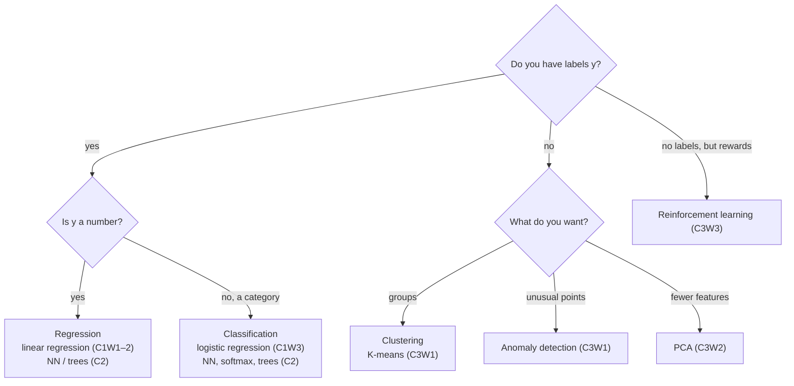

# ML Specialization — Algorithm Comparison
> [!info] ↑ [[ML Specialization - Course Home]] · See also [[ML Specialization - Equation Sheet]] · [[ML Specialization - Glossary]]
> One row per algorithm, added as the course introduces it.

## Which kind of problem is it?

## Algorithms so far
| Algorithm | Type | Output | Model | Cost / objective | Trained with | Introduced |
|---|---|---|---|---|---|---|
| Linear regression (1 feature) | supervised, regression | a number | $wx + b$ | squared error $J$ (convex) | gradient descent | [[C1W1-03 Linear Regression Model\|C1W1]] |

## Optimisation methods
| Method | Idea | Pros | Cons | Introduced |
|---|---|---|---|---|
| Batch gradient descent | step against the gradient using **all** $m$ examples | simple, general, works for any differentiable cost | needs a good $\alpha$; can be slow on huge datasets | [[C1W1-05 Gradient Descent\|C1W1]] |

*More rows in later batches: multiple linear regression, normal equation, logistic regression, neural networks, Adam, decision trees, random forest, XGBoost, K-means, anomaly detection, collaborative and content-based filtering, PCA, DQN.*
