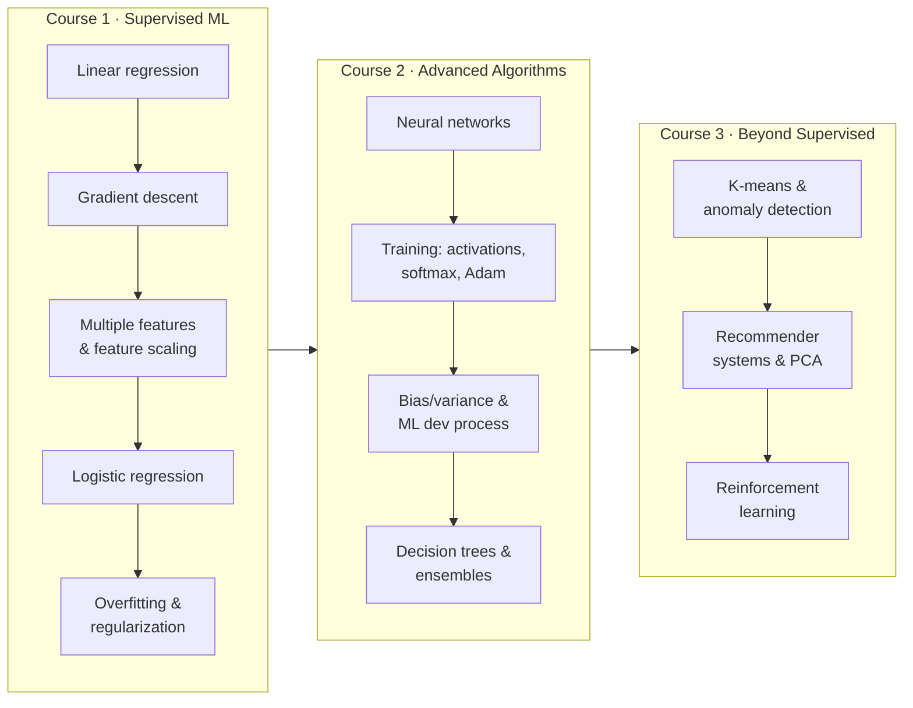

# Machine Learning Specialization — Andrew Ng (DeepLearning.AI · Stanford Online)
> [!info] Course home — start here
> **Labs & code:** https://github.com/rSith/machine-learning-specialization
> **Progress:** [[00. Learning Tracker]] · **Posts:** [[Learning in Public]] · **Concept hub:** [[Machine Learning]]
> **Quick reference:** [[ML Specialization - Equation Sheet|Equation Sheet]] · [[ML Specialization - Algorithm Comparison|Algorithm Comparison]] · [[ML Specialization - Glossary|Glossary]]

> [!tip] How these notes are organised
> - **Course home** → **Week hub** (map, key terms, summary, review questions) → **Lesson notes** (`C1W1-01 …`) → **Lab notes** (`C1W1-L01 …`).
> - Note IDs: `C` = course, `W` = week, `-01` = lesson, `-L01` = lab. They sort in course order.
> - Every lesson links ← previous | next →, to its lab, and to the matching note in `04. Concepts`.
> - Diagrams live in `_assets/`. Equations use LaTeX. Workflows use Mermaid.

## The big picture


## Course 1 — Supervised Machine Learning: Regression and Classification
Home: [[C1 - Supervised ML - Course Home]]
- **Week 1 — Introduction to Machine Learning** → [[C1W1 - Week Hub]] · post: [[ML Specialization - Week 01 Post]]
	- [[C1W1-01 What is Machine Learning]] · [[C1W1-02 Supervised vs Unsupervised Learning]] · [[C1W1-03 Linear Regression Model]] · [[C1W1-04 Cost Function]] · [[C1W1-05 Gradient Descent]]
	- Labs: [[C1W1-L01 Lab - Python and Jupyter]] · [[C1W1-L02 Lab - Model Representation]] · [[C1W1-L03 Lab - Cost Function]] · [[C1W1-L04 Lab - Gradient Descent]]
- **Week 2 — Regression with multiple input variables** → C1W2 - Week Hub *(next batch)*
- **Week 3 — Classification** → C1W3 - Week Hub *(planned)*

## Course 2 — Advanced Learning Algorithms
- **Week 1 — Neural networks** *(planned)* → [[Neural Network]]
- **Week 2 — Neural network training** *(planned)*
- **Week 3 — Advice for applying ML** *(planned)* → [[Model Evaluation]]
- **Week 4 — Decision trees** *(planned)* → [[Decision Trees]] · [[Random Forest]]

## Course 3 — Unsupervised Learning, Recommenders, Reinforcement Learning
- **Week 1 — Unsupervised learning** *(planned)* → [[Clustering]]
- **Week 2 — Recommender systems** *(planned)*
- **Week 3 — Reinforcement learning** *(planned)* → [[Reinforcement Learning]]

## All notes in this specialization
```base
filters:
  and:
    - course == "ML Specialization"
views:
  - type: table
    name: All ML Spec notes
    order:
      - file.name
      - note.module
      - note.type
      - note.status
    sort:
      - property: file.name
        direction: ASC
```
