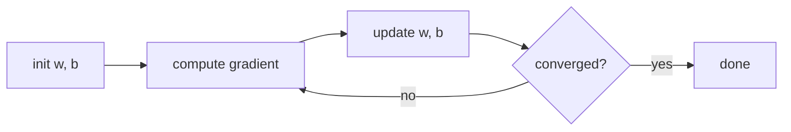

# Gradient Descent
> [!note] Definition
> An **optimisation algorithm** that finds the minimum of a function (usually the [[Cost Function]]) by repeatedly taking small steps in the direction where the function decreases fastest, i.e. against the **gradient**.

## How it works
$$w \leftarrow w - \alpha\frac{\partial J}{\partial w} \qquad b \leftarrow b - \alpha\frac{\partial J}{\partial b} \quad \text{(update simultaneously)}$$
1. Start from initial parameters (e.g. $w = 0, b = 0$).
2. Compute the gradient (slope) of $J$ at the current point.
3. Step **downhill**: subtract $\alpha \times$ gradient.
4. Repeat until the cost stops decreasing (**convergence**).

- **Learning rate $\alpha$:** too small → slow; too large → overshoots and may **diverge**.
- **Local minima:** on non-convex surfaces the starting point decides which valley you reach. Linear regression's squared-error cost is convex, so there's only one minimum.
- **Batch** GD uses all training examples per step. Mini-batch and stochastic versions use subsets *(Course 2–3)*.

## Example
> [!quote] Example
> Linear regression on $(1, 300), (2, 500)$ with $\alpha = 0.01$: starting at $(0, 0)$, the first step moves to $(6.5, 4.0)$. After 10 000 steps it reaches $(199.99, 100.01)$, almost exactly the best line $(200, 100)$.

## Related
- [[Cost Function]] · [[Simple Linear Regression]] · [[Linear Regression]] · [[Neural Network]]
- Course notes: [[C1W1-05 Gradient Descent]] · [[C1W1-L04 Lab - Gradient Descent]]
