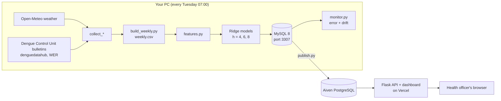

# Session Review — 13 Nov 2026: from half-finished data to a live system
> [!info] [[Dengue Early-Warning - Project Home]] · Map of all notes: [[00. Dengue Early-Warning Overview]]
> One long working session took the project from the middle of Phase 1 to a live website. This note collects **what was done, why, what went wrong and what to learn**, in one place. The detail of every step stays in the phase notes; follow the links.

> [!abstract] How to use this note
> 1. Read **§1** for the whole picture.
> 2. Read **§3** one phase at a time, then open that phase note for the full step.
> 3. **§4 (lessons)** and **§5 (mistakes)** are the parts most worth rereading before a viva or interview.
> 4. Test yourself with **§11**; the answers are folded.

---
## 1. The big picture

**The goal:** forecast weekly dengue cases for each of Sri Lanka's 25 districts 4 to 8 weeks ahead, and turn each forecast into a **Normal / Watch / Warning** alert.

**Where the session started:** weather collected; case data up to May 2026 with a gap; population half done; nothing else.

**Where it ended:** every technical phase built and tested, the model evaluated once on unseen data, a database, an API, a dashboard, a weekly automatic update and a live site: **https://dengue-early-warning.vercel.app**



**The headline result (test 2024 – Nov 2026, never seen in training):**
- Forecast error **24 % lower** than the best simple method (MAE 26.3 vs 34.5 cases per district-week).
- Alerts caught **35 of 52 outbreaks (67 %)**, on average **2.5 weeks before they began**.
- Weak spot: in the fast June–July 2026 epidemic the forecast reacted late.

---
## 2. Timeline

| Time | What | Commit |
|---|---|---|
| 12:12 | Dashboard prototype, built early with a demo forecast | `22e922e` |
| 12:16 | Population table finished (2006–2026) | `ef1fba9` |
| 12:56 | Dengue Control Unit fallback: case data to Nov 2026 | `f6eec52` |
| 16:28 | Phase 1 closed after a rebuild from scratch | `1314e41` |
| 16:39 | Phase 2: correction for the change of case source | `84de676` |
| 16:52 | `weekly.csv`, weekly weather, a scrambled week repaired | `c360268` |
| 17:03 | Flags for incomplete, COVID and epidemic weeks | `733e2c4` |
| 17:08 | EDA notebook and five findings | `900fe53` |
| 17:13 | Phase 3: features, delays, leakage test | `569fd41` |
| 17:21 | Phase 4: model comparison, Ridge chosen | `be95ee5` |
| 17:28 | Phase 5: endemic channel; alert rule chosen **before** the test | `36bd913` |
| 17:31 | Final test, run once | `228766a` |
| 17:44 | Phase 6: database, `predict.py`, Flask API | `3cee1d9` |
| 18:45 | MySQL 8 beside XAMPP; `FLOAT` → `DOUBLE` | `f834a37` |
| 18:57 | Phase 7: dashboard reads the API; contrast fixed | `392ac9a` |
| 19:15 | Phase 8: pipeline, monitoring, model archive, Docker | `180d094` |
| 19:40 – 20:25 | Online: Aiven PostgreSQL, then Vercel | `37b30f7` … `588a39c` |

---
## 3. Phase by phase

### 3.1 Dashboard prototype, built early → [[Phase 07 - Dashboard]], Step 7.1
**What:** a Flask page with a Leaflet map, a Chart.js chart and a sortable table, before any model existed.
**Idea — contract first:** decide the JSON shape the page reads; then the page and the back end can be built in either order. Real case history and real thresholds; only the forecast was a labelled demo.
**Learned:**
- A seasonal forecast must start from **this year's level**. The first demo copied past years and predicted Colombo falling from 584 to 139 overnight.
- Percentiles from only 10 years are noisy: smooth over neighbouring weeks.

### 3.2 Phase 1 — finishing data collection → [[Phase 01 - Data Collection]]
**Population (Step 1.5).** Official district tables exist only from 2014, and the census base changed in 2024 (Mullaitivu jumped +23 % in one year).
- 2006–2013 back-filled at each district's 2014–2019 growth.
- The 2024 census correction phased in from 2012 to 2024 (intercensal adjustment).
- **Caught by checking the national total:** the first version made the country *grow* 1 % from 2024 to 2025 while the published figures fell. Pre-COVID growth was the wrong rate; the step back now uses the 2025→2026 growth.

**Case data (Step 1.4, Part 3).** The WER website was down for weeks.
- The Dengue Control Unit site has no archive page, but its **WordPress media list** (`/wp-json/wp/v2/media`) named every bulletin: 2026 weeks 1–44, nothing missing.
- Parsed 44 PDFs with one regex per district. Fixed: a pattern that crossed line breaks (`\s` → `[ ]`), `Ni` misprinted for `Nil`, a total row with 5 numbers, publisher totals a few cases out.
- **The two sources number 2025 weeks differently** (WER week N+1 = NDCU week N): always join on dates.
- **They agree nationally but not by district** → corrected in Phase 2.
- Found a large epidemic in June–July 2026 (7,891 cases in one week).

**Rebuild (Step 1.6).** Deleted every processed file and reran the collectors: everything came back identical, and the new week 45 bulletin was picked up on its own.

### 3.3 Phase 2 — cleaning and EDA → [[Phase 02 - Cleaning and EDA]]
- **Source correction (2.1):** per-district factor `(WER + 200) / (NDCU + 200)`. The +200 is **shrinkage**: small districts move towards 1. Tested on weeks it never saw: −19 % error in district totals.
- **`weekly.csv` (2.2):** 25 districts × 1,037 weeks; weather summed or averaged over the *case* weeks (Saturday weeks to 2025, Monday after); Kalmunai added to Ampara; population interpolated.
- **A scrambled week:** 2026 week 14 in `denguedatahub` had believable totals but numbers in the wrong districts (Colombo 9, Matale 256). Found by **rank correlation with the neighbouring weeks**; the only such week in 19 years. Repaired from the other source. It had also distorted the first correction factors.
- **Flags (2.3):** 12 incomplete weeks, 94 COVID weeks, 134 epidemic weeks — flagged, never deleted.
- **EDA (2.4), five findings:**
  1. Two seasons: January in the north and east; June–July (and December in Colombo) in the west.
  2. Colombo and Gampaha have 35 % of cases.
  3. Strong autocorrelation (0.72 at 8 weeks): recent cases are the best predictor.
  4. Rain 5–12 weeks earlier and humidity 7–9 weeks earlier relate to cases, weakly (r ≈ 0.16).
  5. A same-week temperature link was a **shared long-term trend**; it vanished when the trend was removed.

### 3.4 Phase 3 — features → [[Phase 03 - Feature Engineering]]
- **Convention:** origin week *t*; cases known up to *t−2* (the bulletin can be 10 days late), weather up to *t−1*; target = cases in *t+4* (and 6, 8).
- 41 features: case lags, usual level for the time of year, last year, rain and humidity windows, season sine/cosine, district.
- **Leakage test:** scramble everything after what the origin may see; the features must not change. **Proved it can fail** by moving the boundary one week.

### 3.5 Phase 4 — models → [[Phase 04 - Modelling]]
- Split by **target week**: train to 2021, validation 2022–23, test 2024+ (untouched).
- Baselines first: **persistence** (25.5) beat **seasonal** (31.2).
- Ridge, Poisson, random forest, gradient boosting; tuned with **yearly time-series CV**. **Ridge won** (22.6, −27 % vs seasonal) at 4, 6 and 8 weeks.
- Every model failed in the 2017 epidemic; trees cannot predict beyond the range they saw.
- Weather added almost nothing to Ridge; tuning hardly mattered.

### 3.6 Phase 5 — alerts and the final test → [[Phase 05 - Evaluation and Alerts]]
- **Endemic channel:** mean and SD of log cases for each district and week of the year, from the 5 most recent usable years, ±2 weeks pooled, flagged weeks left out.
- Forecasts are smoother than reality, so the forecast Warning line is **μ + 1.25σ** (chosen on validation: best recall with warnings at most twice the true outbreak rate). Committed **before** running the test.
- **Count outbreaks as episodes** (2+ weeks), lead time to the **start**, compare with the naive "already high" rule (which is always late).
- **Test, run once:** MAE −24 %; 67 % of outbreaks caught, 2.5 weeks early. The code refuses a second test run.

### 3.7 Phase 6 — database and API → [[Phase 06 - Database and Flask API]]
- Six tables (SQLAlchemy Core); population and flags normalised into their own tables; ER diagram in `docs/er_diagram.md`.
- `predict.py`: forecasts from the current week with 80 % intervals; a **backfill** since 2024 matched the Phase 5 test forecasts to 0.005.
- Four endpoints, JSON errors (400 / 404 / 405 / 503), bound parameters only; 11 API tests.
- **MySQL 8 beside XAMPP:** MySQL 8 would not start because XAMPP held port 3306 → moved to **3307**.
- **`FLOAT` is single precision in MySQL:** 54 forecasts differed by 0.01 from SQLite → `DOUBLE`.

### 3.8 Phase 7 — dashboard on the API → [[Phase 07 - Dashboard]], Step 7.2
- Map and table from `/api/alerts/latest`; chart from `/api/predictions` (cached per district); horizon selector.
- **Contrast measured** with the WCAG formula: map levels were 1.5:1 apart → darker fills, now ≥ 3:1.
- Bugs: an old server still on port 5000 served the old page; `toISOString()` shifted a date by a day (UTC vs Sri Lanka time).

### 3.9 Phase 8 — automation, monitoring, online → [[Phase 08 - Automation and MLOps]]
- `python -m src.pipeline`: every step, logged, timed; exit code 1 on failure; `pipeline_runs` table.
- **Monitoring:** weekly MAE with a **retrain flag** (8-week MAE > 1.3 × test MAE) — it fired in the 2026 epidemic and cleared in November; **PSI drift** against the same weeks in training — case level drifted (0.66), weather did not.
- Model archive by version; `docs/retraining.md` (a person decides; the pipeline never retrains itself).
- Windows Task Scheduler: **Tuesday 07:00**.
- Docker: app (gunicorn, non-root, health check) + MySQL container; both healthy.
- **Online:** free MySQL hosting was gone and Render wanted a card → **Aiven PostgreSQL + Vercel Hobby**. The same SQLAlchemy code runs on PostgreSQL; the live data is identical to local.

---
## 4. The lessons worth keeping
1. **Check a result at the level you will use it.** A believable national total hid a scrambled week and a district-level disagreement between sources.
2. **Prove a test can fail before trusting it** (leakage test, population checks, the foreign-key test).
3. **Choose on validation, write it down, test once.** The alert rule was committed before the test; the code refuses a second test.
4. **Beat the strongest simple baseline**, not the easiest: persistence, not the seasonal average.
5. **The delay of the live data decides the features.** Cases at *t−2*, not *t−1*, because the bulletin is sometimes late.
6. **Remove season and trend before reading a lag correlation.** A flat lag curve means a shared trend, not an effect.
7. **Flag odd periods; never delete them.**
8. **Join on dates, never on week numbers**, across sources.
9. **Repair bad data before fitting anything on it** (the scrambled week changed four factors).
10. **Measure, don't eyeball**: contrast ratios, database size, precision.
11. **Test on the database you deploy on.** SQLite ignored foreign keys and stored doubles; MySQL did not.
12. **Make every writer safe to run twice** (replace, never duplicate).
13. **Monitor error and inputs**, and compare like with like (same season).
14. **Database-neutral code is cheap insurance**: losing free MySQL became a one-line change.
15. **Secrets never go in chats, screenshots or Git**; if they do, rotate them.

---
## 5. Mistakes made, and how they were caught

| Mistake | Caught by | Fix |
|---|---|---|
| Demo forecast ignored this year's level | Looking at the numbers (584 → 139) | Seasonal ratio |
| Population grew when official figures fell | Checking the **national** total | Recent growth for the step back |
| Regex matched across lines | Two PDFs found a row twice | `[ ]+` instead of `\s+` |
| 2025 weeks matched one week apart | Lag correlation best at −1 | Join on ISO dates |
| Scrambled week distorted factors | Rank correlation with neighbours | Repaired; factors recomputed; dated corrections in the notes |
| Same-week temperature "effect" | Flat curve across all lags | Detrending |
| Episode precision flattered a rule warning 60 % of the time | Week precision 9 % | Report week precision and warning share |
| `load_db` deleted districts forecasts pointed to | MySQL error 1451 in the pipeline | Sync districts; SQLite foreign keys switched on |
| `FLOAT` lost precision | Value-by-value comparison | `DOUBLE` |
| Old server answered on port 5000 | Browser showed the old page | Stop test servers |
| Date one day early | Header said 7 Nov | Local time, not `toISOString()` |
| Static files 404 on Vercel | Checking every asset URL | Flask serves `app/static` |
| Password and card shared in chat | — | Rotate the password; block the card |

---
## 6. Numbers to remember

| | |
|---|---|
| Districts / weeks | 25 / 1,037 (Dec 2006 – Nov 2026) |
| Case delay used | 2 weeks (bulletin median 7 days after the week ends) |
| Best model | Ridge on log cases |
| Validation 2022–23 | MAE 22.6 vs seasonal 31.2 (−27 %), persistence 25.5 |
| Test 2024 – Nov 2026 | MAE 26.3 vs 34.5 (−24 %); 6 and 8 weeks: −17 %, −14 % |
| Alerts on the test | 35 / 52 outbreaks, 2.5 weeks early; 30 % of Warning weeks were outbreak weeks |
| 80 % interval coverage | 79 % validation, 83 % test |
| Monitoring | Retrain flag at 1.3 × test MAE; case-level PSI 0.66 (major) |
| Database size | 8.2 MB, +30 KB a week |

---
## 7. Commands

```powershell
# the whole weekly update (what Task Scheduler runs)
python -m src.pipeline

# step by step
python -m src.collect_weather; python -m src.collect_cases; python -m src.collect_population
python -m src.build_weekly
python -m src.train                    # compare models, save ridge_h4/h6/h8
python -m src.evaluate validation      # alert rules on 2022-23 (the test refuses a second run)
python -m src.load_db                  # --rebuild after a schema change
python -m src.predict --backfill
python -m src.monitor
python -m src.publish --backfill       # copy to the online database
flask --app app run --debug            # http://127.0.0.1:5000
pytest                                 # 19 tests
docker compose up -d --build           # app on 8000, MySQL on 3308
```

---
## 8. Where things are

| File | Does |
|---|---|
| `src/collect_*.py` | Download and parse weather, cases, population |
| `src/build_weekly.py` | Source correction, repairs, weekly weather, flags → `weekly.csv` |
| `src/features.py` | The 41 features, with the delays (one place for training and live) |
| `src/train.py` | Split, baselines, models, tuning, saving, model archive |
| `src/alerts.py` | Endemic channel and alert levels |
| `src/evaluate.py` | Alert scoring, the one-time test, figures |
| `src/db.py`, `load_db.py` | Schema, connection, loading |
| `src/predict.py`, `monitor.py`, `publish.py`, `pipeline.py` | Weekly forecasts, monitoring, online copy, the whole run |
| `app/` | Flask API and dashboard |
| `scripts/` | Task Scheduler wrapper and registration, Vercel build, `.env` helper |
| `Dockerfile`, `docker-compose.yml`, `vercel.json`, `pyproject.toml` | Containers and the online deploy |
| `reports/` | Experiments, test results, figures |
| `docs/` | Data dictionary, ER diagram, retraining plan, progress |

---
## 9. Glossary
- **Origin / horizon / target** — the week a forecast is made / how far ahead / the week predicted → [[03.01 Forecast Origin, Horizon and Target]].
- **Reporting delay** — time from a week's end to its publication → [[01.06 Reporting Delay and Data Availability]].
- **Shrinkage** — pulling an estimate from little data towards a safe default: (W + k) / (N + k).
- **Persistence / seasonal baseline** — "same as the newest count" / "usual for this time of year" → [[04.02 Forecasting Baselines - Persistence and Seasonal]].
- **Time-series cross-validation** — train on the past, test on the next year, repeat → [[04.01 Time-Based Splits and Time-Series Cross-Validation]].
- **Endemic channel** — the usual range for each district and week of the year → [[05.02 Endemic Channel and Alert Thresholds]].
- **Episode / lead time** — consecutive outbreak weeks counted once / weeks from the first warning to the start → [[05.03 Alert Metrics - Precision, Recall and Lead Time]].
- **Prediction interval** — a range the true value falls in with a stated probability → [[05.04 Prediction Intervals and Quantile Regression]].
- **PSI** — population stability index, a measure of input drift → [[08.05 Model Monitoring - Data Drift and Concept Drift]].
- **Foreign key** — a column that must point to an existing row in another table.
- **Contract-first** — agree the data format between front and back end before building either.

---
## 10. What is left
**Yours:** test the dashboard with one non-technical person and make the paper sketch (Phase 7); record a demo video, get the report reviewed, share the project and ask a domain expert for feedback (Phase 9); rebuild `.venv` once (Phase 0); reset the Aiven password; block the card.
**Together:** problem statement and literature notes (Phase 0); README polish with a screenshot and architecture diagram; the technical report with limitations and ethics (Phase 9).
**Automatic:** the scheduled runs on 17 and 24 Nov finish Phase 8.

---
## 11. Test yourself
1. Why does the model use cases from week *t−2* and not *t−1*?
2. How was the scrambled 2026 week 14 found, when its national total looked normal?
3. Why is persistence the baseline that matters, not the seasonal average?
4. Why is the forecast Warning line lower than the line that defines an outbreak?
5. The retrain flag was on in July 2026 and off in November. Why not retrain automatically in July?
6. Why did 54 forecasts differ between MySQL and SQLite, and why was that worth fixing?
7. What would the first online check have missed if it had tested only `/api/health`?

> [!success]- Answers
> 1. The Dengue Control Unit bulletin is sometimes published 10 days after the week ends, so at the end of week *t* the count for *t−1* may not exist. Training with *t−1* would make the backtest see data the live system sometimes lacks.
> 2. By comparing each week's ranking of districts with the weeks either side (Spearman correlation −0.04, against 0.48 or more for every other week) and with the other source for the same week (−0.02). The values sat in the wrong districts, so their sum stayed believable.
> 3. It was the stronger simple method (18 % better than seasonal on validation). Beating only the weaker baseline would overstate the model's value.
> 4. A forecast is an expected value, smoother than reality; at μ + 2σ it caught only 23 % of validation outbreaks. The lower line, chosen on validation, offsets that.
> 5. Error rises for any model in an epidemic, and this flag cleared when it ended. A new model changes what officials are told; the plan says a person looks at why first.
> 6. MySQL's `FLOAT` is single precision; stored cases and weather lost digits, so features read back differently and a few forecasts rounded the other way. A database should not silently change data, even slightly.
> 7. That the dashboard's CSS, JavaScript and map file returned 404, so the page loaded without its map and chart.

**Related:** [[Phase 01 - Data Collection]] · [[Phase 02 - Cleaning and EDA]] · [[Phase 03 - Feature Engineering]] · [[Phase 04 - Modelling]] · [[Phase 05 - Evaluation and Alerts]] · [[Phase 06 - Database and Flask API]] · [[Phase 07 - Dashboard]] · [[Phase 08 - Automation and MLOps]] · [[Phase 09 - Documentation and Portfolio]]
