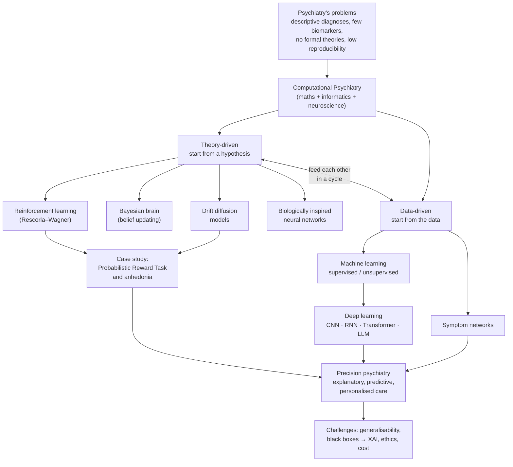

# 🧠 Computational Psychiatry — Research Home

> [!abstract] What this folder is
> A set of beginner-friendly notes explaining one paper: **Antonucci et al. (2026), "What is Computational Psychiatry? An introductory narrative review"** (*Journal of Psychopathology*, online first). The whole paper is about computational psychiatry, so every section has been covered.
> Written for a CS student with **no psychiatry background**. Psychiatric words are explained the first time they appear, and all of them are collected in [[14. Computational Psychiatry Glossary|the Glossary]].

## How to read these notes

The notes use four kinds of callout, so you always know where something came from:

> [!quote] From the paper
> Content taken directly from the source (paraphrased in simple English, with the page number).

> [!info] Extra context (not from the paper)
> Background I added to help a CS student understand. This is **not** a claim made by the paper.

> [!warning] Unclear or inconsistent in the source
> Places where the paper is vague, has a typo, or doesn't give enough detail. These are collected in [[15. Source Issues and Open Questions]].

> [!tip] CS analogy
> A comparison to something you already know from computer science (my explanation, not the paper's).

Text that has no callout is a plain-English explanation of the paper's content.

**Images:** files named `cp-paper-fig…` are the paper's own figures, shown unmodified with credit. Files named `cp-…` without "paper" are charts I simulated in Python for these notes. Each one says so in its caption.

## Reading order

| # | Note | What you'll learn |
|---|---|---|
| 1 | [[01. Paper - What is Computational Psychiatry (Antonucci 2026)]] | The paper at a glance: citation, summary, key takeaways, references to follow up |
| 2 | [[02. Why Psychiatry Needs Computational Methods]] | The problems in psychiatry that computational psychiatry (CP) tries to fix |
| 3 | [[03. Theory-driven vs Data-driven Approaches]] | CP's two main strategies and how they work together |
| 4 | [[04. What is a Model]] | Models, parameters, error, fitting, overfitting (Figure 1) |
| 5 | [[05. Theory-driven Computational Models]] | Generative models, latent variables, decision-making, brain-inspired networks |
| 6 | [[06. Reinforcement Learning and the Rescorla-Wagner Model]] | Learning from reward, prediction errors, the learning rate (Figure 2A–B) |
| 7 | [[07. Bayesian Brain and Belief Updating]] | Priors, evidence and posteriors (Figure 2C) |
| 8 | [[08. Drift Diffusion Models]] | Decisions as noisy evidence accumulation (Figure 2D) |
| 9 | [[09. Probabilistic Reward Task - Anhedonia Case Study]] | The paper's worked example of a theory-driven model |
| 10 | [[10. Data-driven Modelling - AI and Machine Learning]] | AI, ML, deep learning, CNNs, RNNs, transformers (Figure 3A–C) |
| 11 | [[11. Symptom Network Models]] | Mental disorders as networks of interacting symptoms (Figure 3D) |
| 12 | [[12. Machine Learning Applications in Psychiatry]] | What ML has actually achieved: diagnosis, prognosis, early detection |
| 13 | [[13. Clinical Use - Promises, Challenges and Explainable AI]] | Clinical uses, limitations, XAI, costs, and the paper's conclusions |
| 📖 | [[14. Computational Psychiatry Glossary]] | Every psychiatric and technical term, in plain English |
| ⚠️ | [[15. Source Issues and Open Questions]] | Typos, unclear points, and gaps in the paper |

## The big picture

## One-paragraph summary

Psychiatry diagnoses mental disorders mainly by grouping symptoms that tend to appear together, which makes diagnoses consistent but doesn't explain what is going wrong inside a person. **Computational psychiatry (CP)** uses mathematics and computing to build explicit, testable models of mental processes. It has two complementary strategies. **Theory-driven** models start from a scientific hypothesis and write it as equations, for example reinforcement learning, Bayesian belief updating, or drift diffusion. **Data-driven** models start from large datasets and use machine learning to find patterns that predict diagnoses, outcomes or treatment response. Used together, they aim to make psychiatry more **explanatory, predictive and personalised** ("precision psychiatry"). Real obstacles remain: models may not generalise, AI is often a "black box", there are ethical and cost issues, and a mathematical parameter may never fully capture a person's subjective experience.

## Links to my existing concept notes
[[Machine Learning]] · [[Reinforcement Learning]] · [[Supervised Learning]] · [[Unsupervised Learning]] · [[Neural Network]] · [[Deep Learning]] · [[RNN]] · [[Transformer]] · [[LLMs]] · [[Linear Regression]] · [[Classification]]
