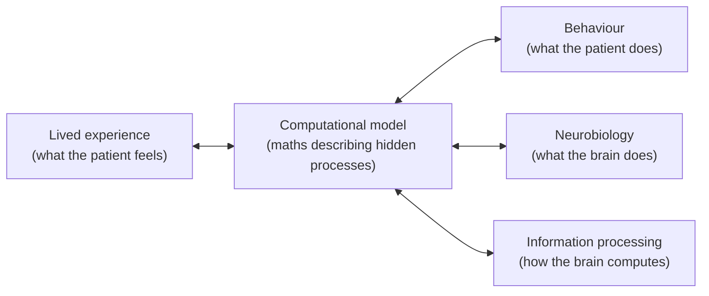

# Why Psychiatry Needs Computational Methods

Back to [[00. Computational Psychiatry - Research Home|Research Home]] · Source: [[01. Paper - What is Computational Psychiatry (Antonucci 2026)|Antonucci 2026]], Introduction (pp. 2–3) and Summary (p. 1)

## First, some basic words

- **Psychiatry**: the branch of medicine that diagnoses and treats mental disorders, such as depression, schizophrenia, anxiety and addiction.
- **Psychiatric disorder / mental disorder**: a recognised pattern of problems in thinking, feeling or behaving that causes distress or impairment.
- **Symptom**: something the patient experiences or shows, for example low mood, hearing voices, or loss of pleasure.
- **Psychiatric phenomena**: anything psychiatry studies, including symptoms, experiences and behaviours.

## What is Computational Psychiatry?

> [!quote] From the paper (p. 2)
> CP "in the broad sense" is "an interdisciplinary field that leverages the potential of mathematics, informatics and related disciplines to improve the understanding of psychiatric phenomena." The authors say it "may contribute to reshaping the way we conceptualise, diagnose and treat mental disorders."

The paper points out that maths and statistics are not new to psychiatry. They have been used for decades in statistical analysis of experiments, **neuroimaging** (brain scanning) and **psychometrics** (designing and scoring psychological questionnaires and tests). What is new is the ambition to build *explicit models of the mental processes themselves*.

## The core problem: psychiatry still runs on subjective measures

In everyday practice, psychiatric care still relies mainly on:
- **patient interviews**
- **questionnaires**
- **clinical intuition**

The paper calls this **subject-centred** perspective (focusing on the person's own experience) "the cornerstone of mental-health care". But because it is qualitative, it can lead to:
- **heterogeneous diagnoses**: different clinicians reach different conclusions, and patients with the same label can be very different;
- **uncertain prognoses**: it is hard to predict how the illness will develop;
- **variable treatment response**: the same treatment works for some patients and not others.

### What CP wants to do about it

> [!quote] From the paper (p. 2)
> "CP seeks **not to replace but to formalise and enrich** these subjective insights by integrating quantitative approaches." Among other things, it may "link lived experience with objective indicators of information processing, neurobiology, and behaviour."

The plan is to **model how faulty ("aberrant") computations in the brain give rise to both observable actions and first-person symptoms**. If this works, it should:
1. make diagnosis more precise,
2. allow treatment to be tailored to each person,
3. improve patient outcomes.

It must do this while **avoiding excessive reductionism**: explaining a mental disorder *only* as a broken molecule or *only* as a faulty thought pattern.

## Why this is hard: psychiatry is complex

Psychiatric disorders involve **many levels at once**: neurobiological, psychological, behavioural, social, environmental and more. No single level fully explains them. So a model has to be:

> [!quote] From the paper (p. 2)
> "as simple as possible, but not simpler", and it must still "make correct predictions of the phenomena they seek to describe."

This trade-off between simplicity and accuracy comes back in [[04. What is a Model]].

## Problem #1: diagnostic manuals describe, they don't explain

Psychiatrists use two main classification systems:
- **DSM-5**: the *Diagnostic and Statistical Manual of Mental Disorders*, 5th edition, published by the American Psychiatric Association.
- **ICD-11**: the World Health Organization's *International Classification of Diseases*, 11th revision.

Both are basically **checklists**. Someone receives a diagnosis if enough listed symptoms occur together.

> [!quote] From the paper (p. 2)
> These systems are criticised for being "rooted in a descriptive medical framework" with a "simplistic conceptualization of 'symptoms'". They "define disorders based on the co-occurrence of aggregated phenomena, rather than attempting to develop explicit working models of mental functions and dysfunctions; hence, they **prioritize reliability over validity**." Diagnostic categories "have been developed to be consistent, not to identify patterns of causal mechanisms."

### Reliability vs validity

| | Meaning | Diagnostic example |
|---|---|---|
| **Reliability** | Getting the *same answer* every time | Two psychiatrists given the same patient reach the same DSM label |
| **Validity** | Measuring the *real thing* | The label matches a real, distinct underlying cause |

> [!tip] CS analogy
> A hash function is perfectly *reliable*: the same input always gives the same output. But the hash tells you nothing about what the input *means*. DSM categories are reliable labels that don't necessarily point to a real underlying mechanism.

> [!quote] From the paper (p. 2)
> "There is general consensus that the field of psychiatry still lacks formal, testable theories that would allow to confirm or refute core hypotheses."

## Problem #2: earlier reform attempts haven't closed the gap

### RDoC (Research Domain Criteria)
Created by the US **National Institute of Mental Health (NIMH)**. Instead of disease categories, RDoC organises mental illness around **functional domains**, using **neurobehavioural constructs** (measurable brain-and-behaviour systems). This moves away from descriptive, statistical models of diagnostic categories and towards mechanistic, theoretical ones.

> [!quote] From the paper (p. 2)
> Despite their promise, such **dimensional frameworks** "still lack a theoretical formalization that effectively explains the connection between clinical phenomenology, psychological and behavioural processes and underlying neurobiological features."

**Clinical phenomenology** means the detailed description of what patients experience. A **dimensional** framework treats mental health as a set of sliding scales rather than yes/no categories.

> [!info] Extra context (not from the paper)
> RDoC's domains include things like reward processing, threat responses and cognitive systems. The paper doesn't list the domains; this example is only to make "functional domain" concrete.

### Open science
Other efforts improve **methodological transparency**: open science practices, data sharing and more rigorous procedures. The paper says these are "extremely important" but **may not fix the theoretical gaps**. A valid, theory-based classification system linking research and clinical practice "remains an ongoing goal" (p. 2).

## The full list of problems CP targets

> [!quote] From the paper (p. 1, Summary)
> CP aims to "overcome long-standing limitations of psychiatric research, including":
> 1. the **lack of formal theories**
> 2. reliance on **descriptive and agnostic diagnostic systems** (*agnostic* = making no claims about causes)
> 3. the **scarcity of valid biomarkers** (a *biomarker* is a measurable biological sign of a disease, like blood sugar for diabetes)
> 4. the predominance of **simplistic outcome measures**
> 5. **limited treatment specificity** (treatments aren't matched to the person's mechanism)
> 6. the **low reproducibility** of many findings (results don't hold when the study is repeated)

## So what *is* CP, methodologically?

> [!quote] From the paper (p. 2)
> CP "can be viewed as an **array of methodological frameworks for constructing and testing formal models** of mental health phenomena, explicitly designed for handling complex data and to represent latent mechanisms."

Broken down:
- **Formal models**: written in mathematics, so they are precise and testable.
- **Latent mechanisms**: hidden processes that can't be observed directly, such as how fast someone learns from reward. ("Latent" = hidden.)
- Instead of adding up symptoms, CP builds **explicit mappings between unobserved processes and observable data**. It states assumptions and **sources of uncertainty** openly, so hypotheses can be specified, tested empirically and progressively refined.
- CP can also work **without a theory first**. It can process **high-dimensional, multimodal data** (many variables from many kinds of source) and "work backwards" from recurring patterns to their origin, which "might be due to relevant causal mechanisms."
- **Advances in computing power** were key. They make it possible to estimate, simulate and compare models that would otherwise be "computationally infeasible".

These last two points are the seeds of CP's two strategies → [[03. Theory-driven vs Data-driven Approaches]].

## Related
- Next: [[03. Theory-driven vs Data-driven Approaches]]
- Terms: [[14. Computational Psychiatry Glossary]]
- Source notes: [[15. Source Issues and Open Questions]] (the ICD-11 reference issue)
