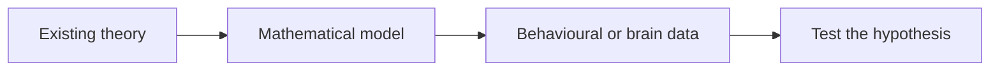
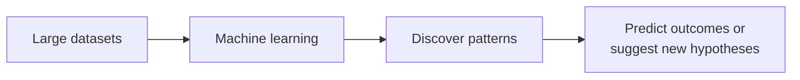
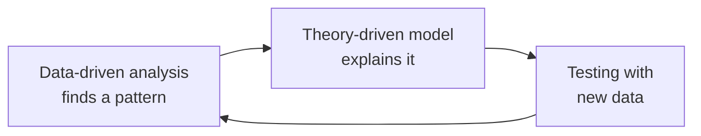

# The Two Main Approaches

Back to [[00. Computational Psychiatry - Research Home|Home]] · Previous: [[02. Why Psychiatry Needs Computational Methods]] · Source: paper pp. 2–3

## 1. Theory-driven approach
**Starts with a theory.** Researchers take an existing idea about how a mental process works, turn it into a mathematical model, and test it against data from behaviour or the brain (e.g. **fMRI** brain scans or **EEG** brain-wave recordings).

**Main question:** How and why does the process happen?

## 2. Data-driven approach
**Starts with data.** Researchers analyse large datasets with machine learning (ML) and look for patterns, without needing a theory first.

**Main question:** What patterns exist, and what can they predict?

## 3. Comparison to remember
| Theory-driven | Data-driven |
|---|---|
| Starts with a hypothesis | Starts with data |
| Builds a model of a proposed mechanism | Finds patterns using ML |
| Explains **how and why** | Discovers patterns and **predicts** |
| Tests an existing explanation | Can suggest new explanations |

The two approaches are **complementary, not competing**.

## 4. Example: negativity bias in depression
**Negativity bias** means giving more attention or weight to negative information than to positive information.

For example, two people get feedback on their work. One focuses on the praise; the other focuses mainly on the criticism. The second shows a stronger negativity bias. Cognitive theories of depression link this bias to **pessimism** and **hopelessness**.

### A. Theory-driven research
Start from the theory that negative thinking patterns contribute to depression. Then:
1. Build a mathematical model of how a person processes positive and negative information.
2. Design a behavioural task to measure the person's choices.
3. Estimate model **parameters** (numbers) that measure each person's negativity bias.
4. Test whether these numbers relate to depression symptoms or brain activity.
5. Check whether treatment (therapy, brain stimulation or medication) changes the bias.

### B. Data-driven research
Don't start with the idea of negativity bias. Instead:
1. Collect large behavioural, brain-scan or digital (e.g. online activity) data.
2. Use ML to search for patterns.
3. Discover, for example, that some people engage more with negative online content.
4. Test whether this pattern predicts pessimism, hopelessness or later clinical outcomes.

The model finds the pattern even though nobody told it to look for "negativity bias".

> The paper presents this as an illustration of how each approach works, not as a real study.

## 5. How the two approaches work together

This cycle can repeat: new data improves the theory, and a better theory guides what data to collect next.

## 6. The goal: precision psychiatry
Together, both approaches support **precision psychiatry**: choosing treatment based on each person's causes, symptoms and biology, instead of one-size-fits-all.

> **One important caution** *(not from the paper)*: finding that a pattern predicts depression does not prove that the pattern **causes** depression.

Next: [[04. What is a Model]]
