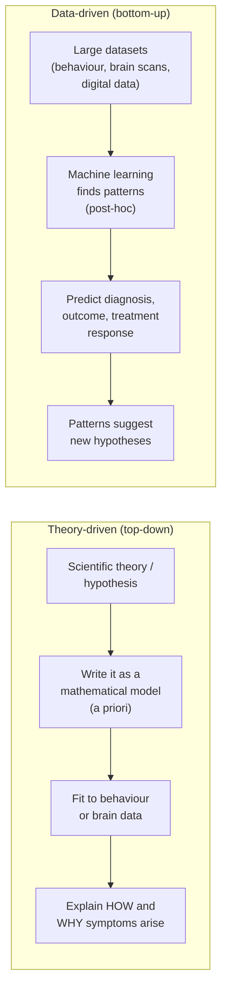
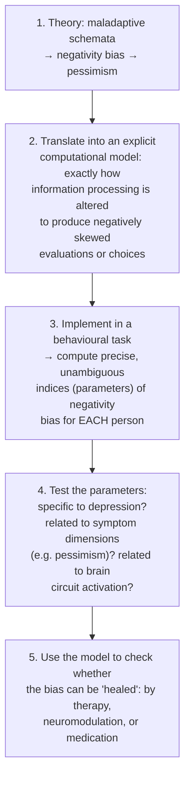
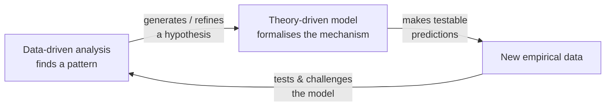

# Theory-driven vs Data-driven Approaches

Back to [[00. Computational Psychiatry - Research Home|Research Home]] · Previous: [[02. Why Psychiatry Needs Computational Methods]] · Source: [[01. Paper - What is Computational Psychiatry (Antonucci 2026)|Antonucci 2026]], pp. 2–3

## The two strategies

> [!quote] From the paper (p. 2)
> "Schematically, two main strategies have emerged: the **theory-driven** and the **data-driven** approach. Both apply mathematical models to interpret human experience and behaviour but follow a distinct pathway."

| | **Theory-driven** | **Data-driven** |
|---|---|---|
| Starting point | A model assumed **a priori** (before seeing the data), mostly based on **cognitive neuroscience** (the study of how the brain produces thinking) | Large amounts of data, analysed **post-hoc** (after collection) |
| Typical data | Often informed by neural data with high spatial or temporal resolution, e.g. **fMRI** (brain scanning that tracks blood flow) and **EEG** (electrical activity recorded from the scalp) | Large behavioural, neuroimaging or **digital phenotyping** datasets (data from phones, wearables and online behaviour) |
| Typical tools | Generative models: belief updating, decision-making, reinforcement learning | Machine learning (ML) |
| Main goal | Scientific understanding of **how and why** phenomena are generated; models are **causally interpretable** and grounded in neuroscience | **Discover patterns** that help diagnosis and outcome prediction, and that may "prompt, extend or challenge existing theories" |
| Typical outputs | Mechanistic links between neurobiology, behaviour and subjective experience | Disease subtyping, risk stratification, prediction of clinical trajectories, estimation of differential treatment response |
| In these notes | [[05. Theory-driven Computational Models]] | [[10. Data-driven Modelling - AI and Machine Learning]] |

> [!tip] CS analogy
> Theory-driven is like writing a **simulator from first principles**: you write the physics, then check whether the simulation looks like reality. Data-driven is like **training a classifier**: you don't specify the rules, the algorithm learns them from examples.

## Worked example from the paper: negativity bias in depression

The paper explains the difference with one example (p. 3).

**Background terms:**
- **Depression**: a mood disorder involving persistent low mood, loss of interest, pessimism and hopelessness.
- **Cognitive theories of depression**: theories that depression is maintained by distorted patterns of thinking.
- **Maladaptive schemata**: deep, unhelpful mental "templates" about oneself and the world, such as "I always fail".
- **Negativity bias**: a tendency to weigh negative information more heavily than positive information.

Cognitive theories suggest that maladaptive schemata activate a negativity bias, which contributes to pessimism and hopelessness.

### The theory-driven route

**Neuromodulation** means treatments that directly change brain activity, for example with magnetic or electrical stimulation.

### The data-driven route

The data-driven route "works the other way around". It does **not** start from a formal model, or even from the idea of negativity bias.

1. Start with large behavioural, neuroimaging or digital phenotyping datasets.
2. Use ML to find patterns or dimensions that tell individuals apart or predict clinical outcomes.
3. **Example from the paper:** a model analysing large-scale online behaviour might find a pattern of **preferential engagement with negatively-valenced content** (people engaging more with negative content), which specifically predicts pessimism and hopelessness, "even though no construct such as 'negativity bias' was specified a priori."

> [!warning] Hypothetical example
> The paper presents both routes as **illustrations of how the approaches would work**. It doesn't report an actual study that found this online-behaviour pattern.

## They are not rivals, they form a cycle

> [!quote] From the paper (p. 3)
> "Theory- and data-driven approaches are not independent alternatives but form a **circular and mutually reinforcing process**, in which data-driven analyses can generate or refine hypotheses, and theory-driven models provide structured explanations that can be tested and challenged by empirical data."

## Where this leads: precision psychiatry

> [!quote] From the paper (p. 1)
> Together, the two approaches "provide complementary tools to generate and test specific hypotheses about psychiatric conditions, while advancing **precision psychiatry** through the tailoring of interventions to individual etiological, clinical, and pathophysiology profiles."

- **Etiological**: about the *causes* of a disorder.
- **Pathophysiology**: the biological processes that go wrong in a disease.
- **Precision psychiatry**: choosing the treatment that fits *this* person's causes and biology, instead of one-size-fits-all.

The paper's hope is to move psychiatry "beyond descriptive symptom frameworks, toward **explanatory, predictive, and personalised** accounts of mental disorders" (p. 1).

> [!info] Extra context (not from the paper)
> The paper cites Bennett, Silverstein & Niv (2019), *"The Two Cultures of Computational Psychiatry"* (ref. 31). Its title suggests these two strategies are often seen as separate research communities. That makes it a good next read for this topic.

## Related
- Next: [[04. What is a Model]]
- Theory side: [[05. Theory-driven Computational Models]]
- Data side: [[10. Data-driven Modelling - AI and Machine Learning]]
- My notes: [[Machine Learning]]
