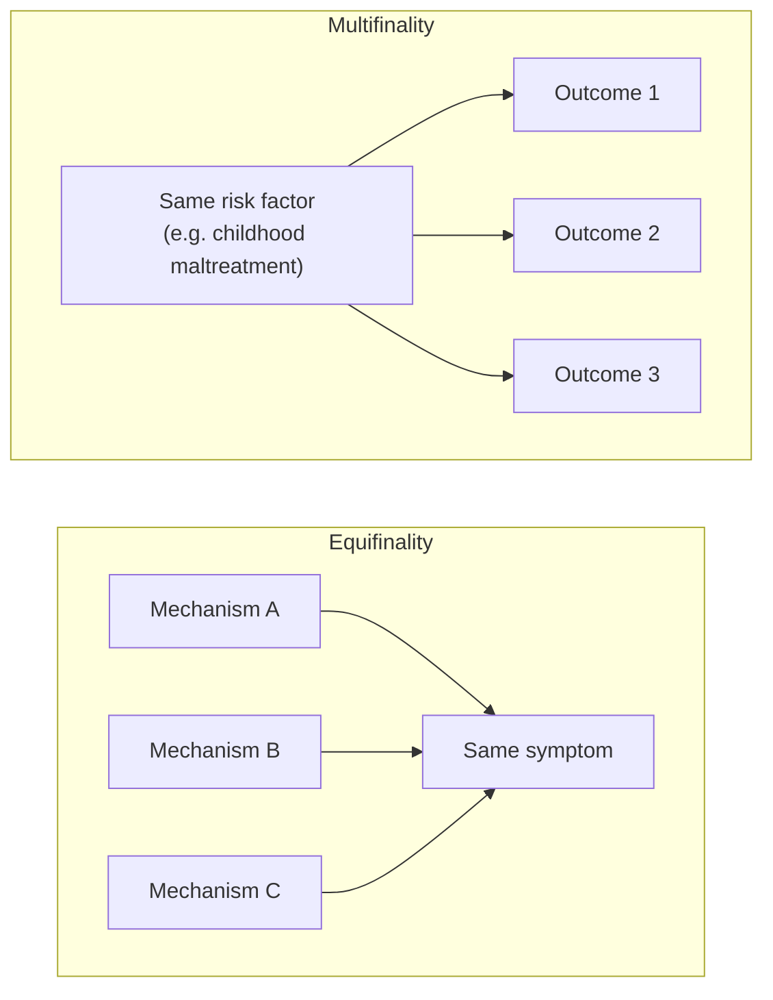
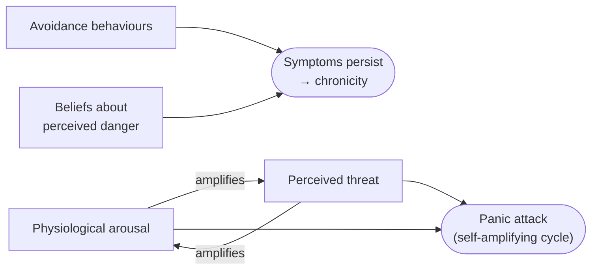
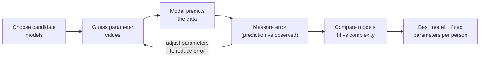

# What is a Model?

Back to [[00. Computational Psychiatry - Research Home|Research Home]] · Previous: [[03. Theory-driven vs Data-driven Approaches]] · Source: [[01. Paper - What is Computational Psychiatry (Antonucci 2026)|Antonucci 2026]], pp. 3–5

Both theory-driven and data-driven research use models, in different ways but with the same basic features. This note covers those shared features.

## 1. A model is a simplified representation

> [!quote] From the paper (p. 3)
> "A model, in the broad sense, is a simplified representation of a complex system, **not necessarily a mathematical one**."

**Non-mathematical example from the paper:** Freud's **topographic model** of the mind (id, ego and superego) was a *conceptual* model. It was meant to organise and interpret mental phenomena, but had no mathematical form.

In the natural sciences, a model is built to **structure observed data, and to describe, predict or explain** a system's behaviour. It "imposes a formal, comprehensible structure on observed phenomena" (p. 3).

## 2. Why modelling psychiatry is especially hard: equifinality and multifinality

Two terms from developmental psychopathology. **Psychopathology** is the scientific study of mental disorders.

- **Equifinality**: *different causes → the same outcome.* The same symptom can come from different underlying mechanisms.
- **Multifinality**: *the same starting point → different outcomes.* People with similar brain dysfunctions (e.g. **brain lesions**, areas of damage) or similar risk factors (e.g. **childhood maltreatment**) can develop quite different clinical characteristics or **clinical trajectories** (the course their illness takes over time).

> [!tip] CS analogy
> Equifinality is like a "500 Internal Server Error": one visible symptom, many possible bugs. Multifinality is like the same memory leak crashing one machine but only slowing down another. You need a model of the *mechanism*, not just a list of error messages.

## 3. Statistical models and their limits

**Statistical models** describe possible links between observed variables using formulas such as **linear regression**. They are common in psychiatry because they are simple and interpretable, but the paper lists known limitations (p. 3):

1. They show **association, not causation**.
2. They may **struggle with complex, non-linear relationships**.
3. Both of these can limit generalisability and clinical usefulness.

> [!example] Example from the paper (p. 3): dopamine and anhedonia
> You could use linear regression to relate **striatal dopamine D2/D3 receptor occupancy** to the severity of **anhedonia**. But this analysis:
> - doesn't represent the key processes involved,
> - isn't necessarily causal,
> - assumes the relationship is a straight line, "despite neurobiological evidence of the contrary."
>
> *Terms:* the **striatum** is a deep brain region involved in reward and movement. **Dopamine** is a chemical messenger linked to reward and motivation. **D2/D3 receptors** are the "docking sites" dopamine binds to, and *occupancy* is how many of them are filled. **Anhedonia** is the reduced ability to feel pleasure or be motivated by reward, a core symptom of depression.

**Biology is usually non-linear.** The paper notes that the relationship between brain function and neural activity typically follows a U-shaped pattern: **moderate** activity goes with optimal functioning, and **extreme** levels (too low or too high) go with dysfunction (p. 3).

![[cp-inverted-u.png]]
*My conceptual sketch (no real data). A straight-line model would completely miss the "too much is also bad" side.*

> [!warning] Small wording issue
> The paper says "U-shaped", but the cited reference (ref. 23, Northoff & Tumati 2019) is titled "*inverted* U-shaped", and the description (best in the middle) also matches an inverted U. The sketch above is drawn as an inverted U.

## 4. Computational models

> [!quote] From the paper (p. 3)
> "Computational models are specifically developed to address these limitations. A computational model is a (generally complex) mathematical representation of a biological or psychological phenomenon."

- In **theory-driven** work, it is based on a formal hypothesis about the **data-generating process** (how the data came to exist).
- In **data-driven** work, it captures the key features of patterns in the data.

**Key strength:** computational models can **recreate realistic system dynamics**. That lets researchers explore what happens under different **perturbations** (disturbances) to neural circuits, behaviour, symptoms or whole psychiatric **syndromes** (a syndrome is a group of symptoms that occur together).

### Example from the paper: panic disorder as a dynamic system (p. 4)

**Panic disorder** involves repeated, sudden attacks of intense fear (**panic attacks**) with strong bodily symptoms, plus ongoing worry about future attacks. A recent computational model (ref. 25, Robinaugh et al. 2024) treats it as a **dynamic system** in which symptoms reinforce each other through **positive and negative feedback loops**. The paper says the model was used to explain:
- how **physiological arousal** (racing heart, breathing) and **perceived threat** can create a **self-amplifying cycle** that leads to a panic attack;
- how **avoidance behaviours** and **beliefs about danger** can make symptoms **persist and become chronic**.

> [!warning] Detail not in the paper
> The paper only summarises this model in two sentences. It doesn't give the equations, or say which loops are positive and which are negative. The diagram shows only what the text states. For details, read ref. 25.

## 5. Parameters: the model's hidden "knobs"

> [!quote] From the paper (p. 4)
> Computational models summarise the hypothesised process through **parameters**. "These parameters are **latent variables** that may quantify cognitive, neural, or informational processes. They do not exist as observable entities but provide a useful way of capturing and describing underlying phenomena."

- **Simple case:** in a linear model $y = ax + b$, the **slope** $a$ and **intercept** $b$ summarise the relationship (Figure 1A).
- **Theory-driven case:** parameters represent **unobservable processes**, for example:
  - how quickly someone updates their beliefs,
  - how much information someone needs before making a decision,
  - mathematical relationships linking datapoints.

  These are **inferred** (estimated) from behavioural or neural data.

## 6. Error, model fitting and model selection

- **Error ($\varepsilon$)**: every model has an error, the **distance between the model's predictions and the observed data** (Figure 1B).
- **Model fitting**: **competing models** are tested on the same data, and each model's parameters are **systematically adjusted to minimise the error** (Figure 1C). This makes models more accurate and inference more reliable.
- **Model selection**: "advanced statistical and mathematical criteria" help choose the best model by **balancing theoretical validity, complexity, and explanatory or predictive power** (p. 4).

> [!info] Extra context (not from the paper)
> The reference the paper cites for model-selection criteria (ref. 30) is about the **Akaike Information Criterion (AIC)**. AIC rewards a model for fitting well and penalises it for every extra parameter: $\text{AIC} = 2k - 2\ln(\hat{L})$, where $k$ is the number of parameters and $\hat{L}$ the maximised likelihood. Lower is better. The paper itself doesn't name AIC or give this formula.

> [!tip] CS analogy
> This is the same loop as training in ML: a loss function (error) plus an optimiser (adjust parameters). See my note [[Linear Regression]].

## 7. Prediction and generalisation

Once the parameters are estimated, a model should **predict future data in similar conditions**. The paper's examples (p. 4):
- a person's behaviour over more rounds of a computer task, or
- the probability of developing a condition for people with similar characteristics.

> [!quote] From the paper (p. 4)
> "Most importantly, the model should be able to **generalize to unseen data**, or to behaviour outside the laboratory."

## 8. Overfitting

> [!quote] From the paper (p. 5)
> **Overfitting** is "when a model becomes excessively tuned with a specific dataset, but loses its ability to generalize to new, unseen data" (Figure 1D). "A model must have a level of complexity appropriate to the problem at hand and be sufficiently representative across populations to support reliability and clinical use."

![[cp-overfitting-curve.png]]
*My simulation, not from the paper. As the model gets more complex, the error on training data keeps falling, but the error on new data eventually shoots up. That is overfitting.*

## Figure 1 from the paper

![[cp-paper-fig1-modelling-principles.jpg]]
*Figure 1, Antonucci et al. (2026), CC BY-NC-ND 4.0, reproduced unmodified.*

**What each panel shows (from the caption, p. 4):**
- **(A)** A simple linear model $y = 2x + 3$ fitted to points. Intercept $b = 3$, slope $a = 2$.
- **(B)** The green line is the **error** $\varepsilon$: the distance between an observed point and the model's prediction. Fitting tries to minimise these errors.
- **(C)** Models of increasing complexity and their errors, from left to right:
  - $y = 3$ (intercept only)
  - $y = x$ (a line through the origin with slope fixed at 1)
  - $y = 2x$ (adjusted slope)
  - $y = 2x + 3$ (slope and intercept)

  The ERROR label shrinks from left to right: "as model complexity increases appropriately, error decreases."
- **(D)** Under- vs overfitting:
  - **0 parameters** 😞 *underfits*: misses the pattern.
  - **Moderate complexity** (2–3 parameters) captures the true relationship and still generalises. In the picture, 2 parameters gets a neutral face 😐 and the 3-parameter curve gets the happy face 🙂.
  - **n parameters** 😞 *overfits*: passes through every point but won't generalise.

> [!warning] Caption detail
> In 1C, the caption says $y = x$ has "one parameter (slope only, fixed at 1)". A value that is *fixed* isn't estimated from data, so strictly it has zero free parameters. This doesn't change the main message. See [[15. Source Issues and Open Questions]].

## Related
- Next: [[05. Theory-driven Computational Models]]
- Applies to data-driven ML too: [[10. Data-driven Modelling - AI and Machine Learning]], [[Model Evaluation]]
- Panic disorder model ↔ symptom networks: [[11. Symptom Network Models]]
