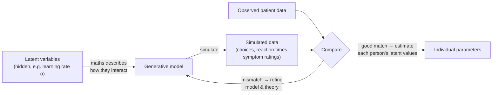

# Theory-driven Computational Models

Back to [[00. Computational Psychiatry - Research Home|Research Home]] · Previous: [[04. What is a Model]] · Source: [[01. Paper - What is Computational Psychiatry (Antonucci 2026)|Antonucci 2026]], pp. 5–7

## Definition

> [!quote] From the paper (p. 5)
> "Theory-driven methods use existing scientific theories, principles and hypotheses to develop models that explain **how and why** certain behaviours or symptoms occur." The neurobiological or causal mechanisms behind a phenomenon are first outlined as theory and then **formalised into one or more computational models**. The maths is then used to check whether the observed data are **consistent with the theory**, which allows specific hypotheses to be tested.

## The defining feature: latent entities and generative models

Theory-driven models do more than describe associations between observable variables and behaviour. They **postulate latent entities and processes**: theoretical things that can't be measured directly, through which psychiatric phenomena are thought to emerge.

These are called **generative models**, and they work in three steps (p. 5):
1. **Define latent variables**, typically representing cognitive or neural constructs (e.g. "learning rate", "reward sensitivity").
2. **Describe their interactions mathematically.**
3. Show **how they generate the observable data**: task choices, **reaction times**, or symptom ratings.

### Why "generative" matters

> [!quote] From the paper (p. 5)
> Models are built so they can "extrapolate, simulate virtual data as similar as possible to those observed in patients. This **generative property is central to their scientific value** because it forces researchers to make explicit assumptions about which latent processes may be altered in a given disorder, and how such alterations are expected to manifest as observable symptoms or behavioural changes."

So generative models "move beyond descriptive correlations and provide **mechanistic accounts**" of psychiatric phenomena.

> [!tip] CS analogy
> A generative model is like a **program that produces output** (a simulator). You can run it, compare its output with real logs, and debug it. A purely descriptive statistic is like a summary of the logs: it tells you *what* happened, but not *which code* produced it.

## What generative models let you do

### 1. Counterfactual "what-if" experiments
You can predict how behaviour **would change if one latent entity were altered**. This lets researchers examine **possible interventions at the level of mechanism, before trying them on patients** (p. 5).

### 2. Cumulative science
Repeatedly comparing simulated with observed data **refines both the models and the theories**, "fostering cumulative advances" (p. 5).

### 3. Individual-level estimates → precision psychiatry
Theory-driven models can **estimate latent variable values for each individual**. This gives a principled way to:
- describe **inter-individual variability** (how people differ);
- find **distinct latent mechanisms** that produce **similar clinical presentations** (this is *equifinality*, see [[04. What is a Model]]).

That is "particularly relevant for informing **differential treatment strategies**" (different treatments for different mechanisms) and for **precision psychiatry** (p. 5).

### 4. Linking levels of analysis
Generative models can connect **behaviour, neuroimaging and physiological measures** in one formal framework, by specifying how all of them could come from **shared latent processes** (p. 5).

> [!quote] An honest limitation stated by the paper (p. 5)
> In principle, these approaches could be applied at every biological level, from neural circuits to large-scale brain signals. But in psychiatry, "the **limited biological grounding of behaviour**" means **most applications have focused on modelling behavioural data from computerised tasks** and relating the resulting parameters to **subjective reports** (what patients say about themselves). This reflects a long effort to bridge self-report measures and experimental evidence in psycho(patho)logy.

## Decision-making: the central domain

> [!quote] From the paper (p. 5)
> "Many psychiatric disorders can be understood as **disturbances of choice under uncertainty**."

Across **depression, addiction, schizophrenia, anxiety and personality disorders**, patients show systematic biases in:
- how **options are evaluated**,
- how **beliefs are updated**,
- how **short- and long-term outcomes are weighed**.

*Terms:* **schizophrenia** is a severe mental disorder involving hallucinations, delusions and disorganised thinking. **Personality disorders** are long-lasting, rigid patterns of thinking and relating to others that cause problems.

### Tasks borrowed from neuroeconomics

**Neuroeconomics** combines economics, psychology and neuroscience to study how people make decisions. Psychiatry increasingly uses its **behavioural tasks** (p. 5):
- They place participants in **controlled, incentivised choice settings** (choices with real rewards such as points or money).
- They allow estimation of latent parameters, such as **learning rates, risk preferences, or social valuation**, which are hard to capture reliably through **self-report** alone.
- They are grounded in **normative models** from economics and neuroscience (models of how an ideal decision-maker *should* choose).
- They **can be translated across species**, so the same task logic can be used with animals.

This makes them a "structured entry point" for computational frameworks of decision-making, including **reinforcement learning** → [[06. Reinforcement Learning and the Rescorla-Wagner Model]].

## The frontier: biologically inspired neural networks

The paper describes a "promising direction" for pushing theory-driven, mechanistic modelling further (p. 5):

- **Biologically inspired Artificial Neural Networks (ANNs)** are emerging as tools for **simulating neural dynamics** across different levels of analysis.
- **Spiking Neural Networks (SNNs)** are "particularly valuable":
  - Their **bottom-up architecture** lets them include key neurobiological mechanisms such as **synaptic plasticity** (connections between neurons strengthening or weakening with experience) and **neuromodulation** (chemicals such as dopamine changing how neurons respond).
  - They reproduce neural dynamics with **realistic topology** (realistic wiring layout).
  - They could potentially model how **cognitive, behavioural and conscious processes emerge** from underlying neural computations, reproducing the brain's **multilevel organisation**.

> [!info] Extra context (not from the paper)
> Standard deep-learning neurons output a continuous number at every step. **Spiking** neurons instead send discrete electrical "spikes" at particular moments in time, like real neurons do, which makes them more biologically realistic. See my note [[Neural Network]] for the standard kind.

> [!quote] From the paper (p. 5–6)
> "While such biologically inspired approaches represent the frontier of theory-driven modelling, **most current applications in psychiatry rely on more established computational frameworks**", mainly reinforcement learning, Bayesian models and drift diffusion models.

## The three established frameworks covered by the paper

| Framework | Core idea | Best for | Note |
|---|---|---|---|
| Reinforcement learning (Rescorla–Wagner) | Learn values from reward feedback via **prediction errors** | Tasks with reward/punishment feedback | [[06. Reinforcement Learning and the Rescorla-Wagner Model]] |
| Bayesian inference / Bayesian brain | Combine **prior beliefs** with **new evidence** | Belief updating, perception | [[07. Bayesian Brain and Belief Updating]] |
| Drift diffusion model | **Noisy evidence accumulates** to a decision threshold | Two-choice perceptual tasks with no feedback, plus reaction times | [[08. Drift Diffusion Models]] |

## Strengths and difficulties

> [!quote] From the paper (p. 7)
> "Computational, generative models often reach **extreme levels of complexity** which may render them difficult for clinicians who don't possess a strong mathematical background. However, they represent a promising perspective to develop a true **'precision pathophysiology'**, by providing insights into the genesis of phenomena that were previously only tackled at the descriptive level."

**Applications listed by the paper** (p. 7), with the topics of the references it cites (titles from the reference list):
- overarching models of psychopathology;
- **depression** (refs. 55–56: depressive rumination from an active inference perspective; decision uncertainty in depression, anxiety and substance use);
- **schizophrenia** (ref. 57: the "dysconnection hypothesis");
- **interoceptive disorders** (ref. 58). *Interoception* is the sense of your body's internal state, such as heartbeat or hunger;
- **hallucinations** (ref. 59, visual hallucinations). A *hallucination* is perceiving something that isn't there;
- **delusions** (ref. 60). A *delusion* is a fixed false belief held despite clear evidence against it.

> [!warning] Not detailed in the paper
> The paper only *lists* these applications. It doesn't explain how any of these models work. Several of the cited titles mention **predictive coding** and **active inference** (refs. 46–51, 55), which are related to the Bayesian brain idea, but the paper never defines those terms. Follow the references if you need them.

## Related
- Worked example: [[09. Probabilistic Reward Task - Anhedonia Case Study]]
- Contrast: [[10. Data-driven Modelling - AI and Machine Learning]]
- My notes: [[Reinforcement Learning]], [[Neural Network]]
