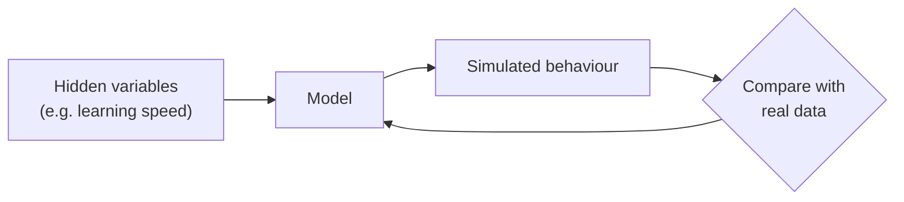

# Theory-driven Models

Back to [[00. Computational Psychiatry - Research Home|Home]] · Previous: [[04. What is a Model]] · Source: paper pp. 5–7

## 1. What are theory-driven models?
They start from an existing scientific theory and turn it into a mathematical model. The model is then checked against real data to see whether the theory fits.

## 2. Generative models
Theory-driven models are usually **generative**: they can **produce (simulate) fake data** that should look like real patient data.

**Why this is useful:**
- Researchers must state their **assumptions clearly**.
- They can run **"what-if" tests**: what would change if one hidden process were different? This helps explore treatments before trying them on patients.
- They can estimate hidden values **for each person**. Two people with the same symptoms may have different underlying causes, which helps choose different treatments.
- They can link **behaviour, brain scans and body measurements** in one model.

**In practice:** most psychiatry studies so far model **choices made in computer tasks** and compare the results with what patients report about themselves.

## 3. Decision-making
The paper says many mental disorders can be seen as **problems in making choices under uncertainty**.

In depression, addiction, schizophrenia, anxiety and personality disorders, people may differ in how they:
- value options,
- update their beliefs,
- weigh short-term against long-term outcomes.

Researchers use tasks from **neuroeconomics** (the study of how the brain makes decisions). Participants make choices for rewards such as points. The tasks measure things like **learning speed**, **risk-taking** and **social value**, which are hard to measure with questionnaires.

## 4. Brain-like neural networks (the frontier)
- **Artificial Neural Networks (ANNs)** inspired by biology can simulate brain activity.
- **Spiking Neural Networks (SNNs)** are especially realistic. They include how brain connections change with learning and how brain chemicals adjust activity.
- They might one day show how thinking and behaviour emerge from brain activity.

However, most current research still uses three established models:

| Model | Simple idea | Note |
|---|---|---|
| Reinforcement learning | Learn from rewards | [[06. Reinforcement Learning and the Rescorla-Wagner Model]] |
| Bayesian brain | Combine expectations with new evidence | [[07. Bayesian Brain and Belief Updating]] |
| Drift diffusion model | Collect evidence until you decide | [[08. Drift Diffusion Models]] |

## 5. Strengths and weaknesses
- **Weakness:** these models can be very complex for clinicians without a strong maths background.
- **Strength:** they can explain how symptoms arise, not just describe them.
- **Used for:** depression, schizophrenia, body-sensing (interoceptive) disorders, hallucinations and delusions. The paper only lists these and doesn't explain the models.

Next: [[06. Reinforcement Learning and the Rescorla-Wagner Model]]
