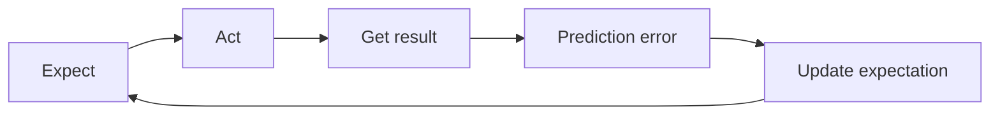

# Reinforcement Learning and the Rescorla–Wagner Model

Back to [[00. Computational Psychiatry - Research Home|Home]] · Previous: [[05. Theory-driven Computational Models]] · Source: paper pp. 6–7

## 1. What is reinforcement learning (RL)?
RL explains how we **learn from feedback**. We try something, see the result, and adjust what we do next time.

## 2. Prediction error
The key idea is the **prediction error**: the difference between what you **expected** and what you **actually got**.

| Prediction error | Meaning | What happens |
|---|---|---|
| Positive | Better than expected | Expect more next time |
| Negative | Worse than expected | Expect less next time |
| Zero | As expected | Little to learn |

## 3. Example: two cafés
A person tries two new cafés on the way to work.
- At first, they switch between them because they don't know which is better.
- Each visit is either good coffee (reward) or disappointing coffee.
- Early on, prediction errors are **large** because expectations are uncertain.
- Over time, they learn which café is better, the errors get **smaller**, and they mostly choose the better café.

![[cp-cafe-example.png]]

## 4. When learning goes wrong
| Disorder | Possible problem in learning |
|---|---|
| Addiction | Keeps choosing something despite repeated bad results |
| Depression | Reacts less to positive results, so learns less from them |
| Anxiety | Expects bad outcomes too strongly, so avoids things |

## 5. The Rescorla–Wagner model
A simple formula for learning from feedback:

$$V_{new} = V_{old} + \alpha \times (R - V_{old})$$

| Symbol | Meaning |
|---|---|
| $V$ | Expected value: how good you expect something to be |
| $R$ | Actual reward |
| $R - V$ | Prediction error |
| $\alpha$ (alpha) | **Learning rate**: how much each new result changes your expectation |

**In words:** new expectation = old expectation + (learning rate × surprise).

## 6. The learning rate
- **High α:** adapts quickly to recent results.
- **Low α:** learns slowly and steadily.

The learning rate is the main way people differ from each other in this model.

![[cp-rw-learning-rates.png]]

> The paper's text describes the formula slightly differently from its figure. The figure's version (shown above) is the standard one. See [[15. Source Issues and Open Questions]].

## 7. Link to Bayesian thinking
RL is similar to Bayesian inference: both update expectations step by step when new information arrives. → [[07. Bayesian Brain and Belief Updating]]

Next: [[07. Bayesian Brain and Belief Updating]]
