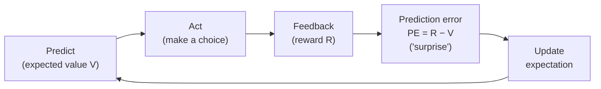

# Reinforcement Learning and the Rescorla–Wagner Model

Back to [[00. Computational Psychiatry - Research Home|Research Home]] · Previous: [[05. Theory-driven Computational Models]] · Source: [[01. Paper - What is Computational Psychiatry (Antonucci 2026)|Antonucci 2026]], pp. 6–7

## Reinforcement learning (RL) in one sentence

> [!quote] From the paper (p. 6)
> RL "provides a formal decision-making framework for understanding how agents **learn from feedback** by evaluating outcomes and updating future choices based on past experiences and long-term goals."

An **agent** is anything that makes choices: a person, an animal, or a program.

## The key idea: prediction error

> [!quote] From the paper (p. 6)
> "Central to RL theory is the concept of the **prediction error**, defined as the discrepancy between expected and actual outcomes, which drives learning and behavioural adaptation."

Behaviour is shaped by **repeated cycles** of:



The paper describes this as minimising **surprise** (prediction error) and updating.

- **Positive PE**: better than expected → raise the expectation.
- **Negative PE**: worse than expected → lower the expectation.
- **PE ≈ 0**: as expected → little learning needed.

> [!info] Extra context (not from the paper)
> The paper cites Schultz, Dayan & Montague (1997), *"A Neural Substrate of Prediction and Reward"* (ref. 43) for prediction errors. That study is widely known for linking prediction errors to **dopamine** neuron activity in the brain, which is why RL is so popular in psychiatry: it connects a formula to real brain chemistry. The paper itself doesn't explain this link.

## Everyday example from the paper: two cafés

> [!example] From the paper (p. 6)
> A person tries **two new cafés** on the way to work.
> 1. At first they **alternate** between them, unsure which is better.
> 2. Each visit gives feedback: sometimes satisfying (**reward**), sometimes disappointing (**null outcome**).
> 3. Early on, **prediction errors are large** because expectations are unstable.
> 4. With experience, **learning occurs and expectations stabilise**. They expect better coffee from one café and worse from the other.
> 5. **Prediction errors decrease**, and choices increasingly favour the more rewarding café (Fig. 2A).

![[cp-cafe-example.png]]
*My simulation of the café story, not from the paper. Left: expected quality for each café settles on its true level. Right: prediction errors start large and shrink towards zero.*

## How RL can "go awry" in mental illness

> [!quote] From the paper (p. 6)
> | Disorder | Possible RL alteration described in the paper |
> |---|---|
> | **Addiction** | Choices may **persist despite repeated negative feedback** |
> | **Depression** | **Reduced sensitivity to positive outcomes** may weaken learning |
> | **Anxiety** | **Exaggerated expectations of negative outcomes** may bias behaviour towards **avoidance** |
>
> "In this sense, RL offers a **mechanistic account** of how learning from experience can go awry in mental illness."

## The Rescorla–Wagner (RW) model

> [!quote] From the paper (p. 7)
> "One of the most effective ways to formalise RL is the Rescorla-Wagner (RW) model, which expresses learning as the **incremental updating of expected value over time**."

### The equation (as printed in Figure 2B)

$$
V_{t+1} = V_t + \alpha\,(R - V_t)
$$

| Symbol | Meaning |
|---|---|
| $V_t$ | **Expected value** at time (trial) $t$: how good you currently expect the option to be |
| $R$ | **Actual reward** received on this trial |
| $R - V_t$ | **Prediction error (PE)** |
| $\alpha$ (alpha) | **Learning rate**: the fraction of the PE used to update. In standard RW models it is between 0 and 1 (the paper doesn't state a range) |
| $V_{t+1}$ | Updated expectation for the next trial |

**In words:** *new expectation = old expectation + (learning rate × surprise).*

### The learning rate: what makes individuals differ

> [!quote] From the paper (p. 7)
> The learning rate $\alpha$ is "the key parameter governing the individual differences". It "determines how strongly new information influences updating in each subject: **higher values reflect rapid adaptation to recent outcomes, whereas lower values reflect slower, more stable learning.**"

![[cp-rw-learning-rates.png]]
*My reproduction of the idea in Figure 2B, not the paper's data. With reward always 1, a high α learns the true value within a few trials, while a low α is still far off after 50.*

> [!tip] CS analogy
> RW is exactly an **exponential moving average** (EMA), the same thing used for smoothing time series or momentum in optimisers. You can rewrite it as
> $$V_{t+1} = (1-\alpha)\,V_t + \alpha\,R$$
> so the new value is a **weighted average** of the old expectation and the new reward. $\alpha$ is the weight on the newest data point. This is also how gradient descent works: the "learning rate" in ML plays the same role.

> [!warning] Wording issues in the paper's text
> 1. The text says "PE is defined as the difference between the **expected value and the actual reward**", which reads as $V - R$. The figure uses $R - V_t$ (actual minus expected). The figure's version is the standard one and the one that makes the equation work.
> 2. The text describes the update as going from $V_{t-1}$ to $V_t$, while the figure goes from $V_t$ to $V_{t+1}$. This is only a shift in index and means the same thing.
> 3. The text says the future value "is the **product** of the past ($V_{t-1}$) and the present ones ($R$)". Mathematically it is a *weighted combination (sum)*, not a product (see the rearranged formula above).
>
> All three are listed in [[15. Source Issues and Open Questions]].

### Try it in Python

```python
# Rescorla–Wagner update (illustration for these notes)
def rescorla_wagner(rewards, alpha, v0=0.0):
    V = [v0]
    for R in rewards:
        pe = R - V[-1]              # prediction error
        V.append(V[-1] + alpha * pe)  # update by a fraction of the surprise
    return V

print([round(v, 3) for v in rescorla_wagner([1, 1, 1, 0, 1], alpha=0.3)])
# [0.0, 0.3, 0.51, 0.657, 0.46, 0.622]
```

## Figure 2 (panels A and B)

![[cp-paper-fig2-theory-driven.jpg]]
*Figure 2, Antonucci et al. (2026), CC BY-NC-ND 4.0, reproduced unmodified. This note covers panels A and B. Panel C is explained in [[07. Bayesian Brain and Belief Updating]] and panel D in [[08. Drift Diffusion Models]].*

- **(A) Bandit task.** A **bandit task** is a choice task named after slot machines ("one-armed bandits"). The caption calls it "a classic single arm bandit task".
  - Trial 1: "Will I win? 50:50", then "YOU WON!"
  - Trial 2: "I love this slot-machine", then another win.
  - Trial 3: "Ye\$\$\$\$ I need more".

  Positive feedback raises expectations and value, so "choices become increasingly driven by learned value."
- **(B) Rescorla–Wagner.** The equation $V_{t+1}=V_t+\alpha(R-V_t)$ and a graph of value over 50 trials for **high, average and low alpha**. Higher α rises quickly to the reward level, and lower α rises slowly.

## Connection to Bayesian inference

The paper notes that the RW updating scheme "bears a conceptual resemblance to **Bayesian inference**". Both treat learning as **iterative updating of expectations under uncertainty**, although they are distinct frameworks (p. 7). → [[07. Bayesian Brain and Belief Updating]]

## Related
- Worked application: [[09. Probabilistic Reward Task - Anhedonia Case Study]] (uses α and a reward-sensitivity parameter β)
- My notes: [[Reinforcement Learning]]
- RL also appears on the clinical side (the paper cites an RL model for medication regimens): [[13. Clinical Use - Promises, Challenges and Explainable AI]]
