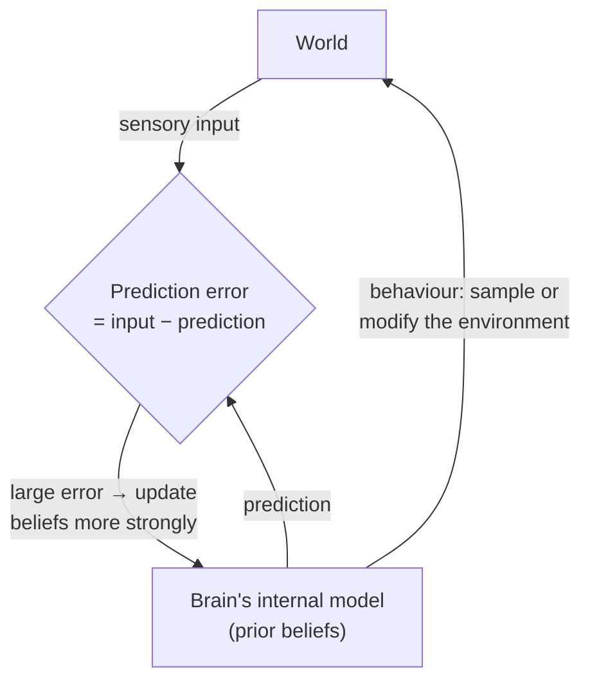

# Bayesian Brain and Belief Updating

Back to [[00. Computational Psychiatry - Research Home|Research Home]] · Previous: [[06. Reinforcement Learning and the Rescorla-Wagner Model]] · Source: [[01. Paper - What is Computational Psychiatry (Antonucci 2026)|Antonucci 2026]], p. 7

## Why this appears after reinforcement learning

The paper introduces Bayesian inference as **conceptually similar** to the Rescorla–Wagner update. In both, an old expectation is combined with new information to form a new one.

> [!quote] From the paper (p. 7)
> "While RL and Bayesian models are distinct, **both frameworks emphasise learning as an iterative process of expectation updating under uncertainty.**"

## Bayesian inference: the three ingredients

| Term | Plain meaning | Label in Figure 2C |
|---|---|---|
| **Prior** | What you expected *before* seeing new evidence | "My expectations" (red/orange curve) |
| **Likelihood / evidence** | What the new information says | "The reality" (blue curve) |
| **Posterior** | Your updated belief after combining the two | "My perception" (green curve) |

> [!quote] From the paper (p. 7 and Figure 2 caption)
> In Bayesian inference, "the prior expectations are updated in light of new evidence (likelihood) to form posterior beliefs." Figure 2C caption: "Bayes' theorem describes how prior expectations (red distribution) are combined with new perceptual evidence (blue distribution) to form a posterior belief (green distribution). The **prediction error** represents the discrepancy between expectations and incoming evidence, with **uncertainty and noise** influencing the weighting of prior versus new information."

The curves are **probability distributions**. The **peak** is the most likely value, and the **width** shows uncertainty: a wide curve means unsure, a narrow curve means confident.

### Bayes' theorem

The figure prints it as $P(A|B) = p(A)\cdot p(B|A)$. The full form of Bayes' theorem is

$$
P(A\mid B) \;=\; \frac{P(B\mid A)\,P(A)}{P(B)} \;\propto\; P(B\mid A)\,P(A)
$$

Read it as: **posterior ∝ likelihood × prior**. Here $A$ is the hidden state of the world (what you're trying to estimate) and $B$ is the observed evidence.

> [!warning] Figure 2C omits the denominator
> The equation in the figure leaves out $P(B)$, so strictly it should use "∝" (proportional to) rather than "=". The denominator only rescales the curve so it adds up to 1. It doesn't change the *shape* of the update, so the figure's message still holds. Listed in [[15. Source Issues and Open Questions]].

## How uncertainty controls the update

The figure caption says uncertainty and noise decide **how much weight** goes to the prior versus the new evidence. My simulation below shows what that means:

![[cp-bayes-updating.png]]
*My illustration, not from the paper. Left: precise (narrow) evidence pulls the belief strongly towards it. Right: the same evidence but noisier (wider), so the belief barely moves from the prior. The prediction error is the same in both panels; only the uncertainty changed.*

> [!info] Extra context (not from the paper)
> For two bell-shaped (Gaussian) curves, the posterior mean is a **precision-weighted average**:
> $$\mu_{\text{post}} = \frac{\pi_{\text{prior}}\,\mu_{\text{prior}} + \pi_{\text{ev}}\,\mu_{\text{ev}}}{\pi_{\text{prior}} + \pi_{\text{ev}}}, \qquad \pi = \frac{1}{\sigma^2}$$
> Rearranged, this looks like Rescorla–Wagner: $\mu_{\text{post}} = \mu_{\text{prior}} + k\,(\mu_{\text{ev}} - \mu_{\text{prior}})$, where $k = \pi_{\text{ev}}/(\pi_{\text{prior}}+\pi_{\text{ev}})$ acts like a learning rate set by uncertainty. This is the standard maths (as in a Kalman filter). It helps explain why the paper calls the two frameworks "conceptually" similar, but the paper doesn't derive it.

## The Bayesian Brain paradigm

> [!quote] From the paper (p. 7)
> The **Bayesian Brain** paradigm "proposes that the brain – a **hierarchical inference system** – continuously maintains and revises [internal] models of the world, updating them **more strongly when incoming information deviates from expectations**. Behaviour, in turn, can be understood as a means of the brain to **sample or modify the environment**, to reduce the discrepancy between predictions and observed outcomes."

Unpacked:
1. **The brain is a prediction machine.** It keeps an internal model of the world and constantly predicts what will happen next.
2. **Hierarchical**: there are predictions at many levels, from raw sensations up to abstract beliefs.
3. **Surprise drives updating.** A big mismatch between prediction and input leads to a big revision.
4. **Action reduces surprise too.** You can either *change your belief* or *act on the world* (look closer, move, avoid) so that the input matches your prediction.

> [!warning] Typo in the paper
> The paper says the brain maintains "**interval** models of the world". From context this is almost certainly a typo for "**internal** models". Quoted above with [internal].

> [!info] Extra context (not from the paper)
> Several references the paper cites for this idea are about **predictive coding**, the **free-energy principle** and **active inference** (refs. 46–51, mostly by Karl Friston and colleagues). These are formal theories built on the Bayesian Brain idea. The paper names the references but doesn't explain these theories. For psychiatry, the idea is that symptoms such as hallucinations or delusions might come from giving too much or too little weight to priors versus evidence. That is a common hypothesis in the field, *not* something this paper states.

## Related
- Similar update logic: [[06. Reinforcement Learning and the Rescorla-Wagner Model]]
- Next framework: [[08. Drift Diffusion Models]]
- Overview: [[05. Theory-driven Computational Models]]
