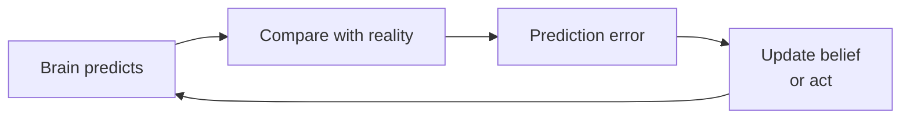

# The Bayesian Brain

Back to [[00. Computational Psychiatry - Research Home|Home]] · Previous: [[06. Reinforcement Learning and the Rescorla-Wagner Model]] · Source: paper p. 7

## 1. Bayesian inference in simple words
You combine **what you already expected** with **new evidence** to get an **updated belief**.

| Term | Simple meaning | Figure 2C label |
|---|---|---|
| **Prior** | What you expected before | "My expectations" |
| **Evidence (likelihood)** | What the new information says | "The reality" |
| **Posterior** | Your updated belief | "My perception" |

**Example:** you expect the bus at 8:00 (prior). Today's app says it's running late (evidence). You now expect it at about 8:10 (posterior).

## 2. Uncertainty decides the weight
- **Clear, reliable evidence** → your belief moves a lot towards it.
- **Noisy, unreliable evidence** → your belief stays close to what you expected.

![[cp-bayes-updating.png]]

## 3. The Bayesian Brain idea
The paper describes the brain as a **prediction machine**:
1. It keeps **internal models** of the world.
2. It constantly predicts what will happen next.
3. When reality differs from the prediction, it **updates more strongly**.
4. **Behaviour** helps too: we act on the world (look closer, move, change things) to reduce the gap between prediction and reality.

## 4. Bayesian vs reinforcement learning
They are different models, but both treat learning as **updating expectations under uncertainty**.

Next: [[08. Drift Diffusion Models]]
