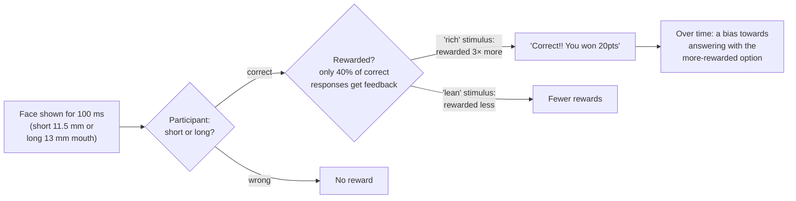
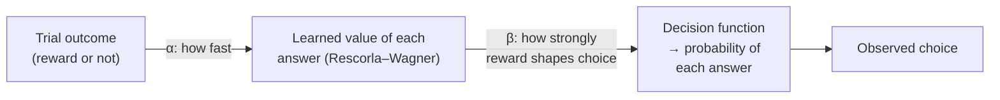

# Case Study: the Probabilistic Reward Task (PRT) and Anhedonia

Back to [[00. Computational Psychiatry - Research Home|Research Home]] · Previous: [[08. Drift Diffusion Models]] · Source: [[01. Paper - What is Computational Psychiatry (Antonucci 2026)|Antonucci 2026]], section "Reinforcement Learning Models and Reward-Based Decision Making: an example of theory-based computational models", pp. 7–8

This is the paper's main **worked example** of a theory-driven model in use. It combines [[06. Reinforcement Learning and the Rescorla-Wagner Model|reinforcement learning]] and [[08. Drift Diffusion Models|drift diffusion]].

## Background terms

- **Anhedonia**: reduced ability to feel pleasure or to be motivated by rewards. It is a core symptom of depression and also occurs in other conditions.
- **Mood disorders**: disorders mainly affecting mood, such as depression and bipolar disorder.
- **Substance use disorders**: addiction to alcohol, nicotine, opioids and similar substances.
- **Biomarker**: an objective, measurable sign of a condition.

## Why the PRT matters

> [!quote] From the paper (p. 7)
> The PRT is "among the most used tasks". It "has been largely applied to assess RL in the context of **mood and substance use disorders**, and has been proposed as a **biomarker for anhedonia**."

## How the task works

| Feature | Detail from the paper |
|---|---|
| Structure | **3 blocks × 100 trials** |
| Stimulus | A simple line-drawing face with either a **short mouth (11.5 mm)** or a **long mouth (13 mm)** |
| Display time | **100 ms**, very brief, so the task is genuinely hard |
| Participant's job | Say whether the mouth was short or long |
| Feedback | Positive feedback for **only 40% of correct responses**, e.g. "Correct!! You won 20pts" |
| The trick | An **asymmetrical reinforcement schedule**: correct responses to one mouth type were rewarded **three times more** than correct responses to the other |
| What participants know | **Nothing about the asymmetry**. They are only told to win as much as possible |

> [!info] Extra context (not from the paper)
> The labels **"rich"** and **"lean"** for the more- and less-rewarded stimulus are common shorthand in PRT studies. The paper doesn't use them; it just says "the most rewarded stimulus".

### The key outcome: response bias

> [!quote] From the paper (p. 7)
> "This asymmetry in the reinforcement schedule is responsible for **systematic preference towards the most rewarded stimulus, namely, response bias**."

The logic: when you're unsure (the face flashed too quickly), a person who is **sensitive to reward** will lean towards the answer that has paid off more often. A person with **anhedonia** might be expected to develop *less* of this bias, because rewards shape their behaviour less.

> [!warning] Interpretation, not stated in the paper
> The paper says the PRT has been *proposed* as a biomarker for anhedonia. It doesn't explicitly say that anhedonic people show reduced response bias, though that is the logic implied. Check ref. 61 (Pizzagalli et al. 2005) and ref. 63 (Huys et al. 2013, *"Mapping anhedonia onto reinforcement learning: a behavioural meta-analysis"*) to confirm.

## Ways to analyse PRT data

### 1. Model-free signal-detection analysis
The paper notes "some **model-free signal-detection analysis** methods are available" (refs. 61, 62).

> [!info] Extra context (not from the paper)
> **Signal detection theory** measures how well someone tells two stimuli apart (*discriminability*) separately from their tendency to favour one answer (*bias*). "Model-free" here means summarising performance directly, without a learning model that changes trial by trial. The paper doesn't give these formulas.

### 2. Reinforcement learning models
RL models "recently emerged as useful methods to **dissect** RL behaviour emerging during the PRT" and have been applied to **mood disorders** (ref. 63) and **substance use disorders** (ref. 64, a study of smoking cessation) (p. 7).

> [!quote] From the paper (p. 7)
> "In RL models participants' choices are modelled with a **decision function that expresses selection probabilities**." Different RL models use different combinations of parameters, but the key ones are usually:
> - **Learning rate (α)**: "the speed at which the system is updated based on previous trials outcomes".
> - **Reward sensitivity (β)**: "the responsiveness to the reward bias".
>
> "Those who rapidly modify behaviour based on recent outcomes have **higher learning rates**, adapting quickly to environmental changes, while a **low learning rate** indicates slower, more rigid learning influenced by long-term trends."

> [!warning] Not specified in the paper
> The paper doesn't give the **decision function** (the formula that turns values into choice probabilities) or the exact way β enters the model. Many RL studies use a *softmax* function, but the paper doesn't say which function the PRT models use. Check ref. 63 for the actual model equations.

### 3. Drift diffusion models
Because the PRT is a **two-alternative forced-choice task** (you must pick one of two answers) with objectively correct responses and measurable errors, it "lends itself naturally" to DDMs. Applied to the PRT (ref. 65), DDMs capture accuracy, reaction times, and the **trial-by-trial dynamics of how biased reinforcement learning influences evidence accumulation** (pp. 7–8). → [[08. Drift Diffusion Models]]

> [!tip] Putting it together
> - **RL** explains *how the bias is learned* across trials (α, β).
> - **DDM** explains *how each single decision is made* given that bias (drift, threshold, starting point).
>
> Combining them could separate "this person learns from reward differently" from "this person decides differently". The title of ref. 65 suggests that is exactly the goal ("disentangle effects of depression on decision-making vs. learning").

## Why this example matters for CP

It shows the full theory-driven pipeline from [[05. Theory-driven Computational Models]]:
1. **Theory**: anhedonia involves altered reward learning.
2. **Task**: the PRT, with a hidden reward asymmetry.
3. **Model**: RL (± DDM) with interpretable parameters α and β.
4. **Individual estimates**: each person gets their own α and β.
5. **Clinical link**: these parameters are candidate **biomarkers** for anhedonia across mood and substance use disorders.

> [!warning] Missing details
> The paper doesn't report any specific results from PRT studies (no effect sizes or group differences). It describes the method, not findings. See [[15. Source Issues and Open Questions]].

## Related
- [[06. Reinforcement Learning and the Rescorla-Wagner Model]]
- [[08. Drift Diffusion Models]]
- The dopamine–anhedonia regression example: [[04. What is a Model]]
