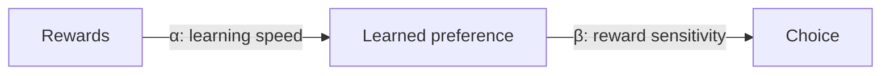

# Example: The Probabilistic Reward Task (PRT)

Back to [[00. Computational Psychiatry - Research Home|Home]] · Previous: [[08. Drift Diffusion Models]] · Source: paper pp. 7–8

## 1. Why this task matters
**Anhedonia** means a reduced ability to feel pleasure or be motivated by rewards. It is common in depression.

The PRT measures how strongly rewards shape a person's choices. It has been used in **mood disorders** and **addiction**, and has been proposed as a **biomarker** (objective measure) of anhedonia.

## 2. How the task works
- A simple cartoon face appears for **0.1 seconds**.
- Its mouth is either **short (11.5 mm)** or **long (13 mm)**.
- The participant says which one it was.
- There are **3 blocks of 100 trials**.
- Only **40% of correct answers** are rewarded ("Correct!! You won 20pts").
- **The hidden trick:** correct answers for one mouth type are rewarded **3 times more** than for the other. Participants are not told this.

## 3. What researchers measure
Over time, people start choosing the **more-rewarded answer** when they are unsure. This is called **response bias**.

A strong bias suggests that rewards strongly shape behaviour.

## 4. Analysing the results
| Method | What it does |
|---|---|
| Signal detection (simple method) | Measures accuracy and bias without a learning model |
| Reinforcement learning model | Estimates **learning rate (α)**, how quickly the person updates, and **reward sensitivity (β)**, how strongly rewards affect choices |
| Drift diffusion model | Shows how the learned bias affects each individual decision |

## 5. Why this example matters
It shows the full theory-driven process:

**Theory** (anhedonia affects reward learning) → **Task** (PRT) → **Model** (RL/DDM) → **Numbers for each person** (α, β) → **Possible biomarker**

> The paper describes the method but reports no results, and it doesn't give the full model formula. See [[15. Source Issues and Open Questions]].

Next: [[10. Data-driven Modelling - AI and Machine Learning]]
