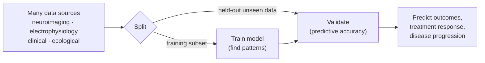
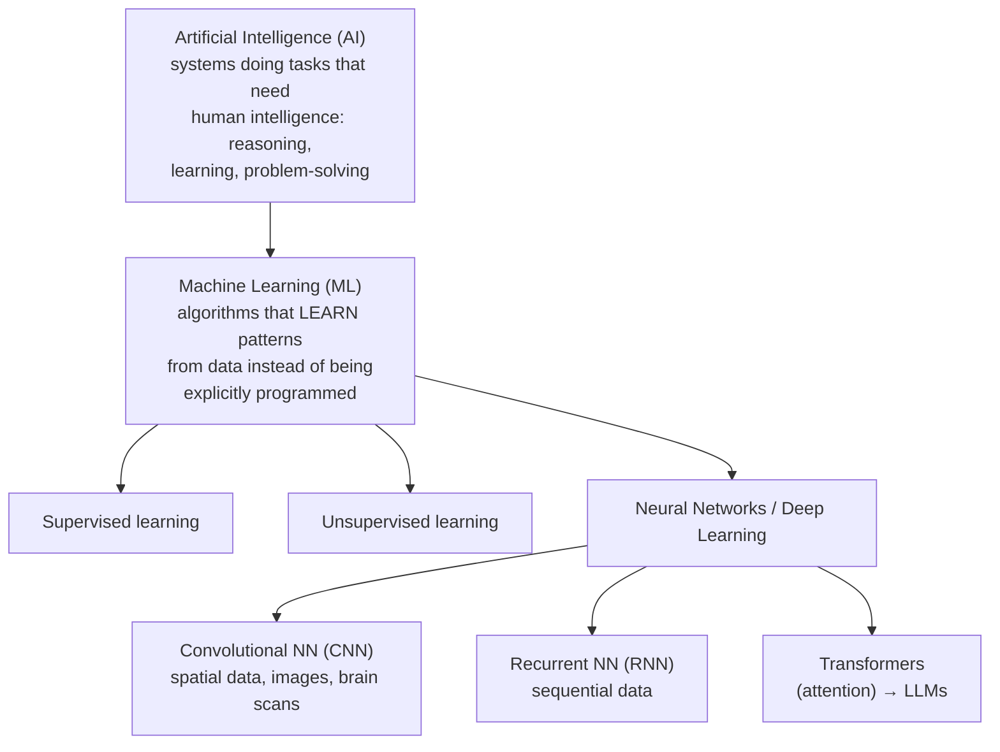

# Data-driven Modelling: AI and Machine Learning

Back to [[00. Computational Psychiatry - Research Home|Research Home]] · Previous: [[09. Probabilistic Reward Task - Anhedonia Case Study]] · Source: [[01. Paper - What is Computational Psychiatry (Antonucci 2026)|Antonucci 2026]], p. 8

> [!note] For a CS student
> Most of this note will feel familiar. What matters here is **how the paper frames ML for psychiatry**. Links to my existing ML concept notes are included.

## What data-driven approaches do

> [!quote] From the paper (p. 8)
> "Data-driven approaches focus on analysing large datasets to uncover patterns and relationships, **not necessarily relying on predefined hypotheses**."

**Where the data comes from** (multiple sources at once):
- **Neuroimaging**: brain scans such as MRI and fMRI.
- **Electrophysiological** data: electrical signals from the brain or body, e.g. EEG.
- **Clinical** data: diagnoses, symptom scores, medical records.
- **Ecological** data: collected in daily life rather than the lab, e.g. phone or wearable data.

**The process:**
1. Algorithms find **recurring motifs, trends or structures**.
2. The patterns are used to **predict unseen data**: clinical outcomes, treatment responses, or future disease progression.
3. Models are **trained on a subset** of the data and **validated on separate, unseen data** to check predictive accuracy.

**Key strength:** especially with AI, these methods can "detect complex structures within large datasets and **distinguish meaningful signals from background noise**" (p. 8).

## The AI family tree (Figure 3A)

The paper uses **Russian nesting dolls** to show that each field sits inside the one before it:

*Transformers are described in the text but are not drawn in Figure 3A. I added them to the diagram for completeness.*

## Supervised vs unsupervised learning (Figure 3B)

| | **Supervised** | **Unsupervised** |
|---|---|---|
| Data | **Labelled**: patient features paired with a known diagnosis or outcome | **Unlabelled**: no categories given |
| Goal | **Predict** clinical categories or treatment responses | **Uncover hidden structure**, such as **subtypes** or patterns |
| Figure 3B example | A crowd of people ("BIG DATA") sorted into labelled groups **M** and **F** | The same crowd grouped by similarity (colour clusters) without any labels |
| My notes | [[Supervised Learning]], [[Classification]] | [[Unsupervised Learning]], [[Clustering]] |

## Deep learning and neural networks (Figure 3C)

> [!quote] From the paper (p. 8)
> "**Deep learning** has emerged as a successful approach in ML, where **multilayer neural networks automatically extract complex features from raw data**. Neural networks are computational models **inspired by the brain**, composed of interconnected layers of 'neurons' that process information."

**Figure 3C** shows a network for **classification**:
- **Input features**: gender, colour, height, weight.
- **Layer #1** computes $y = ax$ and **Layer #2** computes $z = by$, through **weighted connections** ($a_1, a_2, \dots$, $b_1, b_2, \dots$).
- The **output** $w = cz$ gives the class (F or M).
- The **lower panel** compares this with real neurons: a flow from **perception → behaviour** through connected biological neurons.

> [!info] Extra context (not from the paper)
> The figure uses simplified linear notation ($y=ax$). Real neural networks also apply a **non-linear activation function** (such as ReLU or sigmoid) at each layer. Without it, stacking layers would be no more powerful than a single linear model. The paper doesn't discuss activation functions. See [[Neural Network]] and [[Deep Learning]].

### Network architectures named in the paper

Neural networks come in different **architectures**, meaning designs optimised for different kinds of raw data (p. 8):

| Architecture | Specialises in | How (per the paper) | Psychiatry-relevant data | My note |
|---|---|---|---|---|
| **CNN** (Convolutional Neural Network) | **Spatial patterns** | Progressively extracts features, "as some visual neurons do" (ref. 70, Hubel & Wiesel's classic work on the cat visual cortex) | Images, **brain scans** | — |
| **RNN** (Recurrent Neural Network) | **Sequential data** | Keeps a **"memory" of previous inputs** to model time dependencies | Language, speech, **physiological signals** | [[RNN]] |
| **Transformer** | Sequences | **Attention mechanisms** capture **long-range dependencies** more efficiently than RNNs | Text | [[Transformer]] |
| **LLM** (Large Language Model) | Language | Built on transformers, trained on massive text collections; can **generate, summarise or classify** language "with human-like flexibility" | Clinical text, conversation | [[LLMs]] |

### LLMs and chatbots

> [!quote] From the paper (p. 8)
> "LLMs may also enable **AI-driven chatbots to provide supportive interventions or guidance**. While these developments require **careful ethical consideration**, they may offer several benefits."

> [!warning] Not specified
> The paper doesn't say which benefits or which ethical issues it means. It cites ref. 71 (*Large language models in psychiatry: Opportunities and challenges*) and ref. 72 (*Auditing large language models: a three-layered approach*). See [[15. Source Issues and Open Questions]].

## Figure 3 from the paper

![[cp-paper-fig3-data-driven.jpg]]
*Figure 3, Antonucci et al. (2026), CC BY-NC-ND 4.0, reproduced unmodified. This note covers panels A–C. Panel D (symptom networks) is in [[11. Symptom Network Models]].*

**Caption summary (p. 9):**
- **(A)** The hierarchy of AI: ML contains supervised and unsupervised approaches; neural networks are a subset of ML and include convolutional (spatial/image data) and recurrent (sequential data) architectures.
- **(B)** Supervised learning trains on labelled data; unsupervised learning finds hidden structure in unlabelled data without predefined categories.
- **(C)** Input features pass through layers of nodes; each layer transforms the input through weighted connections, extracting features until the output layer classifies. The lower panel shows the parallel between network architecture and neuron structure.

## Beyond classification

The paper says data-driven models are used for more than classification and prediction. They also represent psychopathology as **dynamic symptom networks** → [[11. Symptom Network Models]]. What ML has actually achieved in psychiatry is covered in [[12. Machine Learning Applications in Psychiatry]].

## Related
- Strategy overview: [[03. Theory-driven vs Data-driven Approaches]]
- Overfitting and validation: [[04. What is a Model]]
- My notes: [[Machine Learning]], [[Artificial Intelligence]], [[Deep Learning]]
