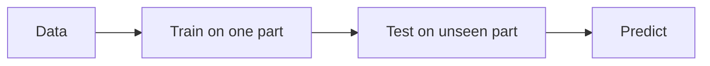

# Data-driven Models and AI

Back to [[00. Computational Psychiatry - Research Home|Home]] · Previous: [[09. Probabilistic Reward Task - Anhedonia Case Study]] · Source: paper p. 8

## 1. What are data-driven models?
They analyse **large datasets** to find patterns, without needing a theory first.

**Data sources:**
- brain scans,
- electrical brain/body signals (e.g. EEG),
- clinical records,
- real-life data (e.g. phones and wearables).

**Goal:** predict things about new people, such as outcomes, treatment response or how a disorder will progress.

## 2. AI, ML and deep learning
| Term | Simple meaning |
|---|---|
| **Artificial Intelligence (AI)** | Computers doing tasks that need human-like intelligence |
| **Machine Learning (ML)** | Part of AI: learning patterns from data instead of following fixed rules |
| **Deep Learning** | Part of ML: neural networks with many layers that find features automatically |

## 3. Supervised vs unsupervised learning
| Supervised | Unsupervised |
|---|---|
| Uses **labelled** data (e.g. patient data + known diagnosis) | Uses **unlabelled** data |
| Predicts a category or outcome | Finds hidden groups (e.g. subtypes of a disorder) |

## 4. Types of neural networks
| Type | Good for | Psychiatry example |
|---|---|---|
| **CNN** (Convolutional) | Images and spatial patterns | Brain scans |
| **RNN** (Recurrent) | Sequences, with a "memory" of earlier inputs | Speech, body signals |
| **Transformer** | Long sequences, using "attention" | Text |
| **LLM** (Large Language Model) | Generating and understanding language | Chatbots that offer support |

The paper says AI chatbots may provide supportive help but **need careful ethical consideration**.

![[cp-paper-fig3-data-driven.jpg]]
*Figure 3 from the paper. A: AI → ML → neural networks. B: supervised vs unsupervised learning. C: a neural network. D: a symptom network.*

## 5. Symptom networks
Data-driven models can also show disorders as **networks of symptoms**. → [[11. Symptom Network Models]]

Next: [[11. Symptom Network Models]]
