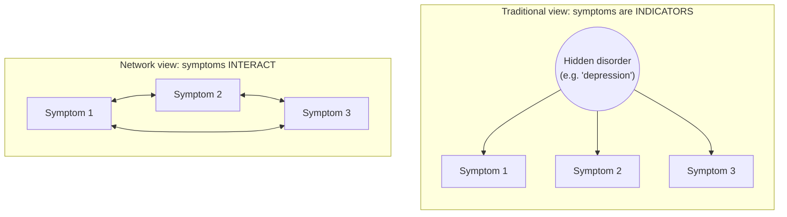

# Symptom Network Models

Back to [[00. Computational Psychiatry - Research Home|Research Home]] · Previous: [[10. Data-driven Modelling - AI and Machine Learning]] · Source: [[01. Paper - What is Computational Psychiatry (Antonucci 2026)|Antonucci 2026]], p. 8 (and p. 4)

## The idea

> [!quote] From the paper (p. 8)
> "In addition to classification and prediction, data-driven models are used to represent psychopathology as **dynamic symptom networks**. This approach views **symptoms as interacting elements rather than mere indicators of an underlying disorder**, enabling the study of symptom associations and dynamics. These psychopathological networks aim to explain **individual differences and symptom fluctuations** within psychiatric syndromes."

### Two ways to think about a disorder

- **Traditional view**: one hidden disease causes all the symptoms, the way an infection causes fever and cough.
- **Network view**: the symptoms *are* the disorder. They cause and maintain each other.

> [!info] Extra context (not from the paper)
> A typical example in network literature: poor sleep → fatigue → poor concentration → worry → poor sleep. Once such a loop is active, it can keep itself going. The paper doesn't give this example. It is only here to make "interacting symptoms" concrete.

> [!tip] CS analogy
> It's a **graph**. Symptoms are **nodes**, statistical associations are **weighted edges**, and you can use graph ideas such as *centrality* (which symptom is most connected) or *clusters*. The paper's figure uses nodes labelled $x_1, y_1, z_1 \dots$, much like a graph data structure.

## Figure 3D

![[cp-paper-fig3-data-driven.jpg]]
*Figure 3, Antonucci et al. (2026), CC BY-NC-ND 4.0, reproduced unmodified. This note covers panel D (bottom right).*

> [!quote] From the paper (Figure 3D caption)
> "Network representation of psychopathology. Symptoms or variables are represented as **interconnected elements**. **Edges** represent associations between symptoms, with **line thickness and colours indicating the strength and direction** of relationships."

What you can see in the panel:
- **Three coloured clusters** of nodes: green ($x_1$–$x_4$), orange ($y_1$–$y_5$) and yellow ($z_1$–$z_5$).
- Nodes inside a cluster are strongly linked (thick lines). Fewer, thinner lines connect different clusters.
- One grey node ($z_6$) has **no connections**: a variable unrelated to the others.

> [!warning] Not explained in the figure
> The caption doesn't say which colour means a positive or a negative relationship (blue vs red edges), or what the node colours represent. My reading is that they are groups of related symptoms, but the paper doesn't confirm it.

## Network ideas elsewhere in the paper: panic disorder

The paper's example of a **computational model** (in [[04. What is a Model]]) is also network-like: panic disorder as a **dynamic system** where symptoms reinforce each other through **positive and negative feedback loops** (arousal ↔ perceived threat → panic attack; avoidance and danger beliefs → chronicity). The model it cites (ref. 25) is titled *"Advancing the network theory of mental disorders: A computational model of panic disorder"*.

So network thinking connects to **both** strategies:
- **data-driven** symptom networks estimated from data (this note);
- **theory-driven** dynamic models of how symptoms push each other over time (panic example).

## Further reading cited by the paper
- Ref. 3: Borsboom (2017), *A network theory of mental disorders*
- Ref. 74: Briganti et al. (2024), *Network analysis: An overview for mental health research*
- Ref. 73: Belvederi Murri et al. (2022), *Depressive symptom complexes of community-dwelling older adults: a latent network model*
- Ref. 76: Corponi et al. (2020), *Symptom networks in acute depression across bipolar and major depressive disorders*
- Ref. 75: Triolo et al. (2021), *Bridging late-life depression and chronic somatic diseases: a network analysis*
- Ref. 99: Fried & Robinaugh (2020), *Systems all the way down: embracing complexity in mental health research*

> [!warning] Not in the paper
> The paper doesn't explain *how* symptom networks are estimated from data (for example which statistical method is used). It only describes what they represent.

## Related
- [[10. Data-driven Modelling - AI and Machine Learning]]
- [[04. What is a Model]] (complex systems, equifinality, panic model)
