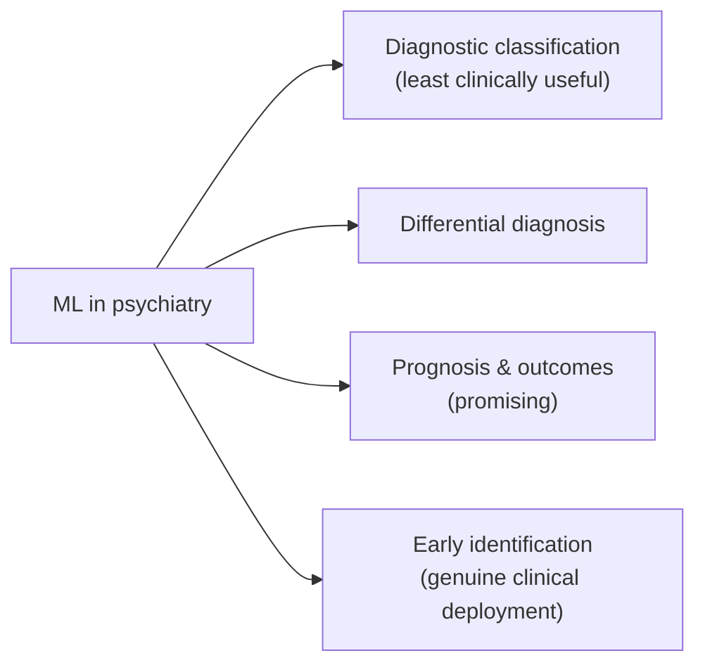

# Machine Learning Applications in Psychiatry

Back to [[00. Computational Psychiatry - Research Home|Research Home]] · Previous: [[11. Symptom Network Models]] · Source: [[01. Paper - What is Computational Psychiatry (Antonucci 2026)|Antonucci 2026]], p. 8

This note collects what the paper says ML has **actually achieved** so far. All numbers come from studies the paper cites; the paper itself reports no new results.

## Overview

## 1. Diagnostic classification

> [!quote] From the paper (p. 8)
> "A primary application of ML is **diagnostic classification** using **neurobiological and neurocognitive data**."

- **Neurocognitive data**: scores from tests of memory, attention, reasoning and similar abilities.
- **Healthy controls**: people without the disorder, used for comparison.

| Task | Result reported by the paper | Cited source (title from the reference list) |
|---|---|---|
| Schizophrenia patients vs healthy controls | **≈ 80–90% accuracy** | Ref. 78: Di Camillo et al. (2024), *MRI-based machine learning classification of schizophrenia spectrum disorders: a meta-analysis* |
| Depression classification | **Currently less effective** (no number given) | Ref. 79: Belov et al. (2024), *Multi-site benchmark classification of major depressive disorder using machine learning on cortical and subcortical measures* |
| Differential diagnosis: **schizophrenia vs bipolar disorder** | Supervised ML "has also proved **good reliability**" (no number given) | Ref. 80: Raio et al. (2023), on cognitive and socio-cognitive deficits in schizophrenia, bipolar disorder and related risk |

*Terms:* **Bipolar disorder** is a mood disorder with episodes of depression and episodes of abnormally elevated mood (mania). **Differential diagnosis** means deciding *which* of several similar-looking disorders a patient has.

> [!info] Extra context (not from the paper)
> - Accuracy alone can mislead when groups are unbalanced. Check the cited studies for sensitivity, specificity and how the test sets were built before quoting the 80–90% figure.
> - The 80–90% figure is attributed to ref. 78, which by its title is about **MRI-based** classification. So the figure probably refers to brain-imaging models, not all kinds of data.

> [!quote] An important caveat from the paper (p. 8)
> Classification of diagnosis "**might find only limited application in clinical practice**". Clinicians can usually already make the diagnosis, so the bigger value lies elsewhere.

## 2. Prognosis and clinical outcomes

ML models "show promise in **predicting prognosis and clinical outcomes**" (p. 8), including:
- **treatment response** (whether a treatment will work);
- **personal functioning** (how well someone manages work, study and relationships; ref. 81);
- **suicidal behaviours** (ref. 82, by title a study predicting 12-month suicide attempts in bipolar disorder with multimodal ML).

Also:
- **Network-based functional connectivity can predict the development of psychiatric disorders** (ref. 13). *Functional connectivity* means how strongly the activity of different brain regions moves together.

## 3. Early identification: where ML is already used

**Early diagnostic tools** are being implemented to identify people **at risk** for:
- **psychosis** (ref. 83). *Psychosis* is losing touch with reality, e.g. through hallucinations or delusions;
- **depression** (refs. 73, 84);
- **persistent psychotic-like experiences** over time, in **longitudinal** studies that follow the same people for years (ref. 85).

> [!quote] From the paper (p. 8), the strongest claim in this section
> "**Early-stage identification is perhaps the area in which ML has already achieved genuine clinical deployment**: models are now used to estimate the **resources needed for managing first-episode psychosis**, and to **detect emerging cases of depression**."

| Deployed use | Cited source |
|---|---|
| Estimating resources needed for **first-episode psychosis** services (someone's first psychotic episode) | Ref. 86: McDonald et al. (2021), a Bayesian method to forecast population need for early-intervention psychosis services in England |
| Detecting emerging cases of **depression** | Ref. 87: Belvederi Murri et al. (2022), risk prediction models for depression in community-dwelling older adults |

> [!warning] Mixed method in the "ML" claim
> By its title, ref. 86 is a "**Bayesian prediction methodology**" using epidemiological evidence. That is a statistical forecasting model, which the paper groups under ML here. Not a problem, but worth knowing if you cite it as an "ML deployment".

## Summary table

| Application | Status according to the paper |
|---|---|
| Diagnosis (schizophrenia vs healthy) | High accuracy (≈80–90%), but limited clinical use |
| Diagnosis (depression) | Less effective so far |
| Differential diagnosis (schizophrenia vs bipolar) | Good reliability |
| Prognosis, treatment response, functioning, suicidal behaviour | Promising |
| Early risk identification (psychosis, depression) | **Genuinely deployed** in some settings |

## Related
- Methods: [[10. Data-driven Modelling - AI and Machine Learning]]
- Clinical integration and limits: [[13. Clinical Use - Promises, Challenges and Explainable AI]]
- My notes: [[Classification]], [[Model Evaluation]]
